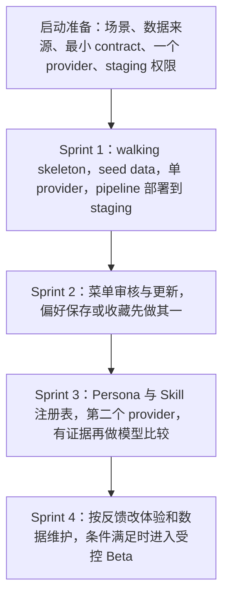

# Large-Lunch-Model

百模百味，寻找你最喜欢的赛博饭友

## 2026-10-27

今天写入了两份基线，并让仓库忽略 macOS 的 `.DS_Store`。服务代码、云资源和模型凭证都还没有开始。

- [tech-stack-requirements.md](tech-stack-requirements.md)：前端、Java 业务后端、Python AI 服务、数据和 AWS 的技术边界。
- [docs/delivery-model-comparison-au-us-cn.md](docs/delivery-model-comparison-au-us-cn.md)：对照澳洲、美国、中国的公开交付实践，整理团队分工、启动条件和前四轮讨论路线。

这两份文件是建议，用来选择后续做法。团队人数、Sprint 长度和上线日期尚未确定。

## 按文档的开发规划

下面三张图直接摘自上述文档，方便从仓库首页看到顺序。前四个 Sprint 按两周讨论，Sprint 2 之后要根据上一轮的用户反馈、人手和失败证据重排，不是八周交付承诺。

证据阶段的时长由证据决定，一个阶段里可以有多个 Sprint。

第一条要跑通的路径是 walking skeleton：薄，但从页面一直连到数据和模型。

Sprint 1 不包含多模型比较、管理后台、自动 OCR、大规模抓取、复杂 LangGraph、Live2D 或 3D。这些留在后续 backlog。

Markdown 里用三个反引号加 `mermaid` 即可画出这些图。GitHub 和 Cursor 的 Markdown 预览会直接渲染，仓库不需要额外插件。若本地预览只显示代码块，在编辑器扩展里安装 Markdown Preview Mermaid Support。
