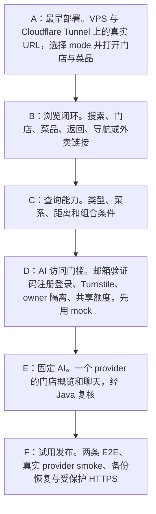
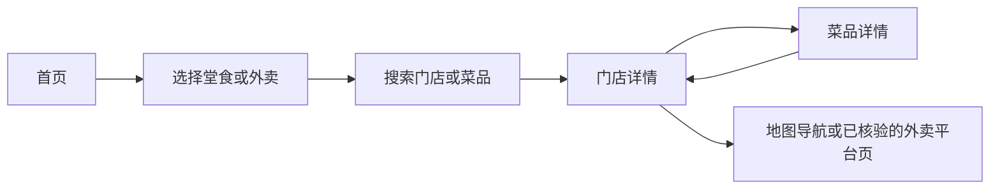
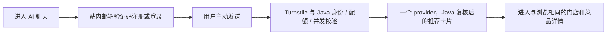

# Large-Lunch-Model

百模百味，寻找你最喜欢的赛博饭友。

面向悉尼 CBD 及周边的门店和菜品目录，以可追溯的菜单事实支持预算内选餐，逐步扩展不同 Model、Persona 与 Skill。

## 2026-11-26

这次把线上运行从 AWS 改成 **一台 Linux VPS 上的 Docker Compose**，边缘使用 **Cloudflare（DNS / WAF / Rate Limiting / Turnstile / Tunnel / R2）**。身份认证改为 **Spring Boot 自建闭环**：Spring Security 6、短效 Access JWT、HttpOnly Refresh Token 轮换、Redis、MySQL、BCrypt，以及邮箱 6 位验证码（Resend / SMTP）。`docs/aws-requirements.md` 由 [VPS 与 Cloudflare 部署要求](docs/deployment-requirements.md) 取代，技术基线、数据、本地开发、Sprint 1 和交付文档已按同一口径同步。

服务、数据库、Compose、测试、VPS、Cloudflare 和发信接入都还没有实现。文档里的命令、API 和目录是初始化约定。VPS 公网不开放业务端口，由 `cloudflared` 主动连出 Cloudflare。注册、登录和发验证码位于自家域名的 `/api/v1/auth/*`，与 AI 接口使用同一套 WAF、Rate Limiting 和 Turnstile。

开发方式仍按一人开发、AI 辅助实现与 review 来排。本轮包含浏览和聊天两条路径。每周投入确认之前不设日期，也不能直接承诺两周全部完成。

用户已确认的预算规则：**按菜品小计计算，包含所选规格、必选加料、实际选择的可选加料和数量；配送费与平台 service fee 等订单级费用另列。** 页面使用“菜品小计，配送费及平台费用另计”。持久化口径是 `MENU_SUBTOTAL`，首版货币为 `AUD`。

继续保留的底线：

- 匿名用户可浏览、搜索、查看详情和跳转地图 / 外卖平台。新的付费 AI chat、推荐和概览生成要求登录、邮箱已验证、有效账号和 Turnstile 服务端验证。
- MySQL 仍是跨实例 admission 的权威记录，限制同一用户多 tab、全局与 provider 并发，并预留每日 request / token quota。重试、取消、重启或扩容后额度仍然有效。Redis 负责验证码、登录撤销加速、防爆破和可重建缓存。
- 云端路径是 **Cloudflare Edge → Cloudflare Tunnel → VPS 内网 Nginx → Next.js / Spring Boot / FastAPI**。公开素材和私有原始文件、备份使用 Cloudflare R2。并发和额度数值是可配置初值，要在压测之后调整。
- 私人会话按 owner 保存并隔离。菜单 provenance、版本复核、审核发布和 Java 最终校验继续沿用。

## 文档导航

| 文件 | 解决的问题 |
| --- | --- |
| [MVP 与 User Stories](docs/sprint-1-mvp-and-user-stories.md) | 两条用户流程、S1-US01–18、安全 / 并发 enablers、单人开发顺序与验收 |
| [技术栈与架构要求](tech-stack-requirements.md) | 阶段范围、服务边界、预算、Spring Boot 认证、admission、API 与验收 |
| [数据要求](docs/data-requirements.md) | 来源权限、菜单版本、账号 / 会话 / 私人对话、quota ledger、导入审核发布与质量 |
| [VPS 与 Cloudflare 部署要求](docs/deployment-requirements.md) | Compose、Tunnel / WAF / Turnstile / R2、Nginx、发信、CI/CD、备份恢复与成本 |
| [本地开发要求](docs/local-development.md) | Host + Docker Compose（MySQL / Redis / Mailpit）、Turnstile mock、fixture、多实例验收与排障 |
| [交付实践与团队组织](docs/delivery-model-comparison-au-us-cn.md) | 团队 ownership、Discovery / Alpha / Beta、Sprint 与交付协作建议 |

先读 MVP 与 User Stories，再读总体技术栈和三份专题。User Stories 定义用户体验；技术基线第 5、7 节定义 Spring Boot 认证、admission 和 API contract；数据文档定义 schema；部署与本地文档规定各环境怎么执行和验收。相关 API、fixtures 和验收要一起改。

## 按文档的开发顺序

下面的 A–F 来自 Sprint 1 文档第 8.1 节：先让一条真实浏览路径可访问，再补查询，然后才接站内注册登录和固定模型。技术基线第 1.1 节仍划分启动准备、本地 walking skeleton、受控 Alpha、后续增量和 Production / Beta。团队人数、Sprint 长度和上线时间尚未确定。

匿名浏览可以先闭合。付费 AI 要等身份、Turnstile、owner 隔离和并发 / 额度控制一起通过，再打开真实 endpoint。本地用 Mailpit 接收验证码；真实发信、live Turnstile、Tunnel 和 R2 备份恢复在 staging 单独验收。

首轮是单人、单店、单渠道选餐，使用一个 provider 和一个 model。门店概览和聊天是同一 AI 服务的两个任务，页面不提供 model、Persona 或 Skill 切换。样本仍按可审核质量准备，规划量级是 5–10 家门店、30–50 个 MenuItems，尚未采集。多模型比较、收藏、多人点菜、站内下单、自动 OCR、大规模 crawler、embedding、复杂 LangGraph、Live2D 和 3D 留在后续 backlog。

图使用 Markdown 的 `mermaid` 代码块。GitHub 和 Cursor 预览会直接渲染。
