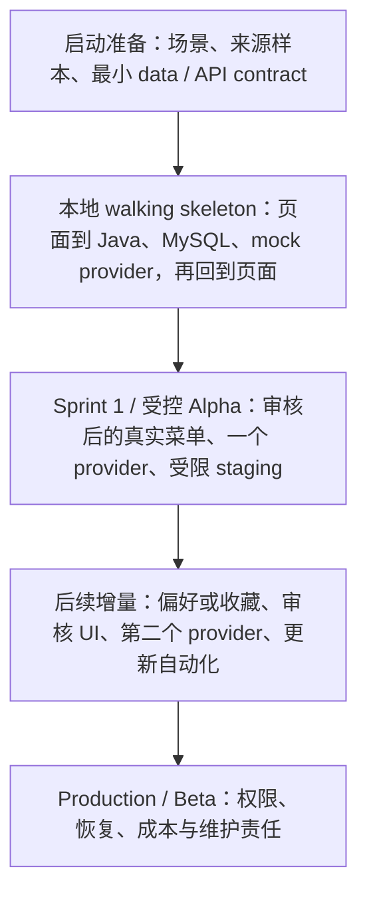
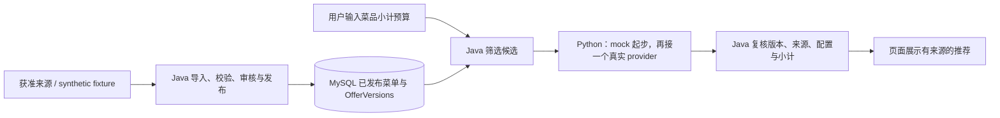

# Large-Lunch-Model

百模百味，寻找你最喜欢的赛博饭友。

面向悉尼 CBD 及周边的门店和菜品目录，以可追溯的菜单事实支持预算内选餐，逐步扩展不同 Model、Persona 与 Skill。

## 2026-10-29

这次在已有技术基线和交付讨论之上，把数据、云端和本地开发拆成三份专题要求，并让预算、版本和发布边界在各文档里使用同一套口径。服务、数据库、Compose、测试、AWS 资源和平台接入都还没有实现。文档里的命令、API 和目录是初始化约定。

用户已确认的预算规则：**按菜品小计计算，包含所选规格、必选加料、实际选择的可选加料和数量；配送费与平台 service fee 等订单级费用另列。** 页面使用“菜品小计，配送费及平台费用另计”。持久化口径是 `MENU_SUBTOTAL`，首版货币为 `AUD`。

本轮文档修订：

- 修正首轮与后续功能混在一起、平台价格和菜品 identity 混用、导入与 AI 权限边界不完整的问题。
- 新增数据、AWS、本地开发三份要求，统一预算、不可变事实版本、审核发布、cache、identity 和错误处理。
- 补齐从空库建立来源与目录的路径，以及可重复执行的 synthetic fixtures。本地 mock、真实 provider、staging 和 production 要分别验收。

## 文档导航

| 文件 | 解决的问题 |
| --- | --- |
| [技术栈与 architecture 要求](tech-stack-requirements.md) | 阶段范围、服务边界、预算、API、推荐流程、版本与验收 |
| [数据要求](docs/data-requirements.md) | 来源权限、MenuItem / Offer、provenance、schema、freshness、导入审核发布与质量 |
| [AWS 要求](docs/aws-requirements.md) | Staging / production、网络、IAM、存储、TLS、CI/CD、成本与恢复 |
| [本地开发要求](docs/local-development.md) | Host + Docker Compose、版本锁定、env、mock provider、fixture、启动顺序与排障 |
| [交付实践与团队组织](docs/delivery-model-comparison-au-us-cn.md) | 团队 ownership、Discovery / Alpha / Beta、Sprint 与交付协作建议 |

先读总体 architecture，再按职责读三份专题。字段含义以专题文档为准；schema 变更必须同时改相关 API、fixtures 和验收。

## 按文档的开发顺序

阶段名称和完成标准来自技术基线第 1.1 节。团队人数、Sprint 长度和上线时间仍未确定；交付文档里的两周 Sprint 是讨论方案。

第一条要跑通的路径先用 synthetic fixtures 和 mock provider 在本地闭合，再分别验证真实菜单、一个真实 provider 和受限 staging。

首轮是单人、单店、单渠道选餐，不要求四个平台全部接通。样本规划量级是 5–10 家门店、30–50 个经过审核的 MenuItems，尚未采集。多模型比较、多人点菜、完整管理 UI、自动 OCR、大规模 crawler、embedding、复杂 LangGraph、Live2D 和 3D 留在后续 backlog。

图使用 Markdown 的 `mermaid` 代码块。GitHub 和 Cursor 预览会直接渲染。
