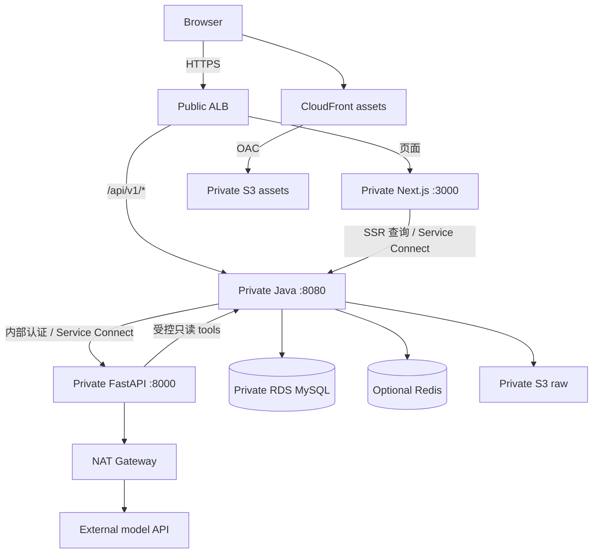

# Large-Lunch-Model：AWS 要求

- 版本：v0.1；更新日期：2026-10-29（Australia/Sydney）。
- 状态：待实现的部署要求与默认方案；尚未创建 AWS 资源、验证账号权限或测得运行费用。
- 上位基线：[技术栈与架构要求](../tech-stack-requirements.md)。
- 相关文件：[数据要求](data-requirements.md)、[本地开发要求](local-development.md)。
- 应用与业务数据默认 Region：`ap-southeast-2`（Sydney）。CloudFront 是 global service；外部 model inference 的处理位置取决于 provider，不能由应用 Region 推断。

## 1. 部署目标与阶段

首轮目标是在受限访问的 staging 上运行一条完整推荐路径：有来源的 seed data → Java 查询与过滤 → 一个 model provider → Java 校验 → 页面展示。

本地开发不依赖 AWS 账号。只有进入云端部署时，才需要确认账号、权限、域名、provider credentials 和费用上限。

| 阶段 | 必须具备 | 按实际功能加入 |
| --- | --- | --- |
| 首轮 staging | VPC、ALB、ECR、三个 Fargate services、RDS MySQL、S3、Cognito、Secrets Manager、CloudWatch、CI OIDC、Service Connect TLS、受限访问、一次性 migration 路径 | CloudFront 支持独立素材分发；Redis 仅在 shared cache / distributed rate limiting 确有用途时部署 |
| 受控 Beta / production | 独立环境与 credentials、恢复演练、容量与成本上限、发布及故障责任、稳定的身份与权限、必要的 HA | Multi-AZ RDS、每 AZ NAT、每服务多副本、ElastiCache HA，按可用性目标配置 |
| 自动 ingestion | 独立 worker、SQS、DLQ、幂等与重试、任务可观测性 | EventBridge Scheduler 定时更新；仅在需要定时获取来源时启用 |

首轮手工导入由 operator 使用 Cognito access token 与 `catalog:import` 权限，经 ALB 的 `/api/v1/admin/ingestion/*` 调用 Java；来源登记、review、publish 使用各自的管理 scopes。内部 ingestion endpoint 只留给 private worker。同一 application service 统一校验，不开放公网 `/internal/v1`。Standalone task 不支持 Service Connect，不能假定一次性 CLI 自动解析其 alias；migration task 直接连接 RDS DNS，不依赖这些 alias。

用户预算使用 `MENU_SUBTOTAL`：所选菜品、规格和必选加料计入；delivery fee 与平台 service fee 另列。AWS 费用预算是团队基础设施开支，与用户的餐饮预算相互独立。

## 2. 环境与资源隔离

- `local`、`staging`、`production` 使用不同配置、数据库、S3 bucket、Secrets 和 model usage 配额。
- 首轮只有 staging；production 资源在确有上线需求后创建。production 优先使用独立 AWS account；若暂用同一 account，仍须独立 VPC、IAM roles、state 和数据资源。
- staging 不复制 production 私人对话或用户信息；演示使用可分发 fixture 或获得授权的数据。
- 资源命名采用 `llm-<environment>-<component>`，其中 `llm` 仅为项目缩写。
- 至少设置 `Project=Large-Lunch-Model`、`Environment`、`Owner`、`ManagedBy=Terraform` cost allocation tags。
- runtime、container architecture、engine versions、区域可用性和 service quotas 在首次部署时记录，使用经过验证的明确版本。

## 3. 网络与流量路径

### 3.1 Subnets 与出站

- VPC 至少规划两个 AZ，每个 AZ 包含 public subnet、application private subnet；数据库使用覆盖两个 AZ 的 DB subnet group。
- ALB 位于 public subnets。Fargate services、RDS 和 Redis 位于 private subnets；Fargate `assignPublicIp=DISABLED`，RDS `publicly_accessible=false`。
- 首轮 staging 默认一台 NAT Gateway 提供 internet egress；这是控制起步成本的选择，存在 NAT 所在 AZ 故障影响及跨 AZ 流量成本。
- 进入有 HA 目标的 production 时，评估每个 application AZ 独立 NAT，并让私有子网使用同 AZ 出站路线。
- Fargate 拉取 image、读取 Secrets、发送 logs、访问 model provider 所需网络路径必须逐一验证。只有 private subnet 并不代表这些操作自动可达。
- S3 gateway endpoint 可用于 S3 私有访问；ECR、Secrets Manager、CloudWatch Logs 等 interface endpoints 按费用和网络需求决定。AWS service endpoints 不提供到任意外部 model API 的 internet egress。
- 首轮采用 IPv4 路线；IPv6 / dual-stack 优化需单独验证外部 provider、image registry 和安全规则的兼容性。

此网络方案依据 [ECS internet connectivity](https://docs.aws.amazon.com/AmazonECS/latest/developerguide/networking-outbound.html) 与 [Fargate networking](https://docs.aws.amazon.com/AmazonECS/latest/developerguide/fargate-task-networking.html)。

### 3.2 ALB routes 与 Security Groups

| 入口 / 路径 | 要求 |
| --- | --- |
| ALB `443` | HTTPS；首轮 staging 使用来源 IP allowlist 或等效受控入口，并在应用层校验身份 |
| ALB `80` | 若启用，只重定向至 HTTPS |
| `/api/v1/*` | 路由至 Java；所有写操作与用户数据读取执行相应授权 |
| `/api/v1/admin/*` | Java 校验 admin / reviewer 权限；普通登录用户不能导入、审核或发布数据 |
| `/internal`、`/internal/*`、`/actuator`、`/actuator/*` | 在 public listener 使用高优先级 fixed `404`，不能落入默认 Next.js 路由或被转发至 Java |
| 其他页面路径 | 路由至 Next.js；不设置可透传任意内部 URL 的 proxy |

- Web Security Group 只允许 ALB Security Group 访问 `3000`；Java 只允许 ALB、Web、AI 和已授权 ingestion service 的必要流量。
- AI 的 `8000` 只接受 Java Security Group；不能创建通向 FastAPI 的 public ALB target route。
- RDS 的 `3306` 只接受 Java runtime 和 migration task Security Groups。AI、Web 与 ingestion worker 不持有业务数据库 credentials。
- Redis 的 `6379` 只允许实际使用它的服务；若 Python 后续确需 AI 临时缓存，使用独立 namespace、credentials 和最小权限。
- Service Connect 的命名、port mappings 和 proxy ingress ports 显式配置；Security Groups 必须匹配最终端口，不能仅凭容器应用端口推断。
- ALB path rules 是入口防护，Java 仍须拒绝 browser credentials 调用内部接口；路径变体、大小写和编码变体由 router 统一规范并做负向测试。

Service Connect 提供服务发现与连接管理，不代替应用 authorization。按 [AWS Service Connect 文档](https://docs.aws.amazon.com/AmazonECS/latest/developerguide/service-connect.html) 为 proxy 预留 task CPU / memory。

### 3.3 DNS 与 TLS

- ALB 使用位于 `ap-southeast-2` 的 ACM certificate，域名通过 DNS validation 验证；Route 53 是默认 DNS 管理方案，已有域名不要求迁移注册商。
- CloudFront 使用自定义域名时，其 viewer certificate 必须位于 `us-east-1`。这不改变 RDS 或 raw data 的 Region。[CloudFront certificate 要求](https://docs.aws.amazon.com/AmazonCloudFront/latest/DeveloperGuide/cnames-and-https-requirements.html)
- 第一轮 CloudFront 仅分发已授权素材；SSE API 直接经 ALB，避免引入尚未验证的 CDN streaming / cache 行为。
- 云端 service-to-service 默认启用 Service Connect managed TLS，并使用 AWS Private CA 的 short-lived certificates；CA、certificate rotation、Secrets 和适用的 KMS 费用纳入预算，不能把 managed TLS 当作免费附带能力。
- 首轮明确采用 `awsvpc` + Service Connect managed TLS：Web / Java 的 ALB target groups 使用 HTTPS，target port 与 task 的 `containerPort` 一致，分别为 3000 / 8080；health checks 同样 HTTPS，使用 `/healthz` 与 `/actuator/health`。不设置 `ingressPortOverride`。流量由 Service Connect proxy 终止 TLS，再在 task 内经 localhost HTTP 到应用；不要求 Next.js / Java 自己配置 HTTPS certificate。ALB 443 listener 选择支持 TLS 1.3 的 security policy，并按官方组合验证 targets healthy。[Service Connect TLS 文档](https://docs.aws.amazon.com/AmazonECS/latest/developerguide/service-connect-tls.html)
- Web、Java、AI 作为 Service Connect-enabled services 加入同一 namespace，应用使用配置的 service alias；proxies 之间启用 TLS。ALB 本身不需要成为 Service Connect client。Security Groups 放行实际 container/proxy port，禁止通过额外端口绕过 proxy。[Service Connect components](https://docs.aws.amazon.com/AmazonECS/latest/developerguide/service-connect-concepts-deploy.html)
- TLS provisioning 使用独立 ECS infrastructure role，按官方 policy 允许 Private CA、Secrets 与相应 KMS 操作；该 role 不替代应用 task / execution roles。Private CA 标记 `AmazonECSManaged=true`，Terraform dependency 确保服务排空后才销毁 CA、相关 role 或 KMS key；没有 CA 和该 role 时不能把部署标为已完成 TLS。
- 若初始化时因成本改用应用 TLS，需要先记录替代方案的证书签发、信任和轮换方式；不得静默退回以明文传送内部 bearer token。TLS 与 service identity / scope 校验分别实施。

## 4. Fargate services 与应用运行

| Service | Container port | 权限与运行约束 |
| --- | --- | --- |
| Next.js | `3000` | 页面、公开目录 SSR；无 DB 或 model key。私人数据首轮由浏览器内存 access token 执行 client fetch，不假定 SSR 获得 token |
| Java business API | `8080` | 唯一业务数据库 writer；验证用户和 service identity；执行过滤、审核、发布与最终推荐校验 |
| FastAPI AI application | `8000` | 调用 model API；只读 tools 通过 Java；不拥有数据库或 ingestion publish 权限 |
| Ingestion worker（后续） | 无 public port | 读取获准 raw objects，提取与清洗，通过限定的内部 ingestion API 提交 draft |
| Migration task | 无 public port | 一次性任务；专用 DDL credentials；成功结束后才继续 release |

- 每个应用具有独立 image、task definition、service、log group、execution role 和 task role。
- 首轮 staging 可每服务一副本，不宣称 HA；进入 production 前根据 availability 目标决定副本数、AZ 分散与 rolling deployment 余量。
- 初始 CPU / memory 由实际 image 启动测试确定，Java heap、metaspace、native memory 与 Service Connect proxy 必须共同纳入 memory budget。
- Fargate CPU / memory 使用合法组合；设置资源上限、非 root user、必要的 writable `/tmp` 和 graceful shutdown。
- 使用与 image 匹配的 `runtimePlatform.cpuArchitecture`；在 Apple Silicon 构建 image 时验证目标 architecture，不能默认本地 image 可直接运行在云端。
- ECR image 使用 commit tag 加 immutable digest；生产 release 按 digest 部署，禁止依赖可变 `latest`。
- 开启 image scanning、配置 lifecycle policy；至少保留当前 release 与已验证的 rollback image，不能在清理中删除仍被运行任务引用的 image。

### 4.1 Health checks 与 streaming

- Next.js 提供轻量 `/healthz`；Java 使用内部 `/actuator/health` 或专用 readiness group；FastAPI 提供 `/healthz`。
- ALB target health check 直接请求 target，不要求 public listener 暴露 health path；响应不包含 credentials、连接字符串或内部拓扑。
- liveness 不调用外部 LLM；provider 短暂故障不能触发全部服务不断重启。readiness 与 dependency 状态按业务需要区分。
- SSE 建议初始 heartbeat 为 15 秒、ALB idle timeout 为 120 秒；provider connect / LLM operation / Java request deadline 初值分别为 5 / 60 / 90 秒。Service Connect HTTP endpoints 显式配置 `perRequestTimeoutSeconds=120`、`idleTimeoutSeconds=120`，不能沿用可能在完整 stream 结束前触发的默认 15 秒 per-request timeout；较短 application deadline 优先生效。以上均为待 smoke 验证的项目初值。[Service Connect timeout](https://docs.aws.amazon.com/AmazonECS/latest/developerguide/service-connect-concepts-deploy.html)
- Application connection timeout、proxy idle timeout、ALB idle timeout 和 shutdown drain 共同验证；ALB 的 HTTP/2 PING 不会重置 idle timeout。[ALB timeout 文档](https://docs.aws.amazon.com/elasticloadbalancing/latest/application/edit-load-balancer-attributes.html)
- 不 buffer 整段 SSE；每个 event flush，禁用会延迟小数据块的压缩或中间 buffering。浏览器断开后尽力取消下游调用并记录最终状态。
- rolling deploy 的 deregistration delay 与应用 shutdown timeout 必须让现有请求有明确结束结果；超过期限按中断处理，不宣称支持断线续传。
- CPU autoscaling 之外还监测 active streams、连接数和 provider concurrency；扩容副本不能绕过团队的总 token / request budget。

## 5. 数据存储与访问

### 5.1 RDS for MySQL

- 选用与本地和 CI 一致、仍受支持的 MySQL major version；实际 minor version 在初始化记录，先验证 MyBatis、Flyway 和 driver 组合。
- 使用 private DB subnet group、TLS database connections、静态加密、独立 runtime user 与 migration user；runtime user 无 DDL / grant 权限。
- Java connection pool 的总容量按最大 task 数计算，并为 migration、运维和数据库内部工作保留余量。
- staging 默认可用 Single-AZ；production 的 Multi-AZ 由 availability 目标决定。Multi-AZ 不替代备份，也不自动提供应用级 rollback。
- 首轮建议 automated backup retention 为 7 天；production 初值为 14 天，具体保留期根据数据要求和费用确定。
- production 开启 deletion protection，Terraform 配置保护持久资源，删除前要求 final snapshot 和明确的数据处置记录。
- storage autoscaling 设置上限，并监控剩余空间；自动扩容不代替成本控制。
- Source / OfferVersion / 推荐记录的保存与删除条件遵循[数据要求](data-requirements.md)；备份保留与来源删除要求一起管理。

RDS 支持指定 retention period 内的 point-in-time recovery；恢复必须实测，不能由“已开启 backup”推断已具备恢复能力。[RDS backup 文档](https://docs.aws.amazon.com/AmazonRDS/latest/UserGuide/USER_WorkingWithAutomatedBackups.html)

### 5.2 S3 与 CloudFront

至少分离以下三个 bucket；名称是模板，需替换为全局唯一的实际名称。

| Bucket 类别 | 内容 | 访问边界 |
| --- | --- | --- |
| `llm-<env>-raw-<unique>` | 获准保存的原始菜单、提取中间产物 | Private；限定 Java / ingestion roles；不关联公开 CloudFront distribution |
| `llm-<env>-assets-<unique>` | 获准公开展示的图片、Persona 素材 | Bucket 保持 private，通过 CloudFront OAC 读取指定 prefix |
| `llm-tfstate-<unique>` | Terraform state 与 lockfile | 仅 infrastructure roles；与应用数据 bucket 分离 |

- 三类 bucket 均启用 Block Public Access、加密和禁止非 TLS 的 bucket policy；应用不能通过 public ACL 公开 raw object。
- assets 使用 S3 REST origin 与 OAC，并以 distribution ARN 限定 bucket policy；OAC 不适用于 S3 website endpoint。[CloudFront S3 access 文档](https://docs.aws.amazon.com/AmazonCloudFront/latest/DeveloperGuide/private-content-restricting-access-to-s3.html)
- raw objects 的 retention、versioning 和 lifecycle 以来源许可为依据；删除必须覆盖旧 versions 与中间产物，不能只创建 delete marker。
- assets 使用带版本或 content hash 的 object key；删除或撤回授权时处理 CDN cache，不能只删数据库引用。
- presigned upload URL 由 Java 在鉴权后签发，限制 object key、有效期、文件类型及大小策略；上传完成后验证实际 object 并登记 metadata。
- 原始文件默认 private；审核人员通过短期授权下载。`source_url` 不等于公开 raw object URL，也不保证第三方内容可再分发。
- S3 Event notifications 若后续启用，同样按可能重复或乱序的事件处理，不能触发未经审核的自动发布。

### 5.3 Redis 与异步任务

- Redis 是 cache / rate limit / temporary state；系统的目录事实和推荐历史仍在 MySQL。
- 首轮没有 Redis 时，以 MySQL transaction 原子预留 request / token budget 并持久化请求状态；进程内限流只做附加防护。多副本付费调用必须共享同一 quota，不能分别使用独立内存计数。
- 模型调用前完成短 transaction 的 quota reservation，外部 HTTP 调用期间不持有 DB lock；结束后结算 usage。进程中断或 usage 不明时保守保留 reservation，由 reconciliation 处理，避免重复释放额度。
- 发布菜单时在 MySQL transaction 内更新 `catalog_revision`；查询先取得 authoritative revision，再使用带 revision 的 cache key，旧 key 依 TTL 清理。首轮不为 cache invalidation 强制引入 SQS 或 outbox。
- ElastiCache 选型按 engine compatibility、最低运行成本、HA 和 workload 比较；不预设 Serverless 一定更便宜。
- 使用 encryption in transit、适用的 ACL / authentication 和 private network；Redis 失败时目录查询可回源，昂贵模型请求按保守策略限流。
- SQS 消息只包含 task ID、source ID、object reference 和 schema version，不能放完整菜单、credentials 或用户私人对话。
- Worker 使用 visibility timeout、bounded retries、DLQ 与 idempotency key；数据库任务状态与消息重复处理结果可追踪。
- EventBridge Scheduler 仅负责触发；数据能否发布由 Java 的校验与审核规则决定。

## 6. 身份、IAM 与 Secrets

| 身份 | 最小职责 |
| --- | --- |
| 人类开发 / 运维 | IAM Identity Center 或受控 federation，MFA；不日常使用 root user |
| CI build role | 推送限定 ECR repositories；无 production DB 或 raw data 读取权 |
| CI deploy role | 更新限定 ECS services、运行 migration task；`iam:PassRole` 只允许明确的 task / execution roles |
| CI infrastructure role | 管理该环境的 Terraform resources；与日常应用 deploy role 分离 |
| ECS infrastructure role for Service Connect TLS | ECS 管理该环境的 Private CA certificates、相关 Secrets / KMS；不能授给 application |
| Task execution role | ECS 拉取 image、写 container logs、读取 task 启动注入所需的具体 Secrets |
| Task role | 应用运行时通过 AWS SDK 所需的 S3 / SQS 等权限；按服务独立 |

Task role 与 execution role 的职责不同；不把宽泛 administrator policy 挂给应用。[ECS task role 文档](https://docs.aws.amazon.com/AmazonECS/latest/developerguide/task-iam-roles.html)

- 首轮远程 staging 用户和 operator 使用 Cognito；浏览器 Authorization Code + PKCE，access token 在内存，私人内容通过 client fetch；CLI 使用单独的 operator 登录，不存长期用户 token。Cognito 负责用户 authentication；Java 检查 JWT signature、issuer、`token_use=access`、expiry、`client_id` 与 scope / group 的适用规则，并映射应用 user ID。
- Java → AI 使用 `BUSINESS_TO_AI_TOKEN`，AI → Java read tools 使用 `AI_TO_BUSINESS_TOKEN`，ingestion → Java draft import 使用 `INGESTION_TO_BUSINESS_TOKEN`；三个 secrets 分别分配 caller identity 与 scopes，不能通用。
- 用户范围与请求上下文以 Java 验证后的数据为准；需要传递签名上下文时由 Java 产生并校验 audience、expiry 与 request 绑定，浏览器不能自选内部 user ID 或 scope。
- ingestion identity 不得拥有 publish 权限；AI identity 不得拥有 ingestion write 或 admin 权限。
- model API keys 仅提供给 AI task；数据库 runtime credentials 仅提供给 Java；migration credentials 仅提供给一次性 migration task。
- Secrets Manager 按环境和服务命名，Terraform 通常只管理 secret metadata 与 ARN；不在 `.tfvars`、state、build args、日志或 frontend variables 中放明文 secret。
- 若使用 ECS environment injection，rotation 后必须发布新 tasks；已运行容器不会自动刷新注入值。[ECS secret injection 文档](https://docs.aws.amazon.com/AmazonECS/latest/developerguide/secrets-envvar-secrets-manager.html)
- 登录 token、presigned URL、完整 prompts、私人 preferences 和支付信息不进入常规日志；必须记录时执行最小化、redaction 与保留期限制。

## 7. Terraform 与 GitHub Actions

### 7.1 Bootstrap 与 state

1. 使用受控人类身份 bootstrap state bucket、GitHub OIDC provider 和环境 roles；bootstrap 必须可重建并记录 owner。
2. state bucket 启用 encryption、versioning、Block Public Access 和访问限制；state 视为敏感资料，不提交 Git。
3. Terraform S3 backend 启用 `use_lockfile = true`；给 lockfile 必要的 Get / Put / Delete 权限，state 本身的权限单独限制。
4. 锁定支持该能力的 Terraform version 与 AWS provider version，提交 `.terraform.lock.hcl`；新项目不新增已 deprecated 的 DynamoDB locking dependency。
5. staging / production 使用独立 backend key 与 IAM boundary；prefer 独立 root configuration，防止一个 workspace 切换误操作环境。
6. `plan` artifact 限定访问与保留期；`apply` 使用审核过的同一 plan，禁止并发修改同一环境的 state。

`use_lockfile` 与 DynamoDB deprecation 以 [Terraform S3 backend 文档](https://developer.hashicorp.com/terraform/language/backend/s3) 为依据；这些 state locks 与 S3 Object Lock 是不同功能。

### 7.2 OIDC 与 release pipeline

- GitHub Actions 使用 OIDC 短期 credentials；workflow 设置所需的 `id-token: write`，不保存长期 AWS access keys。
- IAM trust policy 同时限制 `aud=sts.amazonaws.com` 和精确的 repository / branch 或 GitHub environment `sub`。
- 使用 environment 型 `sub` 时，在 GitHub environment 配置允许部署的 branch / tag；不能假设 JWT 的 `sub` 仍是 branch 型格式。
- production environment 配置保护与 release 权限；不可信 fork PR 的测试 job 不获得部署 roles 或真实 model keys。
- GitHub Actions 第三方 actions 固定可审查的 commit SHA；workflows 最小化 token permissions。

OIDC 条件依据 [GitHub 官方 AWS OIDC 指导](https://docs.github.com/en/actions/how-tos/secure-your-work/security-harden-deployments/oidc-in-aws)。

Release 顺序：

1. lint / type checking、unit / integration / contract tests；常规 CI 使用 mock model provider。
2. 构建并扫描三个 image，推送 ECR，记录 digest、schema migration version 与 AI config versions。
3. 验证待发布代码与现有 schema 的兼容性；必要时完成 snapshot 或恢复点记录。
4. 在 private subnet 启动一次性 migration task，等待明确成功；失败时停止后续 rollout。
5. 更新 ECS services，等待 health checks 和 deployment stability；不在每个 application replica 启动时并行执行 Flyway migration。
6. 导入或选择已审核的 seed data，执行受控真实 provider smoke test 与 E2E；记录 latency、结果、来源和 usage。
7. 仅在 production 环境和验收条件已建立后，将相同 image digests promote；production 使用自己的 secrets 和 data，不能复制 staging credentials。首轮 staging pipeline 到第 6 步结束。

Application rollback 使用已验证的上一版 image；数据库采用兼容性 migration 与 roll-forward 为优先。数据库恢复会影响恢复点后的写入，不能把恢复 snapshot 当成无损的应用 rollback。

## 8. 监控、成本与恢复

### 8.1 最小监控

- CloudWatch logs 使用统一 `request_id` / `ingestion_batch_id`，记录服务、release、错误分类、duration、provider usage 和完成状态。
- 初始 log retention：staging 14 天、production 30 天；根据来源、隐私和排障需求调整，不能无限保留。
- 必须监控 ALB target health / 5xx、ECS task restart / memory、RDS connections / storage、model timeout / rejected requests、预算约束失败与来源过期。
- 启用异步 ingestion 后增加 queue age、retry count、DLQ messages 和审核积压指标。
- 初始告警示例：unhealthy target 持续 5 分钟、连续 3 次 smoke failure、RDS free storage 低于配置阈值；先验证告警能被负责者接收，再根据实际基线调参。
- 公开 health check 不调用付费 model；定时真实 smoke test 设置独立频率与费用上限。

### 8.2 成本控制

首次 `apply` 前记录以下 worksheet；金额必须根据当时 Region、规格与使用量填写，本文不提供未经核算的月费承诺。

| 成本类别 | 必填估算输入 |
| --- | --- |
| Fargate | 三个服务的 vCPU、memory、副本数、运行小时，以及 Service Connect proxy 余量 |
| ALB | 运行小时、LCU、active connections 与 streaming 流量 |
| RDS | engine、instance、Single / Multi-AZ、storage、backup retention |
| 网络 | NAT 数量与小时、NAT data processing、跨 AZ、internet egress、interface endpoints、public IPv4 |
| 存储与分发 | S3 容量 / requests / versions、CloudFront requests / egress、ECR 保留量 |
| 运维与身份 | CloudWatch logs / metrics、Secrets、Cognito、DNS、Service Connect TLS 的 Private CA / certificates / Secrets / KMS，以及可选 Redis / SQS / Scheduler |
| 外部 API | model tokens / request 次数、Google 或其他数据 API 的实际计费；与 AWS bill 分开记录 |

- 月度 AWS budget 的实际金额由 owner 填写；建议 actual spend 的 50% / 80% / 100% 和 forecast 超额告警。
- AWS Budgets 存在数据更新延迟，告警不是实时 hard cap，也不会自动停止所有资源。[AWS Budgets 文档](https://docs.aws.amazon.com/cost-management/latest/userguide/budgets-managing-costs.html)
- 应用单独限制 model request rate、concurrency、token limit 和每环境 usage；无法原子预留足够 quota 或达到阈值时拒绝新增付费请求并保留普通目录浏览。AWS cost alert 不承担这项即时控制。
- staging 可按使用时间减少 application task 数；RDS、ALB、NAT 等费用需分别评估，不能把 task 缩为零等同于环境零费用。
- 资源销毁与数据保留有明确 owner；演示结束后的清理必须保留必要 snapshot、raw source evidence 和恢复信息。

### 8.3 恢复要求

- 进入 production 前明确 RPO、RTO、恢复 owner 和允许的数据损失范围；本文不把未测试的数值写成 SLA。
- staging 至少演练一次：恢复 RDS 到新实例 → 更新独立配置 → 验证 schema、已发布菜单、来源引用与一条推荐路径。
- 恢复环境保持隔离，在开放访问前重放恢复点之后的来源撤销 / 删除清单，并重新检查 Source policy、freshness 和未结算 quota reservations；删除清单需独立保留且自身不含已删除内容，不能只依赖同一恢复点内的数据。演练记录实际耗时、可恢复时间点、S3 references 及失败步骤。
- 同时演练误发布菜单的撤回与重新发布；菜单版本修复通常优先通过业务流程完成，不恢复整个数据库。
- production 上线后按变更风险和恢复目标复测；engine upgrade、migration 大改或 storage policy 变化后重新验证。

## 9. 上云前交付与验收

- [ ] 账号、Region、billing owner、月度上限、通知接收者、domain 和 deployment owner 已记录。
- [ ] Terraform plan 展示真实资源及估算；state、OIDC trust、IAM 和 Secrets 已完成最小权限检查。
- [ ] private tasks 能访问所需 AWS services 和一个 model provider；RDS / Redis / AI 无 public access。
- [ ] public `/internal/*`、`/actuator/*` 被阻断；普通用户不能调用 admin 或 ingestion write API。
- [ ] raw S3 objects 无匿名访问；CloudFront 只分发有权公开的 assets。
- [ ] migration job 成功后才 rollout；release manifest 可定位 image digest、schema 与数据版本。
- [ ] 真实 SSE 分段可见，timeout / cancel / provider failure 有终态，缺少候选时不生成虚构菜品。
- [ ] 推荐预算符合 `MENU_SUBTOTAL`，delivery fee 与 service fee 不计入且分别标注已知 / 未知。
- [ ] Logs 无 credentials，告警可送达；AWS 与 model usage 有分别可见的预算记录。
- [ ] 至少完成一次恢复演练；所有未满足的 production 条件有明确状态，staging 成功不等于 production readiness。

当前待实例化：AWS account、实际 domain、各环境费用上限、engine/runtime 精确版本、task sizing、production 可用性目标和 RPO / RTO。这些事项不阻塞本地 mock provider 与 seed data 的开发。

## 10. 来源核对说明

通用 AWS、GitHub 与 Terraform 资料于 2026-10-28 核对；Service Connect TLS、ALB health check 和 proxy timeout 于 2026-10-29 再次核对。具体网络拓扑、timeout、retention、quota 与部署阶段属于本项目设计选择；首次部署仍需按实际版本验证。
