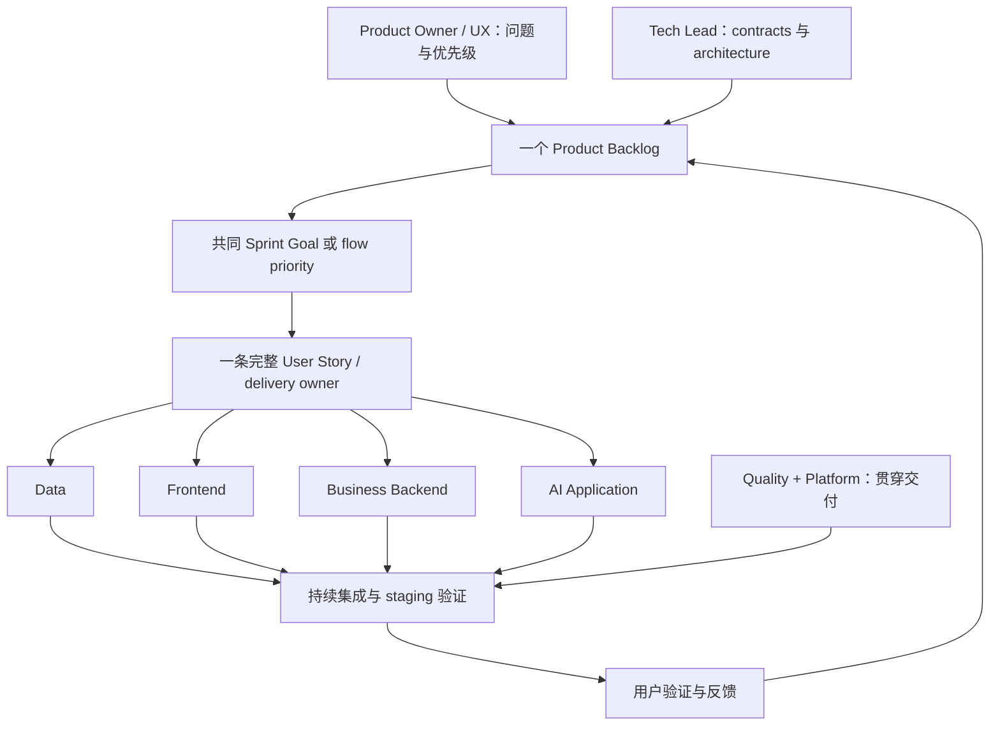
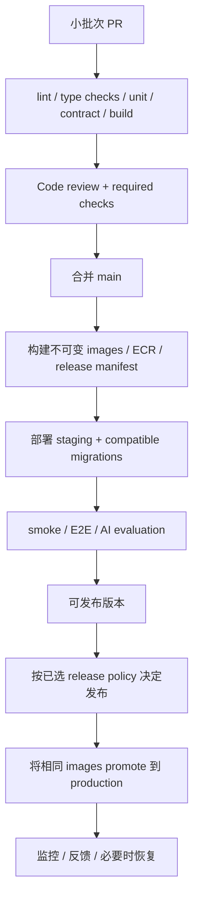

# Large-Lunch-Model：澳洲、美国、中国交付实践与团队组织对比

- 版本：v0.2，供选择与讨论；技术与预算边界于 2026-10-29 同步。
- 编写与来源核对日期：2026-10-27（Australia/Sydney）。
- 项目基线：[tech-stack-requirements.md](../tech-stack-requirements.md)；专题要求：[数据](data-requirements.md)、[AWS](aws-requirements.md)、[本地开发](local-development.md)。
- 用户已确认的预算口径：`MENU_SUBTOTAL`，包含所选规格、必选与已选可选加料和数量；配送费与平台 service fee 等订单级费用另列。本文中的费用与版本语义按技术基线执行。
- 状态：本文是 operating model 建议，尚未选定团队组织、人员、Sprint 长度或上线日期；不代表 CI/CD 或产品功能已经实现。
- 排期假设：以 6–8 人、可持续的接近全职投入为主要讨论场景。实际人数、经验、每周投入、AWS 资源和数据来源均待确认；兼职团队应按实际 capacity 缩小每轮范围。
- 阅读顺序：先看第 1、3、4、13 节选择模式，再看第 5–12 节了解执行细节。

## 1. 当前最值得考虑的组织方式

对这个阶段的 Large-Lunch-Model，建议优先比较：**一个 cross-functional product team，内部明确 Data、Frontend、Backend、AI、Quality 和 Platform ownership；每轮围绕用户可使用的完整功能共同交付。**

你的“分工明确，再由产品和 architecture 协调”是必要的。需要进一步决定的是：这些专业方向是一个团队里的责任分工，还是各自拥有独立 backlog、排期和验收的五个部门。两种组织的协调成本差别很大。

如果只有 6–8 人，却成立五个独立项目组，每组通常只能分到 1–2 人，并且一条推荐功能要等待多次交接。对首版而言，主要风险是数据、API、模型输出和页面没有及时集成，而不只是某一个模块开发慢。

建议优先比较以下两种组织，而暂不定案：

| 项目阶段 | 可以考虑的组织 | 主要交付单位 |
| --- | --- | --- |
| 首版、少量成员、需求仍在探索 | 一个 cross-functional team + discipline owners | 一条可以在 staging 验证的完整 User Story |
| 两条业务价值流已能相对独立推进，且人员足够 | 多个 cross-functional squads + 共享专业能力 | 一个 squad 可自行完成并维护的产品能力 |

首版的 AI 职责建议命名为 **AI Application & Evaluation**。现有技术要求使用外部 model API，并明确排除首版模型训练、fine-tuning 和 GPU 自托管；因此此时直接成立“AI 训练组”会使分工偏离实际工作。

## 2. 先统一几个流程概念

### 2.1 Sprint 是全球使用的 Scrum 概念

本次查到的资料不足以证明“澳洲的软件项目一般都必须按某套 Sprint rule”。Scrum 是跨地区使用的 framework。正式 Scrum 包含 Product Owner、Scrum Master、Developers，以及 Sprint 中的 planning、daily、review、retrospective；团队 cross-functional、self-managing，内部不划分 sub-teams。Sprint 长度固定且不超过一个月，目标是形成符合 Definition of Done 的可用 Increment。[Scrum Guide](https://scrumguides.org/scrum-guide.html)

这里的 Developers 包括创建 Increment 所需的专业成员，可以包含 data、QA、design 等角色，不只指编写业务代码的人。

因此：

- 可以在同一个 Scrum Team 内设置 Frontend owner、Data owner 等专业责任。
- 如果各组独立安排工作、最后集中交接，需要另外设计跨团队协作；不能只因为每两周开会就认为已经实现 Scrum。
- 本文建议的两周周期是本项目的起始选项，不是澳洲规则，也不是 Scrum 唯一允许的长度。
- Sprint Review 用于检查结果与调整方向；产品满足 release 条件时可以在 Sprint 内发布。

### 2.2 “第一轮跑出基板”应具体化为 walking skeleton

walking skeleton 指一条很薄但贯穿系统的可运行路径。对本项目，可以是：

**用户输入菜品小计预算 → Java 查询已发布且有效的 OfferVersions → Python 调用一个模型 → Java 校验候选、菜品事实版本、价格版本和约束 → 页面展示有来源的推荐。**

先使用 synthetic fixtures 和 mock provider 验证本地流程；真实菜单、一个真实 provider 与受限 staging 分别通过验证后，才能报告对应成果。初始创建来源、门店、证据、batch、审核与发布的流程从第一轮就存在，可以通过 CLI 完成。

它同时验证服务连接、数据契约、错误处理和 deployment。只有空目录、三个 hello-world 服务或一张 architecture diagram，还不能证明这一条用户流程可行。

可以先安排少量 preparation / discovery 工作。本文把它称为启动准备；“Sprint 0”不是必须引入的 Scrum 阶段。若准备期没有可用 Increment，应如实记录为研究或环境准备。

### 2.3 CI、Continuous Delivery 与 Continuous Deployment

| 概念 | 本项目中的含义 |
| --- | --- |
| CI | 小批次合并代码，自动执行检查、测试与构建，尽早发现 integration 问题 |
| Continuous Delivery | 通过自动化保持可发布状态；生产发布仍可由人决定时间 |
| Continuous Deployment | 满足自动化条件的变更自动进入 production |

固定 Sprint 与 Continuous Delivery 可以共存：Sprint 管理目标和反馈节奏，pipeline 负责每次变更的验证与交付。DORA 强调持续测试与自动化，测试应贯穿开发过程。[DORA — Continuous delivery](https://dora.dev/capabilities/continuous-delivery/)

## 3. 澳洲、美国、中国：比较公开实践样本

### 3.1 证据范围

下面使用澳洲与美国的政府 digital delivery 指导，以及中国工程平台的官方文档作为可核查样本。**这不是各国企业采用率调查，也不是国家级统一开发标准。** 不应据此推断“澳洲只有 Scrum”“美国不用测试组”或“中国必定按部门串行”。

政府指南与厂商文档的用途不同，不能把它们当成严格对等的统计样本。对本项目有用的是它们提出的具体做法，以及这些做法是否解决当前问题。

| 对比维度 | 澳洲公开指导样本 | 美国公开指导样本 | 中国官方平台样本 |
| --- | --- | --- | --- |
| 代表来源 | DTA、Digital NSW | US Digital Services Playbook、GSA | 云效、TAPD、CodeArts |
| 组织与协作 | multidisciplinary team，覆盖服务所需能力，并赋予团队决策空间 | 小团队、明确 Product Owner、cross-functional delivery | 统一需求视图、角色协作、关联代码与测试；支持多种项目模板 |
| 需求与验证 | 理解用户问题，用 prototype 验证假设，持续反馈 | 尽早形成 MVP，用实际使用情况驱动改进 | 需求拆分、优先级、dependency、迭代与缺陷可追溯 |
| 节奏 | 可采用 Discovery → Alpha → Beta → Live，并按发现调整 | iterative delivery；Agile 方法可按团队场景选择 | 支持 Scrum、Kanban；特定产品场景还支持 IPD |
| 工程实践 | 技术与 operations 参与日常 delivery | 自动测试、build、deployment 与必要的 manual QA | 将扫描、测试、build、环境部署、quality gates 串入 pipeline |
| 对本项目可借鉴 | 先确认用户问题；专业能力共同参与；明确阶段证据 | 尽早交付可用路径；明确决策责任；用反馈调整 | 需求到 release 的追踪链；显式 dependency 和质量门槛 |
| 不能据此推断 | 所有澳洲企业都两周一个 Sprint | 所有美国公司都用 squads 或全自动上线 | 所有中国团队都采用 IPD、职能部门或同一管理方式 |

表中依据见以下具体来源；“对本项目可借鉴”属于本文的设计建议。

### 3.2 澳洲资料怎样应用到这个项目

DTA 的 [Multidisciplinary teams](https://www.digital.gov.au/policy/digital-experience/toolkit/managing-teams/multidisciplinary-teams) 提倡围绕问题或服务组成互补团队，减少对外部团队的依赖。[Digital NSW 的团队指导](https://digital.nsw.gov.au/delivery/digital-service-toolkit/resources-and-guides/plan-a-project/multidisciplinary-delivery)还说明，一人可以承担多个角色，Tech Lead 参与实际技术工作。

DTA 的 [Service design and delivery 指导](https://www.digital.gov.au/policy/digital-experience/toolkit/service-design-and-delivery-process/communicate-benefits)区分 Discovery、Alpha、Beta、Live，并允许根据发现返回前面的工作。

本项目可据此设计以下阶段判断，阶段时长由证据决定：

| 阶段 | 本项目需要回答的问题 | 可供判断的证据 |
| --- | --- | --- |
| Discovery | 用户为何不直接使用地图或餐厅平台？可信菜单从哪里来？ | 少量真实用户访谈、现有替代方案、数据来源样本 |
| Alpha | “有角色的 AI 推荐”是否有用且技术可行？ | 交互 prototype、walking skeleton、真实候选与模型输出对照 |
| Beta | 用户能否持续完成选餐流程，系统能否可靠运行？ | 小范围使用反馈、E2E、数据更新流程、成本与失败记录 |
| Live | 是否具有长期维护和持续改进能力？ | 发布记录、运行责任、监控、数据维护、用户反馈 backlog |

这些阶段可以容纳多个 Sprint。每个阶段都应产出可判断的证据，避免先进行漫长设计、再集中实现。

### 3.3 美国资料怎样应用到这个项目

[US Digital Services Playbook](https://playbook.usds.gov/)提出小团队、迭代、明确 accountable Product Owner，以及自动测试和部署。[GSA Agile Delivery](https://fas.itplaybook.gsa.gov/standards-alignment/agile-delivery/)说明，Agile 不等同于 Scrum，同一组织中的团队也可以采用不同 Agile 方法。

本项目可据此把工作组织成可验证的 product hypotheses，例如：

- 显示菜单来源与更新时间，是否帮助用户理解推荐依据？
- Persona 是否提高用户继续调整偏好或保存推荐的意愿？
- 多模型比较是否改善选择体验，其额外 latency 和成本是否值得？

先确定如何观察结果，再决定实现规模。初期用户数量少时，以访谈、任务完成观察和案例复盘为主；不要把少量反馈包装成有统计显著性的 A/B test。

### 3.4 中国资料怎样应用到这个项目

[云效需求管理](https://help.aliyun.com/zh/yunxiao/user-guide/demand-management/)支持 Scrum、Kanban 和跨团队需求协作；[云效持续交付示例](https://help.aliyun.com/zh/yunxiao/use-cases/how-to-achieve-continuous-delivery-quickly)将扫描、unit tests、review、部署和 quality gates 关联起来。

[TAPD DevOps 工具接入说明](https://cloud.tencent.cn/document/faq/624/34397)展示了需求、代码、构建、测试和交付的关联；[CodeArts 项目类型](https://support.huaweicloud.com/productdesc-devcloud/devcloud_pdtd_00007.html)提供 Scrum、Kanban 和不同 IPD 模板，按业务场景区分使用。

本项目可借鉴统一追踪链：

**用户问题 → Epic / Story → owner 与 acceptance criteria → PR → pipeline → staging 验证 → release → 反馈。**

现有基线已经选择 GitHub Actions 与 AWS。借鉴上述协作方法不要求更换成这些厂商的工具；也无需因一个小型软件产品而立即引入完整 IPD 流程。

## 4. 你提出的五个组，怎样调整更合适

### 4.1 保留专业分工，补齐实际责任

| 原先的组 | 首版建议职责名称 | 实际工作与交付物 | 需要避免的问题 |
| --- | --- | --- | --- |
| 数据挖掘处理组 | Data Engineering & Content Operations | 获取可用菜单、清洗、去重、来源与版本、审核、更新；提供可用数据和 quality report | 先做大规模抓取，却迟迟没有可用且可信的菜品 |
| 前端组 | Frontend & UX | 页面、交互、accessibility、streaming 状态、component tests | 只完成静态页面，最终才连接真实 API |
| 后端组 | Business Backend | Catalog、权限、偏好、硬性过滤、最终校验、事务与数据保存 | 把所有规则放进 prompt，或依赖模型直接写业务表 |
| 测试组 | Quality Engineering | 提前设计 acceptance cases、contract tests、E2E、exploratory testing、质量反馈 | 成为开发完成后的唯一验收队列；开发者不维护自己的测试 |
| AI 训练组 | AI Application & Evaluation | Provider adapters、Persona / Skill、tools、structured output、evaluation、usage 和成本 | 在 API 产品首版就投入训练基础设施，缺少可测量的收益目标 |
| 原方案未显式列出 | Platform / DevOps ownership | 本地环境、CI/CD、IaC、staging、secrets、监控、发布与恢复 | 每个人都以为另一个人会负责部署 |
| 产品与架构 | Product / UX 与 Tech Lead | 用户价值、优先级、架构边界、技术取舍与跨职能协调 | 每项小改动都等待两个负责人集中审批 |

当前“数据处理”主要是 Data Engineering 和内容质量管理。Data Mining 可以在已有足够使用数据、需要发现模式时加入。两者的能力和交付目标不同。

### 4.2 三种组织结构对比

| 组织结构 | 怎么分工 | 优点 | 成本与风险 | 本项目适用条件 |
| --- | --- | --- | --- | --- |
| Functional teams | Data、Frontend、Backend、QA、AI 各自管理任务 | 专业标准易集中；可服务多个产品 | 每条 Story 多次 handoff，整体交付可能无人负责 | 公司已有这些共享部门，且能提供明确服务承诺 |
| Cross-functional team | 一组人覆盖一条用户价值流，专业 owner 负责技术质量 | 能尽早集成；责任围绕完整结果 | 成员需要跨边界协作；稀缺技能可能成为瓶颈 | 当前少量成员的首版最值得优先考虑 |
| Hybrid matrix | 多个产品 squads 交付，chapters / platform 提供专业支持 | 同时支持产品 ownership 与专业复用 | 易出现双重优先级、共享人员争抢 | 多个 squads 和稳定的共享需求已经出现 |

本项目初期更适合把 Data、Frontend、Backend、AI、Quality、Platform 视为 **ownership lanes**，而不是六个独立 backlog。专业 owner 负责约定、review 和维护；一条 Story 的 delivery owner 负责把这些工作连起来。

图表示职责协作，不表示 PO 或 Tech Lead 给每位成员逐项分派任务。

## 5. 人数与角色：可以从什么配置起步

以下是容量规划示例，不是招聘配额，也不是按国家划定的人数标准。

### 5.1 六人起步示例

| 人员槽位 | 主要 responsibility | 首轮重点 | 需要的协作与 backup |
| --- | --- | --- | --- |
| A | Product Owner + UX discovery | 用户场景、流程草图、backlog、acceptance criteria | C 支持交互细节；全队参加用户结果讨论 |
| B | Tech Lead + Java Backend | 数据与服务边界、Catalog、最终结果校验 | E 支持数据接入与 backend；D 共同维护内部 contract |
| C | Frontend | 最小选餐页面、SSE 状态、结果展示 | B / D 共同排查跨服务问题 |
| D | AI Application & Evaluation | 单 provider、Persona / Skill、输出 schema、evaluation | B review tools 权限；E 协助样本和证据 |
| E | Data Engineering + Content Operations | 首批审核数据、来源、导入校验 | B 共同处理业务落库；A 确认内容范围 |
| F | Quality Engineering + Platform coordination | CI、E2E、staging、质量与发布证据 | 各代码 owner 编写并维护自身测试与部署配置 |

F 的组合仅适合首轮范围受控、成员具备相应技能的情况。F 不独自包办全部测试、AWS 和运维。若 pipeline 或测试形成持续等待，应先重新分配职责，而不是继续扩大 F 的负担。

表中的 backup 也以实际技能为前提：E 只有具备 Java 能力才承担 Backend backup；否则应安排 pairing、培训或补充人手，不能因为写了一个名字就认为已有覆盖。首轮优先保住一条完整选餐路径；容量不足时，将目录浏览的完整交互和额外 UI 优化移出本轮。

若采用正式 Scrum，应明确谁承担 Scrum Master accountability；可以兼任其他工作，但须保证促进协作、处理 impediments 的时间与能力。Delivery owner、Tech Lead、Project Manager 都不是 Scrum Master 的同义词。

### 5.2 扩展到八人

在六人配置基础上，优先根据实际瓶颈补充：

- Platform Engineer：接手 IaC、pipeline、监控与运行支持，让 Quality owner 聚焦质量体系。
- Backend / Full-stack Engineer 或 Product Designer：前两者补充业务与端到端交付容量，特别是只有一位 Java owner 时；后者在用户研究、交互与角色体验成为瓶颈时更有价值。

不必因为架构包含多个 service，就为每个 service 创建一个部门。Java、Python、Next.js 是软件边界，团队边界还应考虑交付目标、人员技能与日常依赖。

### 5.3 更小和更大的团队

| 可用人数 / 条件 | 可考虑的安排 | 调整方式 |
| --- | --- | --- |
| 1–3 人或主要兼职 | 一个 backlog，按顺序完成 vertical slices | 合并角色、减少并行 WIP；优先人工审核数据与单 provider |
| 4–8 人，能覆盖主要技能 | 一个 cross-functional team | 设置 owner + backup，围绕共同目标交付 |
| 约 9–15 人，已有两条可独立推进的价值流 | 两个 cross-functional squads | 可按 Catalog & Content、Recommendation Experience 划分；各自具备所需端到端能力 |
| 更大规模且有稳定共享需求 | 多个 squads + Data / Platform shared capabilities | 明确 API、支持方式、维护责任和 dependency 等待时间 |

后三行是组织设计选项，不是人数一到就自动拆组。只有拆分后能够减少等待、形成清晰 ownership，才值得增加组织层级。同一产品的多个 Scrum Teams 应保持一致 Product Goal、Product Backlog 和 Product Owner。[Scrum Guide](https://scrumguides.org/scrum-guide.html)

## 6. 产品和 architecture 怎样统合

### 6.1 决策权与交付责任

| 决策 / 交付物 | 主要负责者 | 需要参与的人 | 留下的证据 |
| --- | --- | --- | --- |
| 用户问题、价值判断、优先级 | Product Owner | UX、团队、真实用户 | Product Goal、backlog、接受或调整范围的理由 |
| Architecture、service boundaries、跨服务取舍 | Tech Lead 主持，相关工程 owner 共同设计 | Data、AI、Platform、Quality | 简短 ADR、OpenAPI / event schema |
| Sprint 内怎样完成工作 | 执行工作的团队成员 | Product Owner 澄清目标 | Sprint Backlog、任务 owner、dependency |
| 一条 Story 完整交付 | 该 Story 的 delivery owner | 相关专业 owner | PR、pipeline、staging demo、验收证据 |
| 自动化与 exploratory testing 策略 | Quality owner 协调 | 所有实现者、PO | 测试策略、关键场景、缺陷记录 |
| 数据能否发布为可信目录 | Data owner 组织审核 | Backend 校验，PO 确认内容规则 | 来源、版本、审核状态、quality report |
| AI 变更是否改善体验 | AI owner 负责实验，PO 判断产品收益 | Data、Quality、Backend | evaluation report、成本 / latency、失败案例 |
| Production release | 指定 release owner 执行 | Product、相关 service owners、Quality | release manifest、验证记录、恢复方案 |

Product Owner 负责价值与优先级，Tech Lead 主持技术边界与权衡，实施团队决定具体实现。跨边界冲突用明确问题和证据讨论，例如“增加四模型比较会增加多少成本，是否影响本轮选餐目标”。

建议把 ADR 限定在影响多个模块或难以逆转的决定，例如 LangGraph 是否进入默认路径、菜单版本如何引用、SSE contract 如何演进。普通函数和组件实现由对应 owner 决定。

### 6.2 一条 Story 如何跨专业协作

示例：**一位用户输入本次菜品小计 AUD 25 的预算，希望看到来自真实菜单的可选菜品及推荐理由。** 首轮单人、单店、单渠道，不包含配送费与 service fee。多人方案的总预算和份量规则留到该功能启用时定义。

| 工作 | 主要 owner | 前置约定 | 可并行的部分 |
| --- | --- | --- | --- |
| 落实已确认预算口径与交互 | Product / UX | MENU_SUBTOTAL、规格 / options、quantity、排除费用的展示 | 页面草图、测试场景 |
| 提供审核后的菜品 fixture | Data | MenuItemRevision、OfferVersion、SourceRecord、snapshot、freshness | 人工数据准备与 backend 开发 |
| 查询候选与最终规则校验 | Backend | budget contract、错误码、数据版本 | 用 fixture 完成 API 和测试 |
| 生成解释与引用 | AI | 候选输入、structured output、provider capability | 先以 mock provider 验证 schema |
| 展示输入与 streaming | Frontend | OpenAPI、SSE event、状态机 | 先对 mock API 开发 |
| 验证用户路径与异常 | Quality + 全体 | acceptance criteria、同一组 fixtures | 从第一天设计 cases 与自动化 |
| staging deployment | Platform + service owners | image、配置、secrets、环境权限 | 环境准备可与代码并行 |

**硬 dependency**：字段含义和 schema 未约定，相关实现可能返工；真实 provider 验证需要可用凭证；AWS deployment 需要环境权限。

**integration dependency**：Frontend 可先对 mock 开发，AI 可先对 fixture 开发，但 Story 完成必须证明真实服务链路集成。mock 通过不能替代真实集成。

人数少时可以按 contract → 数据 / Java → AI → Frontend → E2E 逐步接通；人数足够时以上工作并行，以尽早合并第一条路径作为共同检查点。

## 7. 启动准备与第一个两周 Sprint

### 7.1 启动准备：形成可开工的条件

建议先做短时间的准备，具体时长按现状安排：

1. 确定首个用户场景，例如悉尼 CBD 附近的单人工作日午餐；明确预算、数据覆盖与推荐边界。
2. 明确成员、每周可用时间、专业 owner 和 backup，先确认 capacity 再承诺范围。
3. 明确能合法使用的数据来源及更新方式，准备少量有来源的样本；首轮可手工整理。
4. 按数据要求落实最小 contract：MenuItemRevision、OfferVersion、SourceRecord、MenuSnapshot、MENU_SUBTOTAL、ingestion / review / publish、recommendation request/result 与 SSE events。
5. 确认一个 provider 的接入条件、AWS staging 的账号与权限、费用范围，以及负责者。
6. 建立一个 backlog、轻量 PR review 约定和初版 Definition of Done。

这些是建议的开工条件；本文没有创建云资源或申请 model API credentials。

### 7.2 Sprint 1 Goal

这个示例以启动准备中的 AWS / provider access 已就绪、团队具备相应技能为前提。否则先根据可用条件制定实际 Goal，不直接承诺两周完成云端路径。

**在受限访问的 staging 上，一位试用者可以输入简单条件，从有来源的菜单中获得一个模型生成、经 Java 校验的推荐；该版本可由 pipeline 构建和部署。**

首轮范围建议：

- 小规模、人工审核的真实 seed data；例如 5–10 家门店、30–50 个 MenuItems，仅作为规划量级，不代表已经收集。每个候选有有效且已发布的 OfferVersion；synthetic fixtures 只用于开发与明确标识的演示。
- 一条核心选餐路径、一个 provider、一个 Persona、一个 Skill。
- 最小 streaming、客户端取消及下游尽力取消，以及无候选、provider timeout、输出无效三类失败行为；不承诺断线自动续传。
- Java → Python 的内部身份边界、受限的 staging 访问；完整账号资料与收藏功能可在后续扩展。
- 保留输入预算、SourceRecord、MenuItemRevision / MenuSnapshot / OfferVersion、实际 model ID 与请求状态的最小记录。
- 首轮以 Admin CLI 完成来源与门店 bootstrap、导入、审核和发布；资料过期在查询时排除，不等待自动 scheduler。
- CI、Flyway 初始 migration 与 seed 导入验证，以及一条可重复执行的 staging deployment 路径。

多模型比较、完整管理后台、自动 OCR、大规模抓取、LangGraph 复杂协作、Live2D / 3D 不属于这个 Sprint 的必要目标。它们仍可保留在产品 backlog。

### 7.3 十个工作日的参考节奏

以下是 coordination plan，实际任务持续重叠；不要求每一项恰好在指定日期完成。

| 时间 | 协作重点 | 希望看到的检查点 |
| --- | --- | --- |
| Day 1 | 对齐 Goal、acceptance criteria、contracts；建立可运行 repo 与最小 CI | 每人知道输入输出；首个 PR 能被自动检查 |
| Day 2–3 | 同时推进 seed data、Java、AI adapter、页面、staging 基础环境 | 本地以 mock provider 贯通第一条请求路径 |
| Day 4–5 | 尽早接入一个真实 provider，连接 MySQL 和 SSE | 真实候选与来源可被展示；发现集成问题仍有修复时间 |
| Day 6–8 | 加入规则复核、错误路径、记录、staging deployment | pipeline 能部署；Quality 与 Product 开始使用实际版本 |
| Day 9 | 关键 E2E、受控 live smoke、发布证据与恢复演练 | 对已完成范围有可复查证据 |
| Day 10 | Review、用户反馈、Retrospective、调整下一轮 backlog | 展示完整用户路径；明确剩余风险与下轮改进 |

若 AWS 或 provider 权限尚未就绪，应在 Sprint Planning 结束前设定与现有条件相符的 Goal。正式 Scrum 的 Sprint 开始后发现阻碍时，团队与 Product Owner 协商 scope 和实现计划，保持 Sprint Goal；若 Goal 已过时，由 Product Owner 决定是否取消 Sprint。未能实现 Goal 时应如实记录，只报告已经验证的本地、mock、云端或真实模型路径。[Scrum Guide](https://scrumguides.org/scrum-guide.html)

### 7.4 Sprint 1 的 backlog 示例

| ID | 类型 | 交付内容 | owner / 参与者 | 验收证据 |
| --- | --- | --- | --- | --- |
| LLM-01 | User Story | 浏览首批有来源的 MenuItems | Frontend / Data / Backend | staging 页面与来源字段 |
| LLM-02 | User Story | 输入预算并获得可验证的推荐 | delivery owner + 全体相关成员 | E2E、受控 provider smoke、记录 |
| LLM-03 | User Story | 理解无候选与模型失败状态，并能取消请求 | Frontend / AI / Backend / Quality | 错误与取消路径测试、UI 演示 |
| LLM-04 | Enabler | contracts、fixtures 与内部身份验证 | Backend / AI / Quality | contract tests、未授权请求测试 |
| LLM-05 | Enabler | CI 与 staging deployment | Platform / service owners | build、deploy、smoke 的 run 链接 |
| LLM-06 | Data task | seed data 与审核记录 | Data / Product | 版本化数据与 quality report |

这些 ID 是示例，没有创建真实 issues。Story 是否完成看用户路径和 Definition of Done；某个子任务合并不等于整条 Story 完成。

## 8. 前四个 Sprint 的演进选项

以下每行假设两周，是 discussion roadmap，不是八周交付承诺。Sprint 2 以后应根据前一轮的用户反馈、capacity 和失败证据重新排序；其中的“候选增量”需要拆小后再选入 Sprint。

| Sprint | 目标 | 可选的主要增量 | CI/CD 与质量演进 |
| --- | --- | --- | --- |
| 1 | 证明最小选餐路径可运行 | seed data、单 provider、单 Persona / Skill、staging | 各服务 CI、初始 migration / seed、contract、关键 E2E、自动 staging |
| 2 | 提高数据与推荐可信度 | 改善首轮已有的审核 / 更新流程和必要 UI；偏好保存或收藏二选一优先；按反馈完善未知信息处理 | migration 升级兼容性验证、规则回归、evaluation dataset v1 |
| 3 | 验证角色与模型选择的价值 | Persona / Skill registry；第二个 provider；有证据再加入比较模式 | capability tests、partial failure、成本与 latency 对比 |
| 4 | 验证小范围持续使用与运行能力 | 根据反馈优化体验、数据维护、运行监控；满足条件时进入受控 Beta | release promotion、恢复演练、告警、容量与使用反馈 |

需要状态恢复、复杂 routing 或角色间协作时，在第 3 轮之前安排短期 technical spike 比较自定义 LangGraph workflow。用明确场景评估收益，不把 framework 替换本身当成产品目标。

若第二轮仍存在基本数据或 integration 问题，应优先解决；不要为了符合表格而继续堆叠 provider 和角色。

## 9. CI/CD：从首轮开始建设，并明确谁维护

### 9.1 与当前 architecture 对应的 pipeline

基线采用 monorepo、GitHub Actions、Terraform、AWS ECS Fargate。可采用以下流程：

图是拟议流程，仓库当前没有这些 workflow。production 是否自动发布，要在团队选择 operating model 后确定。

### 9.2 各类检查和 ownership

| 层次 | 建议检查 | 谁负责维护 | 首轮边界 |
| --- | --- | --- | --- |
| Frontend | lint、TypeScript、component tests、build | Frontend owner | 核心表单、结果与失败状态 |
| Java | Maven build、业务规则 tests、MySQL integration tests | Backend owner | 初始 migration / seed；候选与最终 ID / 预算校验；关键身份边界 |
| Python | Ruff、type checking、pytest、schema / tools tests | AI owner | mock provider、timeout、无效输出 |
| Contracts | OpenAPI / SSE fixtures、producer / consumer 一致性 | Java 与 Python / Frontend 共同维护 | 最小请求、结果、错误 event |
| Data | 必填字段、类型、重复 ID、引用完整性、来源与版本 | Data owner | 首批 seed data 的自动检查 |
| E2E | 选餐主路径、无候选、provider 失败、取消 | Quality 协调，相关开发者修复 | 少量高价值路径；核对 Java → Python → provider 的取消与超时行为 |
| Infrastructure | Terraform 检查与 plan review、部署健康检查 | Platform owner | staging 所需资源与访问边界 |
| AI evaluation | 菜品真实性、规则违反、引用、结构化输出、latency / cost | AI + Quality + Product | mock regression 加受控 live 验证 |

每个 Story 都经过相关检查。Quality owner 负责让质量策略完整，不替所有开发者编写 unit tests。

### 9.3 三个执行层级

1. **每个 PR：**快速、可重复的检查，默认使用 mock provider。先让失败易于定位，避免每次 CI 都依赖付费模型或外部不稳定服务。
2. **合并到 main / staging：**真实服务 integration、部署健康检查、关键 E2E。按变更影响运行 AI evaluation；有受控 credentials 和预算时执行 live smoke。
3. **候选 release：**检查实际启用 provider 的连通与能力、数据 / schema 兼容性、已知风险、可恢复性及产品验收证据。

模型和 prompt 的输出具有 variability；live evaluation 应保存样本、版本、参数与结果。一个偶然成功的回答不能代表能力已经稳定。

### 9.4 避免 monorepo 的常见问题

- 目录级变更可以只运行相关服务检查；`contracts/`、公共 fixtures、基础镜像和 deployment 配置变更要触发受影响的跨服务验证。
- 配置 path filtering 时，确保 required checks 的行为明确；不能因检查未运行而产生虚假的绿色结果或永久 pending。
- 不把 Sprint 变成长期分支。优先短生命周期 branch、小 PR、尽早合并；未完成 UI 可以通过 feature flag 隔离。
- release manifest 记录三个应用的 image digest、migration version、Prompt / Skill 版本和相关数据版本；验证过的 image 直接 promote，避免重新构建得到不同内容。
- 服务可独立构建，不代表任何版本组合都兼容。内部 API 与 event 的 breaking change 必须安排兼容窗口或协调发布。
- Flyway migration 优先采用兼容性演进。应用 image 回退不自动意味着数据库可以安全回退；恢复方案要区分 application、schema 和 data。
- AWS 身份按基线使用 OIDC 的短期 credentials，并限制可承担 role 的 repo、branch / environment；无需在本文提前填写 IAM policy。[GitHub OIDC in AWS](https://docs.github.com/en/actions/how-tos/secure-your-work/security-harden-deployments/oidc-in-aws)

GitHub 提供 [ECR / ECS deployment 示例](https://docs.github.com/en/actions/how-tos/deploy/deploy-to-third-party-platforms/amazon-elastic-container-service)。实际配置还要核对服务参数和权限；如需 environment required reviewers，应检查 repo 可见性及 GitHub plan 的支持情况。[Deployment environments](https://docs.github.com/en/actions/reference/workflows-and-actions/deployments-and-environments)

## 10. Data 与 AI 的工作方式

### 10.1 Data pipeline 是持续产品能力

建议最小路径为：

**明确来源的获取 / 存储 / 展示 / LLM processing 条件 → 按许可保存原始证据与采集时间 → 提取 / 清洗 → Java draft 与 schema validation → complete → 人工审核 → Java 原子发布版本 → 查询时检查有效期并持续更新。**

首轮可手工完成获取和审核，但来源、版本、未知字段与发布边界应从一开始存在。Data owner 的完成标准是“应用能够使用且知道其来源的目录数据”，而非只交付一个 CSV 或 crawler。

关键约定包括：

- 门店和菜品如何识别、去重；MenuItemRevision、渠道 OfferVersion 与 MenuSnapshot 的关联；同名不能直接 merge。
- DECIMAL / JSON decimal string、AUD、规格与 selected options、MENU_SUBTOTAL、未知费用、采集和审核时间。
- 过敏原信息的已知 / 未知状态；未标注不能自动被当成安全结论。
- `workflow_state=DRAFT/REVIEWED/PUBLISHED/WITHDRAWN` 与 `freshness_state=FRESH/STALE/UNKNOWN` 分离；review decision 和发布权限分别记录。
- 发布 transaction 更新 catalog revision；cache 使用版本化 key；最终校验同时验证菜品与价格版本，变更返回 DATA_CHANGED；历史证据遵循来源 retention。

这些口径由 Data、Backend、Product 共同维护，具体以数据要求为准。Python ingestion 使用独立身份经 Java API 提交 draft，没有 publish 权限；reviewer / publisher 经 Admin API 审核发布。AI tools 只读，三类权限不能混用。

### 10.2 AI Application 与训练的分界

| 当前应该做 | 以后有条件再做 |
| --- | --- |
| model API 接入、capability matrix、timeout、用户可见且已选择的 fallback 策略 | 自托管 inference infrastructure |
| Persona / Skill、prompt version、受控 tools | fine-tuning 或专门 model training |
| structured output、来源引用、failure handling | ranking model、偏好学习等专门训练 pipeline |
| 固定 evaluation cases、人工评审、成本与 latency | 规模化训练数据、experiment tracking、model registry |

是否启动 training workstream，可以要求一份短 experiment proposal：现有 baseline 有什么具体缺口；prompt、tools、retrieval 或规则优化为何不足；训练数据从哪里来；如何划分 training / validation / held-out evaluation；收益、成本和停止条件是什么。

如果主要问题是菜单过期、候选不完整或规则定义不清，训练模型未必解决这些问题。先找出失败所在，再选择改进手段。

### 10.3 Evaluation 最小方案

建议首轮建立小规模、可人工复核的案例集，覆盖预算不足、无候选、未知过敏原、多语言菜名、过期菜单、provider timeout 和输出不存在的 ID。后续逐步补充真实失败案例；调 prompt 使用的案例与保留的评估案例分开管理。

| Metric / 证据 | 用途 | 判定建议 |
| --- | --- | --- |
| 无效 MenuItem ID / 硬性规则违反 | 验证业务正确性 | 固定回归集内发现违反就阻断；有限样本通过不代表全局保证 |
| Source coverage | 判断推荐能否追溯 | 每个推荐按 contract 携带有效 source references |
| Structured output success | 判断 provider / schema 兼容 | 记录成功率、失败类型与模型版本 |
| 人工 relevance / usefulness review | 判断是否帮助用户选餐 | 使用统一 rubric，保存评分与理由 |
| Latency、token usage、估算成本 | 判断体验与资源是否可接受 | 首轮测 baseline；与 Product 共同设定后续门槛 |

不要先写一个没有证据的“推荐准确率 95%”。先定义什么算成功、样本来自哪里、是否具有代表性，以及失败带来的影响。

## 11. 日常 workflow 与 Definition of Done

### 11.1 一个 backlog，明确完成路径

建议看板状态：**Backlog → Ready → In Progress → Review → Staging Verification → Done**。阻塞使用可见标记和原因，不让它消失在私人聊天里。

一条 Story 至少记录：用户目标、acceptance criteria、delivery owner、相关专业 owner、dependency、data / API 影响、验证方式。PR、pipeline 与 demo 证据关联到 Story。

Ready checklist 是团队自己的辅助约定：需求足够清楚、数据或 fixture 可得、关键 dependency 已知，工作量可切成可交付的小块。它不应变成开始学习前必须填写完的大量表格。

### 11.2 如果选择两周 Sprint

以下时长是本项目建议，随人数和投入调整：

| 活动 | 建议节奏 | 要产生的结果 |
| --- | --- | --- |
| Planning | 每轮开始，约 60–90 分钟 | 一个 Goal、基于 capacity 选择的工作、已知 dependency |
| Daily coordination | 每个工作日，最多约 15 分钟 | 对 Goal 的进展、阻碍、当天需要谁协作 |
| Backlog refinement | 每周一次，约 30–45 分钟 | 下一批 Story 足够清楚，可拆分与估算 |
| Contract / architecture discussion | 有跨边界变更时，按需短会 | schema、兼容策略或 ADR |
| Review | 每轮结束，约 45–60 分钟 | 从实际版本检查用户价值，调整 backlog |
| Retrospective | 每轮结束，约 30–45 分钟 | 选一个下轮可验证的流程改进 |

完整 Scrum 应遵循 Scrum Guide；上述是结合本项目给出的活动容量建议，不构成另一套 Scrum 标准。兼职成员可以增加 async 更新，但需要确认是否仍按正式 Scrum 工作，还是采用较轻的 iteration workflow。

### 11.3 Definition of Done 草案

以下用于功能 Story；research spike 使用预先约定的证据和决策产出，不能假装成已上线能力。

- [ ] acceptance criteria 在完整用户路径中得到验证。
- [ ] 相关代码已 review 并合并；必要检查通过。
- [ ] producer / consumer contracts、fixtures、migration 与配置同步。
- [ ] 关键成功及失败路径通过；涉及 AI 时完成约定的 evaluation。
- [ ] 涉及 streaming 时，验证取消、timeout 和最终结果的状态一致性；尽力取消不能被表述为保证 provider 停止计费。
- [ ] 数据来源、版本和审核状态明确；输出遵循业务规则。
- [ ] 已部署 staging，能够给出可复查的验证记录。
- [ ] 日志能关联 request，错误与 usage 可定位。
- [ ] 需要的说明和运行步骤已更新，没有未记录的阻塞问题。

Production release 还需要满足其环境与运行条件；“Done”与“已经对所有用户上线”应分开记录。

## 12. 用什么衡量项目是否在改善

指标用于团队发现瓶颈，不用于给前端、后端、测试相互排名。不要比较不同团队的 story points，也不要用 commit 数或代码行数代替结果。

| 观察层次 | 适合先看的证据 | 能回答的问题 |
| --- | --- | --- |
| Product | 任务完成观察、用户是否理解依据、是否继续使用或保存推荐 | 功能有没有解决实际问题？ |
| Flow | Story cycle time、blocked time、未完成 WIP | 时间消耗在实现还是等待交接？ |
| Quality | 逃逸缺陷、contract failure、无效推荐、flaky tests | 哪类失败应更早发现？ |
| Data / AI | 数据新鲜度、来源完整度、失败类别、latency / cost | 推荐不佳发生在哪一层？ |
| Delivery / Operations | deploy 记录、失败和恢复记录 | 能否可靠且可重复地发布？ |

截至本次核对，DORA 的 delivery performance 文档使用五项指标：Change lead time、Deployment frequency、Failed deployment recovery time、Change fail rate、Deployment rework rate。应按同一 application / service 的上下文追踪，并用于改进；小团队先收集基本记录即可。[DORA metrics](https://dora.dev/guides/dora-metrics/)

不要把 staging 发布计为 production deployment 后再与生产指标混算。数据量少时展示原始数量和案例，避免过度解释百分比。

## 13. 可以选择的三套流程

这三套是本文的组合方案，各国团队都可以采用；不是“澳洲版、美国版、中国版”的强制对应。

| 选项 | A：固定 Sprint + Continuous Delivery | B：Kanban + 定期 product review | C：Milestones + Sprint + release gates |
| --- | --- | --- | --- |
| 核心组织 | 一个 cross-functional team | 一个 cross-functional team | cross-functional team / squads，协调外部交付责任 |
| 工作节奏 | 暂按两周设 Goal；持续合并与部署 | 按优先级拉取小工作，限制 WIP | milestone 定义结果和约束，内部用短周期交付 |
| 适合情况 | 需要明确学习、协作、演示节奏；团队时间较稳定 | 小团队、兼职或需求变化较多；更看重 flow | 有外部客户、预算节点、合同或固定 release window |
| 反馈方式 | 每轮 Review 与 Retrospective | 建议每周看产品反馈和 flow；定期改进流程 | milestone 检查证据；每轮仍有用户反馈 |
| 发布方式 | staging 持续部署，production 按条件发布 | 持续交付，准备好后发布 | 自动化 pipeline 生成证据，按约定 gate 发布 |
| 主要成本 | planning 与会议；若承诺过满会产生 carry-over | 缺乏固定 Sprint 时，需要更强优先级与 WIP 管理 | 决策和审核成本较高，容易堆积等待 |
| 常见失败 | 两周结束才集成；把 Story 拆成前后端阶段 | 谁都能插单；大量任务同时进行 | 先全部设计、再全部开发、最后统一测试 |
| 本项目建议 | 若有 6–8 人且想建立规范团队协作，优先试运行 | 若主要由 1–3 人或兼职推进，值得优先比较 | 只有出现明确外部 gate 时再引入相应复杂度 |

A 可以借鉴 DTA 的 discovery 和跨职能做法、US Playbook 的快速验证与自动化，以及国内平台的追踪链；B、C 同样可以组合这些做法。

建议将组织模式与流程模式分别选择：例如“一个 cross-functional team + A”，或者“两条价值流的 squads + C”。固定 Sprint 并不强迫按技术层拆组；设立专业部门也不自动决定使用 waterfall。

## 14. 阅读后需要决定的事项

| 决策 | 待选择 / 待确认内容 | 为什么会影响方案 |
| --- | --- | --- |
| 实际 capacity | 人数、技能、每周投入、持续时间 | 决定并行程度与一轮可交付范围 |
| 产品重点 | 单个饭友推荐，还是多个饭友协作 | 决定 AI workflow、evaluation 和 LangGraph 的投入 |
| 首批数据 | 来源、覆盖区域、更新者、审核者 | 决定推荐是否有事实基础 |
| 团队组织 | 单一 cross-functional team，还是已有共享职能组 | 决定 backlog、dependency 和 ownership |
| 交付节奏 | A、B、C 或有理由的组合 | 决定会议、优先级、release 管理方式 |
| 基础资源 | AWS、provider access、预算、GitHub repo 条件 | 决定首轮能够验证到哪个环境 |
| 产品验收 | 谁参与试用，怎样判断有用 | 决定每轮是否获得有效反馈 |

当前倾向供你评估：**先用一个 cross-functional team，明确专业 owner 与 backup；按实际人数选择 A 或 B；首轮交付 walking skeleton 与基础 CI/CD。** 等出现可独立的业务价值流或共享能力瓶颈，再决定拆分 squads。选择之后，下一步才是把方案落实为真实成员分工、首轮 issues 和 pipeline 配置。

## 15. 来源与适用范围

以下链接均在 2026-10-27 核对；文中的人数、Sprint scope、日期安排、职责矩阵和流程组合是针对本项目的建议。

| 来源 | 支持的内容 | 使用边界 |
| --- | --- | --- |
| [项目技术栈要求](../tech-stack-requirements.md) | 当前 architecture、数据 ownership、API inference、CI/CD 方向 | 需求文档，不代表实现状态 |
| [Scrum Guide](https://scrumguides.org/scrum-guide.html) | Scrum accountabilities、团队、Sprint、Increment | framework 定义；不证明各国采用率 |
| [DTA — Multidisciplinary teams](https://www.digital.gov.au/policy/digital-experience/toolkit/managing-teams/multidisciplinary-teams) | 澳洲政府 toolkit 的团队指导 | 不引用其中旧版 criteria 编号作为当前 Standard 要求 |
| [DTA — Service design and delivery](https://www.digital.gov.au/policy/digital-experience/toolkit/service-design-and-delivery-process/communicate-benefits) | Discovery / Alpha / Beta / Live 与反馈 | 政府服务指导，可供项目参考 |
| [Digital NSW — Multidisciplinary delivery teams](https://digital.nsw.gov.au/delivery/digital-service-toolkit/resources-and-guides/plan-a-project/multidisciplinary-delivery) | 角色、兼任与实际 delivery 职责 | NSW 指导，不代表所有澳洲企业 |
| [US Digital Services Playbook](https://playbook.usds.gov/) | 小团队、Product Owner、迭代与自动化 | 美国联邦政府公开指南 |
| [GSA — Agile Delivery](https://fas.itplaybook.gsa.gov/standards-alignment/agile-delivery/) | cross-functional teams 与多种 Agile 方法 | 一个具体组织的做法 |
| [云效 — 需求管理](https://help.aliyun.com/zh/yunxiao/user-guide/demand-management/) | Scrum / Kanban、需求协作 | 厂商能力与实践指导，不是全国统计 |
| [云效 — 如何快速实现持续交付](https://help.aliyun.com/zh/yunxiao/use-cases/how-to-achieve-continuous-delivery-quickly) | CI/CD、测试、review、quality gates | 示例流程，不代表本项目已配置 |
| [腾讯云 — TAPD DevOps 工具接入](https://cloud.tencent.cn/document/faq/624/34397) | 需求到代码、构建、测试与交付的关联 | 工具集成能力，不自动产生团队协作 |
| [华为云 — CodeArts 项目类型](https://support.huaweicloud.com/productdesc-devcloud/devcloud_pdtd_00007.html) | Scrum、Kanban、IPD 的场景区分 | 厂商项目模板，不是国家标准 |
| [DORA — Continuous delivery](https://dora.dev/capabilities/continuous-delivery/) | 持续测试、CI/CD 与工程能力 | 跨地区工程指导 |
| [DORA — Delivery performance metrics](https://dora.dev/guides/dora-metrics/) | 当前五项 delivery metrics 与使用限制 | 按服务上下文改进，不作个人排名 |
| [GitHub — Deploying to ECS](https://docs.github.com/en/actions/how-tos/deploy/deploy-to-third-party-platforms/amazon-elastic-container-service) | build / ECR / ECS deployment 路径 | 示例需适配；身份验证采用项目的 OIDC 方案 |
| [GitHub — OIDC in AWS](https://docs.github.com/en/actions/how-tos/secure-your-work/security-harden-deployments/oidc-in-aws) | 短期 credentials 与 trust policy 边界 | 部署时核对实际 repo 和 environment |
| [GitHub — Deployments and environments](https://docs.github.com/en/actions/reference/workflows-and-actions/deployments-and-environments) | environment protection 与 plan 限制 | 实际能力取决于 repo 和账号条件 |
