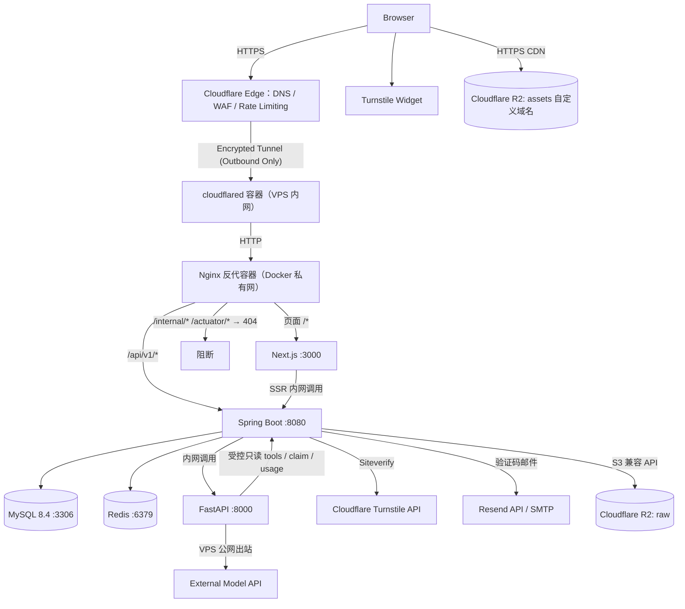
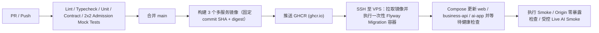

# Large-Lunch-Model：VPS 与 Cloudflare 部署要求

- 版本：v0.4；更新日期：2026-11-26（Australia/Sydney）。
- 状态：待实现的部署要求与默认方案（取代早期 v0.2 的 AWS ECS Fargate 方案）；尚未开通 VPS、配置 Cloudflare Tunnel / R2、验证发信域名或测得运行费用。
- 上位基线：[技术栈与架构要求](../tech-stack-requirements.md)。
- 相关文件：[User Stories 与验收](sprint-1-mvp-and-user-stories.md)、[数据要求](data-requirements.md)、[本地开发要求](local-development.md)。
- 已确认方向：**全面采用 VPS + Docker Compose + Cloudflare（DNS / WAF / Rate Limiting / Turnstile / Tunnel / R2）**，不再使用 AWS（ECS Fargate、ALB、NAT Gateway、RDS、S3、CloudFront、Cognito、AWS WAF、Private CA、Terraform）。身份认证改由 Java Spring Boot（Spring Security + 双 Token + Redis + MySQL）自建闭环，对齐中国大陆成熟的 Spring Boot 工程实践。
- 节点与数据位置建议：VPS 优先选择悉尼（Sydney）或新加坡（Singapore）机房以降低澳洲用户延迟；Cloudflare Edge 与 R2 为全球网络；外部 model provider inference 的处理位置取决于具体 provider，不能由 VPS 地域推断。

## 1. 部署目标与阶段

首轮目标是在一台配置合理、受 Cloudflare 保护的 VPS（staging 环境）上运行一条完整选餐与推荐路径：匿名浏览目录 → Spring Boot 邮箱验证码注册并登录 → Turnstile → Java 原子 admission → 有来源的 seed data 查询与过滤 → 一个 model provider → Java 校验 → 页面展示。匿名用户仍可浏览、搜索和打开外部链接；任何新付费 AI generation 均不得通过匿名 API 或公开概览 cache miss 绕过上述入口。

本地开发不依赖远程 VPS、Cloudflare 账号或真实发信服务。只有进入远程部署时，才需要准备 VPS、域名、Cloudflare Zone / Tunnel / R2 / Turnstile、发信服务（Resend / SMTP）与 model provider credentials。

| 阶段 | 必须具备 | 按实际功能加入 |
| --- | --- | --- |
| 首轮 staging（单台 VPS） | 1 台 Linux VPS（推荐 2C4G 起步、4C8G 更稳）、Docker Engine + Compose v2、Cloudflare DNS / WAF / Rate Limiting / Turnstile / Tunnel（`cloudflared`）、内网 Nginx 反代、Next.js + Java + Python 容器、MySQL 8.4 + Redis 容器、Cloudflare R2（raw / assets / backups 三桶）、Resend / SMTP 发信、GitHub Actions + GHCR 部署脚本、一次性 Flyway migration 路径、每日定时加密备份到 R2 | 轻量监控告警（Uptime Kuma / Prometheus + Alertmanager 或外部 webhook 告警） |
| 受控 Beta / production | 独立环境（独立 VPS 或严格隔离的 Compose 项目/数据库/R2 桶/Secrets）、完整恢复演练证据、容量与成本上限、日志轮转与磁盘告警、明确维护与故障责任 | 独立托管 MySQL（如必要）、第二台应用 VPS 水平扩展（共享同一 MySQL ledger 与 R2） |
| 自动 ingestion（后续） | 独立 ingestion worker 容器（Docker Compose profile 或独立轻量任务机）、数据库任务表或轻量队列（Redis Stream / RabbitMQ）、幂等与重试、失败死信记录 | cron / 定时调度触发；仅在需要定时获取来源时启用 |

首轮手工导入由 operator 使用拥有 `catalog:import` 权限的管理员账号登录，经 Cloudflare Tunnel → Nginx 的 `/api/v1/admin/ingestion/*` 调用 Java；来源登记、review、publish 分别校验对应 RBAC 权限。内部 `/internal/v1/*` 接口只在 Docker Compose 私有内网暴露，绝不经 Nginx 映射到公网。Flyway migration 由一次性 `migration` 容器在部署前执行，直连内网 `mysql:3306`。

用户预算使用 `MENU_SUBTOTAL`：所选菜品、规格、必选加料、实际选择的可选加料和数量计入；delivery fee 与平台 service fee 另列。VPS / Cloudflare / 外部 API 费用是团队基础设施开支，与用户的餐饮预算相互独立。

## 2. 环境与资源隔离

- `local`、`staging`、`production` 使用完全独立的配置、数据库、Redis 实例/密码、R2 buckets、JWT 签名密钥、Turnstile live keys、发信凭证和 model usage 配额。
- 首轮仅部署 `staging`；`production` 在完成首轮验收并确有对外上线需求后独立创建（优先独立 VPS，避免测试操作波及生产数据）。
- `staging` 不复制 `production` 的真实用户邮箱、密码哈希或私人对话；演示使用可分发 fixture 或获准样本数据。
- 容器、卷与 R2 资源统一采用 `llm-<environment>-<component>` 命名，其中 `llm` 为项目缩写。
- 所有 Docker base images、MySQL / Redis / Nginx / `cloudflared` 版本号均固定明确版本 tag（或 digest），禁止在部署配置中使用可变 `latest`。

## 3. 网络架构与流量路径

### 3.1 VPS 防火墙与零公网业务端口（核心安全边界）

采用 **Cloudflare Tunnel（`cloudflared`）** 是本方案防源站暴露的核心机制：

- **UFW / 主机防火墙默认拒绝所有入站（default deny incoming）**：VPS 公网**完全关闭** `80`、`443`、`3000`、`8080`、`8000`、`3306`、`6379` 等全部业务与数据端口。
- 仅开放受控的运维 SSH 入口（禁用密码登录、仅允许 SSH 密钥，推荐进一步结合 Tailscale 私有组网或固定管理 IP 白名单；禁用 root 直接密码登录）。
- `cloudflared` 在 VPS 内部主动向外建立加密隧道连接 Cloudflare Edge，因此：
  - 攻击者无法通过扫描 VPS 公网 IP 直接绕过 Cloudflare WAF / Rate Limiting 访问应用；
  - 无需在主机维护不断变化的 Cloudflare IP 白名单，也无需购买或轮换 Origin SSL 证书与 Origin Secret Header；
  - 容器通过 VPS 默认公网出站直接访问外部 Model API、Turnstile Siteverify、Resend/SMTP 与 R2，无需额外 NAT Gateway。
- Docker 端口绑定强制约束：`compose.prod.yaml` 中所有业务容器（`nginx`、`web`、`business-api`、`ai-app`、`mysql`、`redis`）**一律不配置 `ports:` 映射到宿主机 `0.0.0.0`**（防止 Docker 自动写 `iptables` 规则绕过 UFW 暴露端口）。确需本机运维调试时仅允许绑定 `127.0.0.1`。

### 3.2 内网 Nginx 路由与安全规则

| 入口 / 路径 | 路由与约束 |
| --- | --- |
| `/` 及前端页面路由 | 转发至 `http://web:3000`；不设置可任意透传内部 URL 的通用代理 |
| `/api/v1/*` | 转发至 `http://business-api:8080`；设置请求体大小上限（普通 API 按需，AI 路由严格约束至 `32KB` 左右与 Java 校验对齐） |
| `/api/v1/recommendations/stream` | 转发至 `http://business-api:8080`；显式配置 `proxy_buffering off`、`proxy_cache off`、`proxy_http_version 1.1`、`proxy_set_header Connection ""`、`proxy_read_timeout 120s`、`X-Accel-Buffering: no` |
| `/api/v1/auth/*` | 转发至 `http://business-api:8080`；透传 `Cookie`、`Set-Cookie`、`Origin`、`Host` 与可信客户端 IP；响应显式 `Cache-Control: no-store` |
| `/api/v1/admin/*` | 转发至 `http://business-api:8080`；由 Java Spring Security 校验管理员 / 审核 / 导入 RBAC 权限，普通登录用户返回 403 |
| `/internal`、`/internal/*`、`/actuator`、`/actuator/*`、`/v3/api-docs*`、`/swagger-ui*`、`/doc.html` | Nginx 高优先级直接返回 `404`，绝不转发至 Java 或落入 Next.js |
| `ai-app:8000` | 不在 Nginx 中配置任何公开路由；仅在 Docker 内部私有网络接受 `business-api` 的请求 |

- **可信客户端 IP 传递**：Nginx 仅信任来自 Docker 私有网段内 `cloudflared` 容器的 `CF-Connecting-IP` 头，并将其标准化传递给 Java；Java 仅在可信代理链下读取该 IP，绝不轻信客户端伪造的任意 `X-Forwarded-For`。
- **路径规范化与纵深防御**：Nginx 阻断 `/internal/*` 与 `/actuator/*` 只是第一道门，Java Spring Security 仍必须独立校验内部服务 Token 与管理角色，并做路径大小写、编码变体的负向测试。

### 3.3 DNS、TLS、Edge 防护与缓存隔离

- 应用主域名（如 `staging.<domain>`、`<domain>`）DNS 由 Cloudflare 管理，通过 Tunnel CNAME 指向对应 `*.cfargotunnel.com` 并启用橙云 Proxy；SSL/TLS 加密由 Cloudflare Edge 终止并经加密隧道直达 `cloudflared`。
- 静态素材自定义域名（如 `assets.<domain>`）绑定至公开 R2 桶 `llm-<env>-assets`，与主站 API 域名隔离，避免共享 Cookie 或缓存策略污染。
- **缓存规则（严格隔离私有数据）**：
  - Cloudflare Cache Rules 对 `/api/v1/*`（含 `/api/v1/auth/*`、`/api/v1/conversations/*`、`/api/v1/recommendations/*`）与所有私人页面强制 `Bypass Cache`；
  - SSE 与私有 API 响应由 Java 返回 `Cache-Control: private, no-store`，禁止任何 CDN 缓存、HTML 注入改写或缓冲优化（关闭可能干扰流式响应的优化项）。
- **统一保护认证入口与 AI 入口（相比 AWS 方案的重大简化）**：
  - 由于登录、注册、发邮箱验证码接口（`/api/v1/auth/*`）直接位于自家域名下，**全部天然处于同一套 Cloudflare WAF、Rate Limiting 和 Turnstile 保护之下**，不再需要单独维护另一套云厂商 WAF。
  - Cloudflare Rate Limiting 按路径分组配置（需按实际 Cloudflare plan 的规则条数上限核实）：
    1. 认证敏感写入口：`/api/v1/auth/email-codes`、`/api/v1/auth/register`、`/api/v1/auth/login`、`/api/v1/auth/password/reset`（严格 IP 速率限制）；
    2. 付费 AI 入口：`/api/v1/recommendations/stream` 及按需 AI 概览刷新；
    3. 公开目录浏览：`/api/v1/restaurants`、`/api/v1/menu-items`（宽松防爬限流）。
  - 对 API / SSE 路径的 WAF / 限流动作使用 **Block / 429 JSON 或纯状态码**，**禁止**向 `/api/v1/*` 插入 HTML Managed Challenge；人机交互统一由前端页面的 Turnstile widget 完成。前端必须识别 Edge 直接返回的非 JSON 403 / 429 并给出可恢复提示。

### 3.4 Turnstile 服务端验证规则

- 需执行 Turnstile 校验的入口：
  - `POST /api/v1/recommendations/stream`（`action=ai_chat`）及按需 AI 概览生成/刷新（独立 action，如 `ai_overview`）；
  - `POST /api/v1/auth/email-codes`（`action=auth_email_code`）；
  - `POST /api/v1/auth/register`（`action=auth_register`）；
  - `POST /api/v1/auth/password/reset`（`action=auth_password_reset`）；
  - `POST /api/v1/auth/login`（达到连续失败阈值或高风险策略时触发 `action=auth_login`）。
- 仅前端展示 widget 不构成防护，Java 必须调用 Cloudflare Siteverify 校验 `success=true`、匹配允许的 `hostname` 与对应接口的 `action`。
- Token 有效期 300 秒、一次性使用；验证失败返回 `403 BOT_VERIFICATION_FAILED`，Siteverify 超时或不可用返回 `503 BOT_VERIFICATION_UNAVAILABLE`（fail closed，绝不跳过验证）。
- `TURNSTILE_SECRET_KEY` 仅保存在 VPS 私有环境变量并只注入 `business-api` 容器；浏览器只获得公开的 `NEXT_PUBLIC_TURNSTILE_SITE_KEY`。
- staging 与 production 必须使用各自的 live keys，启动时拒绝 `mock` / `test` mode 或官方测试 key。

## 4. VPS 容器运行、资源规划与流式传输

### 4.1 推荐 VPS 规格与内存预算

单台 VPS 同时运行 Next.js、Spring Boot（JVM）、FastAPI、MySQL 8.4、Redis、Nginx 和 `cloudflared` 时，**2 GB 内存极易 OOM**，推荐最低配置为 **2 vCPU / 4 GB RAM**（推荐 **4 vCPU / 8 GB RAM** + 40–80 GB NVMe 磁盘 + 合理 swap 兜底，但业务运行不得依赖 swap）。

以 **4 GB RAM** 起步为例的容器内存预算参考（实际数值在首次部署启动压测后校准）：

| 容器服务 | 内部端口 | 内存上限参考（4GB VPS） | 关键运行约束 |
| --- | --- | --- | --- |
| `mysql`（MySQL 8.4） | `3306` | `1024M`（`innodb_buffer_pool_size=384M`–`512M`） | 仅内网可达；独立数据卷；独立 runtime DML 与 migration DDL 账号 |
| `business-api`（Spring Boot） | `8080` | `1024M`（`-Xms256m -Xmx512m`） | 唯一业务库写入者；持有 JWT 密钥、Turnstile secret、R2/邮件凭证 |
| `web`（Next.js） | `3000` | `512M` | 公开目录 SSR；无 DB、无 model key、无 Turnstile secret |
| `ai-app`（FastAPI） | `8000` | `512M` | 持有外部 model provider API key；无 DB 凭证；只通过内网受限 API 调 Java |
| `redis`（Redis 7.x） | `6379` | `256M`（`maxmemory 192mb` + LRU 策略） | 开启密码认证；负责验证码、登录态/撤销缓存与目录缓存 |
| `nginx` + `cloudflared` | `80` / 无 | 合计 `~256M` | 统一内网路由、SSE 透传、隐藏内部端点、出站隧道 |
| OS 与突发余量 | — | `~512M` | 防止宿主机内核 OOM killer 误杀数据库 |

> **多副本验证说明**：即使生产/staging 初期按单副本运行，项目仍提供独立的 Compose multi-replica override 配置（如 `2 Java + 2 AI` 共享同一 MySQL，由 Nginx upstream 负载均衡），用于在本地 CI 及 staging 首次发布前验证跨实例共享 admission ledger、并发锁与无缝/滚动重启行为。

### 4.2 容器安全与健康检查

- 所有业务容器采用非 root 用户运行，关闭特权模式，设置 `restart: unless-stopped` 与合理 `stop_grace_period`（graceful shutdown）。
- 明确目标 CPU 架构（如 Apple Silicon 本地开发构建 `linux/amd64` 或匹配 ARM VPS 的 `linux/arm64` 镜像），CI 统一按目标 VPS 架构构建，不混用模拟执行结果。
- 健康检查与探针：
  - `web`：`/healthz`
  - `business-api`：`/actuator/health`（仅在 Docker 内网供 healthcheck 与运维排查使用，不对外开放）
  - `ai-app`：`/healthz`（严禁调用外部 LLM）
- **SSE 与超时对齐**：
  - 初始值保持与架构契约一致：provider connect timeout `5s`、LLM operation deadline `60s`、Java request deadline `90s`、SSE heartbeat `15s`、Nginx proxy read/send timeout `120s`。
  - Cloudflare Proxy 空闲读超时通常为 `100s`；依赖每 `15s` 实际输出的 SSE heartbeat bytes 保活，并必须在真实 `Cloudflare → Tunnel → Nginx → Java → FastAPI` 链路上实测首包时间、逐段 flush、客户端取消传播和超时终态。

## 5. 数据存储、对象存储与邮件服务

### 5.1 MySQL 8.4（VPS 容器化持久存储）

- 使用与本地/CI 一致的 MySQL 8.4 LTS 固定版本镜像，字符集 `utf8mb4`，时区统一 `UTC`（营业时间以 IANA `Australia/Sydney` 存储和解释）。
- 数据持久化在独立 Docker named volume 或宿主机挂载目录（权限最小化）；严禁把数据库文件放入 Git 仓库。
- 严格区分三个数据库角色：
  - `root`：仅首次初始化使用，不配置进任何应用容器；
  - `llm_migrator`：仅一次性 Flyway migration 容器使用，拥有 DDL 权限；
  - `llm_app`：仅 `business-api` 使用，仅拥有业务表的 DML 权限（无 `DROP` / `ALTER` / `GRANT`）。
- 连接池上限按最大 Java 容器数规划，并为目录查询预留连接容量，确保 AI 流量饱和时普通浏览仍正常响应。

### 5.2 Redis 7.x（认证支撑 + 缓存）

- 在重构后的 Spring Boot 自建认证架构中，Redis 成为**首轮必选基础设施组件**，承担以下职责：
  1. 邮箱 6 位验证码存储（带 TTL、60s 发送冷却、错次计数）；
  2. 登录失败防爆破计数与短期冷却；
  3. 登录态 / 撤销黑名单快速缓存（`auth:revoked:sid:*`、`auth:user:min_iat:*`、`auth:user:status:*`）；
  4. 热门目录查询缓存（带 `catalog_revision` 版本号）与 AI 限流预筛。
- **关键降级与权威边界**：
  - **认证撤销可靠性**：Redis 仅作为高速缓存层；当 Redis 短暂不可用时，Java 鉴权过滤器对受保护接口回查 MySQL `auth_session` 与 `users` 表（或 fail closed），绝不因为 Redis 重启而让已注销 Token 或已禁用账号重新生效。
  - **AI 配额权威性**：AI 并发 slots、每日 request / token 额度**始终以 MySQL admission ledger 为唯一权威**，绝不在 Redis 故障时切到本地内存计数器。
- Redis 开启密码认证（`requirepass`），可开启适量 AOF 持久化减少重启后缓存冷启动，但不把 Redis 当作不可丢失的业务事实库。

### 5.3 Cloudflare R2（替代 AWS S3 + CloudFront）

利用 Cloudflare R2 的 **S3 兼容 API** 与**零出口流量费**特性，划分三个独立 bucket：

| Bucket 命名模板 | 访问权限 | 内容与用途 |
| --- | --- | --- |
| `llm-<env>-raw` | 私有（禁止公开访问） | 获准留存的原始菜单 PDF/图片、抓取响应与清洗中间产物；仅 Java / 后续 ingestion worker 持有 R2 API credentials 访问 |
| `llm-<env>-assets` | 自定义域名公开只读（Cloudflare CDN） | 获准公开展示的门店/菜品图片与 Persona 静态素材；文件名带版本或 content hash，撤回授权时同步删除对象并 purge Cloudflare cache |
| `llm-<env>-backups` | 私有（独立写/备凭证） | 定时加密的 MySQL 逻辑备份与删数/撤销审计归档，与应用读写凭证隔离 |

- Java 使用标准 S3 SDK（配置 R2 Endpoint）签发受限 presigned upload URL（限定 key、有效期、文件类型和大小），上传完成后校验对象 metadata 再写入 MySQL `SourceRecord`。
- 所有来源的 retention / 删除规则同样覆盖 R2 对象与生命周期规则；禁止留存的来源不得先写入 `raw` 桶。

### 5.4 发信服务（Resend API / SMTP）

- 注册、邮箱验证与密码重置的 6 位验证码通过 **Resend HTTP API**（推荐，澳洲/国际邮箱送达率稳、免费额度够初期使用）或标准 **SMTP**（如 Postmark、Mailgun 或企业邮箱）发送。
- 在 Cloudflare DNS 为发信子域名配置完整的 **SPF、DKIM、DMARC** 记录，降低验证码邮件进垃圾箱的概率。
- 邮件正文只包含 6 位一次性验证码、有效期（如 10 分钟）与安全提示，不回显用户密码，也不在应用常规日志中打印明文验证码。

## 6. 密钥管理、CI/CD 与发布流程

### 6.1 密钥与配置隔离

- 线上环境变量存放在 VPS 宿主机受限目录（如 `/opt/large-lunch/env/.env.staging`，权限 `chmod 600`，仅部署账号可读），**严禁提交 Git、写入 Docker image layer 或暴露给前端 `NEXT_PUBLIC_*`**。
- 按容器最小化分发环境变量：
  - `web` 仅拿到公开站点配置（`NEXT_PUBLIC_TURNSTILE_SITE_KEY`、公开 assets 域名等）与内网 `BUSINESS_API_INTERNAL_URL`；
  - `business-api` 持有 `DB_APP_*`、`REDIS_PASSWORD`、`JWT_SIGNING_SECRET`、`TURNSTILE_SECRET_KEY`、`MAIL_API_KEY` / SMTP 凭证、R2 凭证与 `BUSINESS_TO_AI_TOKEN`；
  - `ai-app` 仅持有 `MODEL_PROVIDER_API_KEY`、`BUSINESS_TO_AI_TOKEN`（校验入站）与 `AI_TO_BUSINESS_TOKEN`（受限回调用途），**绝不持有数据库密码、JWT 密钥、邮件密钥或 R2 凭证**；
  - `migration` 容器仅在执行迁移时注入 `DB_MIGRATION_*`。
- 关键密钥轮换策略（`JWT_SIGNING_SECRET`、内部服务 Token、R2 Token、Tunnel Token）记录 owner 与轮换步骤，支持多密钥 `kid` 平滑轮换 JWT 签名密钥以免误踢全部在线用户。

### 6.2 GitHub Actions + GHCR + VPS 发布流水线

- 第三方 GitHub Actions 固定可审查的 commit SHA；不可信 fork PR 禁止访问部署 SSH 密钥或真实 provider credentials。
- **发布严格顺序**：
  1. CI 全量检查通过（使用 mock provider 与本地测试库）；
  2. 构建并推送三个不可变镜像至 GHCR，记录 image digests、schema migration version、AI config version；
  3. 发布前在 VPS 触发一次增量/发布前 MySQL 逻辑备份；
  4. 运行一次性 `docker compose run --rm migration` 执行 Flyway，**失败则立即中止发布**；
  5. 以明确 digest 更新 `business-api`、`ai-app`、`web` 容器并等待健康检查通过（避免应用容器启动时各自抢跑 Flyway）；
  6. 执行 staging smoke 检查：目录查询、注册/邮箱验证码/登录/刷新/退出、Turnstile 校验、公网端口扫描确认 80/443/3306 不可直连、一条受控真实 provider smoke。
- **回滚策略**：应用代码回滚直接切回上一版验证过的 GHCR digest；数据库遵循向前兼容（expand-and-contract）迁移原则，不把整库恢复当作日常无损应用回滚。

## 7. 监控、成本控制与备份恢复

### 7.1 最小监控与日志

- **结构化日志**：Java（MDC）、FastAPI、Next.js 与 Nginx 统一输出带 `request_id` 的 JSON 日志；Docker 配置 `json-file` 日志驱动的 `max-size` 与 `max-file` 轮转，防止日志打满 VPS 磁盘。
- **日志脱敏硬约束**：严禁记录明文密码、邮箱验证码、Access/Refresh Token、Turnstile Token、完整 Prompt、完整私人聊天记录或原始用户 IP。
- **核心告警项**（可通过轻量监控如 Uptime Kuma + VPS cron 巡检脚本推送至 Telegram / Discord / Slack / Email）：
  - 站点 HTTPS 可用性与 `/api/v1/restaurants` 健康探活失败；
  - 容器异常重启、CPU/内存接近上限（特别是 JVM 与 MySQL）；
  - VPS 磁盘剩余空间低于 20%；
  - MySQL 定时备份脚本失败或 R2 上传校验失败；
  - AI 异常指标：Turnstile 失败激增、连续 `429`/`503`、provider 超时率飙升、未结算 `RECONCILIATION_REQUIRED` 记录滞留。

### 7.2 成本估算工作表（部署前核实）

相较原 AWS ECS Fargate + Private CA + NAT Gateway + ALB + RDS + Cognito WAF 方案，本方案大幅降低了零流量固定成本。首次上线前仍须如实记录以下实际账单输入：

| 成本类别 | 必填估算输入 | 备注 |
| --- | --- | --- |
| VPS | 厂商、地域（悉尼/新加坡）、规格（2C4G / 4C8G）、月费与流量包 | 单机首轮起步成本可控 |
| Cloudflare | Zone plan（Free / Pro）、WAF / Rate Limiting 规则额度、Turnstile 配额、Tunnel 流量 | 核实 Free Plan 规则条数是否满足首轮防护需求 |
| Cloudflare R2 | 3 个桶的存储容量、Class A/B 请求数 | 出口流量免费，但写入/列表操作需看免费额度上限 |
| 域名与发信 | 域名年费、Resend / SMTP 月免费额度与超额单价 | 严格靠 Turnstile + 冷却限流防止恶意刷邮件费用 |
| 外部 Model API | 单个 provider 的 input/output token 单价、每日全局 10 万 token 上限对应最高日花费 | 在 provider 后台同步设置月度消费硬上限（hard spend limit） |

### 7.3 MySQL 备份与恢复演练（VPS 关键自运维项）

由于不使用托管 RDS，备份与恢复必须作为**硬性上线前置验收项**，绝不能只“配了定时任务就算有备份”：

1. **自动化加密备份**：VPS 每日定时（如澳洲时间凌晨 03:00）通过 `mysqldump --single-transaction --routines --triggers --hex-blob` 导出逻辑备份，使用 `zstd`/`gzip` 压缩并用公钥加密（如 `age` / `gpg`），经 `rclone` 或 S3 CLI 上传至私有 R2 桶 `llm-<env>-backups`；本地仅短留最近 2–3 天，R2 保留 staging 7 天 / production 14 天（受来源 retention 约束）。
2. **恢复演练（staging 至少实测一次）**：
   - 将加密备份从 R2 拉取到隔离测试容器解密并恢复到全新 MySQL 实例；
   - 核对 schema 版本、已发布菜单、来源引用、`users` / `auth_session` / `quota_bucket` 完整性，并跑通一条登录与查询路径；
   - 在恢复环境开放前，重放恢复点之后的来源撤销、内容到期删除清单及安全会话撤销记录（删除/撤销审计清单独立归档，不含已删正文）；
   - 记录实际恢复耗时（RTO）、数据回退窗口（RPO）和失败排查步骤。
3. **菜单误发布优先业务撤回**：错误菜单优先通过 Java Admin API `withdraw` 与重新发布修复，不轻易回滚整库。

## 8. 上线前交付与验收清单

- [ ] VPS 规格、地域、域名、Cloudflare account/plan、R2 桶、发信域名（SPF/DKIM/DMARC）和月度费用上限已记录。
- [ ] UFW 与外部端口扫描证实：VPS 公网 `80 / 443 / 3000 / 8080 / 8000 / 3306 / 6379` 均不可直连；所有业务流量只能经 Cloudflare Tunnel 进入。
- [ ] 公网访问 `/internal/*`、`/actuator/*`、`/swagger-ui*`、`/v3/api-docs*`、`/doc.html` 均返回 `404`；普通用户调用 `/api/v1/admin/*` 返回 `403`。
- [ ] 匿名浏览正常；匿名、未验证邮箱、已禁用账号、已注销旧 Access Token 均无法调用任意付费 AI 生成接口。
- [ ] Spring Boot 自建注册（邮箱 6 位验证码）、登录、Access/Refresh Token 轮换、旧 Refresh Token 重放撤销整条 family、退出立即失效、找回密码踢下线全部旧端均通过 E2E。
- [ ] Turnstile 在发验证码、注册、找回密码、AI 聊天入口均经 Java 服务端校验；缺失/重放/错 host/错 action/Siteverify 不可用全部 fail closed，且 staging 拒绝 mock/test 模式。
- [ ] 隔离 local / CI 的 `2 Java + 2 AI`（共享 MySQL + barrier mock）并发测试通过：50 用户全局 active ≤ 5、单用户 10 tab active ≤ 1、20 同 key 请求至多 1 次 dispatch、Redis 故障时仍以 MySQL admission 与撤销表为准。
- [ ] 真实 Cloudflare → Tunnel → Nginx → Java → FastAPI 链路验证 SSE 分段到达、15 秒 heartbeat 保活、客户端取消传播、timeout 终态，且未被插入 HTML Managed Challenge。
- [ ] `llm-<env>-raw` 与 `llm-<env>-backups` 无匿名访问；`llm-<env>-assets` 仅公开获准素材。
- [ ] 至少完成一次完整的 R2 加密备份拉取、解密与隔离恢复演练并留存耗时记录。
- [ ] 日志脱敏核查无密码/验证码/Token/完整聊天，磁盘轮转配置生效，告警通道已实际触发验证。

## 9. 参考文档说明

- [Cloudflare Tunnel 文档](https://developers.cloudflare.com/cloudflare-one/connections/connect-networks/)：零公网入站端口源站接入。
- [Cloudflare Turnstile server-side validation](https://developers.cloudflare.com/turnstile/get-started/server-side-validation/)：Siteverify、`action` / `hostname` 校验与一次性语义。
- [Cloudflare R2 S3 API 兼容性](https://developers.cloudflare.com/r2/api/s3/api/)：对象存储、Presigned URL 与自定义域名分发。
- [Cloudflare WAF / Rate Limiting](https://developers.cloudflare.com/waf/rate-limiting-rules/)：按路径限流与 plan 限制核查。
- [Docker Compose 生产与网络说明](https://docs.docker.com/compose/how-tos/networking/)：容器内网隔离与非公网端口暴露。
- [Spring Security Architecture](https://docs.spring.io/spring-security/reference/servlet/architecture.html)：过滤器链、BCrypt 与方法级权限控制。
