# Large-Lunch-Model：本地开发要求

- 文档版本：v0.3。
- 更新日期：2026-11-26（Australia/Sydney）。
- 状态：待实现的 development contract；当前 repository 只有设计文档，没有 application、Compose、Makefile、migration 或 seed importer。
- 本文中的目录、环境变量与 commands 是初始化时必须实现和验证的约定，不代表今天已经可以运行。
- 上游约定：[User Stories](sprint-1-mvp-and-user-stories.md)、[总体架构](../tech-stack-requirements.md)、[数据要求](data-requirements.md)、[VPS 与 Cloudflare 部署要求](deployment-requirements.md)。

## 1. 本地环境要达到什么结果

一位开发者应能在不开通远程 VPS、Cloudflare 账号或提供真实 model API key / 发信 API key 的情况下，通过 synthetic fixtures、本地 **Mailpit** 邮件捕获与 deterministic mock provider 完成以下真实闭环路径：

**匿名浏览目录 → 站内邮箱 6 位验证码注册（Mailpit 收码）并登录 → 提交菜品预算与 AI 消息 → Java 校验双 Token 会话、Turnstile（mock）与 admission quota → 查询已发布 Offer → Python 返回结构化候选 → Java 复核 ID、版本、预算和禁忌 → 页面展示推荐与来源。**

首轮必须包含 Spring Boot 自建认证（双 Token 轮换、退出即时撤销、密码重置踢下线）、配额、并发和失败路径；线上部署采用 **VPS + Docker Compose + Cloudflare Tunnel / R2**，本地开发与线上保持高度同构。

预算使用 `MENU_SUBTOTAL`：包含所选规格、必选加料、实际选择的可选加料及数量；配送费和平台 service fee 不计入预算，分别展示为已知金额或未知。Budget object 示例为 `{"amount":"25.00","currency":"AUD","scope":"MENU_SUBTOTAL"}`；金额的详细规则以[数据要求](data-requirements.md)为准。

本地 mock 通过只能说明 application contract 与自建认证链路可运行。真实 provider、真实来源数据、真实发信送达（Resend / SMTP + SPF/DKIM/DMARC）、live Turnstile Siteverify、Cloudflare WAF / Tunnel / R2、VPS 零公网端口与 R2 备份恢复仍有独立 staging 验证要求。

## 2. 默认拓扑与地址

默认使用 host processes 运行三类 application，以便调试和 hot reload；Docker Compose 运行 MySQL 8.4、Redis 7.x 与 Mailpit。

| 组件 | 运行位置 | 默认监听 | 职责 |
| --- | --- | --- | --- |
| Next.js | Host process | `127.0.0.1:3000` | 页面、公开目录 SSR、站内认证表单、本地 `/api/v1` proxy |
| Spring Boot | Host process | `127.0.0.1:8080` | Business API、自建 Spring Security 认证、数据发布与最终校验 |
| FastAPI | Host process | `127.0.0.1:8000` | AI orchestration、mock / real provider adapter |
| MySQL | Docker container | Host `127.0.0.1:3306` → container `3306` | 业务持久化、用户/会话表、AI admission 权威账本 |
| Redis | Docker container | Host `127.0.0.1:6379` → container `6379` | 邮箱验证码、登录防爆破、会话撤销缓存、目录缓存；不作为 AI admission 权威账本 |
| Mailpit | Docker container | SMTP `127.0.0.1:1025` / Web `127.0.0.1:8025` | 捕获本地注册与找回密码 6 位验证码邮件，无需外网发信 |
| 原始资料 storage | Host filesystem | 不提供公开 HTTP 目录 | Raw / processed 文件（线上切换 Cloudflare R2） |

```mermaid
flowchart LR
    browser["Browser :3000"] --> web["Next.js"]
    web -->|"/api/v1 proxy 或 SSR"| java["Java :8080"]
    java --> mysql[("MySQL :3306")]
    java --> redis[("Redis :6379")]
    java --> mailpit["Mailpit SMTP :1025"]
    java -->|"内部请求"| ai["FastAPI :8000"]
    ai -->|"只读 tools"| java
    importer["Import CLI / worker"] -->|"管理员 / 独立 ingestion 身份"| java
    importer --> raw["Private local raw files"]
```

### 2.1 Browser、SSR 和内部调用

- Browser 使用相对路径 `/api/v1/...`，由 Next.js development rewrite 转发到 Java；不向浏览器发布内部服务地址或内部 credentials。
- 首轮 SSR 只查询公开目录，使用 server-only `BUSINESS_API_INTERNAL_URL`，本地值为 `http://127.0.0.1:8080`。私人页面使用 browser client fetch；内存 token 不会自动出现在 SSR 请求里。
- Java 使用 `AI_INTERNAL_URL=http://127.0.0.1:8000` 调用 AI service。
- Python tools 使用 `BUSINESS_API_INTERNAL_URL=http://127.0.0.1:8080` 调用 Java 内部只读 API。
- Proxy 只匹配 `/api/v1` 及其子路径，不代理 `/internal/v1`、Actuator 或本地管理调试路径。
- 同源 proxy 不代替身份验证；Java 继续验证用户与管理员权限。采用 cookie 时还须处理 CSRF；采用 bearer token 时不得把 token 放入 URL。
- 本地 SSE 必须穿过实际 Next.js proxy 验证首段到达、持续输出与取消；若选定版本的 rewrite 不满足要求，应实现并验证透传 Route Handler。
- 线上入口经过 Cloudflare Edge → Cloudflare Tunnel（`cloudflared`）→ VPS 内网 Nginx 将 `/api/v1` 路由到 Java；本地 proxy 和线上入口使用相同 API contract，部署时不能依赖本地 rewrite 才能访问业务。本地 loopback 不能证明 Cloudflare WAF、Tunnel 零公网端口隔离或真实 client IP 传递已经正确。

### 2.2 Container 地址约定

默认 host process 连接 MySQL、Redis 使用 `127.0.0.1` 与 published host port。

以后采用 full-container profile 时，同一 Compose network 内通过 service name，例如 `mysql:3306`、`business-api:8080`、`ai-app:8000` 通信。Container 内的 `localhost` 指向该 container 本身。此时另建 profile 与配置，不静默改变默认 host 开发模式。[Docker Compose networking](https://docs.docker.com/compose/how-tos/networking/)

## 3. Toolchain 与版本锁定

以下是 bootstrap 的选择与验证要求，不是已安装的软件清单。

| 工具 | 初始方向 | 初始化时必须产出的证据 |
| --- | --- | --- |
| Docker Desktop / Engine + Compose v2 | 能运行 Linux containers | Engine ready、Compose 版本、CPU architecture、可用磁盘 |
| Node.js | 与所选 Next.js 兼容的受支持 LTS | 明确版本文件与 CI 相同版本 |
| pnpm | 与 Node.js 兼容 | `packageManager` 字段、`pnpm-lock.yaml` |
| JDK | Java 21 LTS 作为候选 | 与 Spring Boot 3.x、Spring Security 6、MyBatis-Plus / MyBatis、Flyway 的兼容检查 |
| Maven | 使用 Maven Wrapper | 提交 wrapper、校验分发包与 BOM / plugin 版本 |
| Python | Python 3.12 作为候选 | `requires-python`、`.python-version`、依赖安装与测试结果 |
| uv | 项目统一管理 Python dependency | 固定工具版本、提交 `uv.lock` |
| MySQL | 8.4 LTS 作为候选 | 与 JDBC、Flyway、Testcontainers 和 VPS Compose 镜像版本对齐 |
| Redis | 7.x LTS 作为候选 | 固定 image 版本、开启密码认证并验证所用 commands（含 Lua 原子校验脚本） |
| Mailpit | 固定版本 tag | 本地 SMTP 收信与 Web UI / API 检索验证码 |

选择候选版本后，必须形成实际 compatibility matrix，再锁定完整版本。不得把本文候选值描述为已验证组合，也不要独立升级 Spring Boot 和 MyBatis starter。Spring Boot 官方明确第三方 dependency 可能有额外要求。[Spring Boot system requirements](https://docs.spring.io/spring-boot/system-requirements.html)

Docker image 不使用可变 `latest`；CI 与 staging 以同一 lockfile、BOM、image tag / digest 构建。Apple Silicon 与 Linux CI 的 architecture 差异须在 image build 验证中记录。

## 4. 初始化后的 repository 布局

以下路径均相对 repository root，尚待初始化。

| 路径 | 内容 | 是否提交 Git |
| --- | --- | --- |
| `apps/web/` | Next.js application | 是 |
| `services/business-api/` | Spring Boot application、Flyway migrations | 是 |
| `services/ai-app/` | FastAPI、provider adapters、AI tests | 是 |
| `services/ingestion/` | 后续启用的 extraction / worker 代码 | 启用后提交 |
| `tools/ingestion/` | 首轮 Import CLI，调用 Java API 的薄 client | 是 |
| `contracts/` | OpenAPI、JSON Schema、contract fixtures | 是 |
| `data/fixtures/` | Synthetic 或许可允许分发的小型 seed dataset | 是，包含 manifest |
| `data/raw/` | 按来源许可保留的原始文件 | 否 |
| `data/processed/` | 待导入 JSON / CSV 与 extraction 中间结果 | 否 |
| `data/exports/` | 本地 export / backup | 否 |
| `scripts/` | Environment checks、smoke scripts | 是 |
| `compose.yaml`、`Makefile` | 本地基础设施与统一入口 | 是 |
| `.env.example` | 不含真实 secret 的配置说明 | 是 |
| `.env.local` 与服务私有 env files | 本机 credentials 与配置 | 否 |

MySQL 使用 Compose named volume，不能把数据库内部文件作为普通 repository 数据目录提交。Redis 如启用 persistence，也使用独立 named volume；业务事实始终以 MySQL 为准。Named volume 的生命周期独立于 container，删除 container 不等于删除数据。[Docker volumes](https://docs.docker.com/engine/storage/volumes/)

每个 checkout 使用显式 Compose project name；默认 `large-lunch-local`。同时运行多个 worktree 时必须为 project name、host ports、database、cache namespace 和 raw root 分配独立值。

## 5. Environment variables 与 secrets

下表是待实现的配置接口。初始化时需提供按服务分开的 `.env.example`，并说明加载顺序、默认值、必填项与启动校验。

| 变量 | 本地示例 / 含义 | 读取方 |
| --- | --- | --- |
| `APP_ENV` | `local` | 三类 application |
| `JWT_SIGNING_SECRET` / `JWT_KEY_ID` | 本地生成的随机高熵密钥与 `kid` | Java |
| `JWT_ACCESS_TTL_SECONDS` / `REFRESH_TOKEN_TTL_DAYS` | `1200`（20 分钟）/ `7` 天 | Java |
| `AUTH_COOKIE_SECURE` | 本地 HTTP 为 `false`，线上强制 `true` | Java |
| `MAIL_PROVIDER` | `smtp`（本地指向 Mailpit `127.0.0.1:1025`；线上为 `resend` 或真实 `smtp`） | Java |
| `MAIL_FROM_ADDRESS` | `no-reply@local.large-lunch.test` | Java |
| `BUSINESS_API_INTERNAL_URL` | `http://127.0.0.1:8080` | Next.js server、Python |
| `AI_INTERNAL_URL` | `http://127.0.0.1:8000` | Java |
| `DB_HOST` / `DB_PORT` / `DB_NAME` | `127.0.0.1` / `3306` / `large_lunch_local` | Java / migration runner |
| `DB_APP_USER` / `DB_APP_PASSWORD` | 本机独立 DML account | Java |
| `DB_MIGRATION_USER` / `DB_MIGRATION_PASSWORD` | 本机独立 DDL account | Migration runner |
| `REDIS_URL` / `REDIS_PASSWORD` | `redis://127.0.0.1:6379` 与本地密码 | Java |
| `CACHE_NAMESPACE` | `llm:local:<checkout>` | Java |
| `OBJECT_STORE_BACKEND` | `filesystem`（线上为 `r2` S3 兼容协议） | Java / ingestion |
| `RAW_DATA_ROOT` | 指向本 checkout 的 `data/raw` 的绝对路径 | Java / ingestion |
| `AI_PROVIDER_MODE` | `mock` 或 `real` | Python |
| `AI_PROVIDER_ID` / `AI_MODEL_ID` | Mock 模式也记录固定 ID | Python |
| `BUSINESS_TO_AI_TOKEN` | 单独生成的本地 service credential | Java / AI |
| `AI_TO_BUSINESS_TOKEN` | 受 request scope 限制的只读 tools、dispatch claim / usage credential | AI / Java |
| `INGESTION_TO_BUSINESS_TOKEN` | 仅导入权限的 credential | Import client / Java |
| `LOCAL_SEED_ADMIN_EMAIL` / `LOCAL_SEED_ADMIN_PASSWORD` | 仅本地 seed 初始化测试管理员用；绝不用于 staging / production | 本地 seed 脚本 / admin CLI |
| `TURNSTILE_MODE` | `mock`、`test` 或 `live`；含义见 6.1 | Java；Next.js 使用相同的显式 mode |
| `NEXT_PUBLIC_TURNSTILE_SITE_KEY` | Public sitekey；mock 模式不加载 Cloudflare widget | Browser |
| `TURNSTILE_SECRET_KEY` | Siteverify secret；仅 Java 读取，test mode 使用官方 test secret | Java |
| `TURNSTILE_ALLOWED_HOSTNAMES` | 真实环境的明确 hostname allowlist；不接受任意来源 | Java |
| `AI_MAX_ACTIVE_PER_USER` / `AI_MAX_ACTIVE_GLOBAL` / `AI_MAX_ACTIVE_PER_PROVIDER` | `1` / `5` / `5` | Java admission |
| `AI_REQUESTS_PER_USER_PER_MINUTE` / `AI_REQUESTS_PER_USER_PER_DAY` | `5` / `20`；滚动 60 秒与 UTC 日分别计量 | Java admission |
| `AI_TOKENS_GLOBAL_PER_DAY` | `100000`；input + output 的全局 UTC 日预算 | Java admission |
| `AI_MAX_INPUT_TOKENS` / `AI_MAX_OUTPUT_TOKENS` / `AI_MAX_CALLS_PER_TURN` | `6000` / `1000` / `1` | Java contract、Python provider adapter |
| `AI_MAX_MESSAGE_CHARS` / `AI_MAX_REQUEST_BYTES` | `2000` Unicode code points / `32768` bytes；body 读取时即限制 | Java validation；web 同步提示 |
| `AI_QUEUE_ENABLED` | `false`；超出容量立即拒绝，不排无限队列 | Java admission |

三个 service token 名在本地与线上一致，实际值、caller identity、scope 和环境变量分环境隔离。线上部署与轮换遵循[总体架构](../tech-stack-requirements.md)和[VPS 与 Cloudflare 部署要求](deployment-requirements.md)。

上述 AI 数值是首轮可配置默认值，不是已经测得的系统 capacity；quota 的唯一 contract 以总体 framework 为准，修改时同步 fixtures 与部署配置并记录 config version。每日 request quota 计入 provider 已启动或可能已启动的尝试；在启动前原子预留，仅明确未启动失败可释放。滚动 rate limit 独立计算每个新 turn 的提交尝试，验证失败也计入；同 key 查询已有状态不重复计数，不能以 provider 未启动为由无限重试。Input token 上限包含系统指令、历史与候选资料，不能只计算本轮用户文本。

- Service、database、provider 和 admin secret 不使用 `NEXT_PUBLIC_` 前缀，不进入 browser bundle、URL、日志、container image 或 Git。用户 access token 只在其 browser session 内存中使用，不编译进 bundle，也不写 localStorage。
- `.env.example` 只允许非敏感默认值与占位值；启动时拒绝仍为占位符的 credentials。
- 不把完整 root env 自动传给所有服务：Python AI 不应获得 MySQL credentials、ingestion write token 或 admin token。
- Local raw storage 的 read/write、path traversal 防护、source policy 和 retention 仍由 application 管理；不得通过 Next.js `public/` 目录暴露。
- 本地 filesystem adapter 仅模拟应用所需 storage contract。Cloudflare R2（S3 兼容）presigned URL、私有桶权限隔离与公开自定义域名 CDN 行为必须在 staging 单独测试。

## 6. 本地身份与权限边界（真实 Spring Boot 认证）

采用 Spring Boot 自建认证后，**本地环境直接运行与线上完全一致的 Spring Security 6 + 双 Token + Redis + MySQL 认证代码**，仅把外部邮件投递替换为本地 Mailpit 容器，不再需要模拟外部云厂商 IdP：

1. 本地全部服务与端口绑定 loopback（`127.0.0.1`），`AUTH_COOKIE_SECURE=false` 仅允许在 `APP_ENV=local` 生效；staging / production 强制开启 `Secure` Cookie 与严格 `Origin` 校验，启动时检测不安全配置直接 fail closed。
2. 本地可完整走通真实接口：`POST /api/v1/auth/email-codes` → 从 Mailpit Web UI（`http://127.0.0.1:8025`）或自动化测试调用 Mailpit HTTP API 读取 6 位验证码 → `POST /api/v1/auth/register` / `login` / `refresh` / `logout` / `password/reset`。
3. 最小 seed fixture 账号包含：已验证邮箱的普通用户 A / B（`ROLE_USER`）、未验证邮箱用户（`email_verified=false`）、已禁用用户（`status=DISABLED`）以及运营管理员账号（含 `ROLE_OPERATOR`、`ROLE_REVIEWER`、`ROLE_PUBLISHER`）。普通注册绝不会获得任何管理角色。
4. Service credentials 分配不同 audiences / scopes：`BUSINESS_TO_AI_TOKEN`、`AI_TO_BUSINESS_TOKEN`、`INGESTION_TO_BUSINESS_TOKEN` 相互不可替代。
5. SpringDoc OpenAPI / Knife4j 文档 UI 仅允许在 `APP_ENV=local` 启用；staging / production 必须关闭并在 Nginx 层返回 404。
6. Java 对每个私有 API 执行：JWT 验签（签名、`iss`、`exp`、`token_use=access`）→ 查 Redis 会话撤销与禁用缓存（Redis 不可用时回查 MySQL `auth_session` 与 `users` 表）。每次新付费 AI turn 进入 admission 前均查 MySQL 确认 `status=ACTIVE` 与 `email_verified=true`，绝不信任客户端自报字段。
7. AI chat、新生成的推荐及未命中缓存的 AI overview 都走同一身份与配额 gate；匿名可读取公开目录和已批准的缓存概览，cache miss 不得触发后台付费调用。Conversation、message 和 recommendation 归属于服务端确定的 owner；用户 A 访问 B 的 ID 统一返回 `404 NOT_FOUND`，不泄漏资源存在性。
8. Refresh Token 通过 `HttpOnly; SameSite=Lax; Path=/api/v1/auth` Cookie 传输；`POST /api/v1/auth/refresh` 执行 Refresh Token Rotation，并验证“重放已轮换的旧 Refresh Token 会立即撤销整个 `token_family_id`”。
9. `POST /api/v1/auth/logout` 将当前 `auth_session` 在 MySQL 标记 `revoked_at` 并写入 Redis 撤销键、清除 Refresh Cookie；前端清理内存 Access Token、私人缓存并广播给其他 tab。测试复制注销前尚未过期的 Access Token 再次请求私有 API，必须立即被拒绝（包括在停止 Redis 容器的故障注入场景下回查 MySQL 仍被拒绝）。
10. 密码重置（`POST /api/v1/auth/password/reset`）必须更新 `users.token_valid_after` 并撤销全部历史 `auth_session`，使所有旧设备立即下线。
11. 若需要手机或局域网调试，另建明确的局域网 profile 与受控配置，不得把开发默认配置暴露到公网。

### 6.1 Turnstile 的三种验证模式

| Mode | 用途 | 允许环境与通过含义 |
| --- | --- | --- |
| `mock` | Deterministic adapter 模拟 pass、fail、expired、duplicate、timeout 和 hostname / action mismatch | 仅 local / CI；不访问 Cloudflare，不证明真实 Siteverify 可用 |
| `test` | 加载官方 test sitekey，Java 调用 Siteverify 并使用配套 test secret | 仅 local / CI；验证 widget / network / response handling，不证明真实 bot detection |
| `live` | 每个新 AI turn 使用该环境真实 sitekey / secret，Java 调用 Siteverify | staging / production 必须使用；有独立 hostname allowlist |

官方 test keys 用于可重复的自动化测试，不是线上保护；production key 不允许 localhost。只有 public sitekey 可以进入 browser，secret 不进入任何 `NEXT_PUBLIC_*` 变量。[Cloudflare Turnstile testing](https://developers.cloudflare.com/turnstile/troubleshooting/testing/)

Live mode 的 Java 必须验证 Siteverify `success`、预期 `action`（如 `ai_chat`、`auth_email_code`、`auth_register`、`auth_password_reset`、`auth_login`）与 hostname；按需 overview 等其他生成入口启用时使用各自明确 action allowlist 并复用同一 admission service。Token 有效期为 300 秒且只能使用一次。缺失、过期、重复或不匹配均拒绝请求；Siteverify 网络故障也不能跳过验证。客户端获取新 token 后由用户明确重试；已终态失败的 AI request 使用新 key 建立新 turn，不自动提交另一次付费生成。[Turnstile server-side validation](https://developers.cloudflare.com/turnstile/get-started/server-side-validation/)

Test mode 根据官方 dummy response 建立独立、显式的测试 expectation（例如文档中的 `hostname=localhost`、`action=test`），不得据此放宽 live validator。Hostname / action / expiry 的业务拒绝分支由 mock response contract tests 覆盖，并在 staging 使用 live token 重验。CI 使用隔离 runner 与独立测试环境配置，绝不把 CI profile 发布到公网。

同一 owner、同一 `Idempotency-Key`、相同业务 payload 的重试先查已有 request，返回该 request 状态，不重复消费 Turnstile token，也不再次调用 provider。业务 payload hash 排除短期 Turnstile token；并发首次请求由数据库 unique constraint 与 request ownership 保证只有一个 verifier。Siteverify transport retry 使用稳定的 `idempotency_key`。Mock adapter 也必须覆盖这些分支，不能简单对全部请求返回 true。

非 local / CI 环境检测到 Turnstile `mock` / `test` mode、官方 test keys、`AUTH_COOKIE_SECURE=false`、本地测试邮件配置或不完整 live 配置时启动失败；CI profile 本身不得发布到公网。真实 widget 的 CSP 与浏览器加载失败需要单独验证；不得为了使 widget 可用而关闭全部 CSP 或开放任意 CORS。外部 challenge script 不能写入应用 auth token。

### 6.2 Admission 与并发测试拓扑

MySQL 中的 admission ledger 是跨 Java / AI replicas 的统一权威；用户、provider、全局 active slots 与 quota 必须在短 transaction 内原子预留。网络、Turnstile 与 provider 调用不在持有数据库锁的 transaction 中执行。Redis 可以提前筛掉明显超限请求，但 Redis 可用、故障或未启动都不能绕过 MySQL admission。

Python 调用 provider 前必须以 AI service identity 和 Java 签发的 request-scoped context，通过 `POST /internal/v1/ai-requests/{id}/claim` 原子领取唯一 dispatch claim；同一请求的重复 internal stream 调用不能再次领取。只有领取成功才可启动 provider；claim 前后网络结果不确定时不得自动重新 dispatch。通过 `POST /internal/v1/ai-requests/{id}/usage` 幂等回报终态与用量，Python 不直接写 MySQL。该机制保证本系统不会主动重复 dispatch，不宣称第三方 billing exactly-once。

初始化时另提供显式 load-test profile：两个 Java instances 和两个 AI instances 共用测试 MySQL，由测试 router 分散流量；所有 ports 绑定 loopback 或隔离 CI network，不能暴露到公网。Profile 提供可观测 mock provider invocation counter 与 latch，使测试能证明同时在途的调用数，而不只观察 HTTP 返回码。每组测试使用独立 namespace / database；单次 admission 测试中的全部 replicas 必须共用同一 ledger，不能按 process 自动隔离 quota。

- Lease 初值 90 秒，每 15 秒续约，使用 DB 时间与 owner / fencing version；provider connect timeout 5 秒、operation deadline 60 秒、Java request deadline 90 秒、SSE heartbeat 15 秒；线上 VPS Nginx `proxy_read_timeout` / `proxy_send_timeout` 为 120 秒（配合 15 秒 heartbeat 避开 Cloudflare Proxy 100 秒空闲超时）。实现必须验证 deadline、heartbeat 与续约的关系，不能把 lease expiry 当作释放资格。
- Browser disconnect、Cancel、Java crash 或 lease expiry 不等于远端 provider 已停止。对 provider 是否已启动或结束不确定的 request 保留保守 reservation，并进入 bounded reconciliation；不能盲目释放 slot 后立即再次生成。超出 reconciliation deadline 仍无法确认时停止受影响的新 admission 并告警；这些控制不宣称能强制终止 provider 内部计算。
- provider 已启动或可能已启动的失败、timeout 和 Cancel 仍计入每日 request quota；actual usage 有唯一结算 key。Unknown usage 不按零计费，保守保留 token reservation，避免重复扣减或负数；旧 owner 迟到回调不能越过 fencing version 覆盖终态。
- 预留完整 input + 最大 output token 上界；真实 usage 只能在幂等结算后释放多余额度。跨 UTC 午夜的请求保留原 quota bucket 与 active slot，不因新日期而获得额外并发。
- 同 conversation 的两次不同请求使用 version / 条件更新避免历史交错；同一个用户的多 tab 不得到额外 active slot。HTTP / SSE error 与 quota 文案必须与 framework 统一。

## 7. 数据库、migration 与导入

### 7.1 账号与 migration

- Compose 首次启动完成 local database 与两个 application accounts 的 provisioning；普通 Java runtime 不使用 MySQL root 或 DDL 权限。
- Flyway 由一次性 migration runner 执行，使用 migration account；application 启动时只检查 schema version，避免每个实例自动争抢 migration。
- 新 migration 必须从空库运行，并验证从上一 schema version 升级；已发布 migration 不直接改写。
- Schema migration、seed import 和删除数据是三个不同操作；常规启动不能顺带清库或重复生成 seed。
- 本地设置与测试统一 `utf8mb4`、UTC timestamps、DECIMAL 金额；Sydney 营业时间使用 `Australia/Sydney`，测试覆盖 DST 边界。

### 7.2 两种 seed data

| Dataset | 用途 | 发布与展示限制 |
| --- | --- | --- |
| Synthetic fixture | 自动测试、mock E2E、边界案例 | 必须标记 synthetic；不显示为真实可购买餐厅 |
| 真实、来源获准的 pilot seed | 真实 provider smoke 与小范围产品验证 | 保留来源、采集时间、审核、菜单及 OfferVersion；许可限制随数据执行 |

每份可分发 fixture 包含 manifest：`dataset_id`、`dataset_version`、`data_kind`、许可或 synthetic 标记、预期记录数、schema version、内容 hash，以及 synthetic 专用 `reference_time`。Production importer 拒绝 synthetic fixtures；staging 使用 synthetic 时，页面必须明确显示测试数据。

Synthetic 自动化测试使用固定 `reference_time` 与可注入 test clock。交互式本地 fixture 导入可按相对时间生成 synthetic observation，并将生成时间写入 dataset instance manifest；同一 instance 重试幂等，重新生成新 instance 使用新 key。staging / production 禁止 fixture clock 覆盖真实时钟。真实 pilot 菜单绝不能重置 observed_at 假装重新采集，过期必须真实重核。

### 7.3 身份、chat 与 admission fixtures

Flyway 首轮必须创建 User / identity mapping、AuthSession、Conversation、ChatMessage、AIRequest、QuotaBucket、AdmissionLease 和必要的 unique / foreign-key / version constraints；具体字段以[数据要求](data-requirements.md)为准。Fixtures 只使用虚构邮箱、虚构对话与测试身份，不包含真实 access token、密码、Turnstile token 或 provider key。

至少提供 quota 临界值、午夜跨 bucket、已有 active request、stale lease、provider-started 但 usage unknown、已完成幂等 request、同 key 不同 payload、跨 owner 资源和 revoked token family 等状态。Request 生命周期为 `pending / running / completed / failed / cancelled`；独立 admission 生命周期为 `RESERVED / IN_FLIGHT / RECONCILIATION_REQUIRED / SETTLED / RELEASED`。两者不能用同一状态字段混淆。Test clock 只在测试 profile 注入；AI request deadline、quota time window 与 lease 测试使用受控 clock，真实 staging 配额仍使用服务端当前 UTC 时间。安全与 usage ledger 不通过导入目录数据的 ingestion API 创建，测试 fixture 入口不能在 production 暴露。

### 7.4 Import 路径

1. 空库先 migration；admin CLI 通过管理 API 登记 Source policy、Restaurant、Branch。真实来源权限由 operator 核实，不能信任 CSV 自报 ALLOWED。
2. Import client 规范化 CSV / JSON 并校验；使用 `catalog:import` 用户身份调用 `/api/v1/admin/ingestion/source-records` 登记证据，再创建 batch、提交 records chunks、complete 固定 manifest。独立内部 worker API 使用 ingestion service token，二者调用同一 Java application service。
3. Admin CLI 查看 validation report、payload hash、缺失字段与冲突；reviewer 对完整 batch 审核。首轮允许人工 CLI，不依赖管理后台。
4. 有 `catalog:publish` 权限的 publisher 发布；Java 短 transaction 写 immutable versions、current pointers、catalog revision 与 audit。
5. 查询读取 MySQL current revision，使用版本化 cache key 与 TTL；过期条件仍按查询时间检查。首轮不依赖额外失效任务或 queue。
6. 测试 `DRAFT / REVIEWED / PUBLISHED / WITHDRAWN` 和独立的 `FRESH / STALE / UNKNOWN`；拒绝属于 review decision 并退回 DRAFT。

Import client、AI service、Python worker 均不得绕过 Java 直接写业务表。Synthetic fixtures 也走同一 validation / publish service；自动化测试可用测试专用调用入口，但不能削弱业务校验。

## 8. 统一 command contract 与启动顺序

**下列 targets 尚未实现。初始化 PR 应创建它们或在同一次 PR 中更新本文为实际入口；现在直接执行不会启动本项目。**

| 预期 command | 完成条件 |
| --- | --- |
| `make bootstrap` | 校验并锁定 compatibility matrix、安装各语言 dependencies、生成仅本地使用的 env 与随机 fixture credentials，拒绝覆盖现有私有配置 |
| `make doctor` | 检查 toolchain、Docker Engine、ports、env placeholders、CPU architecture，避免输出 secrets |
| `make infra-up` | 启动 MySQL / Redis / Mailpit，等待实际 health checks 通过 |
| `make migrate` | 使用独立账号执行 Flyway，失败时停止后续启动 |
| `make dev-business` | 启动 loopback Java，验证 schema compatibility |
| `make seed-fixtures` | 经 Java API 幂等导入、审核与发布明确标记的 synthetic dataset |
| `make dev-ai` | 启动 FastAPI，默认 deterministic mock provider |
| `make dev-web` | 启动 Next.js，启用本地同源 API proxy |
| `make smoke-local` | 验证匿名目录、已验证用户 AI、Turnstile adapter、预算、SSE、权限与错误路径，输出 request IDs |
| `make test-admission` | 使用隔离 mock profile 的 2 Java + 2 AI 验证 shared ledger、quota、并发、幂等与 crash recovery；不调用真实 provider |
| `make check` | 执行约定的 lint、type check、unit、integration 与 contract checks |
| `make infra-stop` | 停止基础设施，保留 volumes |

首次启动顺序为：`bootstrap → doctor → infra-up → migrate → dev-business → seed-fixtures → dev-ai → dev-web → smoke-local`。三个 `dev-*` processes 分别运行于 terminal 或 process supervisor；不要在等待前台 server 退出后才启动下一服务。

`make bootstrap` 不自动安装系统级 Docker / JDK / Node / Python；缺少 prerequisites 时输出缺项并停止。已选定版本的 repository 中，它必须按提交的 lockfiles 安装，不能每次重新选择版本。

Dependency 安装使用各语言原生工具：pnpm 管理 JS / TS workspace，Maven Wrapper 管理 Java，uv 管理 Python。实现时为每个入口定义明确 working directory 与 lockfile 校验模式。

### 8.1 Health 与 readiness

- Java 本地提供 `/actuator/health`，返回最小状态；readiness 应能反映必要数据库与 schema 是否可用。
- AI 提供 `/healthz`；health probes 不发起真实 LLM 请求、不消耗模型费用。
- Frontend 提供轻量 `/healthz`，可加载不依赖生成的页面，并清晰显示 API unavailable。
- Redis 故障与 model 故障分别处理：目录读取可按规则 fallback 到 MySQL；AI admission 始终以 MySQL ledger 为准，不能在 Redis 故障时换到互不共享的 process counters。
- 本地默认启动 Redis；显式禁用 Redis 时仍运行同一 MySQL admission 路径。MySQL ledger 不可用时拒绝新付费请求；不得转向 Redis counter 或内存 counter 放行。
- Compose 的 container started 不等于 database ready；必须有 readiness 等待与 bounded retry。

## 9. 本地验收案例

| 场景 | 预期结果 |
| --- | --- |
| 空库执行 migration，再执行同一 fixture import 两次 | Schema 一致，业务记录无重复，版本与 batch audit 可查 |
| Base price `"16.00"` + 必选加料 `"2.00"`，预算 `"17.00"` | 排除该组合；不以 base price 单独判定 |
| 菜品小计 `"18.00"`，配送费 `"5.00"`，service fee `"2.00"`，预算 `"20.00"` | 满足菜品预算；费用另列，页面不称总付款为 `"18.00"` |
| 金额 JSON、Java、Python 往返 | 使用 decimal string，不发生 binary floating-point rounding |
| Strict allergen constraint 遇到 unknown evidence | 排除候选，并说明资料不足；不推断为不含 |
| 相同菜名、不同门店或规格 | 保持独立，未经审核不自动合并 |
| 模型返回不存在的 Offer ID 或跨候选记录 | Java 拒绝，不能写入成功推荐或展示权威价格 |
| 生成过程中 MenuItemRevision / MenuSnapshot / OfferVersion 改变、撤回或失效 | Java 最终校验返回 `DATA_CHANGED`；不静默使用旧价，也不自动重试 LLM |
| 生成开始后用户取消 | Browser 终止连接，Java 尽力取消下游；provider-started request 仍计 quota，未知 usage / 执行状态保留 reservation 并 reconciliation |
| `delta` 含未经验证的价格或事实 | UI 只将经 Java 校验的 `result` 显示为权威推荐卡片 |
| Mock timeout / invalid output / no candidates | 返回可区分的错误或空结果，目录继续可用 |
| 普通 token 调用 admin API，AI read token 调用 ingestion write API | 返回拒绝；无数据变更 |
| 发布新版本或撤回来源 | Current candidate 更新，旧缓存不可继续作为有效候选 |
| Redis 重启、Java 重启、MySQL container 重建 | 按 persistence contract 恢复；业务事实不依赖 Redis 存活 |

Mock provider 提供显式 scenario，例如 normal、timeout、invalid ID、invalid schema、provider-started crash、delayed cancellation 和 unknown usage；测试通过 request fixture 选择，不把可操控测试开关暴露到 production 用户 API。

### 9.1 身份、人机验证与 abuse 验收

| 场景 | 预期结果 |
| --- | --- |
| 匿名访问目录、推荐 stream、AI overview cache miss | 目录可读；付费路径返回 `401 AUTH_REQUIRED`；公开 overview cache miss 返回未就绪；provider invocation 为 0 |
| 未验证邮箱、disabled 用户、expired / wrong issuer / wrong audience / ID token 调用 AI | 分别命中邮箱、账户或身份拒绝；不执行 Siteverify 后的付费流程 |
| 用户 A 读取 B 的 Conversation、messages、request 或结果 | 不可访问，不泄漏资源存在性；无跨用户 cache 命中 |
| 登录后返回原页面或 token 过期后重新登录 | 草稿可恢复；由用户再次确认发送，不自动消耗额度 |
| Turnstile 缺失、失败、过期、复用、hostname / action mismatch | `BOT_VERIFICATION_FAILED`，provider invocation 为 0，可保留草稿重新验证 |
| Siteverify timeout / 不可用 | `BOT_VERIFICATION_UNAVAILABLE`；不放行新 AI；目录仍可用 |
| 同 idempotency key 并发提交或网络重试，以及重复 internal stream / claim | 同 payload 返回同 request；只有一个 verifier 与成功 claim，最多一次 provider dispatch；不同 payload 返回 conflict，未知 claim 不自动重发 |
| 2000 Unicode code points / 32768 bytes 边界及超限，包含 emoji 与多字节文本 | 前后端字符计算一致，body 读取过程中即限长；超过限制拒绝，不调用 provider，不将完整异常正文写日志 |
| Prompt injection 诱导跨用户查询、改价、写入或任意 tool 调用 | Java scope / candidate / ownership / final validation 继续生效 |
| HTTP error 与 SSE 中途 error | 建流前返回 JSON error；建流后发 `error` + `done`；UI 不把 HTML challenge 当 SSE result |
| 用户注销、重复 logout、服务端 logout 失败或账户被禁用 | revoke / disable 持久化且重复 logout 幂等；失败不虚报服务端已撤销，复制的旧 access token 在成功 revoke 后不能访问私人 API |

### 9.2 跨实例并发验收

以下是发布前必须完成的测试规格，尚无运行结果；初始阈值是设计值，不代表吞吐承诺。每例记录 config version、request IDs、provider call trace 与 ledger 前后状态。

| 场景 | 必须证明的结果 |
| --- | --- |
| 50 个不同已验证用户同时发起请求，经 2 Java + 2 AI，mock provider 持续在途 | 共享 global / provider active 上限均为 5；其余收到受控 capacity rejection，无无限 queue |
| 同一用户 10 个 tabs 同时用不同 key 请求 | 最多 1 个 active request；其余为 user concurrency / rate rejection，不超卖 quota |
| 同一用户相同 key / payload 并发 20 次，混合两个 Java instances | 最多 1 次 provider invocation；重复请求只读已有状态 |
| 前一轮已终止后发起每分钟第 6 次尝试；跨多个分钟完成 UTC 日第 20 个 provider-started attempt 后再请求 | 分别独立验证 rate / daily quota，避免被 active-slot limit 掩盖；拒绝本身不触发 provider |
| 全局 token budget 接近耗尽，多个用户同时预留 | 仅原子满足完整 token 上界的请求可启动；余额非负，不按 output 为零假设放行 |
| Redis 停止 / 重启，Java / AI rollout 或 crash | 所有存活 instances 仍使用同一 MySQL ledger；不重置每日额度、不重复 provider 调用 |
| MySQL 不可用或 transaction 冲突重试耗尽 | 拒绝新付费请求；内部 retry 有界且不重复付费调用 |
| Cancel、provider timeout、lease 失效、usage 回报重复或乱序 | reservation 不提前释放，结算幂等；unknown 状态进入 reconciliation，不能当作免费失败 |
| 请求跨 UTC 午夜、同 conversation 并发编辑 | quota bucket 归属不变，active slot 不重置；conversation version 防止两轮历史交错 |

Load tests 只针对隔离 mock provider；真实 provider、真实发信与 Cloudflare 只运行低量 integration smoke。不能把本地 50 用户测试当作第三方服务的压力测试授权。

## 10. 真实 provider 与 staging 验证

本地 mock E2E 通过后，选一个实际支持 structured output 的 provider / model，配置独立 key 和费用上限，运行少量人工可核对的真实 smoke cases。

记录实际 provider、model ID、Prompt / Persona / Skill version、候选版本、latency、usage、错误和校验结果。Mock 与真实 provider 的输出必须使用相同内部 schema；无需一次接入四家模型。

原始来源资料只有在使用条件允许外部 inference 时才发送给真实 provider；可以仅发送经过允许的必要结构化事实。真实 provider 失败不能使目录和普通筛选不可用。

真实发信（Resend / SMTP）与邮箱 6 位验证码注册/找回密码、双 Token 轮换与撤销、真实 Turnstile widget 与 Siteverify、Cloudflare WAF / rate rules / Tunnel、VPS 防火墙零公网业务端口、Nginx 路由与 SSE、Cloudflare R2、一次性 migration 容器、R2 加密备份与恢复演练在 staging 验证，按照[VPS 与 Cloudflare 部署要求](deployment-requirements.md)保存证据。本地通过不代替线上验收。

Staging smoke 必须检查直连 VPS 公网 80 / 443 / 3000 / 8080 / 8000 / 3306 / 6379 均不可达、公网访问 `/internal/*` / `/actuator/*` / `/swagger-ui*` / `/doc.html` 返回 404、真实 client IP 只从可信 `cloudflared` → Nginx 代理链读取、API / SSE 不收到 Managed Challenge HTML，以及私人响应不被 edge cache。真实 key 与 secret 分环境管理，staging 通过不能证明 production 已完成相同配置。

## 11. 故障排查与数据保留

| 现象 | 优先检查 |
| --- | --- |
| Docker socket 不可用 | Docker Desktop / Engine 是否 ready，再检查 context 和权限 |
| MySQL connection refused | Published port、container health、host / container 地址是否混用 |
| Access denied / migration 失败 | App 与 migration accounts 是否混用、schema version、Flyway diagnostics |
| 页面 `Failed to fetch` | Java health、Next.js proxy、相对 API path、浏览器 network；不要直接关闭全部 auth / CORS |
| SSE 一次性输出 | Proxy buffering、content type、逐段 flush、超时、实际首段时间 |
| AI 找不到 Java | 当前为 host 还是 container profile，内部 URL 与 service credential 是否匹配 |
| 修改 seed 后看不到变化 | Dataset version、batch 状态、是否真正 publish、current pointer 和 cache namespace |
| 地理范围结果异常 | 经纬度顺序、SRID、单位、门店坐标来源；直线距离不当成步行时间 |
| 已登录仍返回 `AUTH_REQUIRED` / 邮箱未验证 | Access token 类型、issuer / app client、expiry、可信 profile 同步与 account 状态；不要改为信任 browser flags |
| Turnstile 一直失败 | Mode、sitekey / secret 是否配套、hostname / action、token expiry 与重复消费；仅记录错误码，不输出 token |
| AI 长期 busy 或额度未回收 | MySQL reservation、lease owner、provider-started 状态、reconciliation backlog；不要直接清空全部 ledger |
| 多 replicas 后超卖 quota | 是否误用 process counters、是否共用同一 DB / bucket、unique constraints 与 transaction 边界 |

常规关闭使用保留 volumes 的操作。任何 reset command 必须显示将删除的 Compose project、database、volumes 和本地目录，并拒绝非 local 环境及未知目标；不能执行系统范围的 Docker prune。

重建 schema 前先判断是否需要导出人工录入数据。`data/raw`、`data/processed` 与 MySQL volumes 是不同存储，清理其中一项不会自动清理其余项；来源删除与到期清理由应用的 retention workflow 统一追踪。

## 12. 本地开发完成标准

- [ ] Repository 中真实存在本文约定的入口，README 命令与文件一致。
- [ ] 新 checkout 按记录的 toolchain 能安装、migration、seed 并完成 mock E2E。
- [ ] Loopback bindings、独立 credentials、最小业务权限与 non-local auth 拒绝经过验证。
- [ ] Raw files、env、exports、database internals 不进入 Git；可分发 fixtures 有 manifest。
- [ ] 同一批导入可重复执行，发布与撤回影响候选和缓存。
- [ ] 菜品预算、未知禁忌、OfferVersion、SSE、取消与失败路径通过测试。
- [ ] 匿名 / 未验证 / disabled / 跨 owner 请求受拒绝；所有新付费生成路径都经过相同 gate。
- [ ] Turnstile mock、官方 test keys 与 staging live keys 的证据分别记录，non-local bypass 启动检查通过。
- [ ] 2 Java + 2 AI shared-ledger 测试证明 global / user / provider limits、idempotency、budget 与 recovery，不以单进程测试代替。
- [ ] Cloudflare Tunnel 零公网端口隔离、可信 client IP、`private, no-store`、Nginx 阻断内部/文档路径与 R2 备份恢复演练有 staging 证据。
- [ ] 单个真实 provider 的 smoke evidence 与 mock test results 分开记录。
- [ ] 所有未验证项保留未完成状态，不以文档存在代表功能完成。

## 13. 官方参考

既有 toolchain 参考沿用 2026-10-28 核对记录；新增 Turnstile 参考核对日期为 2026-11-05。具体 development topology、command names、quota 数值与 auth profiles 是项目设计决策。

- [Docker Compose networking](https://docs.docker.com/compose/how-tos/networking/)：service-name discovery 与 container networking。
- [Docker volumes](https://docs.docker.com/engine/storage/volumes/)：persistent named volumes 与生命周期。
- [Next.js rewrites](https://nextjs.org/docs/app/api-reference/config/next-config-js/rewrites)：同源 proxy 的实现基础；SSE 行为仍需针对实际版本测试。
- [Spring Boot system requirements](https://docs.spring.io/spring-boot/system-requirements.html)：JDK / build tool 要求与第三方 dependency 兼容提醒。

- [Cloudflare Turnstile testing](https://developers.cloudflare.com/turnstile/troubleshooting/testing/)：官方 test keys 及测试范围。
- [Turnstile server-side validation](https://developers.cloudflare.com/turnstile/get-started/server-side-validation/)：Siteverify、token 期限与一次性语义。
