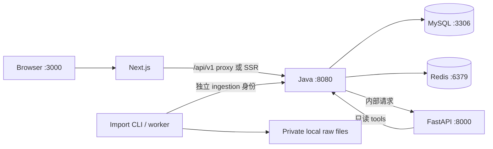

# Large-Lunch-Model：本地开发要求

- 文档版本：v0.1。
- 更新日期：2026-10-29（Australia/Sydney）。
- 状态：待实现的 development contract；当前 repository 只有设计文档，没有 application、Compose、Makefile、migration 或 seed importer。
- 本文中的目录、环境变量与 commands 是初始化时必须实现和验证的约定，不代表今天已经可以运行。
- 上游约定：[总体 framework](../tech-stack-requirements.md)、[数据要求](data-requirements.md)、[AWS 要求](aws-requirements.md)。

## 1. 本地环境要达到什么结果

一位开发者应能在不申请 AWS 资源、不提供真实 model API key 的情况下，通过 synthetic fixtures 与 deterministic mock provider 完成以下路径：

**输入菜品预算 → Java 查询已发布 Offer → Python 返回结构化候选 → Java 复核 ID、版本、预算和禁忌 → 页面展示推荐与来源。**

预算使用 `MENU_SUBTOTAL`：包含所选规格、必选加料、实际选择的可选加料及数量；配送费和平台 service fee 不计入预算，分别展示为已知金额或未知。Budget object 示例为 `{"amount":"25.00","currency":"AUD","scope":"MENU_SUBTOTAL"}`；金额的详细规则以[数据要求](data-requirements.md)为准。

本地 mock 通过只能说明 application contract 可运行。真实 provider、真实来源数据、Cognito、AWS networking 与 production 发布仍有独立验证要求。

## 2. 默认拓扑与地址

默认使用 host processes 运行三类 application，以便调试和 hot reload；Docker Compose 运行 MySQL 与 Redis。

| 组件 | 运行位置 | 默认监听 | 职责 |
| --- | --- | --- | --- |
| Next.js | Host process | `127.0.0.1:3000` | 页面、SSR、本地 `/api/v1` proxy |
| Spring Boot | Host process | `127.0.0.1:8080` | Business API、数据发布与最终校验 |
| FastAPI | Host process | `127.0.0.1:8000` | AI orchestration、mock / real provider adapter |
| MySQL | Docker container | Host `127.0.0.1:3306` → container `3306` | 业务持久化 |
| Redis | Docker container | Host `127.0.0.1:6379` → container `6379` | 开发和验证 cache、限流与临时状态 |
| 原始资料 storage | Host filesystem | 不提供公开 HTTP 目录 | Raw / processed 文件 |

### 2.1 Browser、SSR 和内部调用

- Browser 使用相对路径 `/api/v1/...`，由 Next.js development rewrite 转发到 Java；不向浏览器发布内部服务地址或内部 credentials。
- 首轮 SSR 只查询公开目录，使用 server-only `BUSINESS_API_INTERNAL_URL`，本地值为 `http://127.0.0.1:8080`。私人页面使用 browser client fetch；内存 token 不会自动出现在 SSR 请求里。
- Java 使用 `AI_INTERNAL_URL=http://127.0.0.1:8000` 调用 AI service。
- Python tools 使用 `BUSINESS_API_INTERNAL_URL=http://127.0.0.1:8080` 调用 Java 内部只读 API。
- Proxy 只匹配 `/api/v1` 及其子路径，不代理 `/internal/v1`、Actuator 或本地管理调试路径。
- 同源 proxy 不代替身份验证；Java 继续验证用户与管理员权限。采用 cookie 时还须处理 CSRF；采用 bearer token 时不得把 token 放入 URL。
- 本地 SSE 必须穿过实际 Next.js proxy 验证首段到达、持续输出与取消；若选定版本的 rewrite 不满足要求，应实现并验证透传 Route Handler。
- AWS 由 ALB 将 `/api/v1` 直接路由到 Java；本地 proxy 和云端入口使用相同 API contract，部署时不能依赖本地 rewrite 才能访问业务。

### 2.2 Container 地址约定

默认 host process 连接 MySQL、Redis 使用 `127.0.0.1` 与 published host port。

以后采用 full-container profile 时，同一 Compose network 内通过 service name，例如 `mysql:3306`、`business-api:8080`、`ai-app:8000` 通信。Container 内的 `localhost` 指向该 container 本身。此时另建 profile 与配置，不静默改变默认 host 开发模式。[Docker Compose networking](https://docs.docker.com/compose/how-tos/networking/)

## 3. Toolchain 与版本锁定

以下是 bootstrap 的选择与验证要求，不是已安装的软件清单。

| 工具 | 初始方向 | 初始化时必须产出的证据 |
| --- | --- | --- |
| Docker Desktop / Engine + Compose v2 | 能运行 Linux containers | Engine ready、Compose 版本、CPU architecture、可用磁盘 |
| Node.js | 与所选 Next.js 兼容的受支持 LTS | 明确版本文件与 CI 相同版本 |
| pnpm | 与 Node.js 兼容 | `packageManager` 字段、`pnpm-lock.yaml` |
| JDK | Java 21 LTS 作为候选 | 与 Spring Boot、MyBatis starter、Spring Security 的兼容检查 |
| Maven | 使用 Maven Wrapper | 提交 wrapper、校验分发包与 BOM / plugin 版本 |
| Python | Python 3.12 作为候选 | `requires-python`、`.python-version`、依赖安装与测试结果 |
| uv | 项目统一管理 Python dependency | 固定工具版本、提交 `uv.lock` |
| MySQL | 8.4 LTS 作为候选 | 与 JDBC、Flyway、Testcontainers 和 RDS 可用版本对齐 |
| Redis | 与所选云端 engine 兼容 | 固定 image 版本并验证所用 commands |

选择候选版本后，必须形成实际 compatibility matrix，再锁定完整版本。不得把本文候选值描述为已验证组合，也不要独立升级 Spring Boot 和 MyBatis starter。Spring Boot 官方明确第三方 dependency 可能有额外要求。[Spring Boot system requirements](https://docs.spring.io/spring-boot/system-requirements.html)

Docker image 不使用可变 `latest`；CI 与 staging 以同一 lockfile、BOM、image tag / digest 构建。Apple Silicon 与 Linux CI 的 architecture 差异须在 image build 验证中记录。

## 4. 初始化后的 repository 布局

以下路径均相对 repository root，尚待初始化。

| 路径 | 内容 | 是否提交 Git |
| --- | --- | --- |
| `apps/web/` | Next.js application | 是 |
| `services/business-api/` | Spring Boot application、Flyway migrations | 是 |
| `services/ai-app/` | FastAPI、provider adapters、AI tests | 是 |
| `services/ingestion/` | 后续启用的 extraction / worker 代码 | 启用后提交 |
| `tools/ingestion/` | 首轮 Import CLI，调用 Java API 的薄 client | 是 |
| `contracts/` | OpenAPI、JSON Schema、contract fixtures | 是 |
| `data/fixtures/` | Synthetic 或许可允许分发的小型 seed dataset | 是，包含 manifest |
| `data/raw/` | 按来源许可保留的原始文件 | 否 |
| `data/processed/` | 待导入 JSON / CSV 与 extraction 中间结果 | 否 |
| `data/exports/` | 本地 export / backup | 否 |
| `scripts/` | Environment checks、smoke scripts | 是 |
| `compose.yaml`、`Makefile` | 本地基础设施与统一入口 | 是 |
| `.env.example` | 不含真实 secret 的配置说明 | 是 |
| `.env.local` 与服务私有 env files | 本机 credentials 与配置 | 否 |

MySQL 使用 Compose named volume，不能把数据库内部文件作为普通 repository 数据目录提交。Redis 如启用 persistence，也使用独立 named volume；业务事实始终以 MySQL 为准。Named volume 的生命周期独立于 container，删除 container 不等于删除数据。[Docker volumes](https://docs.docker.com/engine/storage/volumes/)

每个 checkout 使用显式 Compose project name；默认 `large-lunch-local`。同时运行多个 worktree 时必须为 project name、host ports、database、cache namespace 和 raw root 分配独立值。

## 5. Environment variables 与 secrets

下表是待实现的配置接口。初始化时需提供按服务分开的 `.env.example`，并说明加载顺序、默认值、必填项与启动校验。

| 变量 | 本地示例 / 含义 | 读取方 |
| --- | --- | --- |
| `APP_ENV` | `local` | 三类 application |
| `APP_AUTH_MODE` | `local_fixture` | Java |
| `BUSINESS_API_INTERNAL_URL` | `http://127.0.0.1:8080` | Next.js server、Python |
| `AI_INTERNAL_URL` | `http://127.0.0.1:8000` | Java |
| `DB_HOST` / `DB_PORT` / `DB_NAME` | `127.0.0.1` / `3306` / `large_lunch_local` | Java / migration runner |
| `DB_APP_USER` / `DB_APP_PASSWORD` | 本机独立 DML account | Java |
| `DB_MIGRATION_USER` / `DB_MIGRATION_PASSWORD` | 本机独立 DDL account | Migration runner |
| `REDIS_URL` | `redis://127.0.0.1:6379` | Java |
| `CACHE_NAMESPACE` | `llm:local:<checkout>` | Java |
| `OBJECT_STORE_BACKEND` | `filesystem` | Java / ingestion |
| `RAW_DATA_ROOT` | 指向本 checkout 的 `data/raw` 的绝对路径 | Java / ingestion |
| `AI_PROVIDER_MODE` | `mock` 或 `real` | Python |
| `AI_PROVIDER_ID` / `AI_MODEL_ID` | Mock 模式也记录固定 ID | Python |
| `BUSINESS_TO_AI_TOKEN` | 单独生成的本地 service credential | Java / AI |
| `AI_TO_BUSINESS_TOKEN` | 只读 tools credential | AI / Java |
| `INGESTION_TO_BUSINESS_TOKEN` | 仅导入权限的 credential | Import client / Java |
| `LOCAL_USER_TOKEN` / `LOCAL_ADMIN_TOKEN` | 对应不同 fixture actors | Java；用户手动输入本地页面 / admin CLI |

三个 service token 名在本地与云端一致，实际值、caller identity、scope 和 Secrets 分环境隔离。云端传输与轮换遵循[总体 framework](../tech-stack-requirements.md)和[AWS 要求](aws-requirements.md)。

- Service、database、provider 和 admin secret 不使用 `NEXT_PUBLIC_` 前缀，不进入 browser bundle、URL、日志、container image 或 Git。用户 access token 只在其 browser session 内存中使用，不编译进 bundle，也不写 localStorage。
- `.env.example` 只允许非敏感默认值与占位值；启动时拒绝仍为占位符的 credentials。
- 不把完整 root env 自动传给所有服务：Python AI 不应获得 MySQL credentials、ingestion write token 或 admin token。
- Local raw storage 的 read/write、path traversal 防护、source policy 和 retention 仍由 application 管理；不得通过 Next.js `public/` 目录暴露。
- 本地 filesystem adapter 仅模拟应用所需 storage contract。S3 presigned URL、IAM 与 CloudFront 行为必须在 staging 单独测试。

## 6. 本地身份与权限边界

本地默认 fixture identity，以降低 AWS dependency，同时保留真实的授权分支。

1. `local_fixture` 仅允许 `APP_ENV=local`，并要求 Next.js、Java、AI 和数据库 published ports 绑定 loopback。
2. Java 将独立 local bearer tokens 映射到固定 fixture actors 和 roles；token 不得来自任意 `user_id`、`role` header 或 query 参数。
3. 普通用户和 admin 至少使用两个不同 actors。Java 从私有 env 读取并校验 fixture token；开发者在仅 local profile 出现的页面手工输入 `LOCAL_USER_TOKEN`，页面仅保存在内存并作为 Authorization header 发送，不提供读取服务器 env 的 endpoint。`LOCAL_ADMIN_TOKEN` 只交给 admin CLI，fixture admin 显式拥有 source/catalog manage、import、review、publish scopes；production 不沿用该 token。用户 token 无法调用管理接口。
4. Service credentials 分配不同 audiences / scopes：Java → AI、AI → Java read、ingestion → Java write 相互不可替代。
5. `local_fixture` 配置不进入 staging / production。非 local 环境发现此 mode、local tokens 或缺失 issuer 配置时应 fail closed，CI 需覆盖启动拒绝案例。
6. 云端身份验证使用 Cognito；本地 fake actor 测试不算 Cognito integration test。
7. 若需要手机或跨机器开发，另建明确的 development profile 和认证网络配置；不得直接将 fixture mode 改为监听 `0.0.0.0`。

## 7. 数据库、migration 与导入

### 7.1 账号与 migration

- Compose 首次启动完成 local database 与两个 application accounts 的 provisioning；普通 Java runtime 不使用 MySQL root 或 DDL 权限。
- Flyway 由一次性 migration runner 执行，使用 migration account；application 启动时只检查 schema version，避免每个实例自动争抢 migration。
- 新 migration 必须从空库运行，并验证从上一 schema version 升级；已发布 migration 不直接改写。
- Schema migration、seed import 和删除数据是三个不同操作；常规启动不能顺带清库或重复生成 seed。
- 本地设置与测试统一 `utf8mb4`、UTC timestamps、DECIMAL 金额；Sydney 营业时间使用 `Australia/Sydney`，测试覆盖 DST 边界。

### 7.2 两种 seed data

| Dataset | 用途 | 发布与展示限制 |
| --- | --- | --- |
| Synthetic fixture | 自动测试、mock E2E、边界案例 | 必须标记 synthetic；不显示为真实可购买餐厅 |
| 真实、来源获准的 pilot seed | 真实 provider smoke 与小范围产品验证 | 保留来源、采集时间、审核、菜单及 OfferVersion；许可限制随数据执行 |

每份可分发 fixture 包含 manifest：`dataset_id`、`dataset_version`、`data_kind`、许可或 synthetic 标记、预期记录数、schema version、内容 hash，以及 synthetic 专用 `reference_time`。Production importer 拒绝 synthetic fixtures；staging 使用 synthetic 时，页面必须明确显示测试数据。

Synthetic 自动化测试使用固定 `reference_time` 与可注入 test clock。交互式本地 fixture 导入可按相对时间生成 synthetic observation，并将生成时间写入 dataset instance manifest；同一 instance 重试幂等，重新生成新 instance 使用新 key。staging / production 禁止 fixture clock 覆盖真实时钟。真实 pilot 菜单绝不能重置 observed_at 假装重新采集，过期必须真实重核。

### 7.3 Import 路径

1. 空库先 migration；admin CLI 通过管理 API 登记 Source policy、Restaurant、Branch。真实来源权限由 operator 核实，不能信任 CSV 自报 ALLOWED。
2. Import client 规范化 CSV / JSON 并校验；使用 `catalog:import` 用户身份调用 `/api/v1/admin/ingestion/source-records` 登记证据，再创建 batch、提交 records chunks、complete 固定 manifest。独立内部 worker API 使用 ingestion service token，二者调用同一 Java application service。
3. Admin CLI 查看 validation report、payload hash、缺失字段与冲突；reviewer 对完整 batch 审核。首轮允许人工 CLI，不依赖管理后台。
4. 有 `catalog:publish` 权限的 publisher 发布；Java 短 transaction 写 immutable versions、current pointers、catalog revision 与 audit。
5. 查询读取 MySQL current revision，使用版本化 cache key 与 TTL；过期条件仍按查询时间检查。首轮不依赖额外失效任务或 queue。
6. 测试 `DRAFT / REVIEWED / PUBLISHED / WITHDRAWN` 和独立的 `FRESH / STALE / UNKNOWN`；拒绝属于 review decision 并退回 DRAFT。

Import client、AI service、Python worker 均不得绕过 Java 直接写业务表。Synthetic fixtures 也走同一 validation / publish service；自动化测试可用测试专用调用入口，但不能削弱业务校验。

## 8. 统一 command contract 与启动顺序

**下列 targets 尚未实现。初始化 PR 应创建它们或在同一次 PR 中更新本文为实际入口；现在直接执行不会启动本项目。**

| 预期 command | 完成条件 |
| --- | --- |
| `make bootstrap` | 校验并锁定 compatibility matrix、安装各语言 dependencies、生成仅本地使用的 env 与随机 fixture credentials，拒绝覆盖现有私有配置 |
| `make doctor` | 检查 toolchain、Docker Engine、ports、env placeholders、CPU architecture，避免输出 secrets |
| `make infra-up` | 启动 MySQL / Redis，等待实际 health checks 通过 |
| `make migrate` | 使用独立账号执行 Flyway，失败时停止后续启动 |
| `make dev-business` | 启动 loopback Java，验证 schema compatibility |
| `make seed-fixtures` | 经 Java API 幂等导入、审核与发布明确标记的 synthetic dataset |
| `make dev-ai` | 启动 FastAPI，默认 deterministic mock provider |
| `make dev-web` | 启动 Next.js，启用本地同源 API proxy |
| `make smoke-local` | 验证目录、预算、SSE、权限与错误路径，输出 request IDs |
| `make check` | 执行约定的 lint、type check、unit、integration 与 contract checks |
| `make infra-stop` | 停止基础设施，保留 volumes |

首次启动顺序为：`bootstrap → doctor → infra-up → migrate → dev-business → seed-fixtures → dev-ai → dev-web → smoke-local`。三个 `dev-*` processes 分别运行于 terminal 或 process supervisor；不要在等待前台 server 退出后才启动下一服务。

`make bootstrap` 不自动安装系统级 Docker / JDK / Node / Python；缺少 prerequisites 时输出缺项并停止。已选定版本的 repository 中，它必须按提交的 lockfiles 安装，不能每次重新选择版本。

Dependency 安装使用各语言原生工具：pnpm 管理 JS / TS workspace，Maven Wrapper 管理 Java，uv 管理 Python。实现时为每个入口定义明确 working directory 与 lockfile 校验模式。

### 8.1 Health 与 readiness

- Java 本地提供 `/actuator/health`，返回最小状态；readiness 应能反映必要数据库与 schema 是否可用。
- AI 提供 `/healthz`；health probes 不发起真实 LLM 请求、不消耗模型费用。
- Frontend 提供轻量 `/healthz`，可加载不依赖生成的页面，并清晰显示 API unavailable。
- Redis 故障与 model 故障分别处理：目录读取可按规则 fallback 到 MySQL；限流故障不能无条件放开真实模型调用。
- 本地默认启动 Redis；若显式禁用，应实现并启用基于 MySQL 的 request / concurrency quota 与配额释放策略，保持真实模型调用限制。
- Compose 的 container started 不等于 database ready；必须有 readiness 等待与 bounded retry。

## 9. 本地验收案例

| 场景 | 预期结果 |
| --- | --- |
| 空库执行 migration，再执行同一 fixture import 两次 | Schema 一致，业务记录无重复，版本与 batch audit 可查 |
| Base price `"16.00"` + 必选加料 `"2.00"`，预算 `"17.00"` | 排除该组合；不以 base price 单独判定 |
| 菜品小计 `"18.00"`，配送费 `"5.00"`，service fee `"2.00"`，预算 `"20.00"` | 满足菜品预算；费用另列，页面不称总付款为 `"18.00"` |
| 金额 JSON、Java、Python 往返 | 使用 decimal string，不发生 binary floating-point rounding |
| Strict allergen constraint 遇到 unknown evidence | 排除候选，并说明资料不足；不推断为不含 |
| 相同菜名、不同门店或规格 | 保持独立，未经审核不自动合并 |
| 模型返回不存在的 Offer ID 或跨候选记录 | Java 拒绝，不能写入成功推荐或展示权威价格 |
| 生成过程中 MenuItemRevision / MenuSnapshot / OfferVersion 改变、撤回或失效 | Java 最终校验返回 `DATA_CHANGED`；不静默使用旧价，也不自动重试 LLM |
| 生成开始后用户取消 | Browser 终止连接，Java 尽力取消下游并记录最终状态 |
| `delta` 含未经验证的价格或事实 | UI 只将经 Java 校验的 `result` 显示为权威推荐卡片 |
| Mock timeout / invalid output / no candidates | 返回可区分的错误或空结果，目录继续可用 |
| 普通 token 调用 admin API，AI read token 调用 ingestion write API | 返回拒绝；无数据变更 |
| 发布新版本或撤回来源 | Current candidate 更新，旧缓存不可继续作为有效候选 |
| Redis 重启、Java 重启、MySQL container 重建 | 按 persistence contract 恢复；业务事实不依赖 Redis 存活 |

Mock provider 提供显式 scenario，例如 normal、timeout、invalid ID、invalid schema；测试通过 request fixture 选择，不把可操控测试开关暴露到 production 用户 API。

## 10. 真实 provider 与 staging 验证

本地 mock E2E 通过后，选一个实际支持 structured output 的 provider / model，配置独立 key 和费用上限，运行少量人工可核对的真实 smoke cases。

记录实际 provider、model ID、Prompt / Persona / Skill version、候选版本、latency、usage、错误和校验结果。Mock 与真实 provider 的输出必须使用相同内部 schema；无需一次接入四家模型。

原始来源资料只有在使用条件允许外部 inference 时才发送给真实 provider；可以仅发送经过允许的必要结构化事实。真实 provider 失败不能使目录和普通筛选不可用。

Cognito、S3、ALB SSE、IAM、ECS service discovery、migration job、backup / restore 在 staging 验证，按照[AWS 要求](aws-requirements.md)保存证据。本地通过不代替云端验收。

## 11. 故障排查与数据保留

| 现象 | 优先检查 |
| --- | --- |
| Docker socket 不可用 | Docker Desktop / Engine 是否 ready，再检查 context 和权限 |
| MySQL connection refused | Published port、container health、host / container 地址是否混用 |
| Access denied / migration 失败 | App 与 migration accounts 是否混用、schema version、Flyway diagnostics |
| 页面 `Failed to fetch` | Java health、Next.js proxy、相对 API path、浏览器 network；不要直接关闭全部 auth / CORS |
| SSE 一次性输出 | Proxy buffering、content type、逐段 flush、超时、实际首段时间 |
| AI 找不到 Java | 当前为 host 还是 container profile，内部 URL 与 service credential 是否匹配 |
| 修改 seed 后看不到变化 | Dataset version、batch 状态、是否真正 publish、current pointer 和 cache namespace |
| 地理范围结果异常 | 经纬度顺序、SRID、单位、门店坐标来源；直线距离不当成步行时间 |

常规关闭使用保留 volumes 的操作。任何 reset command 必须显示将删除的 Compose project、database、volumes 和本地目录，并拒绝非 local 环境及未知目标；不能执行系统范围的 Docker prune。

重建 schema 前先判断是否需要导出人工录入数据。`data/raw`、`data/processed` 与 MySQL volumes 是不同存储，清理其中一项不会自动清理其余项；来源删除与到期清理由应用的 retention workflow 统一追踪。

## 12. 本地开发完成标准

- [ ] Repository 中真实存在本文约定的入口，README 命令与文件一致。
- [ ] 新 checkout 按记录的 toolchain 能安装、migration、seed 并完成 mock E2E。
- [ ] Loopback bindings、独立 credentials、最小业务权限与 non-local auth 拒绝经过验证。
- [ ] Raw files、env、exports、database internals 不进入 Git；可分发 fixtures 有 manifest。
- [ ] 同一批导入可重复执行，发布与撤回影响候选和缓存。
- [ ] 菜品预算、未知禁忌、OfferVersion、SSE、取消与失败路径通过测试。
- [ ] 单个真实 provider 的 smoke evidence 与 mock test results 分开记录。
- [ ] 所有未验证项保留未完成状态，不以文档存在代表功能完成。

## 13. 官方参考

核对日期：2026-10-28。具体 development topology、command names 与 auth profiles 是项目设计决策。

- [Docker Compose networking](https://docs.docker.com/compose/how-tos/networking/)：service-name discovery 与 container networking。
- [Docker volumes](https://docs.docker.com/engine/storage/volumes/)：persistent named volumes 与生命周期。
- [Next.js rewrites](https://nextjs.org/docs/app/api-reference/config/next-config-js/rewrites)：同源 proxy 的实现基础；SSE 行为仍需针对实际版本测试。
- [Spring Boot system requirements](https://docs.spring.io/spring-boot/system-requirements.html)：JDK / build tool 要求与第三方 dependency 兼容提醒。
