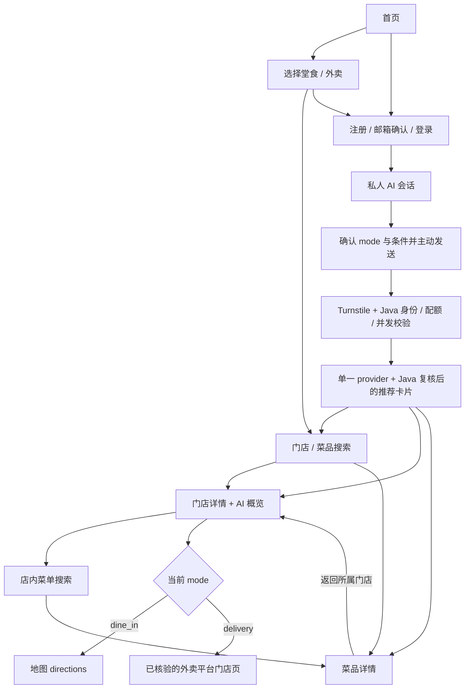

# Large-Lunch-Model：Sprint 1 MVP、用户流程与 User Stories

- 版本：v0.2；更新日期：2026-11-06（Australia/Sydney）。
- 开发方式：一人开发，使用 AI 辅助实现与 review。
- 文档用途：明确第一轮产品范围，作为后续 issues、API contracts、implementation tasks 和验收的依据。
- 当前状态：需求方案，尚未实现；本文件不代表网站已经上线、数据已收集或 provider 已验证。
- 相关文件：[技术栈与 API contract](../tech-stack-requirements.md)、[数据要求](data-requirements.md)、[AWS 要求](aws-requirements.md)、[本地开发要求](local-development.md)、[交付规划](delivery-model-comparison-au-us-cn.md)。
- 用户已确认：保留 ECS Fargate；本次将注册登录后使用 AI chat、流量限制、并发控制和 Cloudflare 防护纳入首轮要求。预算为 `MENU_SUBTOTAL`，配送费与平台 service fee 另列。
- 本版取代早期 draft 中“匿名聊天”“账号后做”“聊天只保留当前 tab”和“单道菜参考价就是预算”的假设；多 provider、收藏等仍属于后续。本文定义用户行为与验收，详细安全状态、阈值和 API 以技术栈 contract 为准。

## 1. 本轮要做成什么

**上线一个可以真实使用的选餐网站：用户可匿名浏览、搜索和查看有来源的门店 / 菜品；注册、确认邮箱并登录后，在人机验证与配额保护下使用 AI chat，最后跳转地图导航或外卖平台。**

第一轮的价值是贯通“找到 → 了解 → 决定 → 前往外部服务”这条路径。网站负责帮助选择；导航、下单、支付与配送由外部服务完成。

### 1.1 用户已经确定的方向

| 已确定方向 | 本轮如何体现 |
| --- | --- |
| 网站可以上线使用 | 有可访问的 HTTPS URL；核心流程连接真实数据和 backend |
| 搜索饭店和菜品 | 门店搜索、全站菜品搜索、店内菜单搜索 |
| 区域、类型、菜系、距离与限制条件 | 在统一查询条件中实现，规则见第 4 节 |
| 堂食和外卖两种逻辑 | 共享目录与详情页，使用不同 mode、筛选条件及最终行动 |
| 饭店详情页有 AI review | 用户已确认：根据菜单、价格和门店资料生成 AI 概览与推荐理由 |
| 与 AI 聊天获得推荐 | 注册、确认邮箱并登录后使用固定 model；推荐真实门店 / 菜品并链接到共用详情页 |
| 并发与流量从首轮开始考虑 | 跨实例 admission control、用户配额、全局 provider / token 上限、可理解的拒绝与恢复状态 |
| Cloudflare 人机验证与防护 | Turnstile server-side validation、edge WAF / rate limiting、origin 防绕过；Cognito 入口另行保护 |
| 第一轮不做多个 AI 或不同建模 | 不提供 model / Persona / Skill 切换；不做多 agent 协作、训练或 fine-tuning |

### 1.2 为了可执行而提出的默认方案

以下是本文件的设计建议，不应冒充用户已经逐项确认：

- 初期覆盖悉尼 CBD 及少量选定区域，与原项目基线一致；界面明确数据覆盖范围。
- 浏览、搜索、详情、地图与平台跳转可以匿名使用；AI chat 与任何新付费 AI generation 必须通过注册登录、邮箱确认、当前账号状态、Turnstile 与额度检查。
- 使用 Cognito managed login + Authorization Code with PKCE，不自行维护密码；最小账号与私人会话属于首轮，收藏、复杂个人资料和历史搜索后续再做。
- 使用人工整理并审核的 seed catalog；不依赖先做 crawler、OCR 或完整 Admin UI。
- 首轮使用一个 provider 和一个 model，门店概览与聊天只是同一 AI service 的两个任务。
- 外卖定义为 `delivery`，跳转外部平台；自取 `pickup` 不在本轮模式范围内。
- 距离按当前或手动选定参考点计算直线距离；不计算步行时间或实时配送时间。
- 限制条件先做 `MENU_SUBTOTAL` 预算、排除指定门店、少量有证据的食材排除；不宣称支持所有饮食要求。预算计算包含所选规格、所有必选及已选可选加料和数量。
- 本轮 UI 优先完成清晰、可用的移动端和桌面布局，不以复杂角色动画作为验收条件。

### 1.3 保留为后续 backlog

多模型比较、多 Persona、Skill 市场、复杂 LangGraph workflow、训练、fine-tuning、复杂个人资料、会话实时多端同步、收藏、多人点餐、站内订单 / 支付、配送追踪、自动抓取用户评论、OCR、推荐评分系统、实时营业筛选、实时库存与配送覆盖、Live2D / 3D、完整双语 UI。

菜名仍保留原文；首轮搜索可维护少量别名，完整翻译与跨语言语义检索另行评估。

## 2. 两条用户流程

### 2.1 流程 A：主动搜索

1. 打开网站，选择“堂食”或“外卖”。
2. 选择区域；需要距离排序时，再选择参考点或主动允许使用当前位置。
3. 搜索门店名称，或按菜系、门店类型与其他条件筛选。
4. 点击结果中的具体门店，进入门店详情页。
5. 阅读地址、菜单来源、模式信息和 AI 概览。
6. 在该门店菜单中搜索菜名、筛选符合条件的菜品。
7. 打开菜品详情，查看价格、说明、来源与已知 / 未知信息。
8. 点击“返回门店”，恢复原店内搜索和浏览位置。
9. 堂食点击“打开地图导航”；外卖点击“前往某外卖平台”。

补充路径：用户也可以从全站“菜品”搜索入口直接找菜。菜品卡片显示所属门店，允许打开菜品或门店详情；菜品页始终有明确的“查看所属门店”入口。

### 2.2 流程 B：AI 辅助选择

1. 打开网站，进入“与 AI 聊天”；未登录时展示注册 / 登录入口，可保留本地未发送草稿。
2. 完成 Cognito 注册、邮箱确认与登录；返回聊天后由用户主动发送，不能自动提交草稿或启动付费请求。
3. 如果 mode 未确定，AI 可以解释选择或展示堂食 / 外卖按钮，由用户确认；不擅自替用户选定。
4. 用户描述需求并发送；Turnstile 完成验证，Java 校验当前身份、配额与并发后才允许新一轮 AI 调用。缺少明确 mode / budget 等必填项时可先使用普通表单澄清；需要 model 处理的澄清也计入同一套配额。
5. 页面展示本次使用的 mode、区域和筛选条件，以及真实推荐卡片。
6. 用户点击“查看推荐列表”“查看门店”或“查看菜品”。
7. 进入与流程 A 相同的目录 / 详情页，保留本次推荐的 mode 和条件。
8. 用户可以搜索店内菜品、查看详情、返回门店，再导航或跳转外卖平台。
9. 用户返回自己的会话，继续调整条件，例如“换一家”或“预算再低一点”；每个新 turn 都重新 admission，同一用户不能靠多 tab 绕过并发限制。

聊天推荐的动作是站内导航与外部链接入口，不包含自动下单。AI 没有找到有效候选时，应说明当前目录的覆盖或条件限制，不凭空补齐门店。

## 3. 页面结构与状态保留

### 3.1 最少需要的页面

路由名是设计建议，尚不是已实现的 API 或页面。

| 页面 | 示例 route | 主要内容 |
| --- | --- | --- |
| 首页 | `/` | mode 选择、搜索入口、聊天入口、覆盖范围 |
| 搜索结果 | `/search` | 门店 / 菜品 tabs、区域、关键词、筛选、排序、分页 |
| 门店详情 | `/restaurants/{branch_id}` | 门店资料、AI 概览、菜单搜索、导航 / 平台按钮 |
| 菜品详情 | `/menu-items/{menu_item_id}` | 菜品事实、来源、当前 mode 的价格信息、返回门店 |
| AI 聊天 | `/chat`、`/chat/{conversation_id}` | 登录门槛、私人会话、当前条件、推荐卡片、验证 / 配额状态、停止与重试 |
| 账号入口 | 登录跳转、OIDC callback、账号状态区 | Cognito managed login / 注册 / 邮箱确认 / 密码恢复；本地页面不收集或存储 Cognito 密码 |

这里的“饭店”在页面上对应具体 **Branch**。同一品牌的不同门店可以有不同菜单、价格、地址和外卖链接；不能只用品牌名称作为跳转依据。

### 3.2 同一套 context 贯穿页面

| Context | 建议保存方式 | 规则 |
| --- | --- | --- |
| `mode` | route query 或统一 client state；刷新时可恢复 | 搜索、AI 请求、卡片与最终行动使用同一值 |
| 区域、关键词、类型、菜系、排序 | URL query | 浏览器 Back / Forward 可以还原搜索条件 |
| 当前门店菜单关键词与分页 | 页面 state + 当前会话恢复 | 从菜品返回时恢复该门店状态 |
| 列表滚动位置 | 页面 / session state | 返回原列表时尽量恢复；数据已变化时按当前结果显示 |
| 精确定位坐标 | 当前会话内存或短期 session context | 不放入可分享 URL；不长期保存到用户档案 |
| 聊天记录与推荐 context | Java 管理的 owner-scoped Conversation / ChatMessage；浏览器只缓存当前用户视图 | 登录后可按 server request 状态恢复；不同用户隔离，退出时清除私人 UI / cache；按数据要求设置 retention |
| 未发送草稿 | 本地短期 state；登录回跳期间临时保留 | 不包含 token / secret；登录完成需用户重新确认发送；账号切换或退出时清除，不能自动作为别人的消息提交 |

“返回门店”是明确的父资源链接。没有浏览历史或通过外部链接直接打开菜品时，也能回到正确 Branch，不能只依赖 `history.back()`。

已有聊天推荐保留生成时的 mode 与条件。用户切换 mode 后，旧卡片要标明原模式；点击时先明确恢复原模式，或按新模式重新查询，不能静默混用旧结果。

## 4. 搜索、筛选与两种 mode 的规则

### 4.1 堂食与外卖共享数据，分开行动

| 项目 | 堂食 `dine_in` | 外卖 `delivery` |
| --- | --- | --- |
| 门店候选 | 已确认支持堂食 | 已确认支持外卖，且有已核验的平台门店链接 |
| 菜单展示 | 当前可用的堂食菜单 / 已标注的参考菜单 | 当前可用的外卖菜单 / 已标注的参考菜单 |
| 最终按钮 | 打开地图导航 | 前往指定平台 |
| 距离含义 | 用户 / 参考点到门店的直线距离 | 同样是到门店的直线距离，不代表配送范围 |
| 外部确认 | 实际路线、是否营业等由地图 / 门店确认 | 最终价格、附加费、库存、配送范围和下单由平台确认 |

mode 支持状态使用 `supported / unsupported / unknown`。搜索与推荐默认不把 `unknown` 当成支持。缺少某一 mode 的有效菜单时，可以显示资料不足，但不能声称候选菜品在该模式下可购买。

首轮不拆成两套独立网站、两份餐厅目录或两套 AI。一个 Branch 可以支持两种 mode，最终展示与行动按当前 context 决定。

### 4.2 各种搜索条件的含义

| 条件 | 首轮建议语义 | 需要的数据 |
| --- | --- | --- |
| 区域 | 在明确维护的 suburb / area 范围内查找 | `area_id` 与所属门店；不是任意地址 geocoding |
| 门店名称 | 名称与已维护别名的关键词匹配 | Branch 名称、别名 |
| 门店类型 | cafe、restaurant、bakery 等枚举标签 | `venue_type`；与菜系分开 |
| 菜系 | Japanese、Chinese、Thai 等标签 | `cuisine_tags`；首批分类保持简洁 |
| 菜品关键词 | 全站匹配 MenuItem，或仅匹配当前 Branch 的菜单 | 菜品名称、已维护别名、已发布菜单 |
| 距离排序 | 从当前 / 手动参考点按直线距离从近到远 | 门店坐标与有效参考点 |
| 菜品小计预算 | 单人本次推荐组合的 `MENU_SUBTOTAL` 上限；搜索匹配展示一份有效配置及其小计 | 同 Branch / channel / fulfillment 的 OfferVersion、数量、规格、必选与已选加料、AUD 和来源 |
| 排除指定门店 | 从结果中去掉用户选择的 `branch_id` | 稳定 Branch ID |
| 排除已维护食材 | 仅使用已审核的食材信息判断 | 食材事实、状态与来源；未知不自动视为满足 |

“预算”使用 `budget = {"amount":"25.00","currency":"AUD","scope":"MENU_SUBTOTAL"}`，是单人本次选餐的菜品小计上限。`menu_subtotal = Σ quantity × (selected_variant_price + Σ selected_option_delta)`；已选规格不再重复加 base price。配送费、service fee、small-order fee 等订单级费用不计入预算，未知费用不写成零；页面显示“菜品小计，配送费与平台费用另计”。搜索展示的单份配置仍不能代替组合总价计算。

### 4.3 组合筛选不能产生假阳性

- 不同维度之间使用 AND；同一多选维度内部使用 OR。例如区域 = CBD，且菜系属于 Japanese 或 Korean。
- 门店级条件先筛 Branch；菜品级条件由**同一个 MenuItem 的一套可购买配置同时满足**，门店才算有合格菜品。OfferVersion 的 channel、fulfillment、所选规格与 options 不得跨平台拼接；必选项价格或相关食材证据缺失时不能当作符合条件。
- 例：A 菜 AUD 15 但明确含某排除食材，B 菜不含该食材但 AUD 30。条件为“不含该食材且不超过 AUD 20”时，这两道菜都不合格，不能把门店当作匹配。
- 有明确食材排除要求时，相关成分未知的菜品不作为已满足条件的推荐。详情页仍保留“未知”及来源状态，不把目录标签解释成整家店的安全保证。
- 推荐解释可展示“该店有 2 道菜符合条件”，但不能把菜品级条件扩张为整家店所有菜都符合。
- 零结果时保留条件并给出修改入口；不能自动放宽用户硬性条件。
- 不填价格上限 / 排除条件时，不额外施加这些过滤。

首轮只上线有可靠字段支持的 filters。界面不能提供一个实际上不参与 backend 查询的筛选控件；缺少字段的计划项应明确保留在 backlog。

### 4.4 定位与距离的 fallback

用户主动点击“使用当前位置”后再请求 permission。拒绝、不可用或超时后，仍能按区域搜索，也可以选择预设区域中心 / 地标作为参考点。没有有效参考点时，保持默认排序并隐藏距离，不使用虚构坐标或 `0 km`。

参考点与区域过滤分开：选择区域可以限制候选，但不自动代表用户位于该区域中心。只有用户选择“从该区域中心计算距离”后，才按该点排序，并显示这个依据。缺少坐标的门店放在已知距离结果之后，标注“距离未知”。

定位需要 HTTPS 与用户授权；还要设置有限 timeout，并处理拒绝、不可用和超时。[MDN — getCurrentPosition](https://developer.mozilla.org/en-US/docs/Web/API/Geolocation/getCurrentPosition)

## 5. AI 的两个任务

### 5.1 门店 AI 概览

用户已确认采用 **基于菜单、价格和门店资料的 AI 概览与推荐理由**。产品可以保留 AI review 的概念，页面建议使用“AI 门店概览”这一名称。

- 输入：已审核门店资料、当前 mode 的菜单、价格、来源与版本。
- 输出：简短概览、可核实的菜单特点、值得查看的真实菜品、依据和未知信息。
- 页面显示 AI 标识、生成时间、资料版本 / 更新时间与来源入口。
- 不生成虚构用户评价、星级、亲身到店体验或“顾客普遍认为”。口味、服务、环境等信息没有来源时不当成事实。
- 首轮公开详情只读取经过事实校验、允许公开的非个性化概览，按 Branch、mode、证据版本、model 和 Prompt version 区分。匿名访问的 cache miss 只能返回未就绪，不启动模型。
- 首轮若提供生成 / refresh 操作，只允许经过邮箱确认的登录用户主动触发，同样执行 Turnstile、用户与全局 admission；公共发布仍须通过事实与来源用途校验。未实现该完整路径时，按钮不开放。后续批量预生成需另定义受控 service identity 与任务配额，不能作为不受限的旁路。
- 缓存缺失、证据更新或生成失败时显示“暂无最新 AI 概览”，门店资料和菜单照常可用。
- 首轮概览不个性化；个性化条件由聊天与搜索处理。

### 5.2 单一 AI 聊天

- 固定一个 provider、一个 model，每个 turn 最多一次 LLM call；不隐藏追加 summarization、agent loop 或自动付费 retry。受控目录读取可由 Java 在调用前准备，不把复杂 tool loop 当成首轮 dependency。
- 聊天与搜索复用 Java 的候选筛选规则，不能绕过 mode、预算、食材排除和目录发布状态。
- 用户可多轮调整条件。新消息只更新明确改变的字段，保留其他条件；界面显示实际用于本次查询的条件。
- 首版 mode、预算、区域和 hard dietary constraints 通过用户确认的结构化条件交给 Java；自然语言条件修改可先引导确认表单，不增加隐含的付费 intent-extraction call。一次 LLM 在确定候选内完成选择与说明。
- mode 未知时澄清；缺少区域时可让用户选区域或明确搜索全部已收录区域，不无限追问。
- AI 只输出实际候选中的 Branch / MenuItem IDs、理由和 source IDs；Java 校验后返回可点击卡片。
- 价格、地址、菜名和外链由 Java 从业务记录填充，不采用模型自行生成的值。
- 用户明确调整硬性条件后才重新查询；零结果不偷偷放宽限制。
- 支持 streaming、停止生成、timeout、明确错误与用户主动重试。只启用一个 model 时，不静默换模型。停止请求不证明 provider 已停止计算或计费；显示“正在停止 / 状态确认中”，未确认前不释放可造成超额调用的额度。
- Java 在输出最终结果前重新验证 MenuItemRevision、MenuSnapshot、OfferVersion、source permission、freshness、所选 options 和总小计。数据已变化则返回 `DATA_CHANGED` 并由用户决定是否重新生成，不自动再付费。
- AI 不可用时，普通搜索、详情、地图与外卖平台入口继续可用。

`delta` 仅作为生成中的文本，不承载可执行链接或未校验卡片。最终事实型推荐以 Java 校验后的 `result` 为准；不可验证的菜品、价格、地址与 URL 不直接展示成推荐结果。

### 5.3 登录、验证与并发的用户体验

AI 的保护必须落实在 Java API；隐藏按钮、禁用输入框或验证前端 token 均不能代替 backend enforcement。浏览器提交的 `user_id`、角色、`email_verified` 或剩余额度不作为授权依据。

| 情况 | 用户应看到的结果 | 后端约束 |
| --- | --- | --- |
| 未登录 / session 已失效 | 登录入口与可保留的未发送草稿；登录后主动再发送 | `401 AUTH_REQUIRED`；不创建新付费调用 |
| 邮箱未确认 / 账号禁用 | 邮箱确认操作或不可使用提示；普通目录仍可访问 | `403 EMAIL_VERIFICATION_REQUIRED` / `ACCOUNT_DISABLED` |
| 人机验证失败、过期或 token 重放 | 重新验证入口，不丢失输入 | `403 BOT_VERIFICATION_FAILED`；无付费调用 |
| Turnstile 验证服务不可用 | 暂时无法发送，可稍后重试 | `503 BOT_VERIFICATION_UNAVAILABLE`；新付费调用 fail closed |
| 发送太频繁 / 已有进行中 turn | 告知稍后发送或返回现有请求，不新增隐藏队列 | `429 USER_RATE_LIMITED` / `USER_CONCURRENCY_LIMITED` |
| 今日个人配额已用完 | 显示 server 返回的重置时间，转换为用户时区 | `429 USER_DAILY_QUOTA_EXCEEDED`；UTC 日边界由 server 决定 |
| 全局 / provider 容量或每日 token 预算不足 | 明确系统繁忙，保留输入，允许普通搜索 | `503 AI_CAPACITY_EXHAUSTED`；不无限排队、不自动轮询生成 |
| provider 暂不可用 | 保留条件，稍后由用户主动重试 | `503 AI_TEMPORARILY_UNAVAILABLE`；无静默 provider fallback |
| 输入过大 / 同 key 不同内容 / 会话版本冲突 | 显示输入限制或要求刷新会话状态 | `413 REQUEST_TOO_LARGE` / `409 IDEMPOTENCY_CONFLICT` / `409 CONVERSATION_BUSY` / `409 VERSION_CONFLICT` |

上述是应用错误；edge WAF 可能在到达 Java 前阻断，frontend 必须处理其非标准响应。SSE 建立前使用 HTTP JSON error；已建立 stream 后使用 `error` 与 `done`。不得在 API / SSE 传输中插入 HTML challenge。`Retry-After` 或配额重置时间由 server 提供，UI 不暗示到时一定有可用容量。

Cloudflare Turnstile token 需要 Java 调用 Siteverify，chat 校验 `success`、允许的 hostname 与 `action=ai_chat`；其他按需 generation 使用独立的 action allowlist 并复用同一 admission service。token 有效期为 300 秒且只能成功使用一次。Managed widget 不等于每条消息都要求用户点 checkbox，但每个新 turn 都必须提交可验证的新 token。对同 owner、同 idempotency key 与相同业务 payload 的已有请求，先读取已有结果 / 状态，不重复消耗 challenge 或调用 provider；payload hash 不含一次性的 Turnstile token。[Cloudflare server-side validation](https://developers.cloudflare.com/turnstile/get-started/server-side-validation/)

以下是首轮**可配置的设计初值，不是已经完成的 capacity test，也不是用户逐项确认的生产容量**：每用户最多 1 个 active call，全局 / 单 provider 最多各 5 个；每用户 5 次新 turn 提交尝试 / rolling 60 秒、20 次已开始或可能已开始的 provider 请求 / UTC 日；全局 100,000 input + output tokens / UTC 日；每次输入最多 6,000 tokens、输出最多 1,000 tokens、1 次 LLM call；消息 2,000 Unicode code points、request body 32,768 bytes；`AI_QUEUE_ENABLED=false`。分钟级 abuse counter 包含验证失败等被拒的新 turn 提交；同 key 查状态不算新 turn，但仍受 transport / edge rate limit。日配额在 admission 时预留、provider 开始或无法确定是否开始时计次；无候选或确认 provider 未开始的失败释放付费预留。

MySQL 中的共享 admission ledger 是跨 Java / AI 实例的权威：同一短 transaction 内检查并预留 user / global / provider slots 与额度，不在 LLM 网络调用期间持锁。Redis 只能辅助快速拒绝；Redis 故障不能重置配额，MySQL 无法安全 admission 时拒绝新付费调用。Python 在调用前领取一次性的 dispatch claim；内部请求重放不能重领，未知失败不自动重新 dispatch。token usage 不明、实例崩溃、取消或 lease 到期须 reconciliation，不能把“连接断开”当成 provider 完成；exact rules 与配置名见[技术栈 contract](../tech-stack-requirements.md)。

## 6. Sprint 1 User Stories

以下 18 条是本轮目标 backlog，顺序编号不代表必须串行。每条包含用户价值与可检查的 acceptance criteria；随后再拆 technical tasks。它们不是“两周必定完成”的承诺，实际 Sprint commitment 要按可用时间确定。

### S1-US01：访问可用的网站

**作为寻找午餐的用户，我希望能直接打开网站并找到搜索和聊天入口，以便开始选餐。**

- AC1：实际部署的 HTTPS URL 可打开；首页连接已发布目录，不仅展示静态 mock。
- AC2：手机与桌面均可完成主要操作，表单和按钮有可辨识名称与键盘访问方式。
- AC3：首页说明初期数据覆盖范围，提供堂食、外卖和聊天入口，并清楚标明 AI 需要注册、确认邮箱与登录。
- AC4：加载、请求失败和空目录都有明确状态与重试 / 返回入口。
- 验证：部署 smoke、手机 / 桌面主路径；依赖 S1-E01、S1-E03。

### S1-US02：选择并保留就餐 mode

**作为选餐用户，我希望选择堂食或外卖，并在后续页面保持这个选择，以便看到合适的门店和行动入口。**

- AC1：mode 使用 `dine_in / delivery`；选择后查询相应候选。
- AC2：搜索、门店、菜品、聊天跳转中保留 mode；刷新目录 / 详情页能恢复它。
- AC3：切换 mode 后重新验证候选；当前门店不支持新 mode 时明确显示原因及返回入口。
- AC4：支持情况未知时，不把该门店作为已确认支持的推荐；直接访问详情仍能说明资料状态。
- 验证：模式切换与深链接；依赖 S1-E01、S1-E02。

### S1-US03：按名称和区域查找门店

**作为知道地点或店名的用户，我希望按区域和名称搜索门店，以便缩小选择范围。**

- AC1：可选已维护区域，输入名称关键词或别名；不输入名称时可浏览该区域。
- AC2：结果对应具体 Branch，显示名称、区域 / 地址、菜系、mode 状态和来源更新信息。
- AC3：区域、关键词和 mode 同时生效；有稳定分页 / 加载更多和明确的默认排序。
- AC4：无结果时保留条件、提示目录覆盖限制，并允许清空某个条件重试。
- 验证：组合查询、分页边界、零结果；依赖 S1-US02、S1-E01。

### S1-US04：按门店类型和菜系筛选

**作为有餐饮偏好的用户，我希望按门店类型和菜系筛选，以便找到符合我想法的选项。**

- AC1：`venue_type` 与 `cuisine_tags` 分开显示，不把 cafe 与 Japanese 混成一个分类维度。
- AC2：不同维度 AND、同一维度多选 OR，与名称、区域和 mode 一起生效。
- AC3：标签来自维护的数据；未知标签不被 AI 临时推断成已确认分类。
- AC4：选中条件可见、可单独移除，返回列表后仍保留。
- 验证：filter truth table；依赖 S1-US03。

### S1-US05：按距离排序

**作为想在附近就餐的用户，我希望按我选择的参考点查看距离顺序，以便选择更近的门店。**

- AC1：只有用户主动请求时才弹定位 permission；也可选择预设参考点。
- AC2：距离标注为近似直线距离，并显示参考点依据；不显示未经计算的步行或配送时间。
- AC3：定位拒绝、不可用、timeout 时仍可区域搜索；没有参考点时明确禁用距离排序。
- AC4：已知距离从近到远；距离相同时使用稳定 tie-breaker；无坐标门店标注未知并排后。
- 验证：固定坐标排序、三类定位错误、无坐标记录；依赖 S1-US03、门店坐标数据。

### S1-US06：排除不符合条件的选择

**作为有预算或饮食限制的用户，我希望排除不符合已选条件的门店和菜品，以便减少无效选择。**

- AC1：首轮支持本文件约定的菜品小计预算、排除指定门店、已维护食材排除；可用 filter 与 backend 实现一致。
- AC2：菜品条件必须由同一个 MenuItem 的有效 OfferVersion 与所选配置同时满足，门店才作为匹配结果；展示匹配菜品和规格 / options。组合推荐须同 Branch、channel、fulfillment，合计数量后仍不超过预算。
- AC3：价格未知不算符合已设置上限；明确食材排除时，相关成分未知不算已经满足。
- AC4：金额按 `MENU_SUBTOTAL` 计算，包括所选规格、必选及已选可选加料和数量；使用 decimal strings / AUD。配送费与 service fee 另列，未知不当作零，不承诺 checkout total。
- AC5：零结果不自动放宽限制；用户修改后再重新查询。
- 验证：同菜组合条件、未知字段、价格边界、排除 ID；依赖 S1-US03、具备相应事实的 MenuItem 数据。

### S1-US07：从菜名找到菜品和门店

**作为已经想好吃什么的用户，我希望全站搜索菜名并找到对应门店，以便不必先猜店名。**

- AC1：搜索页提供“门店 / 菜品”入口，菜品查询只使用当前 mode 下已发布的有效菜单。
- AC2：菜品结果显示菜名、有效 Offer 的渠道 / 规格 / 小计、所属具体门店、来源，并能进入菜品或门店详情。
- AC3：现有区域与菜品限制同时生效；按门店展示时保留实际匹配的菜品。
- AC4：不搜索已删除 / 过期失效记录来制造结果；无匹配有明确反馈。
- 验证：跨店同名菜、模式差异、历史菜单排除；依赖 S1-US03、S1-US06。

### S1-US08：查看具体门店详情

**作为对一家门店感兴趣的用户，我希望了解它的位置、菜单和资料来源，以便判断是否继续选择。**

- AC1：详情由 `branch_id` 定位；同品牌不同分店不会共用错误的地址、菜单或平台链接。
- AC2：显示名称、地址、类型 / 菜系、mode 信息、菜单来源与更新时间；缺失事实明确标记未知。
- AC3：提供菜单区域、AI 概览区域和当前 mode 对应的行动入口；AI 失败不阻断页面。
- AC4：返回搜索 / 聊天时恢复原 context；无历史直接访问时提供返回目录入口。
- 验证：分店隔离、刷新 / 深链接、AI 不可用；依赖 S1-US02、S1-E01。AI 概览本身由 S1-US13 补齐。

### S1-US09：搜索一家门店的菜单

**作为已经选中门店的用户，我希望在它的菜单中搜索菜品，以便快速找到想吃的东西。**

- AC1：关键词只查询当前 Branch、当前有效菜单和当前 mode，不混入其他分店。
- AC2：默认继承有效的菜品限制条件；用户清除条件时页面明确反映变化。
- AC3：显示匹配结果和无结果状态，可清除店内关键词；稳定分页 / 菜单分组不漏项。
- AC4：打开菜品再返回后恢复店内关键词、条件与浏览位置。
- 验证：门店隔离、条件继承、返回恢复；依赖 S1-US08、S1-US06。

### S1-US10：查看菜品详情并返回门店

**作为比较菜品的用户，我希望查看菜品事实并方便地返回所属门店，以便继续比较其他选项。**

- AC1：按 `menu_item_id` 显示原文菜名、所属门店、描述、来源与版本 / 更新时间，并明确所选 Offer 的渠道、规格、options、数量与菜品小计。
- AC2：食材、图片或价格缺失时给出恰当的未知 / placeholder，不让 AI 填造事实。
- AC3：“返回门店”指向该 MenuItem 的 Branch，并保留 mode 与店内搜索；无历史访问也可使用。
- AC4：菜单已更新、菜品已失效或不适用当前 mode 时给出状态与替代浏览入口，不继续当作有效推荐。
- 验证：ID 关联、失效菜品、直接 URL、返回恢复；依赖 S1-US08、S1-E01。

### S1-US11：堂食时打开导航

**作为准备去门店的堂食用户，我希望打开正确目的地的地图 directions，以便安排到店路线。**

- AC1：堂食模式提供导航按钮，使用已核对的具体 Branch 地址 / 坐标，必要时加入正确 Place ID。
- AC2：按钮打开 Google Maps directions，带入门店目的地；不要求本站先拿到用户坐标。
- AC3：没有可核实的地址 / 坐标时不给出猜测链接，明确显示暂不可导航。
- AC4：不承诺必定唤起原生 app 或自动开始 turn-by-turn navigation；外部服务打开后可返回本站继续浏览。
- 验证：人工核对目的地，测试桌面与手机链接；依赖 S1-US08、门店地址数据。

### S1-US12：外卖时打开平台门店页

**作为准备点外卖的用户，我希望跳转到正确门店的外卖平台页面，以便在那里确认配送和下单。**

- AC1：外卖模式显示已核验的 HTTPS 门店链接和平台名称；多个已核验平台可列为多个按钮。
- AC2：链接来自服务端维护的数据；不由模型拼接，不跳到同品牌的错误分店。
- AC3：提示订单、最终价格与配送范围由平台确认；本站不承诺实时可送达、库存或下单成功。
- AC4：无有效链接时明确显示不可跳转，不能用平台首页冒充门店链接。
- AC5：没有安装平台 app 的设备仍可尝试打开网页；app 是否被唤起由平台 / 浏览器决定。
- 验证：链接 scheme / host / 分店人工校验、缺失链接状态；依赖 S1-US08、已核验链接数据。

### S1-US13：阅读有依据的 AI 门店概览

**作为不了解门店的用户，我希望阅读 AI 对现有资料的简短概览，以便更快理解有哪些选项值得查看。**

- AC1：概览基于当前 Branch、mode、有效菜单与来源，展示 AI 标识和生成 / 资料时间。
- AC2：引用的菜品和 source IDs 有效；价格等事实来自业务记录，不出现虚构顾客、星级或到店体验。
- AC3：证据不足时说明限制；旧菜单版本的概览不能无标识地继续当成当前概览。
- AC4：公开读取只返回允许公开且有效的缓存；匿名访问 cache miss、reload、变更 query 或刷新页面均不能触发新付费 generation。未生成或失败时目录页面仍可用。
- AC5：若开放生成 / refresh，该写入 endpoint 与 chat 使用同一 verified login、Turnstile 和 admission contract；不能通过不同 route、后台任务或缓存回填绕过限额。私人对话和偏好不进入公共概览。
- 验证：source / ID 校验、版本失效、人工内容 review、真实 provider smoke；依赖 S1-US08、S1-E04。

### S1-US14：通过聊天澄清条件并获得推荐

**作为不确定吃什么的用户，我希望通过聊天表达需求并逐步调整，以便找到符合条件的真实选项。**

- AC1：使用固定 model；未确定 mode 时让用户选择或确认，已选 mode 时保持一致。
- AC2：用户改变区域、菜系或预算时更新相应条件，其他已确认条件保留，并显示本次 query context。
- AC3：查询复用 Java 的 filters；只有经过校验的有效 Branch / MenuItem 才能进入最终推荐。
- AC4：无候选时说明原因与可修改项；不放宽硬性条件、不编造目录外门店。
- AC5：支持 streaming、停止、timeout 与用户主动重试；取消待确认时保持占用提示，不能通过快速停止 / 重发突破上限；旧请求不覆盖别的 turn。
- AC6：未登录、邮箱未确认或被禁用的用户无法通过直接 HTTP 请求调用模型；每个新 turn 的 Turnstile 必须由 Java 验证，验证失败或不可用时保留草稿并拒绝付费调用。
- AC7：同用户多 tab 共用 active slot 与日配额；系统容量不足立即给出可理解的错误。显示 server 提供的个人额度与 reset time，不把“免费 / 无限”作为文案。
- AC8：相同 owner + `Idempotency-Key` + 相同业务 payload 返回已有 request；不重验证旧 challenge、不重复计费。相同 key 不同内容返回 409；网络中断后可查询已有 request，重试新一轮必须由用户明确触发并使用新 key。Java → Python 内部重放也不能重复领取 dispatch claim。
- AC9：`conversation_id` 必须属于当前用户；`expected_conversation_version` 冲突时以 `VERSION_CONFLICT` 拒绝覆盖其他 tab 更新，保留草稿并重新读取当前会话。
- AC10：发布 / 撤回 / 价格或 source permission 变化造成 final validation 失败时返回 `DATA_CHANGED`，不自动生成第二次。
- 验证：多轮条件变化、无候选、无效 ID、取消 / 断线、idempotency、版本冲突、登录与 challenge 绕过、并发与配额；依赖 S1-US03、S1-US06、S1-US16–18、S1-E04、S1-E06–08。

### S1-US15：从聊天顺畅进入搜索和详情

**作为获得 AI 推荐的用户，我希望点开推荐继续查看门店和菜品，以便沿用同一套浏览流程完成选餐。**

- AC1：最终推荐卡片使用校验后的 IDs，携带本次 mode、理由、来源和条件 snapshot。
- AC2：可进入按相同条件筛选的列表、具体门店或菜品；普通详情页与聊天入口复用。
- AC3：门店里仍能搜索菜、看详情、返回门店，并出现对应 mode 的导航 / 外卖按钮。
- AC4：返回聊天恢复当前 owner 的会话与推荐；刷新后读取 server 状态，不能自动重新发起生成。mode 已变化时明确处理旧推荐 context。
- AC5：点击时实体已失效或模式已不匹配，显示变更状态并提供重新推荐入口。
- 验证：完整聊天 E2E、往返、mode 切换、数据更新；依赖 S1-US08–12、S1-US14。

### S1-US16：注册、确认邮箱并登录使用 AI

**作为想使用 AI 选餐的用户，我希望能完成注册和登录，并理解访问条件，以便在有配额保护的账号下使用聊天。**

- AC1：匿名用户能正常浏览、搜索和使用地图 / 平台链接；AI 入口明确要求注册登录，不能先启动模型再显示登录弹窗。
- AC2：通过 Cognito managed login 完成注册、邮箱确认、登录和密码恢复；OAuth callback 校验 state / nonce，使用 Authorization Code + PKCE。业务 API 只接受 Cognito access token，拒绝 ID token、错误 issuer / client、过期或无效签名。
- AC3：Java 从可信 Cognito 属性确认邮箱与 `Enabled` 状态，并检查本地应用账号状态；不能信任浏览器传来的邮箱确认标志。无法确认当前状态时拒绝新付费请求。
- AC4：登录回跳恢复原路由、mode、条件和当前草稿，由用户主动确认发送；不自动提交、回放或替其他账号发送旧消息。
- AC4a：未发送草稿可在当前 tab 的 sessionStorage 短期保留以完成 redirect；退出 / 切换账号时清除。tokens 不落入该存储，完整历史通过 owner-scoped API 恢复，OAuth URL 不携带聊天正文。
- AC5：登录失败、邮箱未确认、确认码过期 / 重发被限流等情况有清晰指引；UI 不展示 token、密码或内部错误。账号注册不能自动获得 admin 权限。
- AC6：Cognito 托管域名和 API 有独立的 AWS WAF / throttling 防护；不能将应用页的 Turnstile 当成 Cognito 直接注册入口已受 Cloudflare 保护的证据。
- 验证：managed login staging flow、直接 API 未认证 / ID token / 假 verified flag 拒绝、邮箱确认状态刷新、login return 草稿；依赖 S1-E03、S1-E06、S1-E07。

### S1-US17：退出、session 失效或账号禁用时停止私人访问

**作为已登录用户，我希望退出后账号内容与 AI 权限及时失效，以便共享设备或 session 变化时保护自己的数据与配额。**

- AC1：正常退出先调用 `POST /api/v1/auth/logout`，Java 持久化当前可信 `origin_jti` token family 的撤销状态，再由 OIDC client revoke / logout 并清理内存 token、私人 query cache 与草稿。server 调用失败也清除本地敏感状态，并提示服务端撤销未确认；不能声称 server logout 已完成。仅对当前 token family 的 logout 重试，在 JWT 其他验证仍有效时允许返回幂等成功；这不恢复私人读取或 AI 权限。
- AC2：Java 对每个 private API 校验 owner、当前应用账号和 session 撤销状态；旧 access JWT 即使签名和 expiry 尚有效，也不能在 server logout 后继续查询私人会话或启动新生成。
- AC3：过期、撤销或禁用状态返回明确错误与登录 / 浏览入口；旧用户私人内容不能短暂展示给随后登录的另一个账号。新付费调用还必须通过当前 Cognito 状态检查。
- AC4：退出、禁用或 session 到期后不得接受新的 turn；已开始的请求尽力取消并按 provider 实际状态结算，未知 usage 不立刻退还。普通目录继续可用。
- AC5：跨 tab 的本地登出通知可提升 UX，但不能代替 server 拒绝；相同用户重新登录也不能因 token 更新而重置用户配额。
- 验证：logout 后重放旧 JWT、跨 tab、到期、账号禁用、切换账号及进行中请求退出；依赖 S1-US16、S1-E06、S1-E08。

### S1-US18：查看和恢复自己的私人会话

**作为已登录用户，我希望返回或刷新后能继续自己的会话，以便查看已有结果而无需重复消耗 AI 配额。**

- AC1：创建、列表与读取 Conversation 均由 Java 推导 owner；客户端传入别人的 user ID 无效。Conversation / ChatMessage / Recommendation 不能通过猜测 ID、分页或缓存读取其他用户内容；跨 owner 资源统一返回不泄露存在性的 404。
- AC2：站内往返和刷新后，可在当前 retention 范围内读取自己的已保存消息、请求状态与最终推荐；读取不会启动新模型调用。
- AC3：并发更新使用 `expected_conversation_version` 与条件更新；同一用户多 tab 的冲突不会丢消息、覆盖已完成结果或绕过 user active limit。
- AC4：私人 API 使用 private / no-store，不进入共享 CDN / SSR / ISR cache；页面不将完整聊天、精确位置或 token 放入 URL / 日志。
- AC5：展示历史推荐时检查当前数据状态；已撤回证据、过期菜单或被删除内容明确标识，不重新展示为当前有效报价。会话 retention 与删除策略按数据文档执行。
- 验证：两个用户 / 两个 tab、直接 resource ID 请求、刷新 / 断线恢复、cache headers、数据撤回；依赖 S1-US16、S1-E01、S1-E02、S1-E06、S1-E08。

## 7. 支撑 Stories 的 technical enablers

它们是必要工程工作，不必全部改写成“作为用户”的句式。所有工作由同一位开发者负责，可以让 AI 按任务协助，但由开发者验收和决定 merge。

| ID | 内容 | 最小交付物 | 直接支持 |
| --- | --- | --- | --- |
| S1-E01 | 数据模型与可信 seed catalog | Flyway 初始 migration、可重复导入、Branch / MenuItem / source / mode / link 数据校验 | 搜索、详情、filters、AI |
| S1-E02 | 跨层 contracts 与 context | 最小 OpenAPI、SSE events、fixtures、错误码、分页和状态规则 | Frontend ↔ Java ↔ Python |
| S1-E03 | 运行环境与 CI/CD | 本地启动、容器 build、自动检查、staging、HTTPS 发布路径、健康检查 | 真实可访问网站 |
| S1-E04 | 固定 model 的 AI service | 一个 adapter、两个任务 prompt、structured output、证据校验、timeout / cancel、usage 与限额 | AI 概览、聊天 |
| S1-E05 | Release 验证与运行支持 | 关键 E2E、live smoke、外链人工检查、日志关联、告警与恢复步骤 | 首轮试用发布 |
| S1-E06 | Identity 与私人数据 | Cognito managed login / PKCE、邮箱确认、当前账号与 AuthSession 撤销、owner-scoped conversations、private cache 规则 | US14–18 |
| S1-E07 | Edge 与人机验证 | Cloudflare proxied WAF / rate limiting、origin 防绕过、Turnstile server validation、Cognito regional AWS WAF、secret 轮换 | US01、US13、US14、US16 |
| S1-E08 | 跨实例 admission 与成本限制 | MySQL ledger、atomic quota reservation、全局 / provider / user slots、idempotency、cancel / crash reconciliation、2 Java + 2 AI mock load test | 所有新付费 AI 调用 |

### 7.1 首批数据最低要求

建议先覆盖少量门店和菜品，数量按可审核质量决定。必须准备覆盖堂食、外卖、同时支持两者、模式未知、缺失字段、空结果等情况的 test fixtures；对外目录只发布审核通过的真实记录。

| 数据 | 首轮关键字段 / 关系 |
| --- | --- |
| Restaurant / Branch | 品牌与具体门店分开；稳定 ID、名称、区域、地址、可选坐标、类型 / 菜系、各 mode 支持状态 |
| MenuItem / MenuItemRevision | 所属 Branch、原文名称、可选别名、immutable 描述与饮食证据，不直接代表某平台价格 |
| Offer / OfferVersion | channel、fulfillment、规格、options / constraints / dietary evidence、quantity、decimal price / AUD、freshness 与 source |
| MenuSnapshot / source | 来源地址或文件、采集 / 审核时间、版本、发布与失效状态 |
| ExternalLink | Branch、平台名称、HTTPS URL、核验时间、有效状态 |
| AI summary | Branch、mode、证据版本、model / prompt version、source references、生成状态 / 时间 |
| User / AuthSession / Conversation / ChatMessage | Cognito subject 映射、账号与 token-family 撤销状态、owner、version、消息与 retention；无密码 / 原始 token 存储 |
| Recommendation request / Admission / Quota | request ID、owner、conversation、idempotency scope / payload hash、query context、候选版本、实际 model、reservations / usage、terminal / reconciliation 状态 |

这是一份 contract checklist；确切字段与 retention 以[数据要求](data-requirements.md)为准。聊天内容为恢复功能按限定期限保存在私人业务记录中，不进入普通日志；精确位置不默认长期保存。raw / source / 私人内容分别遵守各自权限与删除要求。

### 7.2 模块责任保持清楚

| 模块 | 首轮负责内容 |
| --- | --- |
| Next.js / React | 目录与私人页面、OIDC client、Turnstile UI、mode / query state、streaming、错误 / 配额提示、返回恢复 |
| Java / Spring Boot / MyBatis | 目录、过滤、最终事实与版本验证、identity / owner、Siteverify、atomic admission、quota / usage reconciliation、私人业务记录 |
| FastAPI / Python | 一个 model adapter、门店概览任务、聊天任务、受控只读 tools |
| Data preparation | 手工整理 / 导入脚本、审核、来源、菜单版本和链接维护 |
| CI/CD / Operations | checks、build、deploy、配置 / secrets、日志、健康检查和恢复 |

Python 通过 Java 的内部接口获取业务候选并提交需保存的结果，不直接写业务表。公开目录允许匿名访问，私人会话和付费 AI 不允许；内部 API 仍需独立 caller identity。model key、Turnstile secret 与 origin secret 均留在服务端。

### 7.3 需要先约定的接口能力

保留基线的 REST / JSON、Java 入口与 SSE 方向。下列是能力清单，具体 path 和 DTO 在实现前形成一份 contract，避免从本文直接生成互相不兼容的接口：

- 门店查询：mode、area、门店关键词、类型、菜系、菜品级 filters、参考点、sort、pagination；结果主键是 Branch ID。
- 菜品查询：mode、可选 Branch ID、关键词、filters、pagination；返回所属 Branch 与 source references。
- 门店 / 菜品详情：事实、mode 状态、版本、失效状态、合法的外链信息。
- 门店 AI 概览：当前证据版本对应的已生成内容，或明确的未就绪状态。
- 账号与用量：`GET /api/v1/me`、`GET /api/v1/me/ai-usage`、`POST /api/v1/auth/logout`；授权不依赖客户端传入 user ID。
- 私人会话：`POST /api/v1/conversations`、`GET /api/v1/conversations`、`GET /api/v1/conversations/{id}`；分页有界、owner isolation。
- 聊天推荐：`POST /api/v1/recommendations/stream`，携带 `conversation_id`、`expected_conversation_version`、显式 mode / filters、Turnstile token 与 `Idempotency-Key`；SSE 为 `status`、`delta`、`result`、`error`、`done`。
- 请求恢复与取消：`GET /api/v1/recommendations/{id}`、`POST /api/v1/recommendations/{id}/cancel`，仅 owner 可操作；取消幂等，读取不启动模型。
- 取消 / 断开：请求终止状态一致，尽力取消下游；不承诺 provider 一定停止计费。

## 8. 单人开发顺序与 dependency

### 8.1 先跑通一条薄路径，再扩充能力

| 阶段 | 主要工作 | 验证后才继续的检查点 |
| --- | --- | --- |
| A：启动与最早部署 | E01 / E02 / E03 / E07 最小部分，US01 / US02，US08 / US10 的最薄版本 | 从真实 URL 选择 mode，打开一条真实门店与菜品记录，能返回；不能只在本地运行 |
| B：完成浏览闭环 | US03、US08、US09、US10、US11、US12 | 搜索 → 门店 → 菜品 → 返回 → 正确的导航 / 平台链接 |
| C：完成查询能力 | US04、US05、US06、US07，补全 B 中用 fixture 暂代的 filters | 类型、菜系、距离和同菜组合条件可验证，无结果和定位拒绝可用 |
| D：先完成 AI 访问门槛 | E06 / E07 / E08、US16 / US17 / US18，使用 mock provider | verified login、Turnstile、owner isolation、共享 quota 与并发在多实例测试中生效 |
| E：接入固定 AI | E04、US13、US14、US15 | 受控真实 provider smoke、有来源概览 / 推荐和完整详情路径 |
| F：发布试用版本 | E05、补齐取消 / 错误 / 数据更新与 origin bypass 场景 | 两条完整 E2E、一个真实 provider 验证、受保护 HTTPS 入口、已知限制说明 |

一个 Story 的最薄部分接通不等于整条 Story Done。阶段 B 可以用简单输入和 fixtures 开发店内浏览；到阶段 C，组合条件真实集成并通过 AC 后，才将 US06 / US09 等相关 Story 标为完成。

### 8.2 什么是硬 dependency，什么可以先用 mock

| 工作 | 硬 dependency | 可先独立开发的部分 | 完成时必须有的集成 |
| --- | --- | --- | --- |
| 页面浏览 | 稳定 IDs、最小 schema | 使用 fixtures 完成布局与状态 | 真实 Java API 与已发布数据 |
| 距离排序 | 参考点与门店坐标 | 固定坐标计算与 permission UI | 用户定位 / 手动点 + 实际排序 |
| 外卖跳转 | 已核验的具体门店链接 | 缺失链接状态与按钮 UI | 对外目录中的真实 HTTPS URL |
| AI 概览 | 当前资料、来源、model access | schema 校验、缓存状态、mock 输出 | 一个真实 provider 生成且通过事实检查 |
| AI 聊天 | 候选查询、共享 filters、identity、Turnstile 与共享 admission contract | mock provider、mock / test challenge 与对话 UI | managed login、live Siteverify、真实 provider、Java 校验和完整点击路径 |
| 上线 | 可部署 artifacts、环境权限、配置 | 本地 build 与 CI | 可访问站点、smoke 和日志 |

先上最薄浏览路径，能尽早发现部署和数据问题。不要等所有页面和 AI 功能写完才第一次部署。

### 8.3 单人 capacity 不足时怎样收窄

本轮目标已经包含两条用户路径和多类查询能力，对从零搭建三服务的单人项目，不能直接承诺两周全部完成。没有确认每周投入前，本文件不设置日期或 story points。

优先缩小覆盖区域、门店数量、标签种类和界面精细程度；参考点可以先用少量预设项，外卖平台只接已核验的实际链接。避免增加第 1.3 节的后续功能。

如果固定 timebox 仍无法完成，应明确列出哪些 Stories 移到下一轮，并重新讨论 Sprint commitment；不要把缺失的聊天、距离排序或筛选功能写成已经交付。登录、邮箱确认、server-side Turnstile、owner isolation 和并发 / 额度控制不能作为“之后再补”的理由先开放真实 AI endpoint。本文件保留用户提出的完整首轮目标，便于之后做取舍。

## 9. 每次交给 AI 的任务应有多大

一次聚焦一条 Story 或一个可验证的 implementation slice，不让前端、后端和 AI service 各自生成整套互不一致的实现。

建议任务输入包含：

1. Story ID、用户目标和本次要满足的 AC。
2. 当前 schema、API / SSE contract 与相关代码位置。
3. 本次允许修改的模块，以及需要保持兼容的行为。
4. 关键失败场景与验证方式。
5. 完成报告要求：实际改动、实际运行的检查、剩余问题。

例如为 S1-US12 拆 tasks：确认 `ExternalLink` fixture → backend 返回核验后的链接 → 前端展示平台按钮和缺失状态 → 验证 scheme / host / Branch → 人工在手机和桌面打开 → review diff。无需为这条 Story 额外引入下单 API 或整套平台 integration。

单人看板可采用 `Backlog → Ready → In Progress → Verify → Done`，一次保持一个主要进行中的 Story。写代码、运行检查、亲自走用户流程并 review diff 后，再形成小而清晰的 commit。

## 10. 第一轮 CI/CD 与验收

### 10.1 最小 pipeline

**PR / 小批次变更 → lint / type checks / unit / contract / build → review → main → images → staging → smoke / E2E → 发布同一组验证过的 artifacts → 运行观察。**

- Frontend 检查表单、状态、routes 与关键 component 行为。
- Java 检查 filters、分页、同一 MenuItem 组合条件、ID 校验与初始 migration / seed。
- Python 使用 mock provider 检查 schema、证据引用、timeout 与取消。
- 常规 CI 不依赖真实模型；发布前执行受控 live smoke，确认实际启用 provider 可用。
- 关键配置、模型 key、Turnstile secret 与外部服务凭证保留在服务端；所有新付费 AI 调用共享 verified login、challenge、速率、active slots、token 和日配额限制。
- Cloudflare edge 验证实际 host / route 规则及 origin 防绕过；Cognito managed login / API 通过关联 regional AWS WAF 防护。Cloudflare WAF 不能保护未经过该 zone 的 Cognito 域名；能力与规则依实际 plan 验证。[AWS Cognito WAF](https://docs.aws.amazon.com/cognito/latest/developerguide/user-pool-waf.html)
- 高并发与 fault injection 在隔离 local / CI 环境使用 2 Java + 2 AI、共享 MySQL 与 barrier mock provider，使各请求在测试期间真实重叠；记录配置版本、副本数、负载、admission / denial、延迟和 provider-start 数。50 / 10 / 20 场景不在公网关闭验证来执行。
- ECS Fargate staging 使用至少 2 个 Java / 2 个 AI replicas 进行少量 live Turnstile 与真实 provider smoke，保持 verified login、challenge 和 admission gates；不以第三方服务作为大规模压测目标。
- staging 与 production 使用兼容的 schema；部署记录包括应用版本、数据 / 菜单版本及 prompt / model 配置。
- 修改 Prompt 或菜单来源也要触发相关 validation；它们会改变用户看到的结果。

本文件没有创建 pipeline、部署云资源或验证链接；这些是后续 implementation tasks。

### 10.2 最少验收用例

| 编号 | 场景 | 预期 |
| --- | --- | --- |
| AT01 | 堂食搜索 → 门店 → 店内搜索 → 菜品 → 返回 → 导航 | mode / 条件保持，地图目的地正确 |
| AT02 | 外卖搜索 → 门店 → 菜品 → 返回 → 平台 | 指向核验后的具体分店；不假装本站下单 |
| AT03 | 全站搜菜进入详情 | 菜品与所属 Branch 正确，能访问所属门店 |
| AT04 | 类型 + 菜系 + 区域组合 | AND / OR 语义符合约定 |
| AT05 | A 菜符合价格、B 菜符合食材限制 | 不因跨菜混合判断而误报门店合格 |
| AT06 | 拒绝定位 / timeout / 无坐标 | 搜索仍可用，距离不伪造，fallback 清楚 |
| AT07 | AI 概览无证据或菜单版本改变 | 不生成虚构评价；旧内容不冒充最新 |
| AT08 | 聊天澄清 mode → 推荐 → 详情 → 菜品 → 返回聊天 | 使用同一 context，站内往返不丢当前对话 |
| AT09 | 用户在聊天中降低预算或排除一家店 | 新查询保持其他条件，旧请求不覆盖新结果 |
| AT10 | AI 返回不存在的 ID / URL | Java 拒绝无效结果，不显示未经验证的可点击推荐 |
| AT11 | AI timeout / 停止生成 / 快速重试 | 状态一致，目录和普通搜索继续可用 |
| AT12 | 所选 mode 不支持、菜单失效或无有效外链 | 明确提示，提供继续浏览 / 重新推荐入口 |
| AT13 | 直接 URL 打开菜品、Back / Forward、手机访问 | 父门店关联、搜索状态与核心操作正常 |
| AT14 | 发布、重启、健康检查与恢复 | 实际 HTTPS 站点可访问，数据持久，故障可定位 |
| AT15 | 匿名浏览；直接绕过 UI 调用 chat / refresh | 目录可用，所有新付费 endpoint 拒绝未认证请求，provider-start 为 0 |
| AT16 | 注册、邮箱未确认、确认后登录、篡改 verified flag | 只有可信身份与邮箱状态通过；回跳不自动发送草稿 |
| AT17 | logout 后重放旧 JWT、token 到期、账号禁用与切换 | 私人读取和新 AI 拒绝；符合窄例外的 logout 重试幂等成功；他人 UI / cache 清空；用量不因重新登录清零 |
| AT18 | Turnstile 缺失 / 错误 action 或 hostname / 过期 / replay / outage | 新调用 fail closed，provider-start 为 0；输入保留且有恢复入口 |
| AT19 | 隔离 local / CI 的 2 Java + 2 AI，共享 MySQL + barrier mock；50 个不同用户同时提交 | 默认配置下应用受控 active provider calls ≤ 5；其余快速拒绝，不无限排队；记录实际 latency |
| AT20 | 同一隔离多实例环境，同一用户 10 个 tab 同时用不同 key 提交 | active provider calls ≤ 1；跨实例总日配额不超额 |
| AT21 | 同一隔离多实例环境，相同 owner / key / payload 的 20 次重放 | provider-start 至多 1；旧 challenge 不二次验证，已有请求可查询；不同 payload 为 409 |
| AT22 | 日额度 / token 额度边界、UTC 午夜、长请求跨日 | atomic reservation 无负值与超卖；跨日请求仍归原 quota bucket，active slot 不随午夜清空 |
| AT23 | Redis 故障、MySQL 故障、进程崩溃、取消与 rolling deploy | Redis 故障不丢额度；MySQL admission 不可用时拒绝新付费调用；未知 usage / provider 状态不因 lease 到期而直接释放 |
| AT24 | 两个用户互换 Conversation / Request IDs；两个 tab 同时更新 | 跨 owner 404，private no-store；版本冲突不覆盖会话、不启动第二次调用 |
| AT25 | 直接 ALB / origin 地址、伪造转发 headers、Cloudflare 其他 zone | origin 不可绕过；合法 zone 路径可用；真实客户端 IP 只来自可信代理链 |
| AT26 | staging live Turnstile / Cognito WAF；local mock / test keys 被误部署 | live integration 通过；staging / production 拒绝 local auth、mock challenge 和 test credentials；SSE 不被 HTML challenge 截断 |

### 10.3 Release checklist

- [ ] 已选入 Sprint commitment 的 Stories 满足 AC；未完成项明确列出。
- [ ] 两条主路径在真实部署环境中走通；mock 结果不替代 live 验证。
- [ ] 对外门店、菜单与平台链接有来源 / 核验记录，且展示覆盖与更新信息。
- [ ] 一个真实 model 支持概览与聊天；固定配置，无额外 model 选择界面。
- [ ] 所有可见 filters 实际生效；未知字段、定位拒绝与零结果行为正确。
- [ ] AI 内容与事实来源可区分；无虚构门店、菜品、用户评价或导航链接。
- [ ] 关键 tests / build / deployment checks 通过，日志可关联 request ID。
- [ ] 注册、邮箱确认、登录、logout 撤销、当前账号状态与 owner isolation 的拒绝路径通过。
- [ ] 每个新付费 route（包括 overview refresh）执行 Turnstile 与相同 admission；匿名 cache miss 不触发 LLM。
- [ ] 隔离 local / CI 的 2 Java + 2 AI 共享 ledger 测试证明配额 / 并发不超额，记录实测结果与配置；Fargate 多 replica 的少量 live smoke 保持所有 gates，local mock 不替代 live challenge / edge 检查。
- [ ] Cloudflare WAF / rate limiting 与 origin 防绕过、Cognito 独立防护实际验证；任何 plan 限制与未启用规则明确记录。
- [ ] 取消、崩溃、provider 状态未知、日边界和 rolling deploy 有安全 reconciliation；日志不包含 access token / Turnstile token / secret / 完整聊天。
- [ ] 发布后有检查入口、使用限额、可执行 kill switch 和明确恢复方式。

## 11. 实现前还需要落定的少量选择

以下不阻止先整理需求，但会影响真实开发与验收；由后续实现任务逐项确定，不需要为了开工一次决定所有未来细节。

| 事项 | 当前默认建议 | 需要实际确认的内容 |
| --- | --- | --- |
| 首批区域与资料 | 悉尼 CBD 及少量选定区域，人工审核 | 具体区域、数据来源、门店与菜品覆盖 |
| 搜索 taxonomy | 少量 cuisine / venue type 标签 | 首批词表与别名 |
| 食材排除 | 仅对有审核证据的有限字段启用 | 能支持哪些字段，哪些记录属于未知 |
| 地图与参考点 | Google Maps directions + 预设点 / 可选定位 | 门店地址准确性、参考点列表 |
| 外卖平台 | 只发布已核验的门店 HTTPS 链接 | 实际平台与分店 URL、更新负责人 |
| AI | 一个固定 provider / model | 可用账号、能力、成本、timeout 与限额 |
| 上线环境 | ECS Fargate + Cloudflare → ALB；本次不切换 Vercel / EC2 | 云账号、域名、Cloudflare plan / zone、Cognito / Turnstile live config 与 deploy 权限 |
| 初始流量配置 | 本文第 5.3 节的保守可配置初值 | 用 mock load 和 bounded real smoke 校准；配置变更记录版本 |
| Sprint capacity | 单人、一次一条主要 Story | 每周可用时间及本轮 commitment |

## 12. 外部能力参考与边界

- [Google Maps URLs](https://developers.google.com/maps/documentation/urls/get-started)：可使用跨平台 Maps URL，不需要 Maps API key；directions 的结果可能在 app 或浏览器中打开。导航 URL 不会自动为本站提供 Google 门店目录、路线距离或实时交通数据。
- [MDN — getCurrentPosition](https://developer.mozilla.org/en-US/docs/Web/API/Geolocation/getCurrentPosition)：定位的 HTTPS、permission、timeout 和回调要求。

Maps URLs、Geolocation、Turnstile server validation 与 Cognito WAF 官方资料于 2026-11-05 复核；具体配置及部署证据由 AWS / 本地文档约束。产品范围、页面组织、Story 拆分和初始限制是本项目的设计要求，不是已实现或已压测结论。

本次保留 S1-US01–15 的身份与用户价值，修正预算和匿名 AI 假设，新增 S1-US16–18 及 S1-E06–08。没有创建应用服务、账号、Cloudflare / AWS 资源或执行运行时验收。
