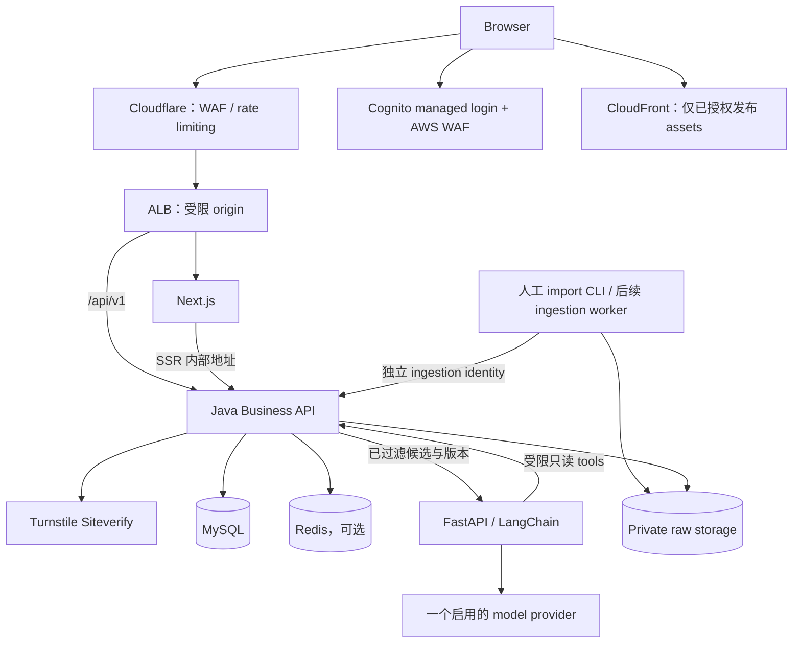

# Large-Lunch-Model：技术栈与 architecture 要求

- 文档版本：v0.3；更新日期：2026-11-06（Australia/Sydney）。
- 范围：悉尼 CBD 及周边的门店、菜品目录与有来源的个性化推荐，逐步扩展多 AI Persona。
- 实现状态：当前 repository 只有文档；本文及关联文件是待实现的 contract，不代表已有服务、数据库、数据集或 AWS 资源。
- 用户已确认：预算按菜品小计，包含所选规格与必选加料；配送费、平台 service fee 等订单级费用另列，不计入预算。
- 本次确认：保留 ECS Fargate；注册、登录、邮箱验证、Cloudflare 防护与跨实例并发控制属于首轮要求。阈值为可配置设计初值，尚未经 load test 验证。
- 文档分工：[MVP 与 User Stories](docs/sprint-1-mvp-and-user-stories.md)规定用户流程与 acceptance criteria；[数据要求](docs/data-requirements.md)规定数据语义、来源与发布；[AWS 要求](docs/aws-requirements.md)规定云端运行；[本地开发要求](docs/local-development.md)规定开发环境；[交付规划](docs/delivery-model-comparison-au-us-cn.md)讨论组织与节奏。

## 1. 范围、阶段与技术方向

### 1.1 交付边界

| 阶段 | 必须完成的结果 | 条件与边界 |
| --- | --- | --- |
| 启动准备 | 首个场景、来源样本、最小 data / API contract | 先验证数据能否获取、使用、保存和更新；允许人工整理 |
| 本地 walking skeleton | 页面 → fixture auth / Turnstile mock → Java admission → MySQL → Python mock → Java 校验 → 页面 | 无需 AWS 或真实模型 key；synthetic fixtures 与真实菜单清楚区分 |
| Sprint 1 / 受控 Alpha | 5–10 家门店、30–50 个人工审核 MenuItems；一个真实 provider、一个 Persona、一个 Skill；登录后 AI、配额与并发限制、Cloudflare 保护的受限 staging | 数量为规划量级；真实数据和 access 就绪后验收；首轮单人、单店、单渠道选餐 |
| 后续增量 | 偏好持久化或收藏、审核 UI、第二个 provider、更多渠道与数据更新自动化 | 依据反馈排序；多人点菜、跨渠道比较各自定义新 contract |
| Production / Beta | 已启用功能的权限、恢复、运行成本与维护责任得到验证 | 不以部署成功代替产品、数据与运维验收 |

首轮不要求四个平台全部接通、全城数据、大规模 crawler、自动 OCR、多模型比较、完整管理后台、embedding、复杂 LangGraph、Live2D 或 3D。新增来源按一个 adapter 一次验证，优先商家提供且使用权明确的菜单。

### 1.2 已选择的核心 stack

| 层次 | 技术 | 职责 |
| --- | --- | --- |
| Frontend | React、Next.js App Router、TypeScript | 页面、筛选、推荐交互、来源与费用口径展示 |
| Business Backend | Java、Spring Boot、Spring MVC、MyBatis | 业务规则、身份与权限、Catalog、预算过滤、数据发布与最终校验 |
| AI Application | Python、FastAPI、LangChain | Provider Adapter、Persona / Skill、候选比较与解释 |
| Persistence | MySQL；Redis 按运行需要启用 | MySQL 是业务事实来源；Redis 管理可重建 cache 与临时状态 |
| Storage / Cloud | S3、AWS ECS Fargate、Docker | 原始资料、可发布 assets、应用运行与部署 |
| Identity / Edge security | Cognito、Cloudflare Turnstile / WAF、Cognito AWS WAF | 登录与邮箱验证、请求校验、边缘防护；应用配额由 Java / MySQL 执行 |

Java 内部采用 modular monolith，AI service 独立部署；不引入 Kubernetes / EKS。选定技术不等于所有配套服务必须在首轮同时启用。runtime 与 dependency 的确切版本在 bootstrap 时按兼容矩阵固定，不能把文档示例当成已验证组合。

## 2. 服务职责与信任边界

| 组件 | 必须负责 | 访问边界 |
| --- | --- | --- |
| Next.js | 页面、浏览器交互、SSR、stream 状态 | 不直连 MySQL；SSR 使用内部 Java 地址；用户请求不得跨用户 cache |
| Java | 业务表读写、审核发布、候选过滤、推荐验证、权限与 audit | 唯一业务数据库写入 owner；Flyway migration 使用独立受控账号 |
| Python AI service | Prompt、provider 调用、解释和 structured output | 无业务 DB credentials；tools 只读，限制候选、用户范围与 request ID |
| Import CLI / Ingestion Worker | 获取允许使用的资料、解析、清洗、提出匹配建议 | 可写指定 raw storage；通过 Java ingestion API 写 draft，无发布权限 |
| Data reviewer | 审核字段、来源、匹配和版本 | 通过受权限保护的 Java API review / publish；首轮 CLI 足够 |

AI tools 与 ingestion API 是两类权限，不能因为都由 Python 调用而共用凭证。原始菜单、OCR 文本、用户评论均是不可信数据；其中的指令不得改变 system policy、allowed tools、身份或预算规则。模型不得任意访问 URL 或执行导入资料中的代码。

## 3. 数据模型与预算 contract

### 3.1 身份、渠道与版本

| 实体 | 含义 |
| --- | --- |
| Restaurant / Branch | 品牌与实体门店；独立门店也必须有稳定 Branch ID |
| Dish | 可选的通用菜品概念，用于分类；不能凭同名自动把不同菜合并 |
| MenuItem / MenuItemRevision | 门店菜品身份与 immutable 描述、饮食事实 revision，不直接代表某平台价格 |
| Offer / OfferVersion | 菜品在特定渠道、fulfillment 与规格下的售卖报价；已发布版本不可原地覆盖 |
| MenuSnapshot | 某门店与渠道的一次已发布菜单版本，引用确切 OfferVersions |
| Source / SourceRecord | 来源规则与具体证据记录；存储、展示、外发给 LLM 的权限分别判断 |
| ExternalMapping | 平台外部 ID 到内部身份的映射、匹配依据与审核状态 |
| IngestionBatch / Review | 导入批次、校验报告、审核决定、幂等与发布记录 |
| Recommendation | 输入、候选引用、最终 OfferVersions、provider 与 Prompt 版本、状态与反馈关联 |
| User / AuthSession | Cognito issuer + sub 映射、账号状态、可信邮箱验证状态、session 撤销记录 |
| Conversation / ChatMessage | 私人会话 owner、version、消息顺序和 request 关联 |
| AIRequest / AdmissionLease / QuotaBucket | 请求幂等、调用资格、并发占位、额度预留与结算 |

价格、可用性、营业信息分别保留来源与观察时间；采集时间不等于价格生效时间。`workflow_state` 使用 `DRAFT / REVIEWED / PUBLISHED / WITHDRAWN`；拒绝是 ReviewRecord 的决定并回到 DRAFT。`freshness_state` 使用 `FRESH / STALE / UNKNOWN`；资料过期、许可到期各有 eligibility reason，二者不能压成一个互斥 status。渠道价格不会互相覆盖，无法确认的跨平台匹配留待审核。

MySQL 保存结构化目录、draft、audit 和版本；本地文件 / Private S3 保存允许保留的原始资料；Redis 不承担持久化事实。大文件放对象存储，MySQL 保存 object key、hash 和受控 metadata。来源禁止留存时不得先把完整 response 写入 raw storage；historical snapshot 也不豁免 retention 要求。

### 3.2 预算与费用

请求必须使用稳定语义：`budget = {"amount":"25.00","currency":"AUD","scope":"MENU_SUBTOTAL"}`。首轮该 amount 是一个人的本次选餐小计上限；不默认为每人预算与多人总预算之间自动换算。

`menu_subtotal = Σ quantity × (selected_variant_price + Σ selected_option_delta)`。

- `selected_variant_price` 已是选定规格的价格，不能再重复加 base price。
- 所有必选项必须有明确选择；用户选中的可选加料也计入。缺少必选项价格或配置时，该组合不能作为“预算内”结果。每个 option 有稳定 ID、价格调整、选择约束、可售状态与饮食证据；禁忌和可售性在最终选定配置上校验，不能只检查菜品本体。
- 菜单价格使用已含适用税费的展示价格；税务口径未知则标记未知，不能由 LLM 推算。配送费、service fee、small-order fee 等订单级费用不计入小计，单独展示已知 / 未知。
- 首轮默认按常规菜单价，不计会员、首单、coupon 或其他有条件优惠；之后支持优惠时另存条件及期限。
- 金额在 MySQL 用 DECIMAL，在 Java 用 BigDecimal，在 Python 用 Decimal；JSON 使用十进制字符串，currency 必填。首轮 AUD 精确到分，不使用二进制浮点数累计金额。
- 首轮每个推荐组合只包含同一 Branch、同一 channel / fulfillment 的 Offer；不能把不同平台最低价拼成一个可下单套餐。
- UI 显示“菜品小计，配送费与平台费用另计”。`delivery_fee = null` 代表未知，不能当成 `0.00`。
- “小计满足预算”只证明已审核菜单报价符合规则，不承诺下单总额、实时库存或平台结算价。

### 3.3 发布和读取一致性

首轮最小路径：允许使用的样本 → 规范化 JSON / CSV → schema validation → Java draft → 人工 review → Java publish → 目录查询。

每个可见 snapshot 的发布在短 MySQL transaction 内完成：校验审核版本 → 写 immutable OfferVersions / Snapshot → 更新 active pointer 与 `catalog_revision` → 写 audit → commit。批次体积超过单次发布上限时，先分成可独立审核发布的 snapshot，避免长事务。重复发布返回原结果；相同幂等 key 与不同 payload 返回冲突。

目录 cache key 含数据库中的当前 `catalog_revision`；正确性不能只依赖“提交数据库后删 Redis 成功”。首轮从 MySQL 读取权威 revision，旧 cache key 到期回收；来源权限撤回及影响硬约束的门店状态变更也在事务内增加 revision。命中 cache 后仍按当前时间检查 eligibility，TTL 不超过所含证据的最早有效期；后续引入 outbox / event invalidation 时须证明同样的一致性。更新失败保留上一已发布版本，过期数据不进入严格预算候选。

完整字段、refresh policy、权限与验收以[数据要求](docs/data-requirements.md)为准。

## 4. Frontend 要求

| 用途 | 默认选型 |
| --- | --- |
| 类型与组件 | TypeScript strict、Tailwind CSS、shadcn/ui |
| API / 表单 | TanStack Query、React Hook Form、Zod |
| UI state | React state；复杂共享状态出现后再加 Zustand |
| Dependency / tests | pnpm、Vitest、React Testing Library、Playwright |

首轮提供预算与简单条件输入、候选/推荐结果、原始菜名、门店、渠道、规格、菜品小计、来源与更新时间。中文与 English 文案分离，原始名称不被译名覆盖。首轮还包含 User Stories 中的最小目录搜索、详情、返回状态、注册登录与私人会话恢复；偏好保存、收藏、多 Persona 与多 provider 选择留待后续。

首轮仅公开目录采用 SSR；私人页面在浏览器通过带 access token 的 client fetch 读取，内存 token 不假定能被 SSR 获得。浏览器调用同源 `/api/v1`，本地通过 Next.js rewrite，云端经 Cloudflare 保护的 ALB。SSR 使用 server-only Java 地址，不能把 Docker / Service Connect host 或 internal token 放进 `NEXT_PUBLIC_*`。私人响应设为 private / no-store，不能进入共享 ISR / CDN cache。

匿名用户可浏览目录；AI 输入保留未发送草稿并引导登录 / 邮箱验证，完成后由用户再次点击发送，不能自动发起收费请求。每个新 AI turn 获取 Turnstile token；Managed widget 可无交互完成，并非每条都强制点击复选框。必须处理 loading、empty、error、cancelled、data-changed、login-required、verification-required、quota-exceeded、busy、challenge-failed；比较功能启用后才增加每个模型的 partial 状态。键盘操作与手机布局纳入验收。首轮角色采用可替换的静态资源及 idle / thinking / speaking / error 状态，角色与 model ID 解耦。

登录 redirect 的草稿恢复只允许在当前 tab 的 sessionStorage 临时保存未发送文本和表单条件，设置短 TTL 并在退出 / 切换账号后清除；已发送历史仍由 owner-scoped API 读取，tokens 不存于其中。OAuth state 仅携带随机关联值，不把文本、token 或精确位置放进 URL。

首版 `mode=dine_in/delivery` 分别映射到 `fulfillment_type=DINE_IN/DELIVERY`；data schema 的 PICKUP 留作兼容，暂不开放对应 UI mode。mode、预算、区域和 hard dietary constraints 在本轮调用前以用户确认的结构化条件交给 Java；自然语言中的条件修改可提示用户确认表单，不额外发起付费 intent extraction。单次 LLM 负责在这批候选中解释与选择，不能修改已确认 hard constraints。

## 5. Java Business Backend 要求

### 5.1 技术与模块

默认使用 Spring MVC、MyBatis、Spring Security、Jakarta Bean Validation、OpenAPI、Flyway、Maven Wrapper、JUnit / Mockito / Testcontainers、Actuator / Micrometer。简单 CRUD 是否引入 MyBatis-Plus 由兼容验证与实际收益决定。

模块划分为 Catalog、Ingestion / Review、Recommendations、Users / Access、Preferences / Favorites（后续）、Agents registry、Observability。模块间通过明确 service interface 协作，不把 ORM entity 直接作为跨语言 DTO。

### 5.2 硬性规则

1. Java 执行预算、地区、渠道、可用性、freshness 和明确禁忌的过滤及最终复核；Persona 不得改变规则。
2. 过敏原与饮食标签使用 `contains / confirmed_absent / unknown` 或等价三态。严格禁忌查询排除 unknown，结果不表述为医学安全保证。
3. 地理范围使用有来源的坐标及 MySQL spatial 查询，坐标顺序、SRID、米制距离通过已知地点 fixture 验证。首轮显示直线距离；步行时间和送达可行性需要独立数据。
4. MyBatis 参数化查询；排序字段白名单；分页有上限；metadata、数量和 input size 有约束。
5. LLM 与外部 HTTP 调用不持有数据库 transaction 或锁。provider 重试区分连接失败与可能已计费请求，客户端自动重连不重复触发收费调用。
6. 发布、偏好更新与推荐状态迁移具有 concurrency control；所有状态更新通过 Java 完成。

### 5.3 注册登录、session 与权限

匿名用户可以浏览、搜索、读取已发布详情和使用已核验的地图 / 平台链接。**所有新付费 AI 调用**（包括 chat、recommendation、按需 AI 概览与刷新）都要求已注册、已登录、邮箱已验证且账号 ACTIVE；不能通过改 endpoint、直接调 Python 或公共 cache miss 绕过。已批准的公共 AI 概览可公开读，未命中时返回“暂无概览”，不得由匿名读取触发生成。

- 使用 Cognito managed login 完成注册、邮箱确认、登录和密码重置，浏览器采用 Authorization Code + PKCE，校验 state / nonce 与精确 callback allowlist。公开 app client 不携带 client secret，密码不进入 Java / Next.js 自建表。首轮仅 email 账号，不扩展 social login。
- Java 验证 access token 的签名、issuer、expiry、`token_use=access`、适用的 `client_id` / audience 与 scope，映射唯一 `(issuer, sub)`；禁止信任浏览器传来的 user ID、角色或 `email_verified`，ID token 不充当 API access token。
- access token 不保证带有 `email_verified`。首轮在新付费请求前由 Java 以受限 IAM 调用该 User Pool 的 `AdminGetUser`，核对可信 subject、Enabled 与 `email_verified`；同步可信状态但不覆盖应用 DISABLED。获取失败时拒绝新 AI 请求，不猜测为已验证。费用 / request quota 在该检查后才预留。[Cognito access token](https://docs.aws.amazon.com/cognito/latest/developerguide/amazon-cognito-user-pools-using-the-access-token.html)、[AdminGetUser](https://docs.aws.amazon.com/cognito-user-identity-pools/latest/APIReference/API_AdminGetUser.html)
- access / refresh token 由成熟 OIDC client 在内存中管理，不持久化到 localStorage；SSR 只处理公共目录。若未来改 cookie session，另补 HttpOnly、Secure、SameSite 与 CSRF contract。
- Cognito app client 启用 token revocation。Java 私有 API 同时检查 MySQL 的账号状态与 AuthSession 撤销记录；只验 JWT 签名不能发现所有撤销。`POST /api/v1/auth/logout` 幂等撤销当前可信 `origin_jti` token family，随后浏览器执行 Cognito revoke / logout、清理 token 与私人缓存并广播退出给其他 tab。重复 logout 只对当前 token family 设窄例外：JWT 签名、issuer、client 与 expiry 等仍有效时，即使 family 已撤销也返回幂等成功；不授予读取或生成权限。撤销 tombstone 至少覆盖该 family 最长可能有效期；无法确认时不得提前删除。退出失败要明确提示并仍清本机敏感状态，不能声称服务端已撤销。[Cognito revocation](https://docs.aws.amazon.com/cognito/latest/developerguide/token-revocation.html)
- 账号禁用以应用管理流程先更新 MySQL DISABLED、撤销 session、请求取消在途任务，再同步 Cognito。直接在 Cognito 禁用会在下次新 AI 请求的 profile 检查被发现；不把离线 JWT 描述为实时撤销通知。私人结果发布与读取均重新检查 owner / account / session。请求关联发起 session 与 token expiry，在 heartbeat / final result 检查失效、退出或禁用信号，停止输出并尽力取消；usage / audit 收尾仍必须写入。已经到 provider 的调用可能仍计费。
- Conversation、ChatMessage、AIRequest、Recommendation 均按服务端 owner 隔离；跨用户 ID 访问统一 404，不暴露对象是否存在。普通 admin / reviewer 角色不自动获得私人 chat 内容权限。私人 API 与 SSE 禁止共享 CDN / ISR cache。
- 内部身份按方向独立：`BUSINESS_TO_AI_TOKEN`、`AI_TO_BUSINESS_TOKEN`、`INGESTION_TO_BUSINESS_TOKEN`。AI tools 只接受 Java 签发的 request-scoped 候选范围与期限，不能靠任意 user ID 越权；ingestion 无发布权限。内部 token 不进入 Prompt、浏览器或日志。
- 本地 `local_fixture` 仅用于 loopback；staging / production 启动拒绝 fixture auth 与 mock / test Turnstile bypass。

### 5.4 Cloudflare 与 Turnstile

云端页面和业务 API 入口为 Cloudflare proxied hostname → HTTPS ALB → ECS Fargate。Cloudflare WAF、HTTP rate limiting、DDoS protection 处理入口攻击；Java 的验证、权限和额度检查仍是独立边界。ALB origin 必须限制 Cloudflare 来源地址，并检查本环境的 origin secret header 与 Host，防止绕开 edge 或利用其他 Cloudflare zone 转发；详见 AWS 文档。

每个新 AI turn 在 Java 调用 Siteverify；仅前端显示 widget 不构成验证。必须检查 `success`、hostname allowlist、`action=ai_chat`；其他按需生成入口若启用，使用独立 action allowlist 但复用同一 admission service。token 有效期 300 秒、只可使用一次；过期 / 重放要求刷新。`TURNSTILE_SECRET_KEY` 仅存在 Java server / Secrets Manager，site key 可公开。Siteverify transport retry 复用同一 UUID `idempotency_key`；token / secret 不写日志或业务表。[Turnstile server-side validation](https://developers.cloudflare.com/turnstile/get-started/server-side-validation/)

已有 user-scoped idempotency request 先返回原状态，不再次消费旧 Turnstile token；新 request row 由唯一约束确定一个验证 owner。同一 token 不得用于不同 request。验证失败返回 403，Siteverify 超时 / 不可用返回 503，均不调用 provider；普通浏览继续可用。注册 / 登录由 Cognito managed login 承担，其域名不在本项目 Cloudflare origin 后面，须关联 AWS WAF 并配置确认邮件和登录保护；不能声称在本站跳转前放 widget 就保护了 Cognito 的直接 API。[Cognito WAF](https://docs.aws.amazon.com/cognito/latest/developerguide/user-pool-waf.html)

API / SSE 路径使用可识别的 block / rate-limit 响应，不插入 HTML Managed Challenge；人机交互通过页面 Turnstile 完成。前端还要识别 edge 直接返回的非 JSON 403 / 429，显示可恢复提示，不能当作模型输出。Cloudflare plan、rule quota 和限流精度须部署时核实，不把边缘计数当精确业务配额。

前端将用户输入、菜单与模型输出按不可信内容渲染，禁用 raw HTML；需要 Markdown 时使用安全 renderer / sanitization，链接限定批准的协议与来源，禁止 `javascript:` URL。CSP 仅放行应用和实际需要的 Cognito / Turnstile origins；CORS 使用明确 allowlist，不以 CORS 代替授权。分页、body、连接池与请求时间均有上限，入口已有的 MyBatis 参数化查询、URL ingest SSRF 检查继续生效。

### 5.5 首轮并发、配额与 backpressure

下表为可配置的保守初值，**不是已测容量、SLA 或用户数量承诺**；调整需记录 `admission_config_version`、成本和 load-test 证据。并发限制从第一个真实 provider 调用前就生效。

| Config key | 初值 | 语义 |
| --- | --- | --- |
| `AI_MAX_ACTIVE_PER_USER` | 1 | 同一账号跨 tab / 会话 / Java replica 的 active 请求上限 |
| `AI_MAX_ACTIVE_GLOBAL` | 5 | 整个环境的 active paid AI 请求上限 |
| `AI_MAX_ACTIVE_PER_PROVIDER` | 5 | 当前启用 provider 的上限；与 global 同时满足 |
| `AI_REQUESTS_PER_USER_PER_MINUTE` | 5 | rolling 60 秒内的新 turn 提交尝试，失败验证也占 attempt；同 key 查状态不算新 turn |
| `AI_REQUESTS_PER_USER_PER_DAY` | 20 | UTC 日内已开始 / 可能已开始的 provider 请求；开始前先预留名额 |
| `AI_TOKENS_GLOBAL_PER_DAY` | 100000 | 环境级 UTC 日 input + output token 预留与用量总上限 |
| `AI_MAX_INPUT_TOKENS` | 6000 | 完整 Prompt 上限，含 system、历史、候选、tool / schema 开销 |
| `AI_MAX_OUTPUT_TOKENS` | 1000 | provider 端输出限制；模型若另计 reasoning tokens，适配时必须纳入上限与预留 |
| `AI_MAX_CALLS_PER_TURN` | 1 | 首版单次 LLM 调用；不隐式做付费总结、二次修复或 fallback |
| `AI_MAX_MESSAGE_CHARS` | 2000 | 单条用户输入 Unicode code points 上限 |
| `AI_MAX_REQUEST_BYTES` | 32768 | AI POST body 上限，读取时即限制，不等完整载入后再校验 |
| `AI_QUEUE_ENABLED` | false | 无等待队列；容量不足立即 backpressure |

MySQL 是 admission 唯一权威。Java 在短 transaction 中按固定锁顺序检查账号 / conversation version、user / global / provider slot、daily request 与 token bucket，并一起预留；原子 conditional update / unique constraints 防止两个实例同时通过。Redis 只能预筛或 cache，不能使用 Redis 与 DB 两套互不一致的配额，不能在故障时切到空的 process-local counter。MySQL 无法确认资格则拒绝新付费请求；已有 stream 能继续收尾但不发起下一次调用。所有外部 HTTP / LLM / Siteverify 均在 transaction 外执行。

最小执行顺序：限制 body / transport attempt → 验证身份与 owner → 解析 idempotency / 创建 pending request → user attempt limit → 可信邮箱检查 / Siteverify → Java 候选与 Prompt token 上限检查 → atomic admission → 唯一 dispatch claim → provider → Java final validation 与 usage settlement。无候选可直接完成空结果，不调用模型、不消耗 daily AI quota；仍通过短接受事务检查 owner、account、session、conversation version / active turn，并保存消息与空结果。并发的同会话 turn 返回 CONVERSATION_BUSY / VERSION_CONFLICT，不能绕过历史顺序。服务端 quota 信息只供 UI 展示，以 admission 时状态为准；IP 限流是补充，不能用 IP 代替账号计数，也不能仅靠登录防止多账号滥用。

- 幂等范围为 `user_id + operation + Idempotency-Key`；hash 包含 business input、conversation ID / expected version、provider config，排除 access token、Turnstile token、transport headers。唯一 request row 确定 owner；重放使用该 request 已冻结的配置快照计算 hash，不因部署换 config 把相同输入误判冲突。相同 key / 不同输入返回 409。并发重试只能获得原 request ID，不能创建第二次调用。admission 前 verifier / owner 崩溃也需按 90 秒请求期限落为未 dispatch 的失败，禁止 pending 永久挂起；新尝试由用户用新 key 主动提交。AI idempotency metadata 默认保留 90 天，该窗口内保证复用；过窗不支持旧 key replay，客户端新 turn 始终创建新 key。
- Java 为 request 签发一次性的 dispatch claim，由 Python 经受限 internal API 原子领取后才调用 provider；重复内部调用无法再次领取。claim 前后的未知失败均不得自动重新 dispatch，未持有数据库锁等待网络。不声称网络分区下可在第三方实现 exactly-once billing。
- admission 先预留完整输入的保守 token 上界加最大输出；完整 Prompt 由可复核 tokenizer / provider adapter 计算，无法界定收费 token 的 model 不启用。超长历史采用确定性截断并提示，不触发额外 LLM summary。实际 usage 幂等结算释放差额；估计成本不是账单保证。
- provider 明确未开始的失败可释放 daily request / token reservation；已开始或无法确认是否开始的请求，即使失败、超时、取消或 final validation 返回 DATA_CHANGED，也计入 daily request。usage 不明时保留 token 上界，待 reconciliation 后调整；不能把未知用量当零。
- lease 初值 90 秒、每 15 秒续约，使用 DB 时间与 owner / fencing version。expiry 是检查信号，不能直接证明远端调用已停止。崩溃、断线、取消后进入 `RECONCILIATION_REQUIRED`，未知调用继续占用 slot / 额度，直到可靠终态或受审计的人工处理；必要时暂停新 AI。旧 owner 的迟到回调不能覆盖新状态或重复结算。
- provider operation deadline 60 秒；Java request deadline 90 秒。取消必须传播，收到取消请求可先结束前端 stream，但不能提前释放未知 provider slot。此并发上限约束本系统批准的在途调用；第三方在断线后是否仍计算需单独核实，不能保证即时停止计费。
- UTC 日期以 reservation 创建时的 bucket 固定，跨午夜任务仍在原 bucket 结算；active slot 不因午夜重置。rolling minute attempt 记录采用 DB 时间，配置变更不能清空 ledger。多实例 scaling / rolling deploy 不自动提高 provider 或 daily 上限。
- AI 的 HTTP connection pool、Java stream executor、Python semaphore、DB pool 均有界；其上限按 replica 总量规划，不能以增加线程绕过共享 admission。DB pool 预留目录查询容量，AI 饱和时普通浏览保持可用。cache stampede 只允许单 owner 刷新，不能产生额外匿名 AI 调用。

首轮验收至少在共享 MySQL 的 2 Java + 2 AI replicas 上用 barrier mock provider 保持调用重叠：50 个不同用户同时新建请求，最多 5 个获准 active；同用户 10 个 tab / 不同 keys 最多 1 个 active；20 个同 key 请求最多 1 次 provider dispatch。覆盖 Redis 故障、MySQL 故障、进程 crash、滚动部署、lease 到期、取消、午夜边界、usage 回调重放和额度耗尽。记录实际 peak、reject count、p95、DB pool wait、token ledger 与 config version；这些是待执行验收，不是当前测试结果。

## 6. Python AI Application 要求

默认组合：FastAPI、Pydantic / Pydantic Settings、Uvicorn、LangChain、HTTPX、uv / uv.lock、Ruff、type checker 与 pytest。模型训练、fine-tuning、GPU 自托管不属于当前范围。

Provider Adapter 提供普通调用、streaming、capability 查询、timeout、统一错误和 usage。GPT、Claude、Grok、DeepSeek 为后续支持方向，首轮只实现并验证一个 provider；使用其受支持 integration，并记录准确 model ID。structured output 与 tool calling 必须按实际 model 验证，不假设可互换。fallback 需用户可见且预先选择，不静默切换 provider。

Persona 定义语气与关注点；Skill 定义目标、tools、input / output schema 与限制。配置使用版本化 Markdown instructions 与 YAML / JSON metadata，包含稳定 ID、version、schema、allowed tools 与 capability requirements。首轮一个“预算内选餐” Skill 即可；用户任意上传代码不在范围内。

### 6.1 推荐 workflow

1. Java 按第 5 节完成身份、Turnstile、候选过滤与 atomic admission，以最新发布 revision 筛选具有来源的 OfferVersions；记录 request、候选快照及预留，提交 transaction 后才允许 dispatch。
2. Java 向 AI 传递最小必要偏好、候选及证据。只有允许用于外部 inference 的字段可以进入 Prompt；无需传递姓名、邮箱或精确住址。
3. AI 使用固定 Persona / Skill，在候选内选择组合并解释；补充 tools 由 Java 再次授权。
4. AI 返回 `menu_item_id`、`menu_item_revision_id`、`menu_snapshot_id`、`offer_id`、`offer_version_id`、`quantity`、`selected_options`、`reason`、`source_ids`、`uncertainties`。`source_ids` 指具体 SourceRecord ID。
5. Java 校验 IDs 属于候选集、source 引用支持相应事实、选择项完整、currency 与小计、含加料的最终禁忌、发布状态和数据版本；金额由 Java 重算。
6. 在模型返回后的短 MySQL transaction 内，锁定所涉 current pointers / 来源状态行，或使用等价的原子 CAS；复核 MenuSnapshot、MenuItemRevision、OfferVersion、来源权限与有效期，并原子保存 Recommendation completion。发布、撤回与最终校验遵守同一锁顺序。相关 active version 或 hard facts 已变化则返回 `DATA_CHANGED`；不自动重复调用付费模型。结果代表最终 transaction 提交时的有效数据，之后的更新通过读取时检查标明。

无候选返回结构化原因，不要求 LLM 编造替代菜品。解释与原始菜单冲突时不得作为已验证事实输出；关键事实由 Java 模板填充，文本解释可丢弃或降级。返回 source ID 只证明引用关系可校验，不代表任意自然语言推断已被自动证实。

### 6.2 Retrieval 与 async ingestion

首轮使用结构化筛选与关键词检索。embedding、reranking、LangGraph 仅在 evaluation 显示收益后加入。AI process 的 background task 不承担必须可靠完成的数据导入。

启用批量 OCR 或定时采集后，使用 SQS + 独立 ingestion worker，消息只传 batch ID / object reference；重复投递由幂等处理，失败进入 dead-letter queue。首轮人工 CLI 导入不依赖 SQS 或 scheduler。

## 7. API 与 streaming contract

以下是待实现接口，最终 schema 由 Java OpenAPI 与 FastAPI OpenAPI 维护，contract tests 验证消费者一致性。

| 路径 | 用途与权限 | 阶段 |
| --- | --- | --- |
| `GET /api/v1/restaurants`、`GET /api/v1/menu-items` | 仅已发布目录，支持 Branch / channel / fulfillment 过滤 | 首轮 |
| `GET /api/v1/agents` | 返回实际启用的 provider / Persona / Skill 与 capabilities | 首轮可各一项 |
| `GET /api/v1/me`、`GET /api/v1/me/ai-usage` | 当前有效 session 的最小 profile / 配额视图；不调用模型 | 首轮 |
| `POST /api/v1/auth/logout` | 幂等撤销当前 session family；浏览器随后完成 Cognito logout | 首轮 |
| `POST /api/v1/conversations`、`GET /api/v1/conversations`、`GET /api/v1/conversations/{id}` | 创建 / 分页读取自己的会话；有效账号与 owner isolation | 首轮 |
| `POST /api/v1/recommendations/stream` | 已验证邮箱的登录用户；Turnstile + admission；携带 conversation_id、expected_conversation_version 与 Idempotency-Key | 首轮 |
| `POST /api/v1/recommendations/{id}/cancel` | owner 幂等请求取消；不直接释放未知 provider 用量 | 首轮 |
| `GET /api/v1/recommendations/{id}` | 仅请求 owner 可读取状态与已保存结果，解决连接中断后的查询 | 首轮；不代表自动续流 |
| `POST /internal/v1/recommendations/stream` | Java 调用 AI，使用 business-to-AI identity 与 request-scoped admission context | 首轮 |
| `POST /internal/v1/ai-requests/{id}/claim` | AI identity + Java 签发 context 原子领取唯一 dispatch；不能重复领取 | 首轮 |
| `POST /internal/v1/ai-requests/{id}/usage` | AI identity 回报受限 request 的终态 / usage；Java 幂等结算，AI 不写 DB | 首轮 |
| `GET /internal/v1/catalog/candidates` | AI 受限只读 tool；必须带有效 request context | 需要补查时 |
| `POST /api/v1/admin/sources`、`POST /api/v1/admin/restaurants`、`POST /api/v1/admin/branches` | 有权限的 operator 登记来源 policy、品牌和门店；ingestion identity 不能自己批准来源用途 | 首轮 bootstrap |
| `PATCH /api/v1/admin/sources/{id}`、`POST /api/v1/admin/menu-snapshots/{id}/withdraw` | source manager 更新用途 / 撤销来源；publisher 撤回错误菜单并写 audit / revision | 首轮维护 |
| `POST /internal/v1/ingestion/source-records` | ingestion identity 登记来源观察与获准证据引用 | 首轮 |
| `POST /internal/v1/ingestion/batches` | 建立受控导入批次 | 首轮 |
| `POST /internal/v1/ingestion/batches/{id}/records` | 幂等写入 draft，返回 validation report | 首轮 |
| `POST /internal/v1/ingestion/batches/{id}/complete` | 固定完整 records manifest，完成后才允许 review | 首轮 |
| `POST /api/v1/admin/ingestion/source-records`、`POST /api/v1/admin/ingestion/batches`、`POST /api/v1/admin/ingestion/batches/{id}/records`、`POST /api/v1/admin/ingestion/batches/{id}/complete` | 人工 CLI 使用 `catalog:import` 用户权限，调用与内部 ingestion 相同的 application service；云端经 Cloudflare / ALB 管理入口 | 首轮 |
| `GET /api/v1/admin/ingestion/batches/{id}` | reviewer 查看 validation report、payload hash 和差异 | 首轮 |
| `POST /api/v1/admin/ingestion/batches/{id}/review` | reviewer 对确切批次版本作决定 | 首轮 CLI 调用 |
| `POST /api/v1/admin/ingestion/batches/{id}/publish` | publisher 原子发布已审核版本 | 首轮 CLI 调用 |
| `PUT /api/v1/me/preferences`、`POST /api/v1/recommendations/{id}/feedback` | 个人偏好与反馈，owner isolation | 后续 |

所有 ingestion 幂等 key 按 caller + operation + resource scope 隔离；records 每个 chunk 有独立 key / hash，complete 校验预期数量与 manifest hash。更改审核内容必须重新打开为 DRAFT 并重新 complete / review，禁止在已发布 snapshot 上追加。

原始文件上传先由 Java 校验 source policy、文件类型/大小与权限，再提供受限 S3 presigned URL；上传完成校验对象后登记。URL ingest 限定来源、协议、redirect 与目标地址，拒绝 localhost、metadata endpoint 和私有网段，避免 SSRF。首轮可只支持本地文件输入。

统一 error 包含 `code`、`message`、`request_id`、`retryable`，按需含 `retry_after_seconds` / `reset_at`。通用业务码包括 `VALIDATION_ERROR`、`FORBIDDEN`、`NO_CANDIDATES`、`DATA_CHANGED`、`PROVIDER_TIMEOUT`、`INVALID_MODEL_OUTPUT`、`SOURCE_NOT_PERMITTED`；新 AI 入口使用以下明确分类，UI 不依赖英文 message 判断：

| HTTP | Code | 行为 |
| --- | --- | --- |
| 401 | `AUTH_REQUIRED` | 缺失 / 过期 / 被撤销 session，引导登录并保留未发送输入 |
| 403 | `EMAIL_VERIFICATION_REQUIRED`、`ACCOUNT_DISABLED` | 不调用模型；引导验证或说明账号不可用 |
| 403 | `BOT_VERIFICATION_FAILED` | 获取新 Turnstile token 后由用户重试 |
| 404 | `NOT_FOUND` | 对象不存在或不属于当前用户 |
| 409 | `IDEMPOTENCY_CONFLICT`、`CONVERSATION_BUSY`、`VERSION_CONFLICT` | 读取现有请求 / 当前会话，不自动重发收费请求 |
| 413 | `REQUEST_TOO_LARGE` | 缩短请求；不保存超限正文 |
| 429 | `USER_RATE_LIMITED`、`USER_CONCURRENCY_LIMITED`、`USER_DAILY_QUOTA_EXCEEDED` | 返回适用的 Retry-After / reset_at，展示等待或额度耗尽 |
| 503 | `AI_CAPACITY_EXHAUSTED`、`AI_TEMPORARILY_UNAVAILABLE`、`BOT_VERIFICATION_UNAVAILABLE` | global / provider 容量或全局 daily token 耗尽、依赖故障；受控拒绝并保留浏览 |

stream 建立前用 HTTP JSON；建立后以 `error` + `done` 表达失败，不能再更改 HTTP status。`Retry-After` 为保守重试建议，daily quota 提供 UTC reset_at，busy 不保证该时刻有空位；前端不自动发起下一次收费请求。

### 7.1 SSE 与请求生命周期

使用 POST + fetch streaming；event 为 `status`、`delta`、`result`、`error`、`done`，携带 `request_id` 与单调 sequence。只有 `result` 是经 Java 校验的权威业务结果；`delta` 为暂态表达，不把其中未验证的价格、菜品或禁忌判断显示为已确认结果。

请求状态持久化于 MySQL：`pending → running → completed / failed / cancelled`。无候选属于已完成但为空的业务结果；`done` 表示传输结束，不等同于成功。业务完成后客户端断开不得把已完成记录改成 cancelled。状态更新使用条件更新防止并发覆盖；传输 / 推荐状态与 admission / settlement 分开，`cancelled` 或 `failed` 不表示 provider 一定停止或用量已结算。

- 请求创建支持 user-scoped `Idempotency-Key` 与 payload hash；同 key/同内容通过 `status` 返回已有 request ID 后以 `done` 结束，客户端使用 GET 查询该请求，不再次验证旧 challenge，不启动新的 stream 或付费调用；同 key/不同内容返回 409。重试新一轮推荐显式使用新 key。
- 初始建议：provider connect timeout 5 秒，LLM operation deadline 60 秒，Java 请求 deadline 90 秒，SSE heartbeat 15 秒，ALB idle timeout 120 秒；均为待 smoke 验证的配置初值，不是延迟承诺。
- heartbeat 是实际输出的 SSE comment / event bytes，不能依赖 HTTP/2 PING。Service Connect endpoints 的 `perRequestTimeoutSeconds` / `idleTimeoutSeconds` 初值显式设为 120 秒，避免默认 per-request timeout 截断 stream；应用 60 / 90 秒 deadline 优先生效。代理禁用 response buffering 与 SSE cache，逐段 flush。
- 浏览器取消 / 连接断开向 Java、Python、provider 传播取消；provider 可能已处理并计费，需记录 usage 不确定状态并按第 5.5 节保留 reservation。应用 shutdown 有 drain 与独立期限。
- 首轮不自动重连或 replay stream；已有请求可通过 GET 查询。web / Java / AI 的 timeout 与 ALB 连接 idle 设置须分开理解并验证。

## 8. Persistence、privacy 与 observability

MySQL 使用 utf8mb4、显式外键/unique constraints/indexes、UTC timestamps；营业时段保留 `Australia/Sydney` 等 IANA timezone 与跨午夜规则。Schema 使用 Flyway versioned migrations；发布由一次性 migration task 执行，runtime DB user 无 DDL 权限。

Redis key 必须有 namespace、owner、TTL 与版本维度。首轮私人会话持久化在 MySQL，默认保留 30 天后删除正文；此期限为项目初值，来源 policy 更短时取更短期限，backup / restore 同步处理。日志不保存 chat 正文、Turnstile token 或原始 IP。非内容 quota / settlement audit 初值 90 天，未解决的 reservation 与安全撤销记录按必要有效期保留。首轮不在 Redis / CDN 缓存私人 LLM 结果；以后若引入，key 至少含 owner、偏好版本、catalog revision、model、Persona / Skill / Prompt 版本，并落实删除与失效。

每次推荐记录 request ID、候选版本、实际 provider / model、Prompt / Skill 版本、latency、usage、完成状态；费用使用明确价格版本估算。日志默认不含完整 Prompt、原始菜单正文、access token 或敏感偏好。调试 tracing 默认关闭，开启前明确采样、脱敏、访问权限与 retention。外部 LLM 数据传递必须符合各来源允许的用途。

来源撤回、资料过期或删除请求要传播到 raw、derived records、cache 与可见推荐；保留必要的非内容 audit / tombstone，历史记录可标识“证据已删除”，不能为复现无限保留受限内容。数据库和对象备份的过期/恢复后删除重放也需纳入流程。

## 9. AWS 与本地开发边界

默认 AWS Region 为 `ap-southeast-2`。应用、业务数据的部署 Region 不代表外部 provider inference 都在澳洲。

| 能力 | 首轮 staging | 扩展条件 |
| --- | --- | --- |
| 应用 | 保留 ECS Fargate 三服务、ECR、ALB、service discovery；支持多 replica admission | 副本数与 autoscaling 由实测决定；共享 AI quota 不随副本翻倍 |
| Edge | Cloudflare proxied DNS、WAF / rate limiting、Turnstile、受限 origin；Cognito 关联 AWS WAF | 规则 / 计划 / 费用经 staging 验证，不宣称绝对防攻击 |
| 数据 | Private RDS MySQL、Private S3 | 存储与备份按来源 retention；production restore drill |
| Redis | 仅需要 cache / 预筛时部署 | admission 始终在 MySQL；故障不切换到独立计数器 |
| Identity / secrets | Cognito、Secrets Manager、task roles | 服务访问按 caller 与资源最小授权 |
| Assets | 授权 assets 用 S3 + CloudFront OAC | 原始资料 bucket 不连接公开 distribution |
| Ingestion | CLI → Java review / publish | 自动任务才启用 SQS、worker、EventBridge Scheduler |
| 运维 | CloudWatch、cost alerts、GitHub OIDC、Terraform | Budget alert 不替代应用额度拒绝与并发限制 |

首轮云端默认 Service Connect managed TLS 与 AWS Private CA；ALB HTTPS target / health checks 经过 proxy，应用内部保持 HTTP，具体配置和 CA 成本见 AWS 文档。公网只开放页面与获准业务 API；内部 endpoints、RDS、Redis 不公开。私有服务访问互联网 provider 需要明确出站路径与成本。migration、备份恢复、Terraform state、IAM、TLS 与部署策略详见[AWS 要求](docs/aws-requirements.md)。

本地默认主机运行三个应用，Docker Compose 提供 MySQL 与 Redis；端口分别为 3000 / 8080 / 8000 / 3306 / 6379，绑定 localhost。默认 mock provider，真实 provider 与 AWS smoke 分别验收。详细启动 contract、env、seed 与排障见[本地开发要求](docs/local-development.md)。

## 10. Repository 与工程交付

### 10.1 待实现目录

| 路径 | 内容 |
| --- | --- |
| `apps/web/` | Next.js / React frontend |
| `services/business-api/` | Java / Spring Boot / MyBatis 与 Flyway migrations |
| `services/ai-app/` | FastAPI、provider adapters、AI tools |
| `tools/ingestion/` | 首轮文件校验与 API import CLI |
| `services/ingestion/` | 后续可靠 async worker，不混入 AI process |
| `contracts/` | OpenAPI snapshots、JSON Schema、request/result fixtures |
| `ai-config/personas/`、`ai-config/skills/` | 版本化配置 |
| `data/fixtures/` | synthetic 或允许分发的小型 seed，标识来源与用途 |
| `data/raw/`、`data/processed/` | 本地资料与中间结果，排除 Git；同样受 retention 限制 |
| `infra/terraform/`、根目录 `compose.yaml` / `Makefile` | 云端 IaC 与本地依赖配置；未来辅助 Compose 文件可放 `infra/compose/`，canonical 入口仍为根文件 |
| `docs/` | 要求、architecture decisions、运行与维护说明 |

pnpm 管理 JS / TS，Maven 管理 Java，uv 管理 Python，各自提交 lockfile / wrapper / BOM。Bootstrap 必须固定 runtime、framework、driver、镜像与 CPU architecture，并验证 Spring Boot / MyBatis / Security 以及 LangChain / provider packages 的组合。Apple Silicon 本地和 ECS target architecture 在构建时明确，不把 x86 模拟执行视为已验证 ARM release。

### 10.2 CI/CD 与测试

GitHub Actions 默认执行检查、测试、镜像构建、staging deploy 与 smoke；production 是独立受控 promotion，使用已验证 image digest。GitHub OIDC 获取短期 AWS credentials。PR 不获取 production secrets，常规 CI 使用 mock provider。

首轮重点：登录 / 邮箱 / session 撤销、Turnstile replay / outage、跨用户访问、MySQL admission 多实例争用与 usage 结算、origin 绕过检查，以及 schema / required options / decimal、cross-platform identity、审核与 publish 幂等、catalog revision、硬性过滤、内部 scope、owner isolation、无候选、无效模型输出、DATA_CHANGED、SSE 取消和重复请求。选中的真实 provider 必须通过受控 live smoke；未启用 providers 不构成首轮阻塞。

数据与服务 contract changes 要触发跨服务 checks。发布 manifest 记录 image digests、migration version、配置版本和 data version；应用回滚不自动回滚 database schema。生产恢复通过实际 restore drill 证明。

## 11. 分阶段验收

### 11.1 本地可开发

- [ ] bootstrap、locked dependencies、Compose 与健康检查可重复执行。
- [ ] synthetic fixtures 经同一条 import / review / publish 路径进入 MySQL，重复执行不产生重复项。
- [ ] mock provider 跑通页面 → Java → Python → Java final validation；没有真实 key 仍可开发。
- [ ] 本地数据可持久化；destructive reset 明确范围；internal auth 与 local-only profile 有测试。
- [ ] 2 Java + 2 AI 的 mock 并发案例、idempotency、取消 / crash reconciliation、Redis / MySQL 故障与午夜 quota 边界通过，记录实际结果。

### 11.2 首轮真实数据与受控 Alpha

- [ ] 5–10 家门店、30–50 MenuItems 的规划样本实际通过审核，来源与权限可查；不足时如实报告实际数量。
- [ ] Offer / OfferVersion 明确渠道、规格、必选项和 AUD 小计；配送费与 service fee 不计入预算且未知不冒充零。
- [ ] 一个 provider / Persona / Skill 的真实 smoke、错误路径、来源与 Java 复核通过。
- [ ] stream 不把未审核输出当权威事实；版本变化、重复请求、取消都有可追溯结果。
- [ ] 注册 → 邮箱确认 → 登录 → live Turnstile → 有额度的 AI turn 通过；匿名 / 禁用 / 未验证 / 越权 / 重放请求不能调用 provider。
- [ ] 有 cloud access 时部署 Cloudflare 保护的受限 staging，验证 origin 不可绕过、Cognito AWS WAF、CI/CD、告警、quota 与恢复；仅本地通过不得标记云端完成。

### 11.3 后续功能与 Production

- [ ] 仅对实际启用的偏好/收藏、多 provider、多渠道或多人点菜执行对应功能与权限验收。
- [ ] 已发布数据具有可执行更新、过期、撤回与 reviewer ownership。
- [ ] Production 的可用性、RPO/RTO、预算、告警接收者和恢复证据记录完整。

## 12. 参考与变更记录

2026-11-06 修订：保留 ECS Fargate；将账户与邮箱确认、session 撤销、Turnstile、Cloudflare / origin 边界、共享 admission ledger、并发 / quota 默认值、私人会话与多实例验收纳入首轮。相关能力均待实现，未执行 load test 或部署。

2026-10-29 修订：统一阶段范围；明确菜品小计预算；补齐 Offer 与 provenance；分离 AI / ingestion 权限；定义审核发布、revision 与最终验证；区分本地 mock、staging、production；补充 streaming、idempotency、retention、云端和本地运行边界。本文是项目设计要求，不声称已实现或验证 runtime。

- [Next.js deployment](https://nextjs.org/docs/app/getting-started/deploying) 与 [rewrites](https://nextjs.org/docs/app/api-reference/config/next-config-js/rewrites)：部署与本地 routing 能力。
- [Spring Security JWT resource server](https://docs.spring.io/spring-security/reference/servlet/oauth2/resource-server/jwt.html)：签名、issuer 与时间验证；Cognito 特定 claims 按 AWS 文档补充。
- [MyBatis](https://mybatis.org/mybatis-3/) 与 [Flyway migrations](https://documentation.red-gate.com/fd/migrations-184127470.html)：持久化与 schema 管理参考。
- [FastAPI deployment](https://fastapi.tiangolo.com/deployment/) 与 [LangChain integrations](https://docs.langchain.com/oss/python/integrations/providers/overview)：服务与 provider integration 参考。
- [MySQL spatial analysis](https://dev.mysql.com/doc/refman/8.4/en/spatial-analysis-functions.html)：空间查询参考；首轮选择与单位须 fixture 验证。
- [ALB attributes](https://docs.aws.amazon.com/elasticloadbalancing/latest/application/edit-load-balancer-attributes.html)：idle timeout 与实际传输 bytes；本文 timeout 初值属于项目建议。
- 平台数据使用条件、AWS 与本地工具的具体官方来源分别列在三份专题文档中；发布前对实际采用的版本和来源复核。
