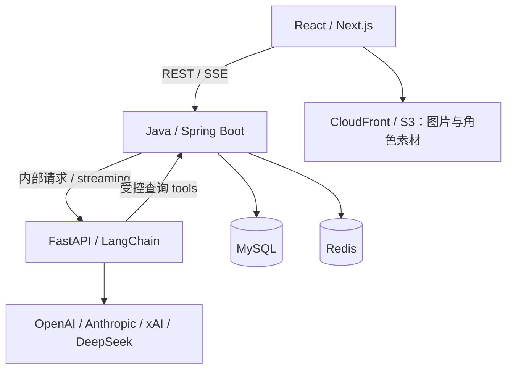

# 多 AI 美食探索网站：技术栈与架构要求

- 文档版本：v0.1
- 编写日期：2026-10-27（Australia/Sydney）
- 项目名称：待定
- 项目范围：悉尼 CBD 及周边商家与菜品目录、个性化推荐、多 AI 拟人角色交互。
- 文档用途：作为项目初始化、开发分工、接口设计与 AWS 部署的技术基线。本文件描述待实现的要求，不代表功能已经实现。

## 1. 已确定的技术方向

| 层次 | 已确定的核心技术 | 核心职责 |
| --- | --- | --- |
| Frontend | React、Next.js、TypeScript | 页面、交互、搜索筛选、AI 对话与角色展示 |
| Business Backend | Java、Spring Boot、MyBatis | 业务规则、权限、目录管理、数据库读写、推荐请求管理 |
| AI Application | Python、FastAPI、LangChain | 多模型调用、Persona、Skill、tool calling、推荐解释与 AI workflow |
| Data | MySQL、Redis | 业务数据持久化、缓存、限流、临时状态 |
| Cloud Platform | AWS、Docker、ECS Fargate | 应用运行、数据库、对象存储、网络、监控与交付 |

架构采用“React 前端 + Java 业务后端 + Python AI 应用服务”。Java backend 内部采用 modular monolith，按业务领域分模块；Python AI 服务独立部署。云端采用 ECS Fargate，不采用 Kubernetes / EKS。

下文标注“默认”的工具，是本版建议采用的具体配套；“按需”的组件在出现明确需求后加入。项目名字、角色原画和具体 model ID 独立于技术栈管理。

## 2. 服务职责与数据边界

| 服务 | 必须负责 | 数据访问边界 |
| --- | --- | --- |
| Frontend | 页面渲染、条件输入、结果呈现、角色状态、streaming 展示 | 通过 Java API 访问业务；素材通过 CDN 或授权上传地址访问 |
| Java Backend | 用户与权限、餐厅菜单、用户偏好、硬性过滤、最终结果校验、业务数据落库 | 业务 MySQL 的读写由该服务统一管理 |
| Python AI Service | Prompt 组装、Persona / Skill 执行、模型调用、候选比较、结构化输出 | 默认通过 Java 内部 API 取得候选和补充证据，不直接写业务表 |
| Ingestion Worker（按需） | 菜单提取、OCR、清洗、重复项识别 | 产出待审核结果，经 Java API 校验与审核后发布 |

Java 是面向用户的业务 API 入口。Python AI 服务只开放内部接口，接收经 Java 验证的用户范围与请求上下文。模型输出返回 Java 后，须重新校验菜品 ID、硬性约束与数据版本，再保存最终推荐记录。

## 3. Frontend 要求

### 3.1 默认技术组合

| 用途 | 默认选型 |
| --- | --- |
| 应用框架 | React + Next.js App Router |
| 开发语言 | TypeScript，启用 strict mode |
| 样式与基础组件 | Tailwind CSS + shadcn/ui |
| 浏览器端 API 数据管理 | TanStack Query |
| 表单与输入校验 | React Hook Form + Zod |
| 本地 UI 状态 | React state；跨组件状态复杂后按需加入 Zustand |
| 包管理 | pnpm |
| 单元与组件测试 | Vitest + React Testing Library |
| 浏览器 E2E | Playwright |

Next.js 负责页面路由、渲染与前端资源管理。核心业务规则与持久化逻辑集中在 Java backend。公开餐厅和菜品详情页支持服务端渲染；对话、筛选和角色交互按需要使用 Client Components。

### 3.2 首版界面要求

- 提供餐厅目录、菜品目录、详情页、搜索与筛选、收藏、偏好设置、推荐对话。
- 以 MenuItem 为可推荐对象，展示所属门店、价格、菜单来源与更新时间。
- 用户可独立选择 Model、Persona 和 Skill；配置界面与业务 API 使用稳定 ID。
- 支持预算、距离、辣度、饮食禁忌、菜系、就餐场景和餐厅氛围偏好。
- 支持中文与 English 文案，菜名保留原文，并可附加译名。
- 支持手机和桌面布局、键盘操作、清晰的 loading / empty / error / partial 状态。
- AI 回答使用 streaming；模型状态和角色动画状态分别管理。
- 默认调用用户选择的一个模型；“多模型比较”作为显式操作。
- 页面向用户标明当前模型，以及信息来自菜单、用户反馈还是 AI 推断。

### 3.3 角色展示要求

首版采用透明立绘、表情切换和轻量动画，至少支持 idle、thinking、speaking、error 四种状态。角色视觉资产与 provider、model ID 解耦。

Live2D Cubism SDK for Web 和 Blender / GLB / React Three Fiber 作为后续展示路线。Blender 用于离线制作素材；在线页面使用预先导出的资产。角色资源需要延迟加载，避免阻塞目录和推荐功能。

## 4. Java Business Backend 要求

### 4.1 默认技术组合

| 用途 | 默认选型 |
| --- | --- |
| 语言与应用框架 | Java LTS + Spring Boot |
| HTTP API | Spring MVC |
| 数据访问 | MyBatis；简单 CRUD 按需使用 MyBatis-Plus |
| 关系型数据库 | MySQL |
| 缓存与限流客户端 | Spring Data Redis |
| 身份与权限 | Spring Security；云端接入 Cognito 的 OIDC / OAuth 2.0 |
| 参数校验 | Jakarta Bean Validation |
| API specification | OpenAPI |
| 数据库迁移 | Flyway |
| 构建 | Maven Wrapper |
| 测试 | JUnit + Mockito；数据库与缓存集成测试使用 Testcontainers |
| 健康状态与指标 | Spring Boot Actuator + Micrometer |

Spring MVC 为默认业务 HTTP 栈。AI streaming 的转发必须支持逐段输出、请求取消和独立超时；实现时验证线程池、连接池和并发限制。

### 4.2 模块划分

| 模块 | 职责 |
| --- | --- |
| Users / Access | 用户资料、角色权限、登录身份映射 |
| Catalog | 餐厅品牌、门店、菜品、菜单版本、价格与来源 |
| Preferences | 禁忌、口味、预算、氛围、距离和就餐场景 |
| Recommendations | 候选筛选、请求状态、结果校验、反馈与推荐记录 |
| Agents | 可用模型、角色与 Skill 的公开目录、版本引用和启停状态 |
| Ingestion / Admin | 菜单导入、校验、人工审核、发布与更新 |
| Observability | request ID、业务指标、模型 usage 与错误记录 |

### 4.3 业务规则

1. 预算、门店范围、明确禁忌等硬性条件由业务规则执行，并在最终结果上复核。
2. 原料和过敏原信息保留“已确认包含 / 已确认不包含 / 未知”等状态及来源；未标注不能自动视为不含。
3. 价格、地址、菜品名称和营业信息以业务记录为依据，AI 输出不能直接覆盖这些字段。
4. MyBatis 查询须参数化；动态排序、字段名等不能使用未经校验的用户输入。
5. 业务事务范围保持短小，调用外部 LLM 时不得持有数据库事务或锁。
6. Java 负责业务落库和权限校验；Python 负责 AI orchestration。
7. Java 与 Python 的内部接口具有明确身份验证、调用超时和数据范围，不能信任浏览器传入的 user ID。
8. Cognito 身份映射至应用用户；授权判断基于服务端身份与角色，不使用前端传入的角色作为依据。

## 5. FastAPI / LangChain AI Application 要求

### 5.1 默认技术组合

| 用途 | 默认选型 |
| --- | --- |
| 语言与 API | Python + FastAPI |
| Schema 与配置 | Pydantic + Pydantic Settings |
| ASGI server | Uvicorn |
| LLM 与 tools 组合 | LangChain |
| 外部与内部 HTTP 调用 | HTTPX |
| Dependency 管理 | uv，提交 uv.lock |
| 代码质量 | Ruff + type checking |
| 测试 | pytest |
| 复杂有状态 workflow | LangGraph，按需加入 |
| tracing / evaluation | 统一 request ID 与结构化日志；LangSmith 按需加入 |

本层负责 AI 应用开发与模型 API inference。模型训练、fine-tuning、GPU 自托管不属于首版要求。

### 5.2 Provider 与模型

| 模型系列 | Provider | 默认 LangChain integration |
| --- | --- | --- |
| GPT | OpenAI | langchain-openai |
| Claude | Anthropic | langchain-anthropic |
| Grok | xAI | langchain-xai |
| DeepSeek | DeepSeek | langchain-deepseek |

统一 Provider Adapter 至少提供：普通调用、streaming、能力查询、timeout、错误归一化和 usage 记录。structured output、tool calling 等能力按具体模型核验，不能假设四家行为完全相同。

- model ID、参数、启停状态、价格配置与 capability metadata 由配置管理。
- 默认通过各 provider 的 API 接入；Bedrock 可作为后续 adapter，是否使用取决于模型及 Region 支持。
- Model、Persona、Skill 分开建模，允许自由组合，但组合须满足模型能力要求。
- 不支持的能力须明确禁用或返回可理解的错误。
- 模型不可用时明确提示；切换到其他模型必须采用用户可见、已选择的 fallback 策略。
- 每次请求记录 provider、实际 model ID、Prompt / Skill 版本、耗时、usage 和完成状态；费用为按价格版本计算的估算值。

### 5.3 Persona 与 Skill

Persona 定义角色语气、表现方式和关注点。Skill 定义任务目标、所需 tools、输入输出 schema 和执行约束。Persona 不能改变预算、禁忌、证据来源等业务约束。

首版 Skill 以仓库中的 Markdown instructions 和 YAML / JSON metadata 管理，通过服务端 registry 加载。metadata 至少包含 `skill_id`、`version`、`input_schema`、`output_schema`、`allowed_tools` 和所需模型能力。

默认提供“预算内选餐”“多人点菜”“相似菜品比较”“按场景推荐”等任务配置。首版使用预置 Skill；用户任意上传并执行代码不属于本版范围。

### 5.4 推荐 workflow

1. Java 验证身份、偏好和查询条件，使用 MySQL 查询并执行硬性过滤。
2. Java 将候选 MenuItem、证据、偏好快照和菜单版本传给 FastAPI。
3. LangChain 加载 Persona / Skill，按需要调用受控的只读 tools 补充信息。
4. AI 对候选进行比较，生成解释和结构化推荐。
5. Java 校验最终 MenuItem ID、预算、禁忌和版本，保存结果并返回前端。

推荐输出至少包含 `menu_item_id`、`reason`、`source_ids` 和 `uncertainties`。确定的价格与餐厅信息由 Java 关联业务记录后返回。无候选时返回空结果及原因，不生成不存在的菜品。

多模型比较默认使用相同候选集、用户条件、菜单版本、Persona 和 Skill，以便比较模型差异。模型超时可返回部分结果，并保留每个模型的独立状态。

### 5.5 Retrieval 与后台任务

首版采用结构化查询和关键词检索，LangChain tools 调用 Java 的检索接口。后续通过评估确有收益时，再增加 embedding、reranking 或独立 vector index。

MySQL 是当前主数据库；此前 PostgreSQL / PostGIS / pgvector 的选型不作为本版依赖。地理范围查询使用 MySQL 的空间数据能力；距离结果标注为直线距离，步行时间需要单独的路线数据。

长耗时 OCR、批量菜单提取等通过 SQS + 独立 worker 处理，配置幂等、重试与 dead-letter queue。FastAPI 的进程内 background task 不承担必须可靠完成的导入任务。

## 6. 服务接口与 streaming 约定

| 边界 | 协议与要求 |
| --- | --- |
| Browser → Java | HTTPS、REST / JSON、版本化路径 `/api/v1` |
| Java → FastAPI | 内部 HTTP API，使用服务身份与签名上下文，路径 `/internal/v1` |
| Python tools → Java | 内部只读 API，限定 request ID、用户范围和查询条件 |
| Streaming | SSE；使用 POST + fetch streaming 的前端实现 |
| 文件上传 | Java 校验上传请求并签发 S3 presigned URL；上传完成后验证并登记 |
| 后台任务 | SQS 消息传递任务 ID 与对象引用；避免将大文件放入消息体 |

接口默认包括：

- `GET /api/v1/restaurants`
- `GET /api/v1/menu-items`
- `GET /api/v1/agents`
- `PUT /api/v1/me/preferences`
- `POST /api/v1/recommendations/stream`
- `POST /api/v1/recommendations/{id}/feedback`
- `POST /internal/v1/recommendations/stream`（Java 调用 Python）

前后端及服务间 schema 使用 OpenAPI 管理；业务 API schema 由 Java 维护，AI 内部 API schema 由 FastAPI / Pydantic 维护。跨语言 DTO 不直接复用 ORM entity，依靠 contract tests 校验一致性。

SSE event type 至少包含 `status`、`delta`、`result`、`error`、`done`。事件携带 `request_id`；比较模式增加模型分支 ID。`delta` 是生成中的文本，`result` 是经过 Java 校验的最终业务结果。

Java 应逐段转发 stream，不等待整段模型回答；客户端断开时尽力取消下游调用。代理、ALB 和内部连接设置匹配的 timeout / heartbeat。首版不承诺断线自动续传；重试要产生清晰的新请求记录，避免把重复调用伪装成同一次回答。

## 7. 数据与 Redis 要求

### 7.1 MySQL

核心实体包括 Restaurant、Branch、Dish、MenuItem、MenuSnapshot、User、Preference、Favorite、Recommendation、Feedback、AgentConfigReference。

- Restaurant 为品牌，Branch 为门店；Dish 为通用菜品概念，MenuItem 为门店实际售卖的版本。
- 菜单记录保存来源、采集时间、审核状态、版本及可用性。
- 价格使用 DECIMAL 并记录 currency，默认 AUD；不使用浮点数处理金额。
- 时间戳统一存储 UTC；营业时间按门店 IANA timezone 解释，悉尼使用 Australia/Sydney。
- 字符集采用 utf8mb4；外键、唯一约束、索引和分页策略随 schema 明确定义。
- schema 变更通过 Flyway migration 管理；生产发布前验证 migration 和备份恢复。
- 推荐记录保留输入偏好快照、候选版本和实际模型信息，以支持复现与反馈分析。

### 7.2 Redis

首版用途为热门目录缓存、API / 模型调用限流、短期请求状态。Redis 不作为用户资料、菜单事实或推荐历史的唯一存储。

每类 key 规定 namespace、owner、TTL 和失效条件。Java 管理业务缓存；Python 若使用 AI 临时缓存，采用独立 namespace 与最小权限。

个性化结果缓存必须区分用户或会话、偏好版本、菜单版本、model ID、Persona / Skill / Prompt 版本。菜单发布、偏好更新后应失效相关缓存，禁止跨用户复用私人对话缓存。

## 8. AWS 云平台要求

默认应用与业务数据 Region 为 `ap-southeast-2`（Sydney）。外部模型的处理 Region 取决于 provider，不把应用部署在 Sydney 等同于所有 inference 都在澳洲发生。

| 能力 | AWS 选型 | 使用要求 |
| --- | --- | --- |
| 应用运行 | ECS Fargate | Next.js、Java、FastAPI 各自拥有 container image 和 service |
| 镜像仓库 | ECR | 镜像绑定 commit / release tag，生产部署使用可追溯版本 |
| HTTP 入口 | Application Load Balancer | 页面流量到 Next.js，`/api/v1/*` 到 Java；AI 内部接口不公开 |
| 内部服务通信 | ECS Service Connect | Java 与 Python 使用稳定的内部服务名称 |
| 数据库 | RDS for MySQL | 私有网络访问，启用备份并验证恢复 |
| 缓存 | ElastiCache for Redis OSS | 私有访问；本地与云端验证 engine 版本及命令兼容性 |
| 对象存储与分发 | S3 + CloudFront | 原始菜单与公开素材分离，按对象权限访问 |
| 用户身份 | Cognito | Java 验证 access token 的签名、issuer、有效期及适用的 client / scope |
| Secrets | Secrets Manager | 模型 API key、数据库 credentials 按服务授权读取 |
| 日志与监控 | CloudWatch | 聚合日志、错误率、延迟、任务失败和模型费用估算 |
| 异步导入 | SQS + worker | 按任务启用，配置幂等、重试和 dead-letter queue |
| 定时更新 | EventBridge Scheduler | 按需触发菜单更新任务 |
| 域名与 TLS | Route 53 + ACM | 域名和证书配置纳入部署记录 |

网络要求：

- ALB 为应用入口，RDS、Redis 和 AI service 不直接暴露公网。
- 应用服务采用受控 Security Group；配置到外部 LLM API 的必要出站路径。
- 基础设施预算包含 Fargate、ALB、RDS、Redis、网络出站 / NAT 和第三方模型 API。
- 使用 ECS task role 访问 AWS；模型密钥不进入前端 bundle、镜像或仓库。
- 服务间认证与用户授权独立校验，私有网络本身不替代身份验证。
- 扩容前先确定数据库连接池、LLM 并发配额和请求成本限制。

## 9. 开发、版本与交付

### 9.1 仓库结构

采用 monorepo；各语言使用各自的 dependency 管理工具。

| 路径 | 内容 |
| --- | --- |
| `apps/web/` | Next.js / React frontend |
| `services/business-api/` | Java / Spring Boot / MyBatis |
| `services/ai-app/` | FastAPI / LangChain，及共享 Python 处理代码 |
| `contracts/` | OpenAPI snapshots、跨服务 schema 与 contract fixtures |
| `ai-config/personas/` | 版本化角色配置 |
| `ai-config/skills/` | Skill metadata 与 instructions |
| `infra/terraform/` | AWS infrastructure as code |
| `docs/` | 技术文档、API 说明、architecture decisions、运行手册 |

本地默认运行 frontend、Java API、Python AI service，并通过 Docker Compose 提供 MySQL 和 Redis。pnpm 只管理 JS / TS workspace；Maven 和 uv 分别管理 Java 与 Python。

### 9.2 版本策略

- Node.js 和 Java 采用受支持的 LTS；Python、MySQL 与各 framework 采用互相兼容的受支持稳定版本。
- 初始化时记录确切 runtime / framework 版本，提交 pnpm-lock.yaml、uv.lock、Maven dependency / BOM 配置和 wrapper。
- Spring Boot、MyBatis starter、MyBatis-Plus 与 Spring Security 作为兼容组合验证；LangChain 与 provider packages 同样成组验证。
- Docker base image 与应用镜像使用明确版本，避免依赖可变的 latest tag。
- 升级先经过 CI 与 staging，再发布 production。模型 ID 和 Prompt 版本也纳入变更记录。

### 9.3 CI/CD 与测试

默认使用 GitHub Actions + Terraform。workflow 执行 lint / type checking、测试、构建镜像、推送 ECR、部署 staging、smoke test 和 production 发布。GitHub Actions 通过 OIDC 获取短期 AWS credentials。

重点测试包括：

- Java：硬性过滤、权限、MyBatis 查询、事务、缓存失效、限流。
- Python：provider adapter、Skill schema、结构化结果、tool 权限、timeout 与部分失败。
- Contract：Java ↔ Python DTO、stream event 格式、错误码。
- E2E：选择角色和模型 → 设置偏好 → 获取推荐 → 收藏与反馈。
- AI evaluation：菜品真实性、约束违反率、来源完整性、结构化输出成功率、latency 和单次请求成本。

常规 CI 使用 mock provider，避免每次测试消耗真实 token。每个对外启用的 provider 在发布前执行受控的真实 smoke test。模型失败时，菜品目录与普通筛选仍须可用。

## 10. 首版验收要求

- [ ] React / Next.js、Java backend、FastAPI AI service 可分别启动，并通过接口完成一次端到端推荐。
- [ ] 餐厅、门店、菜品、菜单来源和版本可录入、审核、查询与展示。
- [ ] MyBatis 操作 MySQL；Redis 缓存、限流及失效机制具有实际使用场景。
- [ ] 用户可保存偏好；预算与禁忌由业务规则执行，AI 输出不能绕过。
- [ ] Model、Persona、Skill 可独立选择，配置和运行记录可追溯。
- [ ] GPT、Claude、Grok、DeepSeek 的 adapter 有统一接口；每个启用项经过真实连通与能力验证。
- [ ] Streaming、取消、模型 timeout、部分失败和无候选结果有完整 UI 与 API 行为。
- [ ] AI 推荐引用真实 MenuItem 与来源，不以生成内容覆盖菜单事实。
- [ ] 三类应用容器可部署到 AWS ECS Fargate，无 Kubernetes / EKS 依赖。
- [ ] 完成权限与数据隔离测试、CI/CD、日志关联、基础告警、预算提醒及数据库恢复验证。

后续按实际需求扩展 Live2D / 3D、embedding 检索、复杂 LangGraph workflow、OCR 自动化和更多模型。具体实例规格、并发上限、timeout、token budget 和月度费用上限在部署 sizing 时记录为可配置参数。

## 11. 官方参考

以下链接用于核对框架能力；本文件中的服务划分和默认选型属于项目设计决策。核对日期：2026-10-27。

- [React](https://react.dev/)
- [Next.js deployment](https://nextjs.org/docs/app/getting-started/deploying)
- [Spring Boot](https://spring.io/projects/spring-boot)
- [MyBatis](https://mybatis.org/mybatis-3/)
- [MyBatis-Plus](https://baomidou.com/en/introduce/)
- [FastAPI containers](https://fastapi.tiangolo.com/deployment/docker/)
- [LangChain overview](https://docs.langchain.com/oss/python/langchain/overview)
- [LangChain provider integrations](https://docs.langchain.com/oss/python/integrations/providers/overview)
- [MySQL spatial analysis](https://dev.mysql.com/doc/refman/8.4/en/spatial-analysis-functions.html)
- [AWS ECS Fargate](https://docs.aws.amazon.com/AmazonECS/latest/developerguide/AWS_Fargate.html)
- [ECS Service Connect](https://docs.aws.amazon.com/AmazonECS/latest/developerguide/service-connect.html)
- [RDS for MySQL](https://docs.aws.amazon.com/AmazonRDS/latest/UserGuide/CHAP_MySQL.html)
- [Amazon ElastiCache](https://docs.aws.amazon.com/AmazonElastiCache/latest/dg/WhatIs.html)
- [GitHub Actions deployment to ECS](https://docs.github.com/en/actions/how-tos/deploy/deploy-to-third-party-platforms/amazon-elastic-container-service)

