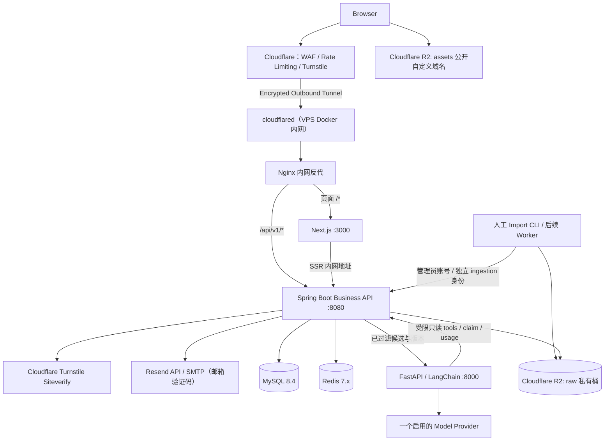

# Large-Lunch-Model：技术栈与架构要求

- 文档版本：v0.4；更新日期：2026-11-26（Australia/Sydney）。
- 范围：悉尼 CBD 及周边的门店、菜品目录与有来源的个性化推荐，逐步扩展多 AI Persona。
- 实现状态：当前 repository 只有文档；本文及关联文件是待实现的 contract，不代表已有服务、数据库、数据集或云端资源。
- 用户已确认：预算按菜品小计，包含所选规格与必选加料；配送费、平台 service fee 等订单级费用另列，不计入预算。
- 本次架构重构确认：**全面切换为 VPS + Docker Compose + Cloudflare（DNS / WAF / Turnstile / Tunnel / R2），移除 AWS 依赖**；身份认证改由 **Spring Boot（Spring Security 6 + 双 Token + Redis + MySQL + 邮箱验证码）** 自建闭环，并对齐中国大陆成熟的 Spring Boot 后端工程流程。并发与配额阈值为可配置设计初值，尚未经 load test 验证。
- 文档分工：[MVP 与 User Stories](docs/sprint-1-mvp-and-user-stories.md)规定用户流程与 acceptance criteria；[数据要求](docs/data-requirements.md)规定数据语义、来源与发布；[VPS 与 Cloudflare 部署要求](docs/deployment-requirements.md)规定线上运行与备份恢复；[本地开发要求](docs/local-development.md)规定开发环境；[交付规划](docs/delivery-model-comparison-au-us-cn.md)讨论组织与节奏。

## 1. 范围、阶段与技术方向

### 1.1 交付边界

| 阶段 | 必须完成的结果 | 条件与边界 |
| --- | --- | --- |
| 启动准备 | 首个场景、来源样本、最小 data / API contract | 先验证数据能否获取、使用、保存和更新；允许人工整理 |
| 本地 walking skeleton | 页面 → Spring Boot 本地注册/登录（Mailpit）+ Turnstile mock → Java admission → MySQL/Redis → Python mock → Java 校验 → 页面 | 无需远程 VPS、Cloudflare 或真实模型 key；synthetic fixtures 与真实菜单清楚区分 |
| Sprint 1 / 受控 Alpha | 5–10 家门店、30–50 个人工审核 MenuItems；一个真实 provider、一个 Persona、一个 Skill；Spring Boot 邮箱验证码登录后 AI、配额与并发限制、Cloudflare Tunnel + VPS 受限 staging | 数量为规划量级；真实数据和 access 就绪后验收；首轮单人、单店、单渠道选餐 |
| 后续增量 | 偏好持久化或收藏、审核 UI、第二个 provider、更多渠道与数据更新自动化 | 依据反馈排序；多人点菜、跨渠道比较各自定义新 contract |
| Production / Beta | 已启用功能的权限、R2 备份恢复演练、运行成本与维护责任得到验证 | 不以部署成功代替产品、数据与运维验收 |

首轮不要求四个平台全部接通、全城数据、大规模 crawler、自动 OCR、多模型比较、完整管理后台、embedding、复杂 LangGraph、Live2D 或 3D。新增来源按一个 adapter 一次验证，优先商家提供且使用权明确的菜单。

### 1.2 已选择的核心 stack

| 层次 | 技术 | 职责 |
| --- | --- | --- |
| Frontend | React、Next.js App Router、TypeScript | 页面、筛选、站内登录/注册/重置密码表单、推荐交互、来源与费用口径展示 |
| Business Backend | Java 21、Spring Boot、Spring MVC、Spring Security 6、MyBatis-Plus + MyBatis XML、Flyway | 业务规则、自建认证与 RBAC 鉴权、Catalog、预算过滤、数据发布、AI admission 与最终校验 |
| AI Application | Python 3.12、FastAPI、LangChain | Provider Adapter、Persona / Skill、候选比较与解释 |
| Persistence & Cache | MySQL 8.4；Redis 7.x（首轮必选） | MySQL 是业务事实与 AI admission 唯一权威；Redis 承担邮箱验证码、登录态/撤销加速缓存、防爆破与目录缓存 |
| Object Storage & Mail | Cloudflare R2（S3 兼容 API）、Resend API / SMTP | 私有原始资料、公开 CDN 素材、加密数据库备份；注册与密码重置验证码邮件 |
| Edge & Hosting | Cloudflare（DNS / WAF / Rate Limiting / Turnstile / Tunnel）、单台 Linux VPS + Docker Compose + Nginx | 零公网业务端口接入、边缘防护、容器化运行与低成本平滑扩展 |

Java 内部采用 modular monolith，AI service 独立部署；不引入 Kubernetes、AWS ECS 或重型微服务注册中心。选定技术保持容器化与云无关，未来业务规模增长时可平滑扩多台 VPS 或迁移云托管服务。runtime 与 dependency 的确切版本在 bootstrap 时按兼容矩阵固定，不能把文档示例当成已验证组合。

## 2. 服务职责与信任边界

| 组件 | 必须负责 | 访问边界 |
| --- | --- | --- |
| Next.js | 页面、浏览器交互、公开目录 SSR、站内认证表单、stream 状态 | 不直连 MySQL / Redis；SSR 使用 Docker 内网 Java 地址；私人数据不得进入共享缓存 |
| Java（Spring Boot） | 业务表读写、自建用户与会话认证、邮箱验证码、审核发布、候选过滤、AI admission、推荐验证与 audit | 唯一业务数据库写入 owner；Flyway migration 使用独立受控 DDL 账号；持有 JWT 密钥、Turnstile secret、发信凭证与 R2 凭证 |
| Python AI service | Prompt、provider 调用、解释和 structured output | 无业务 DB / Redis / R2 / JWT credentials；tools 只读，限制候选、用户范围与 request ID |
| Import CLI / 后续 Worker | 获取允许使用的资料、解析、清洗、提出匹配建议 | 经 Java 签发受限 R2 presigned URL 传 raw 文件；通过 Java ingestion API 写 draft，无发布权限 |
| Data reviewer / publisher | 审核字段、来源、匹配和版本 | 通过受 RBAC 保护的 Java Admin API review / publish；首轮 CLI 足够 |

AI tools 与 ingestion API 是两类权限，不能因为都由 Python 调用而共用凭证。原始菜单、OCR 文本、用户评论均是不可信数据；其中的指令不得改变 system policy、allowed tools、身份或预算规则。模型不得任意访问 URL 或执行导入资料中的代码。

## 3. 数据模型与预算 contract

### 3.1 身份、渠道与版本

| 实体 | 含义 |
| --- | --- |
| Restaurant / Branch | 品牌与实体门店；独立门店也必须有稳定 Branch ID |
| Dish | 可选的通用菜品概念，用于分类；不能凭同名自动把不同菜合并 |
| MenuItem / MenuItemRevision | 门店菜品身份与 immutable 描述、饮食事实 revision，不直接代表某平台价格 |
| Offer / OfferVersion | 菜品在特定渠道、fulfillment 与规格下的售卖报价；已发布版本不可原地覆盖 |
| MenuSnapshot | 某门店与渠道的一次已发布菜单版本，引用确切 OfferVersions |
| Source / SourceRecord | 来源规则与具体证据记录；存储、展示、外发给 LLM 的权限分别判断 |
| ExternalMapping | 平台外部 ID 到内部身份的映射、匹配依据与审核状态 |
| IngestionBatch / Review | 导入批次、校验报告、审核决定、幂等与发布记录 |
| Recommendation | 输入、候选引用、最终 OfferVersions、provider 与 Prompt 版本、状态与反馈关联 |
| User / UserRole / AuthSession | 自建邮箱账号、`BCrypt` 密码哈希、账号状态、可信邮箱验证状态、RBAC 角色、`session_id` / `token_family_id` / `refresh_token_hash` 与撤销记录 |
| EmailVerificationCode（Redis） | 6 位邮箱验证码哈希、用途（`REGISTER` / `RESET_PASSWORD` / `VERIFY_EMAIL`）、短 TTL、发送冷却与失败次数 |
| Conversation / ChatMessage | 私人会话 owner、version、消息顺序和 request 关联 |
| AIRequest / AdmissionLease / QuotaBucket | 请求幂等、调用资格、并发占位、额度预留与结算 |

价格、可用性、营业信息分别保留来源与观察时间；采集时间不等于价格生效时间。`workflow_state` 使用 `DRAFT / REVIEWED / PUBLISHED / WITHDRAWN`；拒绝是 ReviewRecord 的决定并回到 DRAFT。`freshness_state` 使用 `FRESH / STALE / UNKNOWN`；资料过期、许可到期各有 eligibility reason，二者不能压成一个互斥 status。渠道价格不会互相覆盖，无法确认的跨平台匹配留待审核。

MySQL 保存结构化目录、用户、会话、draft、audit 和版本；本地文件 / Private Cloudflare R2 保存允许保留的原始资料；Redis 承担验证码、会话撤销加速与可重建缓存，不承担业务持久化事实。大文件放 R2 对象存储，MySQL 保存 object key、hash 和受控 metadata。来源禁止留存时不得先把完整 response 写入 raw storage；historical snapshot 也不豁免 retention 要求。

### 3.2 预算与费用

请求必须使用稳定语义：`budget = {"amount":"25.00","currency":"AUD","scope":"MENU_SUBTOTAL"}`。首轮该 amount 是一个人的本次选餐小计上限；不默认为每人预算与多人总预算之间自动换算。

`menu_subtotal = Σ quantity × (selected_variant_price + Σ selected_option_delta)`。

- `selected_variant_price` 已是选定规格的价格，不能再重复加 base price。
- 所有必选项必须有明确选择；用户选中的可选加料也计入。缺少必选项价格或配置时，该组合不能作为“预算内”结果。每个 option 有稳定 ID、价格调整、选择约束、可售状态与饮食证据；禁忌和可售性在最终选定配置上校验，不能只检查菜品本体。
- 菜单价格使用已含适用税费的展示价格；税务口径未知则标记未知，不能由 LLM 推算。配送费、service fee、small-order fee 等订单级费用不计入小计，单独展示已知 / 未知。
- 首轮默认按常规菜单价，不计会员、首单、coupon 或其他有条件优惠；之后支持优惠时另存条件及期限。
- 金额在 MySQL 用 DECIMAL，在 Java 用 BigDecimal，在 Python 用 Decimal；JSON 使用十进制字符串，currency 必填。首轮 AUD 精确到分，不使用二进制浮点数累计金额。
- 首轮每个推荐组合只包含同一 Branch、同一 channel / fulfillment 的 Offer；不能把不同平台最低价拼成一个可下单套餐。
- UI 显示“菜品小计，配送费与平台费用另计”。`delivery_fee = null` 代表未知，不能当成 `0.00`。
- “小计满足预算”只证明已审核菜单报价符合规则，不承诺下单总额、实时库存或平台结算价。

### 3.3 发布和读取一致性

首轮最小路径：允许使用的样本 → 规范化 JSON / CSV → schema validation → Java draft → 人工 review → Java publish → 目录查询。

每个可见 snapshot 的发布在短 MySQL transaction 内完成：校验审核版本 → 写 immutable OfferVersions / Snapshot → 更新 active pointer 与 `catalog_revision` → 写 audit → commit。批次体积超过单次发布上限时，先分成可独立审核发布的 snapshot，避免长事务。重复发布返回原结果；相同幂等 key 与不同 payload 返回冲突。

目录 cache key 含数据库中的当前 `catalog_revision`；正确性不能只依赖“提交数据库后删 Redis 成功”。首轮从 MySQL 读取权威 revision，旧 cache key 到期回收；来源权限撤回及影响硬约束的门店状态变更也在事务内增加 revision。命中 cache 后仍按当前时间检查 eligibility，TTL 不超过所含证据的最早有效期；后续引入 outbox / event invalidation 时须证明同样的一致性。更新失败保留上一已发布版本，过期数据不进入严格预算候选。

完整字段、refresh policy、权限与验收以[数据要求](docs/data-requirements.md)为准。

## 4. Frontend 要求

| 用途 | 默认选型 |
| --- | --- |
| 类型与组件 | TypeScript strict、Tailwind CSS、shadcn/ui |
| API / 表单 | TanStack Query、React Hook Form、Zod |
| UI state | React state；复杂共享状态出现后再加 Zustand |
| Dependency / tests | pnpm、Vitest、React Testing Library、Playwright |

首轮提供预算与简单条件输入、候选/推荐结果、原始菜名、门店、渠道、规格、菜品小计、来源与更新时间。中文与 English 文案分离，原始名称不被译名覆盖。首轮还包含 User Stories 中的最小目录搜索、详情、返回状态、站内注册/登录/找回密码与私人会话恢复；偏好保存、收藏、多 Persona 与多 provider 选择留待后续。

首轮仅公开目录采用 SSR；私人页面在浏览器通过带内存 Access Token 的 client fetch 读取。浏览器调用同源 `/api/v1`，本地通过 Next.js rewrite，线上经 Cloudflare Tunnel → 内网 Nginx。SSR 使用 server-only Java 内网地址，不能把内部服务 host 或 internal token 放进 `NEXT_PUBLIC_*`。私人响应设为 `private, no-store`，不能进入共享 ISR / CDN cache。

- **站内认证体验与 Token 管理**：
  - 提供 `/login`、`/register`、`/forgot-password` 站内页面（无需跳第三方托管域名）；注册与找回密码通过表单输入邮箱 → 完成 Turnstile → 点击“发送 6 位验证码”（前端显示 60 秒倒计时）→ 填码提交。
  - Access Token 仅保存在浏览器内存（如 React state / auth store），**严禁写入 `localStorage` 或 `sessionStorage`**；Refresh Token 由后端通过 `HttpOnly; Secure; SameSite=Lax; Path=/api/v1/auth` Cookie 下发与管理。页面刷新或新开 tab 时，前端静默调用 `POST /api/v1/auth/refresh` 换取新的内存 Access Token（前端 API 拦截器对单次 `401` 做并发去重刷新重试，但**绝不自动重发收费 AI 生成请求**）。
  - 退出登录时调用 `POST /api/v1/auth/logout`，清空内存 Access Token、TanStack Query 私人缓存和未发送草稿，并通过 `BroadcastChannel` 通知其他同源 tab 同步退出。
- **未发送草稿与 AI 触发约束**：
  - 匿名用户可浏览目录；AI 输入框可临时保留未发送草稿（当前 tab `sessionStorage`，短 TTL，不含任何 token，退出或切换账号时清空）并引导登录，登录完成后回到聊天页**由用户再次主动点击发送**，绝不自动发起收费请求。
  - 每个新 AI turn 获取一次性 Turnstile token；Managed widget 可无交互完成，并非每条都强制点击复选框。必须处理 loading、empty、error、cancelled、data-changed、login-required、verification-required、quota-exceeded、busy、challenge-failed。键盘操作与手机布局纳入验收。首轮角色采用可替换静态资源及 idle / thinking / speaking / error 状态，角色与 model ID 解耦。

首版 `mode=dine_in/delivery` 分别映射到 `fulfillment_type=DINE_IN/DELIVERY`；data schema 的 PICKUP 留作兼容，暂不开放对应 UI mode。mode、预算、区域和 hard dietary constraints 在本轮调用前以用户确认的结构化条件交给 Java；自然语言中的条件修改可提示用户确认表单，不额外发起付费 intent extraction。单次 LLM 负责在这批候选中解释与选择，不能修改已确认 hard constraints。

## 5. Java Business Backend 要求（对齐中国大陆成熟 Spring Boot 工程实践）

### 5.1 技术栈与国内标准工程分层

默认技术栈对齐中国大陆成熟的 Spring Boot 业务后端体系：
- **核心框架**：Java 21 LTS + Spring Boot 3.x + Spring MVC + **Spring Security 6** + Spring Data Redis
- **持久层**：**MyBatis-Plus**（单表 CRUD、分页插件、乐观锁 `@Version` 提效）+ **原生 MyBatis XML**（MySQL 空间地理查询、复杂多表联合筛选、AI 原子并发抢占与条件更新 SQL）+ **Flyway**（严格版本化 DDL 管理）
- **工程配套**：Jakarta Bean Validation (`@Valid`)、MapStruct（或显式 Mapper 实现 `DTO / VO / Entity` 严格分层，绝不把数据库 Entity 直接暴露给 Controller 或跨服务 DTO）、`@RestControllerAdvice` 全局统一异常处理与稳定业务错误码、SLF4J + Logback（MDC 注入 `request_id` / 脱敏 `user_id` 输出 JSON 结构化日志）、**SpringDoc OpenAPI 3**（可选搭配 **Knife4j** 增强接口文档，但文档 UI 仅限 `local` profile 启用，线上强制关闭并在 Nginx 屏蔽）、Maven Wrapper、JUnit 5 / Mockito / Testcontainers、Actuator / Micrometer。

模块划分为 `auth`（认证、会话与验证码）、`catalog`（门店/菜品/空间检索）、`ingestion`（导入/审核/发布）、`recommendation`（AI 编排、admission、预算复核与结算）、`conversation`（私人会话）、`agent`（Provider/Persona/Skill 注册表）、`common`（统一错误、安全上下文、审计、工具）。模块间通过清晰的 Service Interface 协作。

### 5.2 硬性业务规则

1. Java 执行预算、地区、渠道、可用性、freshness 和明确禁忌的过滤及最终复核；Persona 不得改变规则。
2. 过敏原与饮食标签使用 `CONFIRMED_PRESENT / CONFIRMED_ABSENT / UNKNOWN` 三态。严格禁忌查询排除 unknown，结果不表述为医学安全保证。
3. 地理范围使用有来源的坐标及 MySQL spatial 查询，坐标顺序、SRID、米制距离通过已知地点 fixture 验证。首轮显示直线距离；步行时间和送达可行性需要独立数据。
4. MyBatis 参数化查询；排序字段白名单；分页有上限；metadata、数量和 input size 有约束。
5. LLM 与外部 HTTP 调用（含 Siteverify 与邮件发送）不持有数据库 transaction 或锁。provider 重试区分连接失败与可能已计费请求，客户端自动重连不重复触发收费调用。
6. 发布、会话追加、配额预留与推荐状态迁移具有 concurrency control；所有状态更新通过 Java 完成。

### 5.3 Spring Boot 自建认证、双 Token 会话与 RBAC 权限

匿名用户可以浏览、搜索、读取已发布详情和使用已核验的地图 / 平台链接。**所有新付费 AI 调用**（包括 chat、recommendation、按需 AI 概览与刷新）都要求已注册、已登录、邮箱已验证且账号 `ACTIVE`；不能通过改 endpoint、直接调 Python 或公共 cache miss 绕过。已批准的公共 AI 概览可公开读，未命中时返回“暂无概览”，不得由匿名读取触发生成。

#### 5.3.1 账号注册、邮箱 6 位验证码与密码安全

- **邮箱规范化与唯一性**：入库前对邮箱执行 `trim` + 小写规范化，MySQL 建 `UNIQUE(email)` 约束；首轮仅支持邮箱 + 密码注册，不扩展第三方 OAuth social login。
- **密码存储与强度**：使用 Spring Security `BCryptPasswordEncoder`（cost factor 10–12）单向加盐哈希存储；最小密码策略（如长度 8–72 字符，包含字母与数字）前后端同步校验，严禁将明文密码或哈希写入日志或错误响应。
- **6 位数字邮箱验证码（Redis 闭环）**：
  - `POST /api/v1/auth/email-codes` 接收 `email`、`purpose`（`REGISTER` / `RESET_PASSWORD` / `VERIFY_EMAIL`）与 Turnstile token；
  - 校验 Turnstile（`action=auth_email_code`）后，通过 Redis 实施 **60 秒发送冷却**、单邮箱每日上限（如 10 次）与单 IP 滚动限流；
  - 验证码经 `SecureRandom` 生成 6 位数字，服务端加盐哈希后写入 Redis（TTL 初值 10 分钟），同时记录尝试计数（连续输错 5 次立即作废，防暴力枚举）；
  - 邮件异步或短超时调用 Resend API / SMTP 发送（不在 DB 事务内调用）；响应对未知/已存在邮箱保持克制，降低邮箱枚举风险。
- **注册与验证状态**：
  - 推荐首轮采用**一步验证注册**：`POST /api/v1/auth/register` 同时提交 `email`、`password`、`code` 和 Turnstile token（`action=auth_register`），通过 Redis Lua 脚本或原子校验并消费验证码后，创建 `status=ACTIVE`、`email_verified=true`、`roles=ROLE_USER` 的用户。
  - 表结构仍保留 `email_verified` 字段与 `EMAIL_VERIFICATION_REQUIRED` 防御检查，兼容管理员建号或未来扩展延迟验证场景；所有新付费 AI 调用进入 admission 前均在本地 MySQL 校验 `status=ACTIVE` 与 `email_verified=true`。

#### 5.3.2 双 Token 机制（Access JWT + Refresh Cookie）与即时撤销

结合中国大陆常见的 **Spring Security + JWT + Redis** 最佳实践，同时补齐纯无状态 JWT 无法即时登出/禁用的短板：

- **Access Token（短效 JWT，初值 15–30 分钟）**：
  - 由 Java 服务端使用高熵密钥（HS256 或 RS256，支持 `kid` 平滑轮换）签发，Claims 仅包含 `iss`、`sub`（内部 `user_id`）、`sid`（`auth_session.session_id`）、`jti`、`roles`、`token_use=access`、`iat`、`exp`；不放邮箱、密码或敏感偏好。
  - 前端存于内存，通过 `Authorization: Bearer <access_token>` 发送。
- **Refresh Token（长效不透明高熵随机串，初值 7–14 天）**：
  - 服务端生成 256-bit 随机串，仅将 SHA-256 哈希存入 MySQL `auth_session`（关联 `session_id`、`token_family_id`、`user_id`、`expires_at`、`revoked_at`），原始值通过 `Set-Cookie: llm_refresh=<token>; HttpOnly; Secure; SameSite=Lax; Path=/api/v1/auth` 下发浏览器。
  - `POST /api/v1/auth/refresh` 与 `POST /api/v1/auth/logout` 使用 Cookie 时，Java 强制校验 `Origin` / `Referer` 允许列表防 CSRF。
  - **Refresh Token Rotation & 重放检测**：每次刷新生成新 Refresh Token 并作废旧 Token；若检测到已被轮换的旧 Refresh Token 再次提交，判定为 Token 泄露，**立即原子撤销同一 `token_family_id` 下的全部会话**、写 Redis 撤销标记并记录 `SecurityAudit`。
- **即时撤销与禁用（Redis 加速 + MySQL 权威）**：
  - 自定义 Spring Security `JwtAuthenticationFilter` 验签通过后，检查 Redis 撤销键（`auth:revoked:sid:{sid}` 与用户级全局失效时间戳 `auth:user:min_iat:{user_id}` 及禁用状态 `auth:user:disabled:{user_id}`）。
  - **Redis 故障降级安全边界**：若 Redis 不可用，过滤器自动回查 MySQL `auth_session` 与 `users` 表确认会话未撤销且账号为 `ACTIVE`（若 MySQL 亦不可用则 fail closed 返回 `503`），**绝不退化为仅验离线 JWT 签名**。
  - `POST /api/v1/auth/logout`：在 MySQL 将当前 `auth_session` 标记 `revoked_at`（保留 tombstone 至最长有效期），同步写入 Redis 撤销键（TTL 覆盖 Access Token 最大剩余有效期），并清空 Refresh Cookie；重复 logout 幂等返回成功，不恢复任何私有读取权限。
  - **密码重置与账号禁用**：用户执行 `POST /api/v1/auth/password/reset` 或管理员禁用账号时，在 MySQL 撤销该用户全部活跃 `auth_session`，并在 Redis 写入 `auth:user:min_iat:{user_id}`（或 `disabled` 标记），使该用户所有设备现有 Access Token **秒级失效**；同时尽力取消在途 AI 任务（usage / audit 收尾仍按规则完成）。
- **登录防撞库**：同一邮箱或 IP 连续登录失败达到阈值（如 5 次 / 15 分钟）后，通过 Redis 触发强制 Turnstile 验证（`action=auth_login`）及退避冷却，返回清晰错误提示。

#### 5.3.3 RBAC 权限与服务间内部身份

- **RBAC 角色与权限**：使用 Spring Security `@PreAuthorize` 方法级鉴权：
  - `ROLE_USER`：默认注册角色，仅可访问自有私人会话、AI 推荐与个人用量视图；
  - `ROLE_OPERATOR`（含 `catalog:manage`、`catalog:source:manage`、`catalog:import`）、`ROLE_REVIEWER`（`catalog:review`）、`ROLE_PUBLISHER`（`catalog:publish`）、`ROLE_ADMIN`：仅通过受控初始化脚本或管理员显式授予，普通注册绝不能获得管理角色。
  - 首轮运营 CLI（`tools/ingestion/`）使用独立管理员账号登录获取短期 token 调用 `/api/v1/admin/ingestion/*`。
- **Owner 隔离**：Conversation、ChatMessage、AIRequest、Recommendation 全部由 Java 从当前认证 `SecurityContext` 提取 `user_id`，绝不信任请求体或路径中的他人 `user_id`；跨用户访问统一返回 `404 NOT_FOUND`，不暴露对象是否存在。普通 admin / reviewer 不自动拥有查看用户私人 chat 正文的权限。
- **内部服务身份独立**：`BUSINESS_TO_AI_TOKEN`、`AI_TO_BUSINESS_TOKEN`、`INGESTION_TO_BUSINESS_TOKEN` 三个静态高熵凭证按方向与 scope 严格分离；AI tools 仅接受 Java 签发的 request-scoped 候选范围与期限。内部 token 不进入 Prompt、浏览器或日志。
- **测试防旁路**：非 `local` 环境启动时，拒绝任何测试 auth bypass 或 Turnstile mock / test mode 配置。

### 5.4 Cloudflare、Tunnel 与 Turnstile

线上流量统一经 **Cloudflare Edge（WAF / Rate Limiting / DDoS）→ Cloudflare Tunnel（`cloudflared`）→ VPS 内网 Nginx → Docker Compose 服务**。由于 VPS 公网业务端口全关闭，源站天然不可绕过，且 `/api/v1/auth/*` 与 `/api/v1/recommendations/*` 全部受同一套 Cloudflare 边缘规则保护（详見 [VPS 与 Cloudflare 部署要求](docs/deployment-requirements.md)）。

Java 在以下入口执行 Cloudflare Siteverify 服务端验证（仅前端渲染 widget 不构成验证）：
- 新 AI turn：`action=ai_chat`（其他按需 AI 生成入口使用独立 action allowlist 并复用同一 admission service）；
- 发送邮箱验证码：`action=auth_email_code`；
- 账号注册：`action=auth_register`；
- 找回密码：`action=auth_password_reset`；
- 高风险登录：`action=auth_login`。

校验规则：必须检查 `success=true`、匹配环境 `hostname` allowlist 与期望 `action`。token 有效期 300 秒、一次性消费；验证失败返回 `403 BOT_VERIFICATION_FAILED`，Siteverify 超时或不可用返回 `503 BOT_VERIFICATION_UNAVAILABLE`（均不调用 provider 或发邮件，普通浏览不受影响）。`TURNSTILE_SECRET_KEY` 仅注入 Java 容器。已有 user-scoped 幂等 AI request 先返回原状态，不再次消费旧 Turnstile token；Siteverify transport retry 复用同一 UUID `idempotency_key`。

API / SSE 路径在 Cloudflare 规则中禁用 HTML Managed Challenge，使用可识别的 Block / 429 响应；前端对 Edge 直接返回的非 JSON 403 / 429 显示可恢复提示。前端严禁 raw HTML 渲染用户输入或模型输出，链接限定合法协议与来源（禁止 `javascript:`）；CSP 仅放行应用与 Turnstile 必要来源，CORS 设明确 allowlist。

### 5.5 首轮并发、配额与 backpressure

下表为可配置的保守初值，**不是已测容量、SLA 或用户数量承诺**；调整需记录 `admission_config_version`、成本和 load-test 证据。并发限制从第一个真实 provider 调用前就生效。

| Config key | 初值 | 语义 |
| --- | --- | --- |
| `AI_MAX_ACTIVE_PER_USER` | 1 | 同一账号跨 tab / 会话 / Java replica 的 active 请求上限 |
| `AI_MAX_ACTIVE_GLOBAL` | 5 | 整个环境的 active paid AI 请求上限 |
| `AI_MAX_ACTIVE_PER_PROVIDER` | 5 | 当前启用 provider 的上限；与 global 同时满足 |
| `AI_REQUESTS_PER_USER_PER_MINUTE` | 5 | rolling 60 秒内的新 turn 提交尝试，失败验证也占 attempt；同 key 查状态不算新 turn |
| `AI_REQUESTS_PER_USER_PER_DAY` | 20 | UTC 日内已开始 / 可能已开始的 provider 请求；开始前先预留名额 |
| `AI_TOKENS_GLOBAL_PER_DAY` | 100000 | 环境级 UTC 日 input + output token 预留与用量总上限 |
| `AI_MAX_INPUT_TOKENS` | 6000 | 完整 Prompt 上限，含 system、历史、候选、tool / schema 开销 |
| `AI_MAX_OUTPUT_TOKENS` | 1000 | provider 端输出限制；模型若另计 reasoning tokens，适配时必须纳入上限与预留 |
| `AI_MAX_CALLS_PER_TURN` | 1 | 首版单次 LLM 调用；不隐式做付费总结、二次修复或 fallback |
| `AI_MAX_MESSAGE_CHARS` | 2000 | 单条用户输入 Unicode code points 上限 |
| `AI_MAX_REQUEST_BYTES` | 32768 | AI POST body 上限，读取时即限制，不等完整载入后再校验 |
| `AI_QUEUE_ENABLED` | false | 无等待队列；容量不足立即 backpressure |

MySQL 是 AI admission 唯一权威。Java 在短 transaction 中按固定锁顺序检查账号 / conversation version、user / global / provider slot、daily request 与 token bucket，并一起预留；原子 conditional update / unique constraints 防止多实例同时通过。Redis 仅用于预筛或缓存，绝不能维护与 DB 不一致的第二套配额，也不在故障时降级到空内存计数器。MySQL 无法确认资格则拒绝新付费请求。所有外部 HTTP / LLM / Siteverify 均在 transaction 外执行。

最小执行顺序：限制 body / transport attempt → JWT 验签与会话撤销校验 → 解析 idempotency / 创建 pending request → user attempt limit → 本地 MySQL 核对账号 ACTIVE 与 `email_verified` / Turnstile Siteverify → Java 候选与 Prompt token 上限检查 → atomic admission → 唯一 dispatch claim → provider → Java final validation 与 usage settlement。无候选可直接完成空结果，不调用模型、不消耗 daily AI quota；仍通过短事务检查 owner、account、session、conversation version / active turn，并保存消息与空结果。并发的同会话 turn 返回 `CONVERSATION_BUSY` / `VERSION_CONFLICT`，不能绕过历史顺序。

- 幂等范围为 `user_id + operation + Idempotency-Key`；hash 包含 business input、conversation ID / expected version、provider config，排除 access token、Turnstile token、transport headers。唯一 request row 确定 owner；重放使用该 request 已冻结的配置快照计算 hash。相同 key / 不同输入返回 `409`。admission 前 verifier / owner 崩溃按 90 秒期限落为未 dispatch 的失败，禁止 pending 永久挂起。AI idempotency metadata 默认保留 90 天。
- Java 为 request 签发一次性 dispatch claim，由 Python 经受限 internal API 原子领取后才调用 provider；重复内部调用无法再次领取。claim 前后未知失败均不得自动重新 dispatch。
- admission 先预留完整输入的保守 token 上界加最大输出；超长历史确定性截断并提示，不触发额外 LLM summary。实际 usage 幂等结算释放差额。
- provider 明确未开始的失败可释放 daily request / token reservation；已开始或无法确认是否开始的请求，即使失败、超时、取消或 final validation 返回 `DATA_CHANGED`，也计入 daily request。usage 不明时保留 token 上界待 reconciliation。
- lease 初值 90 秒、每 15 秒续约，使用 DB 时间与 owner / fencing version。崩溃、断线、取消或过期进入 `RECONCILIATION_REQUIRED`，未知调用继续占用 slot / 额度，直到可靠终态或受审计的人工处理。旧 owner 迟到回调不能覆盖终态或重复结算。
- provider operation deadline 60 秒；Java request deadline 90 秒。取消尽力向下游传播，收到取消请求可先结束前端 stream，但不提前释放未知 provider slot。
- UTC 日期以 reservation 创建时的 bucket 固定，跨午夜任务仍在原 bucket 结算；active slot 不因午夜重置。rolling minute attempt 采用 DB 时间，容器重启或扩容不清空 ledger。
- AI 的 HTTP connection pool、Java stream executor、Python semaphore、DB pool 均有界；DB pool 预留目录查询容量，AI 饱和时普通浏览保持可用。

首轮验收在共享 MySQL 的 **2 Java + 2 AI Docker Compose 实例**上用 barrier mock provider 保持调用重叠：50 个不同用户同时新建请求，最多 5 个获准 active；同用户 10 个 tab / 不同 keys 最多 1 个 active；20 个同 key 请求最多 1 次 provider dispatch。覆盖 Redis 故障、MySQL 故障、进程 crash、容器重启、lease 到期、取消、午夜边界、usage 回调重放和额度耗尽。

## 6. Python AI Application 要求

默认组合：FastAPI、Pydantic / Pydantic Settings、Uvicorn、LangChain、HTTPX、uv / uv.lock、Ruff、type checker 与 pytest。模型训练、fine-tuning、GPU 自托管不属于当前范围。

Provider Adapter 提供普通调用、streaming、capability 查询、timeout、统一错误和 usage。GPT、Claude、Grok、DeepSeek 为后续支持方向，首轮只实现并验证一个 provider；使用其受支持 integration，并记录准确 model ID。structured output 与 tool calling 必须按实际 model 验证，不假设可互换。fallback 需用户可见且预先选择，不静默切换 provider。

Persona 定义语气与关注点；Skill 定义目标、tools、input / output schema 与限制。配置使用版本化 Markdown instructions 与 YAML / JSON metadata，包含稳定 ID、version、schema、allowed tools 与 capability requirements。首轮一个“预算内选餐” Skill 即可；用户任意上传代码不在范围内。

### 6.1 推荐 workflow

1. Java 按第 5 节完成身份、Turnstile、候选过滤与 atomic admission，以最新发布 revision 筛选具有来源的 OfferVersions；记录 request、候选快照及预留，提交 transaction 后才允许 dispatch。
2. Java 向 AI 传递最小必要偏好、候选及证据。只有允许用于外部 inference 的字段可以进入 Prompt；无需传递邮箱或精确住址。
3. AI 使用固定 Persona / Skill，在候选内选择组合并解释；补充 tools 由 Java 再次授权。
4. AI 返回 `menu_item_id`、`menu_item_revision_id`、`menu_snapshot_id`、`offer_id`、`offer_version_id`、`quantity`、`selected_options`、`reason`、`source_ids`、`uncertainties`。`source_ids` 指具体 SourceRecord ID。
5. Java 校验 IDs 属于候选集、source 引用支持相应事实、选择项完整、currency 与小计、含加料的最终禁忌、发布状态和数据版本；金额由 Java 重算。
6. 在模型返回后的短 MySQL transaction 内，锁定所涉 current pointers / 来源状态行（或等价原子 CAS）；复核 MenuSnapshot、MenuItemRevision、OfferVersion、来源权限与有效期，并原子保存 Recommendation completion。相关 active version 或 hard facts 已变化则返回 `DATA_CHANGED`；不自动重复调用付费模型。

无候选返回结构化原因，不要求 LLM 编造替代菜品。解释与原始菜单冲突时不得作为已验证事实输出；关键事实由 Java 模板填充，文本解释可丢弃或降级。

### 6.2 Retrieval 与 async ingestion

首轮使用结构化筛选与关键词检索。embedding、reranking、LangGraph 仅在 evaluation 显示收益后加入。AI process 的 background task 不承担必须可靠完成的数据导入。

后续启用批量 OCR 或定时采集时，使用独立 ingestion worker 容器 + 数据库任务表或轻量队列（如 Redis Stream / RabbitMQ），消息只传 batch ID / object reference；重复投递由幂等处理，失败进入死信记录。首轮人工 CLI 导入不依赖消息队列或定时调度器。

## 7. API 与 streaming contract

以下是待实现接口，最终 schema 由 Java SpringDoc OpenAPI 与 FastAPI OpenAPI 维护，contract tests 验证消费者一致性。

| 路径 | 用途与权限 | 阶段 |
| --- | --- | --- |
| `GET /api/v1/restaurants`、`GET /api/v1/menu-items` | 仅已发布目录，支持 Branch / channel / fulfillment 过滤（匿名可读） | 首轮 |
| `GET /api/v1/agents` | 返回实际启用的 provider / Persona / Skill 与 capabilities（匿名可读） | 首轮可各一项 |
| `POST /api/v1/auth/email-codes` | 发送 6 位邮箱验证码（Turnstile + 冷却 + 日限次） | 首轮 |
| `POST /api/v1/auth/register` | 校验邮箱、6 位验证码、密码与 Turnstile 并创建账号 | 首轮 |
| `POST /api/v1/auth/login` | 邮箱密码登录，签发内存 Access JWT 与 HttpOnly Refresh Cookie（连续失败触发 Turnstile） | 首轮 |
| `POST /api/v1/auth/refresh` | 校验 Origin 与 Refresh Cookie，轮换双 Token（检测重放则撤销整条 family） | 首轮 |
| `POST /api/v1/auth/logout` | 幂等撤销当前会话（MySQL + Redis）并清除 Refresh Cookie | 首轮 |
| `POST /api/v1/auth/password/reset` | 校验邮箱、6 位验证码与 Turnstile 重置密码，并踢下线全部历史会话 | 首轮 |
| `GET /api/v1/me`、`GET /api/v1/me/ai-usage` | 当前有效 session 的最小 profile / 配额视图；不调用模型 | 首轮 |
| `POST /api/v1/conversations`、`GET /api/v1/conversations`、`GET /api/v1/conversations/{id}` | 创建 / 分页读取自己的会话；有效账号与 owner isolation | 首轮 |
| `POST /api/v1/recommendations/stream` | 已验证邮箱的登录用户；Turnstile + admission；携带 conversation_id、expected_conversation_version 与 Idempotency-Key | 首轮 |
| `POST /api/v1/recommendations/{id}/cancel` | owner 幂等请求取消；不直接释放未知 provider 用量 | 首轮 |
| `GET /api/v1/recommendations/{id}` | 仅请求 owner 可读取状态与已保存结果，解决连接中断后的查询 | 首轮；不代表自动续流 |
| `POST /internal/v1/recommendations/stream` | Java 调用 AI，使用 `BUSINESS_TO_AI_TOKEN` 与 request-scoped admission context | 首轮 |
| `POST /internal/v1/ai-requests/{id}/claim` | AI 使用 `AI_TO_BUSINESS_TOKEN` 原子领取唯一 dispatch；不能重复领取 | 首轮 |
| `POST /internal/v1/ai-requests/{id}/usage` | AI 回报终态 / usage；Java 幂等结算，AI 不写 DB | 首轮 |
| `GET /internal/v1/catalog/candidates` | AI 受限只读 tool；必须带有效 request context | 需要补查时 |
| `POST /api/v1/admin/sources`、`POST /api/v1/admin/restaurants`、`POST /api/v1/admin/branches` | 具备对应 RBAC 权限的 operator 登记来源 policy、品牌和门店 | 首轮 bootstrap |
| `PATCH /api/v1/admin/sources/{id}`、`POST /api/v1/admin/menu-snapshots/{id}/withdraw` | 更新来源权限 / 撤销来源；撤回错误菜单并写 audit / revision | 首轮维护 |
| `POST /internal/v1/ingestion/*` | 后续独立 worker 使用 `INGESTION_TO_BUSINESS_TOKEN` 调用的内部导入接口 | 后续 / 测试覆盖 |
| `POST /api/v1/admin/ingestion/source-records`、`batches`、`batches/{id}/records`、`batches/{id}/complete` | 人工 CLI 使用 `catalog:import` 权限调用，复用同一 application service；线上经 Cloudflare Tunnel → Nginx 管理入口 | 首轮 |
| `GET /api/v1/admin/ingestion/batches/{id}`、`review`、`publish` | reviewer / publisher 查看校验报告、审核与原子发布（首轮 CLI 调用） | 首轮 |
| `PUT /api/v1/me/preferences`、`POST /api/v1/recommendations/{id}/feedback` | 个人偏好与反馈，owner isolation | 后续 |

所有 ingestion 幂等 key 按 caller + operation + resource scope 隔离；records 每个 chunk 有独立 key / hash，complete 校验预期数量与 manifest hash。更改审核内容必须重新打开为 DRAFT 并重新 complete / review，禁止在已发布 snapshot 上追加。

原始文件上传先由 Java 校验 source policy、文件类型/大小与权限，再签发受限 **Cloudflare R2（S3 兼容）presigned URL**；上传完成校验对象后登记。URL ingest 限定来源、协议、redirect 与目标地址，拒绝 localhost 和私有网段，避免 SSRF。首轮可只支持本地文件输入。

统一 error 包含 `code`、`message`、`request_id`、`retryable`，按需含 `retry_after_seconds` / `reset_at`。通用业务码包括 `VALIDATION_ERROR`、`FORBIDDEN`、`NO_CANDIDATES`、`DATA_CHANGED`、`PROVIDER_TIMEOUT`、`INVALID_MODEL_OUTPUT`、`SOURCE_NOT_PERMITTED`；认证与 AI 入口使用以下明确分类，UI 不依赖英文 message 判断：

| HTTP | Code | 行为 |
| --- | --- | --- |
| 400 | `INVALID_VERIFICATION_CODE`、`VERIFICATION_CODE_EXPIRED`、`WEAK_PASSWORD` | 引导重新输入或重新获取 6 位邮箱验证码 |
| 401 | `AUTH_REQUIRED`、`INVALID_CREDENTIALS`、`SESSION_REVOKED` | 缺失 / 过期 / 被撤销 session 或密码错误，引导登录并保留未发送草稿 |
| 403 | `EMAIL_VERIFICATION_REQUIRED`、`ACCOUNT_DISABLED` | 不调用模型；引导邮箱验证或说明账号不可用 |
| 403 | `BOT_VERIFICATION_FAILED` | 获取新 Turnstile token 后由用户重试 |
| 404 | `NOT_FOUND` | 对象不存在或不属于当前用户 |
| 409 | `EMAIL_ALREADY_REGISTERED`、`IDEMPOTENCY_CONFLICT`、`CONVERSATION_BUSY`、`VERSION_CONFLICT` | 邮箱冲突提示登录；AI 冲突读取现有请求 / 当前会话，不自动重发收费请求 |
| 413 | `REQUEST_TOO_LARGE` | 缩短请求；不保存超限正文 |
| 429 | `AUTH_RATE_LIMITED`、`USER_RATE_LIMITED`、`USER_CONCURRENCY_LIMITED`、`USER_DAILY_QUOTA_EXCEEDED` | 返回适用的 `retry_after_seconds` / `reset_at`，展示冷却或额度耗尽 |
| 503 | `AI_CAPACITY_EXHAUSTED`、`AI_TEMPORARILY_UNAVAILABLE`、`BOT_VERIFICATION_UNAVAILABLE`、`EMAIL_DELIVERY_UNAVAILABLE` | 容量耗尽或依赖故障；受控拒绝并保留目录浏览 |

stream 建立前用 HTTP JSON；建立后以 `error` + `done` 表达失败，不能再更改 HTTP status。`Retry-After` 为保守重试建议，daily quota 提供 UTC `reset_at`，前端不自动发起下一次收费请求。

### 7.1 SSE 与请求生命周期

使用 POST + fetch streaming；event 为 `status`、`delta`、`result`、`error`、`done`，携带 `request_id` 与单调 sequence。只有 `result` 是经 Java 校验的权威业务结果；`delta` 为暂态表达，不把其中未验证的价格、菜品或禁忌判断显示为已确认结果。

请求状态持久化于 MySQL：`pending → running → completed / failed / cancelled`。无候选属于已完成但为空的业务结果；`done` 表示传输结束，不等同于成功。业务完成后客户端断开不得把已完成记录改成 cancelled。状态更新使用条件更新防止并发覆盖；传输状态与 admission / settlement 分开。

- 请求创建支持 user-scoped `Idempotency-Key` 与 payload hash；同 key / 同内容通过 `status` 返回已有 request ID 后以 `done` 结束，客户端使用 GET 查询该请求，不再次验证旧 Turnstile token，不启动新付费调用；同 key / 不同内容返回 `409`。
- 初始建议：provider connect timeout 5 秒，LLM operation deadline 60 秒，Java 请求 deadline 90 秒，SSE heartbeat 15 秒，Nginx `proxy_read_timeout` 120 秒（避开 Cloudflare Proxy 100 秒空闲超时）。
- heartbeat 是实际输出的 SSE comment / event bytes。Nginx 与代理显式关闭 response buffering 与缓存，逐段 flush。
- 浏览器取消 / 连接断开向 Java、Python、provider 传播取消；provider 可能已处理并计费，需记录 usage 不确定状态并保留 reservation。
- 首轮不自动重连或 replay stream；已有请求可通过 GET 查询。

## 8. Persistence、privacy 与 observability

MySQL 使用 `utf8mb4`、显式外键/unique constraints/indexes、UTC timestamps；营业时段保留 `Australia/Sydney` 等 IANA timezone 与跨午夜规则。Schema 使用 Flyway versioned migrations；发布由一次性 migration 容器执行，runtime DB user 无 DDL 权限。

Redis key 必须有明确前缀 namespace、TTL 与版本维度（如 `llm:{env}:auth:code:*`、`llm:{env}:auth:revoked:sid:*`、`llm:{env}:catalog:v{rev}:*`）。首轮私人会话持久化在 MySQL，默认保留 30 天后删除正文；此期限为项目初值，来源 policy 更短时取更短期限，R2 备份恢复同步重放删除清单。日志不保存密码、验证码、Token、完整 Prompt、chat 正文或原始 IP。非内容 quota / settlement / security audit 初值保留 90 天，未解决的 reservation 与会话撤销 tombstone 按必要有效期保留。首轮不在 Redis / CDN 缓存私人 LLM 结果。

每次推荐记录 request ID、候选版本、实际 provider / model、Prompt / Skill 版本、latency、usage、完成状态；费用使用明确价格版本估算。来源撤回、资料过期或删除请求要传播到 R2 raw 对象、derived records、Redis cache 与可见推荐；保留必要非内容 audit / tombstone。

## 9. 线上 VPS 部署与本地开发边界

| 能力 | 首轮 staging（单台 VPS + Cloudflare） | 后续扩展条件 |
| --- | --- | --- |
| 应用与入口 | 单台 Linux VPS（2C4G 起步、4C8G 推荐）跑 Docker Compose（Next.js + Java + Python + Nginx + `cloudflared`），零公网业务端口 | 流量增长时再拆多台 VPS 或迁托管容器，共享 MySQL 与 R2 |
| Edge 与人机验证 | Cloudflare proxied DNS、WAF / Rate Limiting、Turnstile（统一保护认证与 AI）、Tunnel | 按实际流量与规则额度评估是否升 Pro plan |
| 数据与缓存 | VPS Docker Compose 运行 MySQL 8.4 + Redis 7.x；每日定时加密备份上传 Cloudflare R2 | 需要多可用区高可用时再迁托管 MySQL / Redis |
| 身份与发信 | Spring Boot（Spring Security 6 + 双 Token + BCrypt + Redis/MySQL）+ Resend / SMTP 发信 | 如需企业 SSO 或第三方登录再叠加 Spring OAuth2 Client |
| 对象存储与素材 | Cloudflare R2（`raw` 私有、`assets` 公开自定义域名 CDN、`backups` 私有） | S3 兼容接口无缝迁移 |
| 运维与 CI/CD | GitHub Actions 构建固定 digest 镜像推 GHCR → SSH 执行一次性 Flyway migration + Compose 更新；JSON 日志轮转 + 轻量探活告警 | 团队扩大后再引入集中日志/指标平台 |

本地默认主机运行三个应用（方便热重载调试），Docker Compose 提供 MySQL 8.4、Redis 7.x 与 **Mailpit**（本地邮件捕获容器）；端口分别为 `3000 / 8080 / 8000 / 3306 / 6379 / 1025 / 8025`，全部绑定 `127.0.0.1`。默认 mock provider 与 Turnstile mock，本地即可走通**真实 Spring Boot 邮箱验证码注册登录全流程**；详细约定见[本地开发要求](docs/local-development.md)。

## 10. Repository 与工程交付

### 10.1 待实现目录

| 路径 | 内容 |
| --- | --- |
| `apps/web/` | Next.js / React frontend |
| `services/business-api/` | Java 21 / Spring Boot / Spring Security / MyBatis-Plus / Flyway migrations |
| `services/ai-app/` | FastAPI、provider adapters、AI tools |
| `tools/ingestion/` | 首轮文件校验与 API import / admin CLI |
| `services/ingestion/` | 后续可靠 async worker，不混入 AI process |
| `contracts/` | OpenAPI snapshots、JSON Schema、request/result fixtures |
| `ai-config/personas/`、`ai-config/skills/` | 版本化配置 |
| `data/fixtures/` | synthetic 或允许分发的小型 seed，标识来源与用途 |
| `data/raw/`、`data/processed/` | 本地资料与中间结果，排除 Git；同样受 retention 限制 |
| `infra/compose/`、`infra/nginx/`、`scripts/backup/`、根目录 `compose.yaml` / `Makefile` | 本地与 VPS 生产 Docker Compose、Nginx 配置、MySQL R2 加密备份/恢复脚本 |
| `docs/` | 需求、架构决策、部署与维护说明 |

pnpm 管理 JS / TS，Maven Wrapper 管理 Java，uv 管理 Python，各自提交 lockfile / wrapper / BOM。Bootstrap 必须固定 runtime、framework、driver、镜像与 CPU architecture，并验证 Spring Boot 3.x / Spring Security 6 / MyBatis-Plus / Flyway 以及 LangChain / provider packages 的兼容矩阵。Apple Silicon 本地与 VPS 目标架构（`linux/amd64` 或 `linux/arm64`）在构建时明确匹配。

### 10.2 CI/CD 与测试

GitHub Actions 默认执行检查、测试、镜像构建（推 GHCR）、staging 部署与 smoke；production 使用已验证的同一 image digest 受控发布。PR 不获取部署密钥或真实 provider / 发信密钥，常规 CI 使用 mock provider 与本地邮件 mock。

首轮重点测试：Spring Boot 注册/邮箱验证码/防刷/登录/Refresh Token 轮换与重放撤销家族/退出即时失效/找回密码全端下线、Turnstile replay / outage、跨用户 404 隔离、MySQL admission 2×2 多实例争用与 usage 结算、Redis 故障降级、VPS 零公网业务端口与 Nginx 屏蔽 `/internal` / `/actuator`，以及 schema / required options / decimal、审核与 publish 幂等、catalog revision、硬性过滤、无候选、无效模型输出、`DATA_CHANGED`、SSE 取消和重复请求。

## 11. 分阶段验收

### 11.1 本地可开发

- [ ] bootstrap、locked dependencies、Compose（MySQL + Redis + Mailpit）与健康检查可重复执行。
- [ ] synthetic fixtures 经同一条 import / review / publish 路径进入 MySQL，重复执行不产生重复项。
- [ ] 本地真实跑通 Spring Boot 邮箱验证码注册（经 Mailpit 收码）→ 登录 → 刷新 Token → 退出失效 → 重置密码全端下线。
- [ ] mock provider 跑通页面 → Java → Python → Java final validation；没有真实 key 仍可开发。
- [ ] `2 Java + 2 AI` 的 Compose 并发案例、idempotency、取消 / crash reconciliation、Redis 故障回查 MySQL、MySQL 故障 fail closed 与午夜 quota 边界通过并记录实际结果。

### 11.2 首轮真实数据与受控 Alpha

- [ ] 5–10 家门店、30–50 MenuItems 的规划样本实际通过审核，来源与权限可查；不足时如实报告实际数量。
- [ ] Offer / OfferVersion 明确渠道、规格、必选项和 AUD 小计；配送费与 service fee 不计入预算且未知不冒充零。
- [ ] 一个 provider / Persona / Skill 的真实 smoke、错误路径、来源与 Java 复核通过。
- [ ] stream 不把未审核输出当权威事实；版本变化、重复请求、取消都有可追溯结果。
- [ ] 注册（真实邮件收码）→ 登录 → live Turnstile → 有额度的 AI turn 通过；匿名 / 禁用 / 未验证 / 已注销 / 越权 / 重放请求不能调用 provider。
- [ ] VPS + Cloudflare Tunnel staging 上线验收：公网业务端口全关闭、`/internal` 与 `/actuator` 返回 404、R2 权限隔离、CI/CD、告警、quota 与一次完整的 R2 备份恢复演练；仅本地通过不得标记线上完成。

### 11.3 后续功能与 Production

- [ ] 仅对实际启用的偏好/收藏、多 provider、多渠道或多人点菜执行对应功能与权限验收。
- [ ] 已发布数据具有可执行更新、过期、撤回与 reviewer ownership。
- [ ] Production 的独立环境隔离、RPO/RTO、月度成本上限、告警接收者和恢复证据记录完整。

## 12. 参考与变更记录

- **2026-11-26 修订（v0.4）**：全面移除 AWS（ECS Fargate、ALB、NAT、RDS、S3、CloudFront、Cognito、AWS WAF、Private CA、Terraform），重构为 **VPS + Docker Compose + Nginx + Cloudflare（Tunnel / WAF / Turnstile / R2）**；身份认证切换为对齐中国大陆成熟实践的 **Spring Boot 自建认证（Spring Security 6 + 双 Token + BCrypt + Redis + MySQL + 邮箱 6 位验证码 + Resend/SMTP）**，保留全部业务规则、防幻觉复核、MySQL 跨实例 admission ledger 与高并发安全边界。
- **2026-11-06 修订（v0.3）**：将账户与邮箱确认、session 撤销、Turnstile、共享 admission ledger、并发/quota 默认值、私人会话与多实例验收纳入首轮。
- **2026-10-29 修订（v0.2）**：统一阶段范围；明确菜品小计预算；补齐 Offer 与 provenance；分离 AI / ingestion 权限；定义审核发布、revision 与最终验证。

参考资料：
- [Next.js deployment](https://nextjs.org/docs/app/getting-started/deploying) 与 [rewrites](https://nextjs.org/docs/app/api-reference/config/next-config-js/rewrites)
- [Spring Security Reference](https://docs.spring.io/spring-security/reference/index.html)
- [MyBatis-Plus](https://baomidou.com/)、[MyBatis](https://mybatis.org/mybatis-3/) 与 [Flyway migrations](https://documentation.red-gate.com/fd/migrations-184127470.html)
- [FastAPI deployment](https://fastapi.tiangolo.com/deployment/) 与 [LangChain integrations](https://docs.langchain.com/oss/python/integrations/providers/overview)
- [MySQL spatial analysis](https://dev.mysql.com/doc/refman/8.4/en/spatial-analysis-functions.html)
- [Cloudflare Tunnel](https://developers.cloudflare.com/cloudflare-one/connections/connect-networks/)、[Turnstile](https://developers.cloudflare.com/turnstile/get-started/server-side-validation/) 与 [R2](https://developers.cloudflare.com/r2/api/s3/api/)
