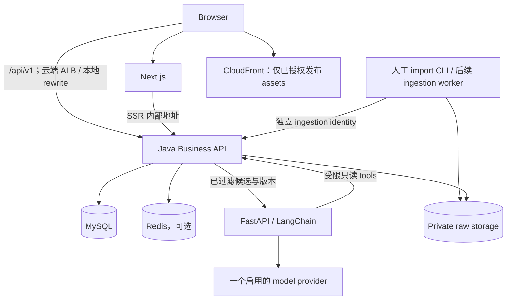

# Large-Lunch-Model：技术栈与 architecture 要求

- 文档版本：v0.2；更新日期：2026-10-29（Australia/Sydney）。
- 范围：悉尼 CBD 及周边的门店、菜品目录与有来源的个性化推荐，逐步扩展多 AI Persona。
- 实现状态：当前 repository 只有文档；本文及关联文件是待实现的 contract，不代表已有服务、数据库、数据集或 AWS 资源。
- 用户已确认：预算按菜品小计，包含所选规格与必选加料；配送费、平台 service fee 等订单级费用另列，不计入预算。
- 文档分工：[数据要求](docs/data-requirements.md)规定数据语义、来源与发布；[AWS 要求](docs/aws-requirements.md)规定云端运行；[本地开发要求](docs/local-development.md)规定开发环境；[交付规划](docs/delivery-model-comparison-au-us-cn.md)讨论组织与节奏。

## 1. 范围、阶段与技术方向

### 1.1 交付边界

| 阶段 | 必须完成的结果 | 条件与边界 |
| --- | --- | --- |
| 启动准备 | 首个场景、来源样本、最小 data / API contract | 先验证数据能否获取、使用、保存和更新；允许人工整理 |
| 本地 walking skeleton | 页面 → Java → MySQL → Python mock provider → Java 校验 → 页面 | 无需 AWS 或真实模型 key；synthetic fixtures 与真实菜单清楚区分 |
| Sprint 1 / 受控 Alpha | 5–10 家门店、30–50 个人工审核 MenuItems；一个真实 provider、一个 Persona、一个 Skill；受限 staging | 数量为规划量级；真实数据和 access 就绪后验收；首轮单人、单店、单渠道选餐 |
| 后续增量 | 偏好持久化或收藏、审核 UI、第二个 provider、更多渠道与数据更新自动化 | 依据反馈排序；多人点菜、跨渠道比较各自定义新 contract |
| Production / Beta | 已启用功能的权限、恢复、运行成本与维护责任得到验证 | 不以部署成功代替产品、数据与运维验收 |

首轮不要求四个平台全部接通、全城数据、大规模 crawler、自动 OCR、多模型比较、完整管理后台、embedding、复杂 LangGraph、Live2D 或 3D。新增来源按一个 adapter 一次验证，优先商家提供且使用权明确的菜单。

### 1.2 已选择的核心 stack

| 层次 | 技术 | 职责 |
| --- | --- | --- |
| Frontend | React、Next.js App Router、TypeScript | 页面、筛选、推荐交互、来源与费用口径展示 |
| Business Backend | Java、Spring Boot、Spring MVC、MyBatis | 业务规则、身份与权限、Catalog、预算过滤、数据发布与最终校验 |
| AI Application | Python、FastAPI、LangChain | Provider Adapter、Persona / Skill、候选比较与解释 |
| Persistence | MySQL；Redis 按运行需要启用 | MySQL 是业务事实来源；Redis 管理可重建 cache 与临时状态 |
| Storage / Cloud | S3、AWS ECS Fargate、Docker | 原始资料、可发布 assets、应用运行与部署 |

Java 内部采用 modular monolith，AI service 独立部署；不引入 Kubernetes / EKS。选定技术不等于所有配套服务必须在首轮同时启用。runtime 与 dependency 的确切版本在 bootstrap 时按兼容矩阵固定，不能把文档示例当成已验证组合。

## 2. 服务职责与信任边界

| 组件 | 必须负责 | 访问边界 |
| --- | --- | --- |
| Next.js | 页面、浏览器交互、SSR、stream 状态 | 不直连 MySQL；SSR 使用内部 Java 地址；用户请求不得跨用户 cache |
| Java | 业务表读写、审核发布、候选过滤、推荐验证、权限与 audit | 唯一业务数据库写入 owner；Flyway migration 使用独立受控账号 |
| Python AI service | Prompt、provider 调用、解释和 structured output | 无业务 DB credentials；tools 只读，限制候选、用户范围与 request ID |
| Import CLI / Ingestion Worker | 获取允许使用的资料、解析、清洗、提出匹配建议 | 可写指定 raw storage；通过 Java ingestion API 写 draft，无发布权限 |
| Data reviewer | 审核字段、来源、匹配和版本 | 通过受权限保护的 Java API review / publish；首轮 CLI 足够 |

AI tools 与 ingestion API 是两类权限，不能因为都由 Python 调用而共用凭证。原始菜单、OCR 文本、用户评论均是不可信数据；其中的指令不得改变 system policy、allowed tools、身份或预算规则。模型不得任意访问 URL 或执行导入资料中的代码。

## 3. 数据模型与预算 contract

### 3.1 身份、渠道与版本

| 实体 | 含义 |
| --- | --- |
| Restaurant / Branch | 品牌与实体门店；独立门店也必须有稳定 Branch ID |
| Dish | 可选的通用菜品概念，用于分类；不能凭同名自动把不同菜合并 |
| MenuItem / MenuItemRevision | 门店菜品身份与 immutable 描述、饮食事实 revision，不直接代表某平台价格 |
| Offer / OfferVersion | 菜品在特定渠道、fulfillment 与规格下的售卖报价；已发布版本不可原地覆盖 |
| MenuSnapshot | 某门店与渠道的一次已发布菜单版本，引用确切 OfferVersions |
| Source / SourceRecord | 来源规则与具体证据记录；存储、展示、外发给 LLM 的权限分别判断 |
| ExternalMapping | 平台外部 ID 到内部身份的映射、匹配依据与审核状态 |
| IngestionBatch / Review | 导入批次、校验报告、审核决定、幂等与发布记录 |
| Recommendation | 输入、候选引用、最终 OfferVersions、provider 与 Prompt 版本、状态与反馈关联 |

价格、可用性、营业信息分别保留来源与观察时间；采集时间不等于价格生效时间。`workflow_state` 使用 `DRAFT / REVIEWED / PUBLISHED / WITHDRAWN`；拒绝是 ReviewRecord 的决定并回到 DRAFT。`freshness_state` 使用 `FRESH / STALE / UNKNOWN`；资料过期、许可到期各有 eligibility reason，二者不能压成一个互斥 status。渠道价格不会互相覆盖，无法确认的跨平台匹配留待审核。

MySQL 保存结构化目录、draft、audit 和版本；本地文件 / Private S3 保存允许保留的原始资料；Redis 不承担持久化事实。大文件放对象存储，MySQL 保存 object key、hash 和受控 metadata。来源禁止留存时不得先把完整 response 写入 raw storage；historical snapshot 也不豁免 retention 要求。

### 3.2 预算与费用

请求必须使用稳定语义：`budget = {"amount":"25.00","currency":"AUD","scope":"MENU_SUBTOTAL"}`。首轮该 amount 是一个人的本次选餐小计上限；不默认为每人预算与多人总预算之间自动换算。

`menu_subtotal = Σ quantity × (selected_variant_price + Σ selected_option_delta)`。

- `selected_variant_price` 已是选定规格的价格，不能再重复加 base price。
- 所有必选项必须有明确选择；用户选中的可选加料也计入。缺少必选项价格或配置时，该组合不能作为“预算内”结果。每个 option 有稳定 ID、价格调整、选择约束、可售状态与饮食证据；禁忌和可售性在最终选定配置上校验，不能只检查菜品本体。
- 菜单价格使用已含适用税费的展示价格；税务口径未知则标记未知，不能由 LLM 推算。配送费、service fee、small-order fee 等订单级费用不计入小计，单独展示已知 / 未知。
- 首轮默认按常规菜单价，不计会员、首单、coupon 或其他有条件优惠；之后支持优惠时另存条件及期限。
- 金额在 MySQL 用 DECIMAL，在 Java 用 BigDecimal，在 Python 用 Decimal；JSON 使用十进制字符串，currency 必填。首轮 AUD 精确到分，不使用二进制浮点数累计金额。
- 首轮每个推荐组合只包含同一 Branch、同一 channel / fulfillment 的 Offer；不能把不同平台最低价拼成一个可下单套餐。
- UI 显示“菜品小计，配送费与平台费用另计”。`delivery_fee = null` 代表未知，不能当成 `0.00`。
- “小计满足预算”只证明已审核菜单报价符合规则，不承诺下单总额、实时库存或平台结算价。

### 3.3 发布和读取一致性

首轮最小路径：允许使用的样本 → 规范化 JSON / CSV → schema validation → Java draft → 人工 review → Java publish → 目录查询。

每个可见 snapshot 的发布在短 MySQL transaction 内完成：校验审核版本 → 写 immutable OfferVersions / Snapshot → 更新 active pointer 与 `catalog_revision` → 写 audit → commit。批次体积超过单次发布上限时，先分成可独立审核发布的 snapshot，避免长事务。重复发布返回原结果；相同幂等 key 与不同 payload 返回冲突。

目录 cache key 含数据库中的当前 `catalog_revision`；正确性不能只依赖“提交数据库后删 Redis 成功”。首轮从 MySQL 读取权威 revision，旧 cache key 到期回收；来源权限撤回及影响硬约束的门店状态变更也在事务内增加 revision。命中 cache 后仍按当前时间检查 eligibility，TTL 不超过所含证据的最早有效期；后续引入 outbox / event invalidation 时须证明同样的一致性。更新失败保留上一已发布版本，过期数据不进入严格预算候选。

完整字段、refresh policy、权限与验收以[数据要求](docs/data-requirements.md)为准。

## 4. Frontend 要求

| 用途 | 默认选型 |
| --- | --- |
| 类型与组件 | TypeScript strict、Tailwind CSS、shadcn/ui |
| API / 表单 | TanStack Query、React Hook Form、Zod |
| UI state | React state；复杂共享状态出现后再加 Zustand |
| Dependency / tests | pnpm、Vitest、React Testing Library、Playwright |

首轮提供预算与简单条件输入、候选/推荐结果、原始菜名、门店、渠道、规格、菜品小计、来源与更新时间。中文与 English 文案分离，原始名称不被译名覆盖。后续再扩展完整目录交互、偏好保存、收藏、多 Persona 与多 provider 选择。

首轮仅公开目录采用 SSR；私人页面在浏览器通过带 access token 的 client fetch 读取，内存 token 不假定能被 SSR 获得。浏览器调用同源 `/api/v1`，本地通过 Next.js rewrite，云端通过 ALB。SSR 使用 server-only Java 地址，不能把 Docker / Service Connect host 或 internal token 放进 `NEXT_PUBLIC_*`。私人响应设为 private / no-store，不能进入共享 ISR / CDN cache。

必须处理 loading、empty、error、cancelled、data-changed；比较功能启用后才增加每个模型的 partial 状态。键盘操作与手机布局纳入验收。首轮角色采用可替换的静态资源及 idle / thinking / speaking / error 状态，角色与 model ID 解耦。

## 5. Java Business Backend 要求

### 5.1 技术与模块

默认使用 Spring MVC、MyBatis、Spring Security、Jakarta Bean Validation、OpenAPI、Flyway、Maven Wrapper、JUnit / Mockito / Testcontainers、Actuator / Micrometer。简单 CRUD 是否引入 MyBatis-Plus 由兼容验证与实际收益决定。

模块划分为 Catalog、Ingestion / Review、Recommendations、Users / Access、Preferences / Favorites（后续）、Agents registry、Observability。模块间通过明确 service interface 协作，不把 ORM entity 直接作为跨语言 DTO。

### 5.2 硬性规则

1. Java 执行预算、地区、渠道、可用性、freshness 和明确禁忌的过滤及最终复核；Persona 不得改变规则。
2. 过敏原与饮食标签使用 `contains / confirmed_absent / unknown` 或等价三态。严格禁忌查询排除 unknown，结果不表述为医学安全保证。
3. 地理范围使用有来源的坐标及 MySQL spatial 查询，坐标顺序、SRID、米制距离通过已知地点 fixture 验证。首轮显示直线距离；步行时间和送达可行性需要独立数据。
4. MyBatis 参数化查询；排序字段白名单；分页有上限；metadata、数量和 input size 有约束。
5. LLM 与外部 HTTP 调用不持有数据库 transaction 或锁。provider 重试区分连接失败与可能已计费请求，客户端自动重连不重复触发收费调用。
6. 发布、偏好更新与推荐状态迁移具有 concurrency control；所有状态更新通过 Java 完成。

### 5.3 身份、服务权限与 abuse control

- 云端使用 Cognito access token；验证签名、issuer、expiry、`token_use`、适用的 `client_id` / audience 与 scope，并映射应用用户和角色。ID token 不充当业务 API access token。
- 浏览器采用 Authorization Code + PKCE；首轮 access token 保存在内存，由成熟 OIDC client 管理。若以后采用 cookie session，必须补齐 HttpOnly、Secure、SameSite 与 CSRF protection 的 contract。
- 内部调用采用独立 caller identity、role/scope 与 request-scoped context。首轮可使用分方向 bearer service tokens：`BUSINESS_TO_AI_TOKEN`、`AI_TO_BUSINESS_TOKEN`、`INGESTION_TO_BUSINESS_TOKEN`；本地配置与云端 Secrets 隔离，支持轮换。
- AI 的只读调用同时校验由 Java 创建的 request context、候选范围与有效期；不能仅凭 AI 传入的 user ID 查询任意私人数据。内部 token 不传入 Prompt。
- Java 内部 API 即使在私有网络也要求身份验证；ALB 不公开 `/internal/v1` 或 Actuator。Admin API 需独立 reviewer / publisher 权限。
- 付费请求的并发、请求数与 token/cost 上限必须可跨实例执行。Redis 未启用或故障时采用数据库保守额度控制或拒绝新付费请求，不能退化为无限调用。公共目录可继续使用 MySQL。
- 本地 fixture auth 只用于 loopback 开发，staging / production 启动时拒绝该 profile，详见本地文档。

## 6. Python AI Application 要求

默认组合：FastAPI、Pydantic / Pydantic Settings、Uvicorn、LangChain、HTTPX、uv / uv.lock、Ruff、type checker 与 pytest。模型训练、fine-tuning、GPU 自托管不属于当前范围。

Provider Adapter 提供普通调用、streaming、capability 查询、timeout、统一错误和 usage。GPT、Claude、Grok、DeepSeek 为后续支持方向，首轮只实现并验证一个 provider；使用其受支持 integration，并记录准确 model ID。structured output 与 tool calling 必须按实际 model 验证，不假设可互换。fallback 需用户可见且预先选择，不静默切换 provider。

Persona 定义语气与关注点；Skill 定义目标、tools、input / output schema 与限制。配置使用版本化 Markdown instructions 与 YAML / JSON metadata，包含稳定 ID、version、schema、allowed tools 与 capability requirements。首轮一个“预算内选餐” Skill 即可；用户任意上传代码不在范围内。

### 6.1 推荐 workflow

1. Java 验证请求和额度，以最新发布 revision 筛选具有来源的 OfferVersions；记录 request 与候选快照，提交 transaction。
2. Java 向 AI 传递最小必要偏好、候选及证据。只有允许用于外部 inference 的字段可以进入 Prompt；无需传递姓名、邮箱或精确住址。
3. AI 使用固定 Persona / Skill，在候选内选择组合并解释；补充 tools 由 Java 再次授权。
4. AI 返回 `menu_item_id`、`menu_item_revision_id`、`menu_snapshot_id`、`offer_id`、`offer_version_id`、`quantity`、`selected_options`、`reason`、`source_ids`、`uncertainties`。`source_ids` 指具体 SourceRecord ID。
5. Java 校验 IDs 属于候选集、source 引用支持相应事实、选择项完整、currency 与小计、含加料的最终禁忌、发布状态和数据版本；金额由 Java 重算。
6. 在模型返回后的短 MySQL transaction 内，锁定所涉 current pointers / 来源状态行，或使用等价的原子 CAS；复核 MenuSnapshot、MenuItemRevision、OfferVersion、来源权限与有效期，并原子保存 Recommendation completion。发布、撤回与最终校验遵守同一锁顺序。相关 active version 或 hard facts 已变化则返回 `DATA_CHANGED`；不自动重复调用付费模型。结果代表最终 transaction 提交时的有效数据，之后的更新通过读取时检查标明。

无候选返回结构化原因，不要求 LLM 编造替代菜品。解释与原始菜单冲突时不得作为已验证事实输出；关键事实由 Java 模板填充，文本解释可丢弃或降级。返回 source ID 只证明引用关系可校验，不代表任意自然语言推断已被自动证实。

### 6.2 Retrieval 与 async ingestion

首轮使用结构化筛选与关键词检索。embedding、reranking、LangGraph 仅在 evaluation 显示收益后加入。AI process 的 background task 不承担必须可靠完成的数据导入。

启用批量 OCR 或定时采集后，使用 SQS + 独立 ingestion worker，消息只传 batch ID / object reference；重复投递由幂等处理，失败进入 dead-letter queue。首轮人工 CLI 导入不依赖 SQS 或 scheduler。

## 7. API 与 streaming contract

以下是待实现接口，最终 schema 由 Java OpenAPI 与 FastAPI OpenAPI 维护，contract tests 验证消费者一致性。

| 路径 | 用途与权限 | 阶段 |
| --- | --- | --- |
| `GET /api/v1/restaurants`、`GET /api/v1/menu-items` | 仅已发布目录，支持 Branch / channel / fulfillment 过滤 | 首轮 |
| `GET /api/v1/agents` | 返回实际启用的 provider / Persona / Skill 与 capabilities | 首轮可各一项 |
| `POST /api/v1/recommendations/stream` | 校验身份、额度与预算，创建推荐请求 | 首轮 |
| `GET /api/v1/recommendations/{id}` | 仅请求 owner 可读取状态与已保存结果，解决连接中断后的查询 | 首轮；不代表自动续流 |
| `POST /internal/v1/recommendations/stream` | Java 调用 AI，使用 business-to-AI identity | 首轮 |
| `GET /internal/v1/catalog/candidates` | AI 受限只读 tool；必须带有效 request context | 需要补查时 |
| `POST /api/v1/admin/sources`、`POST /api/v1/admin/restaurants`、`POST /api/v1/admin/branches` | 有权限的 operator 登记来源 policy、品牌和门店；ingestion identity 不能自己批准来源用途 | 首轮 bootstrap |
| `PATCH /api/v1/admin/sources/{id}`、`POST /api/v1/admin/menu-snapshots/{id}/withdraw` | source manager 更新用途 / 撤销来源；publisher 撤回错误菜单并写 audit / revision | 首轮维护 |
| `POST /internal/v1/ingestion/source-records` | ingestion identity 登记来源观察与获准证据引用 | 首轮 |
| `POST /internal/v1/ingestion/batches` | 建立受控导入批次 | 首轮 |
| `POST /internal/v1/ingestion/batches/{id}/records` | 幂等写入 draft，返回 validation report | 首轮 |
| `POST /internal/v1/ingestion/batches/{id}/complete` | 固定完整 records manifest，完成后才允许 review | 首轮 |
| `POST /api/v1/admin/ingestion/source-records`、`POST /api/v1/admin/ingestion/batches`、`POST /api/v1/admin/ingestion/batches/{id}/records`、`POST /api/v1/admin/ingestion/batches/{id}/complete` | 人工 CLI 使用 `catalog:import` 用户权限，调用与内部 ingestion 相同的 application service；云端经 ALB 管理入口 | 首轮 |
| `GET /api/v1/admin/ingestion/batches/{id}` | reviewer 查看 validation report、payload hash 和差异 | 首轮 |
| `POST /api/v1/admin/ingestion/batches/{id}/review` | reviewer 对确切批次版本作决定 | 首轮 CLI 调用 |
| `POST /api/v1/admin/ingestion/batches/{id}/publish` | publisher 原子发布已审核版本 | 首轮 CLI 调用 |
| `PUT /api/v1/me/preferences`、`POST /api/v1/recommendations/{id}/feedback` | 个人偏好与反馈，owner isolation | 后续 |

所有 ingestion 幂等 key 按 caller + operation + resource scope 隔离；records 每个 chunk 有独立 key / hash，complete 校验预期数量与 manifest hash。更改审核内容必须重新打开为 DRAFT 并重新 complete / review，禁止在已发布 snapshot 上追加。

原始文件上传先由 Java 校验 source policy、文件类型/大小与权限，再提供受限 S3 presigned URL；上传完成校验对象后登记。URL ingest 限定来源、协议、redirect 与目标地址，拒绝 localhost、metadata endpoint 和私有网段，避免 SSRF。首轮可只支持本地文件输入。

统一 error 包含 `code`、`message`、`request_id`、`retryable`。至少定义 `VALIDATION_ERROR`、`UNAUTHORIZED`、`FORBIDDEN`、`NO_CANDIDATES`、`DATA_CHANGED`、`PROVIDER_TIMEOUT`、`INVALID_MODEL_OUTPUT`、`RATE_LIMITED`、`SOURCE_NOT_PERMITTED`。

### 7.1 SSE 与请求生命周期

使用 POST + fetch streaming；event 为 `status`、`delta`、`result`、`error`、`done`，携带 `request_id` 与单调 sequence。只有 `result` 是经 Java 校验的权威业务结果；`delta` 为暂态表达，不把其中未验证的价格、菜品或禁忌判断显示为已确认结果。

请求状态持久化于 MySQL：`pending → running → completed / failed / cancelled`。无候选属于已完成但为空的业务结果；`done` 表示传输结束，不等同于成功。业务完成后客户端断开不得把已完成记录改成 cancelled。状态更新使用条件更新防止并发覆盖。

- 请求创建支持 user-scoped `Idempotency-Key` 与 payload hash；同 key/同内容通过 `status` 返回已有 request ID 后以 `done` 结束，客户端使用 GET 查询该请求，不启动新的 stream 或付费调用；同 key/不同内容返回 409。重试新一轮推荐显式使用新 key。
- 初始建议：provider connect timeout 5 秒，LLM operation deadline 60 秒，Java 请求 deadline 90 秒，SSE heartbeat 15 秒，ALB idle timeout 120 秒；均为待 smoke 验证的配置初值，不是延迟承诺。
- heartbeat 是实际输出的 SSE comment / event bytes，不能依赖 HTTP/2 PING。Service Connect endpoints 的 `perRequestTimeoutSeconds` / `idleTimeoutSeconds` 初值显式设为 120 秒，避免默认 per-request timeout 截断 stream；应用 60 / 90 秒 deadline 优先生效。代理禁用 response buffering 与 SSE cache，逐段 flush。
- 浏览器取消 / 连接断开向 Java、Python、provider 传播取消；provider 可能已处理并计费，需记录 usage 不确定状态。应用 shutdown 有 drain 与独立期限。
- 首轮不自动重连或 replay stream；已有请求可通过 GET 查询。web / Java / AI 的 timeout 与 ALB 连接 idle 设置须分开理解并验证。

## 8. Persistence、privacy 与 observability

MySQL 使用 utf8mb4、显式外键/unique constraints/indexes、UTC timestamps；营业时段保留 `Australia/Sydney` 等 IANA timezone 与跨午夜规则。Schema 使用 Flyway versioned migrations；发布由一次性 migration task 执行，runtime DB user 无 DDL 权限。

Redis key 必须有 namespace、owner、TTL 与版本维度。首轮不缓存私人 LLM 结果；以后若引入，key 至少含 owner、偏好版本、catalog revision、model、Persona / Skill / Prompt 版本，并落实删除与失效。

每次推荐记录 request ID、候选版本、实际 provider / model、Prompt / Skill 版本、latency、usage、完成状态；费用使用明确价格版本估算。日志默认不含完整 Prompt、原始菜单正文、access token 或敏感偏好。调试 tracing 默认关闭，开启前明确采样、脱敏、访问权限与 retention。外部 LLM 数据传递必须符合各来源允许的用途。

来源撤回、资料过期或删除请求要传播到 raw、derived records、cache 与可见推荐；保留必要的非内容 audit / tombstone，历史记录可标识“证据已删除”，不能为复现无限保留受限内容。数据库和对象备份的过期/恢复后删除重放也需纳入流程。

## 9. AWS 与本地开发边界

默认 AWS Region 为 `ap-southeast-2`。应用、业务数据的部署 Region 不代表外部 provider inference 都在澳洲。

| 能力 | 首轮 staging | 扩展条件 |
| --- | --- | --- |
| 应用 | ECS Fargate 三服务、ECR、ALB、service discovery | Production 冗余、副本数按容量与恢复目标确定 |
| 数据 | Private RDS MySQL、Private S3 | 存储与备份按来源 retention；production restore drill |
| Redis | 有 cache / distributed limit 场景时部署 | 未部署时采用 MySQL 安全路径，不缺失额度控制 |
| Identity / secrets | Cognito、Secrets Manager、task roles | 服务访问按 caller 与资源最小授权 |
| Assets | 授权 assets 用 S3 + CloudFront OAC | 原始资料 bucket 不连接公开 distribution |
| Ingestion | CLI → Java review / publish | 自动任务才启用 SQS、worker、EventBridge Scheduler |
| 运维 | CloudWatch、cost alerts、GitHub OIDC、Terraform | Budget alert 不替代应用额度拒绝与并发限制 |

首轮云端默认 Service Connect managed TLS 与 AWS Private CA；ALB HTTPS target / health checks 经过 proxy，应用内部保持 HTTP，具体配置和 CA 成本见 AWS 文档。公网只开放页面与获准业务 API；内部 endpoints、RDS、Redis 不公开。私有服务访问互联网 provider 需要明确出站路径与成本。migration、备份恢复、Terraform state、IAM、TLS 与部署策略详见[AWS 要求](docs/aws-requirements.md)。

本地默认主机运行三个应用，Docker Compose 提供 MySQL 与 Redis；端口分别为 3000 / 8080 / 8000 / 3306 / 6379，绑定 localhost。默认 mock provider，真实 provider 与 AWS smoke 分别验收。详细启动 contract、env、seed 与排障见[本地开发要求](docs/local-development.md)。

## 10. Repository 与工程交付

### 10.1 待实现目录

| 路径 | 内容 |
| --- | --- |
| `apps/web/` | Next.js / React frontend |
| `services/business-api/` | Java / Spring Boot / MyBatis 与 Flyway migrations |
| `services/ai-app/` | FastAPI、provider adapters、AI tools |
| `tools/ingestion/` | 首轮文件校验与 API import CLI |
| `services/ingestion/` | 后续可靠 async worker，不混入 AI process |
| `contracts/` | OpenAPI snapshots、JSON Schema、request/result fixtures |
| `ai-config/personas/`、`ai-config/skills/` | 版本化配置 |
| `data/fixtures/` | synthetic 或允许分发的小型 seed，标识来源与用途 |
| `data/raw/`、`data/processed/` | 本地资料与中间结果，排除 Git；同样受 retention 限制 |
| `infra/terraform/`、根目录 `compose.yaml` / `Makefile` | 云端 IaC 与本地依赖配置；未来辅助 Compose 文件可放 `infra/compose/`，canonical 入口仍为根文件 |
| `docs/` | 要求、architecture decisions、运行与维护说明 |

pnpm 管理 JS / TS，Maven 管理 Java，uv 管理 Python，各自提交 lockfile / wrapper / BOM。Bootstrap 必须固定 runtime、framework、driver、镜像与 CPU architecture，并验证 Spring Boot / MyBatis / Security 以及 LangChain / provider packages 的组合。Apple Silicon 本地和 ECS target architecture 在构建时明确，不把 x86 模拟执行视为已验证 ARM release。

### 10.2 CI/CD 与测试

GitHub Actions 默认执行检查、测试、镜像构建、staging deploy 与 smoke；production 是独立受控 promotion，使用已验证 image digest。GitHub OIDC 获取短期 AWS credentials。PR 不获取 production secrets，常规 CI 使用 mock provider。

首轮重点：schema / required options / decimal、cross-platform identity、审核与 publish 幂等、catalog revision、硬性过滤、内部 scope、owner isolation、无候选、无效模型输出、DATA_CHANGED、SSE 取消和重复请求。选中的真实 provider 必须通过受控 live smoke；未启用 providers 不构成首轮阻塞。

数据与服务 contract changes 要触发跨服务 checks。发布 manifest 记录 image digests、migration version、配置版本和 data version；应用回滚不自动回滚 database schema。生产恢复通过实际 restore drill 证明。

## 11. 分阶段验收

### 11.1 本地可开发

- [ ] bootstrap、locked dependencies、Compose 与健康检查可重复执行。
- [ ] synthetic fixtures 经同一条 import / review / publish 路径进入 MySQL，重复执行不产生重复项。
- [ ] mock provider 跑通页面 → Java → Python → Java final validation；没有真实 key 仍可开发。
- [ ] 本地数据可持久化；destructive reset 明确范围；internal auth 与 local-only profile 有测试。

### 11.2 首轮真实数据与受控 Alpha

- [ ] 5–10 家门店、30–50 MenuItems 的规划样本实际通过审核，来源与权限可查；不足时如实报告实际数量。
- [ ] Offer / OfferVersion 明确渠道、规格、必选项和 AUD 小计；配送费与 service fee 不计入预算且未知不冒充零。
- [ ] 一个 provider / Persona / Skill 的真实 smoke、错误路径、来源与 Java 复核通过。
- [ ] stream 不把未审核输出当权威事实；版本变化、重复请求、取消都有可追溯结果。
- [ ] 有 cloud access 时部署受限 staging，证明公网边界、CI/CD、日志、成本上限与备份恢复；仅本地通过不得标记云端完成。

### 11.3 后续功能与 Production

- [ ] 仅对实际启用的偏好/收藏、多 provider、多渠道或多人点菜执行对应功能与权限验收。
- [ ] 已发布数据具有可执行更新、过期、撤回与 reviewer ownership。
- [ ] Production 的可用性、RPO/RTO、预算、告警接收者和恢复证据记录完整。

## 12. 参考与变更记录

2026-10-29 修订：统一阶段范围；明确菜品小计预算；补齐 Offer 与 provenance；分离 AI / ingestion 权限；定义审核发布、revision 与最终验证；区分本地 mock、staging、production；补充 streaming、idempotency、retention、云端和本地运行边界。本文是项目设计要求，不声称已实现或验证 runtime。

- [Next.js deployment](https://nextjs.org/docs/app/getting-started/deploying) 与 [rewrites](https://nextjs.org/docs/app/api-reference/config/next-config-js/rewrites)：部署与本地 routing 能力。
- [Spring Security JWT resource server](https://docs.spring.io/spring-security/reference/servlet/oauth2/resource-server/jwt.html)：签名、issuer 与时间验证；Cognito 特定 claims 按 AWS 文档补充。
- [MyBatis](https://mybatis.org/mybatis-3/) 与 [Flyway migrations](https://documentation.red-gate.com/fd/migrations-184127470.html)：持久化与 schema 管理参考。
- [FastAPI deployment](https://fastapi.tiangolo.com/deployment/) 与 [LangChain integrations](https://docs.langchain.com/oss/python/integrations/providers/overview)：服务与 provider integration 参考。
- [MySQL spatial analysis](https://dev.mysql.com/doc/refman/8.4/en/spatial-analysis-functions.html)：空间查询参考；首轮选择与单位须 fixture 验证。
- [ALB attributes](https://docs.aws.amazon.com/elasticloadbalancing/latest/application/edit-load-balancer-attributes.html)：idle timeout 与实际传输 bytes；本文 timeout 初值属于项目建议。
- 平台数据使用条件、AWS 与本地工具的具体官方来源分别列在三份专题文档中；发布前对实际采用的版本和来源复核。
